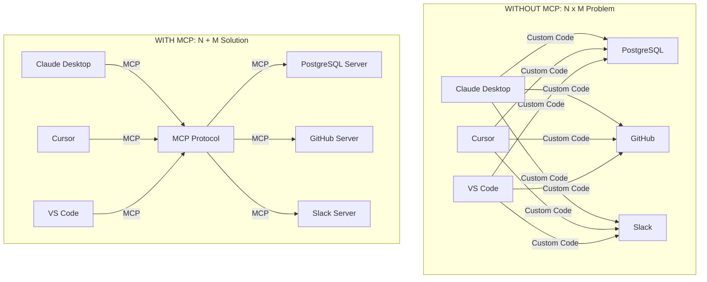
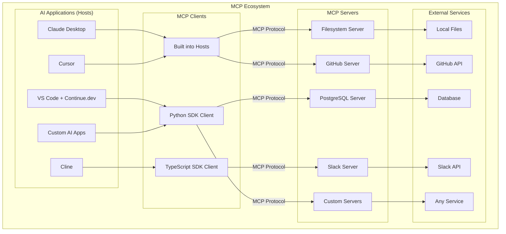
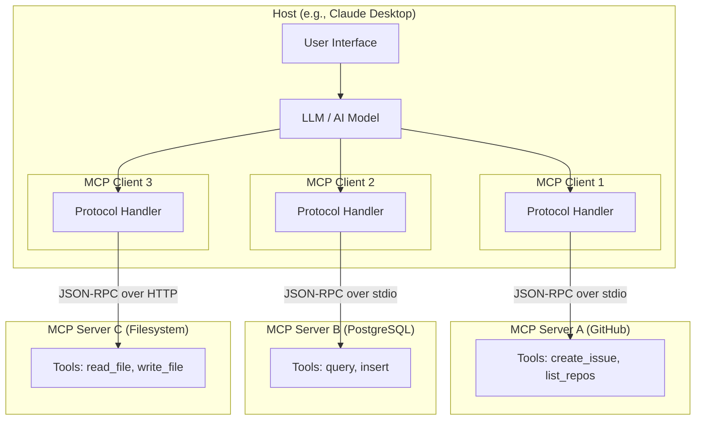
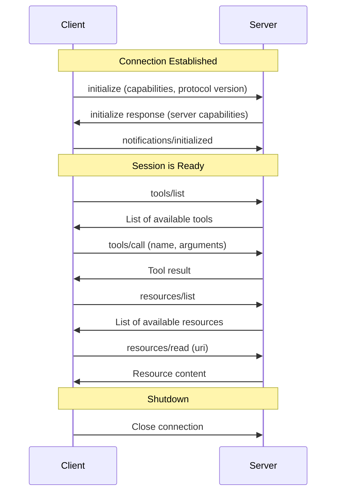
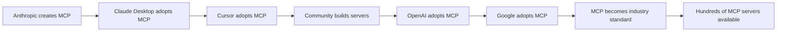

# Chapter 1: Introduction to Model Context Protocol (MCP)

---

## Learning Objectives

By the end of this chapter, you will be able to:

1. Explain what Model Context Protocol (MCP) is and why Anthropic created it
2. Describe the N x M integration problem and how MCP solves it
3. Identify the core components: Client, Server, Host, Resources, Tools, Prompts
4. Understand the transport layer and JSON-RPC messaging
5. Compare MCP with REST, GraphQL, Function Calling, LangChain Tools, and Plugins
6. Trace the history and evolution of MCP
7. Recognize real-world MCP deployments across the AI industry
8. Build basic JSON-RPC messages and MCP-style tool schemas by hand

---

## 1.1 What is MCP?

**Model Context Protocol (MCP)** is an open standard created by **Anthropic** (the company behind Claude) that defines how AI applications communicate with external data sources and tools.

Think of MCP as **USB for AI applications**.

Before USB, every device (printer, mouse, keyboard, camera) needed its own unique cable and port. You had serial ports, parallel ports, PS/2 ports, and proprietary connectors. It was a mess.

USB solved this by creating **one universal standard**. Now every device uses the same connector and protocol.

MCP does the same thing for AI. Before MCP, every AI application (Claude, ChatGPT, Cursor, VS Code Copilot) needed custom code to connect to every data source (databases, APIs, file systems, cloud services). Each connection was unique and incompatible.

MCP creates **one universal protocol** so any AI application can connect to any data source using the same standard.

### Key Facts About MCP

| Fact | Detail |
|------|--------|
| Created by | Anthropic |
| Released | November 2024 (open-sourced) |
| Type | Open standard / protocol |
| License | Open source |
| Transport | JSON-RPC 2.0 over stdio or HTTP+SSE |
| Language SDKs | Python, TypeScript, Java, Kotlin, C# |
| Adopted by | Claude Desktop, Cursor, VS Code, Continue.dev, Cline, and many more |

### The One-Line Definition

> MCP is a standardized protocol that lets AI models securely access external tools and data through a universal client-server interface.

---

## 1.2 Why MCP? The Problem Before MCP

### The N x M Integration Problem

Imagine you have:

- **N** AI applications: Claude Desktop, Cursor, VS Code Copilot, Continue.dev, your custom AI app
- **M** data sources: PostgreSQL, GitHub, Slack, Google Drive, local files, Jira, Confluence

Without MCP, you need **N x M** custom integrations.

If you have 5 AI apps and 10 data sources, that is **50 custom integrations**. Each one must be built, maintained, tested, and secured separately.

```
Without MCP:
5 AI apps x 10 data sources = 50 custom integrations

With MCP:
5 AI apps x 1 protocol + 10 data sources x 1 protocol = 15 implementations
```

That is a reduction from 50 to 15. With larger numbers, the savings are even more dramatic.

### Mermaid Diagram: The N x M Problem vs MCP Solution



### Real-World Analogy: The Universal Translator

Imagine the United Nations before they had translators. If 10 diplomats each spoke a different language, you would need 45 translators (one for every pair). That is the N x M problem.

Now imagine you have ONE universal language that every diplomat learns. Each diplomat only needs to learn one additional language. That is MCP -- it is the universal language for AI-to-tool communication.

### Problems Before MCP

| Problem | Description |
|---------|-------------|
| **Fragmented integrations** | Every AI app built its own connectors from scratch |
| **Vendor lock-in** | Tools built for Claude did not work in Cursor or VS Code |
| **Security inconsistency** | Each integration had different security models |
| **Maintenance burden** | N x M integrations meant exponential maintenance cost |
| **No reusability** | A GitHub connector for one AI app could not be reused in another |
| **Context isolation** | AI models were trapped behind information silos |
| **Inconsistent schemas** | Every tool defined its interface differently |

---

## 1.3 History and Evolution

### Timeline

| Date | Event |
|------|-------|
| 2023 | Anthropic begins internal work on tool-use protocols |
| Early 2024 | Claude gains function calling capabilities |
| Mid 2024 | Anthropic develops MCP internally |
| November 2024 | MCP is open-sourced and announced publicly |
| December 2024 | Rapid community adoption begins |
| January 2025 | Cursor, VS Code, and others adopt MCP |
| March 2025 | MCP specification updated with Streamable HTTP transport |
| Mid 2025 | MCP becomes the de facto standard for AI-tool integration |
| 2025-2026 | Ecosystem matures with hundreds of community servers |

### Why Anthropic Created MCP

Anthropic observed that:

1. **AI models are only as useful as the data they can access**. A brilliant AI that cannot read your files or query your database is limited.
2. **Every company was reinventing the wheel**. OpenAI had plugins, Google had extensions, everyone had their own approach.
3. **The industry needed a standard**. Just like HTTP standardized web communication, AI-tool communication needed a standard.

Anthropic decided to **open-source** MCP rather than keep it proprietary because:

- An open standard benefits the entire ecosystem
- Wider adoption makes the standard more valuable
- It positions Anthropic as a leader in AI infrastructure
- It reduces fragmentation across the industry

---

## 1.4 MCP Ecosystem Overview

### Mermaid Diagram: MCP Ecosystem



### Key Players in the MCP Ecosystem

**Hosts (AI Applications)**:
- **Claude Desktop**: Anthropic's desktop app, the first MCP host
- **Cursor**: AI-powered code editor with deep MCP support
- **VS Code**: Via Continue.dev and Copilot extensions
- **Cline**: VS Code extension for AI coding
- **Open WebUI**: Open-source web interface for LLMs
- **Cherry Studio**: Desktop AI assistant

**Official MCP Servers** (maintained by Anthropic and community):
- Filesystem, GitHub, GitLab, Google Drive, Slack, PostgreSQL, SQLite, Brave Search, Puppeteer, and many more

**SDKs**:
- Python SDK (`mcp` package)
- TypeScript SDK (`@modelcontextprotocol/sdk`)
- Java/Kotlin SDK
- C# SDK

---

## 1.5 Core Concepts

### The Three Core Roles

MCP defines three distinct roles in its architecture:

#### 1. Host

The **Host** is the AI application that the user interacts with. It is the outermost container.

Examples: Claude Desktop, Cursor, VS Code with Continue.dev

The Host:
- Is the application the user sees and uses
- Contains one or more MCP Clients
- Manages the overall user experience
- Controls which MCP servers are connected
- Enforces security policies

#### 2. Client

The **Client** is a component inside the Host that handles communication with a specific MCP Server.

The Client:
- Maintains a 1:1 connection with a single MCP Server
- Sends requests to the Server
- Receives responses from the Server
- Handles the MCP protocol details
- Is typically invisible to the end user

#### 3. Server

The **Server** is a lightweight program that exposes specific capabilities (tools, resources, prompts) to Clients.

Examples: A GitHub MCP server, a PostgreSQL MCP server, a filesystem MCP server

The Server:
- Runs as a separate process
- Exposes tools, resources, and/or prompts
- Handles requests from exactly one Client at a time
- Connects to external data sources or services
- Is typically small and focused on one domain

### Mermaid Diagram: Client-Server-Host Relationship



### The Three Capabilities

MCP Servers can expose three types of capabilities:

#### 1. Tools

**Tools** are functions that the AI model can call to perform actions.

Think of tools as "verbs" -- they DO things.

Examples:
- `search_files` -- searches for files matching a pattern
- `run_query` -- executes a SQL query
- `send_message` -- sends a Slack message
- `create_issue` -- creates a GitHub issue

Tools are **model-controlled**: the AI model decides when and how to use them.

#### 2. Resources

**Resources** are data that the AI model can read.

Think of resources as "nouns" -- they ARE things.

Examples:
- `file:///home/user/document.txt` -- a local file
- `postgres://localhost/mydb/users` -- a database table
- `github://repo/issues` -- GitHub issues

Resources are **application-controlled**: the host application decides which resources to expose to the model.

#### 3. Prompts

**Prompts** are reusable prompt templates that the server provides.

Think of prompts as "recipes" -- they are predefined ways to use the tools and resources.

Examples:
- `summarize_code` -- a prompt template for summarizing code
- `review_pr` -- a prompt template for reviewing pull requests
- `explain_error` -- a prompt template for explaining error messages

Prompts are **user-controlled**: the user selects which prompts to use.

### Summary Table of Capabilities

| Capability | Controlled By | Analogy | Example |
|-----------|---------------|---------|---------|
| Tools | AI Model | Verbs (actions) | `search_files()`, `run_query()` |
| Resources | Application | Nouns (data) | `file:///path`, `db://table` |
| Prompts | User | Recipes (templates) | `summarize_code`, `review_pr` |

---

## 1.6 Transport Layer

MCP messages travel between Client and Server over a **transport layer**. The protocol supports multiple transports:

### 1. stdio (Standard Input/Output)

- The Server runs as a child process of the Client
- Messages are sent via stdin and stdout
- Best for local servers
- Simplest to set up
- Most common transport for desktop applications

### 2. HTTP with Server-Sent Events (SSE)

- The Server runs as an HTTP server
- Client sends requests via HTTP POST
- Server streams responses via SSE
- Best for remote servers
- Supports network-based communication

### 3. Streamable HTTP (newest)

- Evolved from the SSE transport
- More flexible streaming capabilities
- Better support for bidirectional communication
- The recommended transport for new HTTP-based servers

### Transport Comparison

| Feature | stdio | HTTP + SSE | Streamable HTTP |
|---------|-------|------------|-----------------|
| Deployment | Local process | Network server | Network server |
| Latency | Very low | Higher | Medium |
| Setup complexity | Simple | Medium | Medium |
| Remote access | No | Yes | Yes |
| Multiple clients | No | Yes | Yes |
| Best for | Desktop apps | Web services | Modern apps |

---

## 1.7 JSON-RPC 2.0

MCP uses **JSON-RPC 2.0** as its message format. JSON-RPC is a simple protocol for remote procedure calls using JSON.

### Why JSON-RPC?

- It is simple and well-understood
- It is language-agnostic
- It supports requests, responses, and notifications
- It has built-in error handling
- It is lightweight (no extra overhead)

### JSON-RPC Message Types

#### 1. Request

A request asks the server to do something.

```json
{
    "jsonrpc": "2.0",
    "id": 1,
    "method": "tools/call",
    "params": {
        "name": "search_files",
        "arguments": {
            "query": "hello world"
        }
    }
}
```

#### 2. Response (Success)

A successful response returns a result.

```json
{
    "jsonrpc": "2.0",
    "id": 1,
    "result": {
        "content": [
            {
                "type": "text",
                "text": "Found 3 matching files"
            }
        ]
    }
}
```

#### 3. Response (Error)

An error response indicates something went wrong.

```json
{
    "jsonrpc": "2.0",
    "id": 1,
    "error": {
        "code": -32601,
        "message": "Method not found"
    }
}
```

#### 4. Notification

A notification is a message that does not expect a response.

```json
{
    "jsonrpc": "2.0",
    "method": "notifications/initialized"
}
```

### MCP-Specific Methods

| Method | Direction | Purpose |
|--------|-----------|---------|
| `initialize` | Client to Server | Start a session |
| `notifications/initialized` | Client to Server | Confirm initialization |
| `tools/list` | Client to Server | List available tools |
| `tools/call` | Client to Server | Call a specific tool |
| `resources/list` | Client to Server | List available resources |
| `resources/read` | Client to Server | Read a resource |
| `prompts/list` | Client to Server | List available prompts |
| `prompts/get` | Client to Server | Get a specific prompt |
| `ping` | Either direction | Keep-alive check |

---

## 1.8 Sessions and Lifecycle

An MCP session follows a specific lifecycle:

```
1. Initialize    --> Client sends initialize request with its capabilities
2. Initialized   --> Server responds, client sends initialized notification
3. Ready         --> Both sides are ready to exchange messages
4. Use           --> Client calls tools, reads resources, gets prompts
5. Shutdown      --> Either side initiates graceful shutdown
```

### Mermaid Diagram: Session Lifecycle



### Session Key Points

1. **Every session starts with initialization**. The client tells the server what it supports, and the server responds with what it supports.
2. **Capability negotiation happens once**. After initialization, both sides know what the other can do.
3. **The session is stateful**. The server can maintain state between requests within a session.
4. **Either side can close**. Both client and server can initiate shutdown.

---

## 1.9 Comparisons

### REST API vs MCP

| Feature | REST API | MCP |
|---------|----------|-----|
| Purpose | General web APIs | AI-tool integration |
| Discovery | Manual (read docs) | Automatic (tools/list) |
| Schema | OpenAPI (optional) | Built-in tool schemas |
| Session | Stateless | Stateful |
| Transport | HTTP | stdio, HTTP, SSE |
| AI-optimized | No | Yes |
| Bidirectional | No (request/response only) | Yes (notifications) |
| Standardized for AI | No | Yes |

**Key insight**: REST APIs are designed for humans and generic applications. MCP is designed specifically for AI models to discover and use tools. An AI model can call `tools/list` to discover what is available without reading any documentation.

### GraphQL vs MCP

| Feature | GraphQL | MCP |
|---------|---------|-----|
| Purpose | Flexible data querying | AI-tool integration |
| Query language | Yes (GraphQL) | No (JSON-RPC) |
| Schema | Required (SDL) | Built-in (JSON Schema) |
| Use case | Frontend-backend | AI-external services |
| Subscriptions | Yes | Yes (notifications) |
| Tool execution | No (read-focused) | Yes (tools + resources) |

**Key insight**: GraphQL is great for querying data with custom shapes. MCP is designed for AI models to both query data (resources) AND perform actions (tools).

### Function Calling vs MCP

| Feature | Function Calling | MCP |
|---------|-----------------|-----|
| Defined by | Each LLM provider | Open standard |
| Portability | Provider-specific | Universal |
| Discovery | Static (defined at call time) | Dynamic (tools/list) |
| Transport | Part of LLM API | Independent protocol |
| Server concept | No | Yes |
| Reusability | Limited | High |
| Ecosystem | Provider-specific | Cross-platform |

**Key insight**: Function calling is how an AI model expresses "I want to call a function." MCP is the protocol for actually connecting to and calling that function on an external server. They are complementary: the AI model uses function calling internally, and MCP handles the external communication.

### LangChain Tools vs MCP

| Feature | LangChain Tools | MCP Tools |
|---------|----------------|-----------|
| Defined in | Python code | MCP protocol |
| Runtime | In-process | Separate server process |
| Discovery | Import in code | Dynamic (tools/list) |
| Language | Python (primarily) | Any language |
| Reusability | Within LangChain | Any MCP client |
| Isolation | Same process | Process isolation |
| Security | Code-level | Protocol-level |

**Key insight**: LangChain tools run inside your Python process. MCP tools run in a separate server process, providing better isolation, security, and reusability. You can use LangChain/LangGraph as a client that connects to MCP servers.

### Plugin Systems vs MCP

| Feature | Plugins (e.g., ChatGPT Plugins) | MCP |
|---------|--------------------------------|-----|
| Standard | Proprietary | Open |
| Approval | Often requires review | Self-hosted |
| Distribution | App store model | Direct connection |
| Control | Platform controls | You control |
| Flexibility | Limited by platform | Full flexibility |
| Open source | Usually not | Yes |

**Key insight**: Plugin systems are controlled by the platform (OpenAI, etc.). MCP is an open protocol you control entirely. You can build, host, and connect MCP servers without any approval process.

---

## 1.10 Real-World Examples

### Anthropic -- Claude Desktop

Claude Desktop was the first application to support MCP. Users can configure MCP servers in a JSON file, and Claude can then use those tools during conversations.

Example: Connecting Claude Desktop to a filesystem MCP server lets Claude read and write files on your computer.

### Cursor

Cursor (the AI code editor) adopted MCP to allow its AI to connect to external tools. Developers can add MCP servers for databases, documentation, and custom APIs, making Cursor's AI more powerful.

### VS Code

VS Code supports MCP through extensions like Continue.dev and GitHub Copilot. This lets the AI assistant in VS Code access external data sources through a standard protocol.

### OpenAI

OpenAI announced MCP support in early 2025, adding it to their agents SDK and products. This was a significant validation of MCP as an industry standard.

### Google

Google added MCP support to their ADK (Agent Development Kit) and Gemini products, further cementing MCP as a cross-industry standard.

### Industry Adoption Pattern



---

## 1.11 How MCP Works -- A Complete Example

Let us walk through a complete example of how MCP works in practice.

**Scenario**: A user asks Claude Desktop to "find all Python files in my project."

**Step 1**: The user types the request in Claude Desktop (the Host).

**Step 2**: Claude (the LLM) decides it needs to use the `search_files` tool from the filesystem MCP server.

**Step 3**: The MCP Client inside Claude Desktop sends a `tools/call` JSON-RPC request to the filesystem MCP Server.

```json
{
    "jsonrpc": "2.0",
    "id": 42,
    "method": "tools/call",
    "params": {
        "name": "search_files",
        "arguments": {
            "path": "/home/user/project",
            "pattern": "*.py"
        }
    }
}
```

**Step 4**: The filesystem MCP Server receives the request, searches the filesystem, and returns the results.

```json
{
    "jsonrpc": "2.0",
    "id": 42,
    "result": {
        "content": [
            {
                "type": "text",
                "text": "Found 15 Python files:\n- main.py\n- utils.py\n- config.py\n..."
            }
        ]
    }
}
```

**Step 5**: The MCP Client passes the result back to Claude (the LLM).

**Step 6**: Claude formulates a natural language response for the user.

**Step 7**: The user sees "I found 15 Python files in your project..." in the Claude Desktop interface.

---

## 1.12 MCP Message Structure Deep Dive

### Initialize Request

This is the first message a Client sends to a Server:

```json
{
    "jsonrpc": "2.0",
    "id": 1,
    "method": "initialize",
    "params": {
        "protocolVersion": "2025-03-26",
        "capabilities": {
            "roots": {
                "listChanged": true
            }
        },
        "clientInfo": {
            "name": "MyAIApp",
            "version": "1.0.0"
        }
    }
}
```

### Initialize Response

The Server responds with its capabilities:

```json
{
    "jsonrpc": "2.0",
    "id": 1,
    "result": {
        "protocolVersion": "2025-03-26",
        "capabilities": {
            "tools": {
                "listChanged": true
            },
            "resources": {
                "subscribe": true,
                "listChanged": true
            }
        },
        "serverInfo": {
            "name": "MyMCPServer",
            "version": "1.0.0"
        }
    }
}
```

### Tool Definition

When a Client calls `tools/list`, the Server returns tool definitions:

```json
{
    "tools": [
        {
            "name": "search_files",
            "description": "Search for files matching a pattern",
            "inputSchema": {
                "type": "object",
                "properties": {
                    "path": {
                        "type": "string",
                        "description": "Directory to search in"
                    },
                    "pattern": {
                        "type": "string",
                        "description": "Glob pattern to match"
                    }
                },
                "required": ["path", "pattern"]
            }
        }
    ]
}
```

---

## 1.13 Hands-On Coding

This chapter includes the following code files in the `code/` directory:

### Examples

1. **example1_json_rpc_basics.py** -- Build and parse JSON-RPC messages by hand
2. **example2_mcp_vs_rest.py** -- Simulate the N x M problem vs MCP's unified approach
3. **example3_mcp_message_structure.py** -- Create MCP initialize, tools/list, and tools/call messages
4. **example4_simple_tool_schema.py** -- Build MCP tool schemas as Python dictionaries
5. **example5_session_lifecycle.py** -- Simulate the full MCP session lifecycle

### Exercises

1. **exercise1_create_messages.py** -- Create JSON-RPC messages for a calculator tool
2. **exercise2_design_tool_schema.py** -- Design tool schemas for a weather service
3. **exercise3_session_simulation.py** -- Build a complete session simulation

### Mini Project

- **mini_project_protocol_simulator.py** -- A complete MCP protocol message simulator

---

## 1.14 Summary

### What We Learned

1. **MCP is the USB for AI** -- a universal protocol for connecting AI applications to external tools and data
2. **It solves the N x M problem** -- instead of custom integrations for every combination, you build one standard interface
3. **Three roles**: Host (the AI app), Client (the protocol handler), Server (the capability provider)
4. **Three capabilities**: Tools (actions), Resources (data), Prompts (templates)
5. **JSON-RPC 2.0** is the message format -- simple, well-understood, language-agnostic
6. **Multiple transports**: stdio for local, HTTP+SSE for remote
7. **Sessions are stateful** with a clear lifecycle: initialize, use, shutdown
8. **Industry-wide adoption**: Anthropic, OpenAI, Google, Cursor, VS Code all support MCP

### Key Takeaway

MCP is not just another API standard. It is a paradigm shift in how AI applications interact with the external world. By learning MCP, you are learning the protocol that will underpin the next generation of AI applications.

---

## 1.15 Interview Questions

### Q1: What is MCP and who created it?

**Answer**: MCP (Model Context Protocol) is an open standard created by Anthropic that defines how AI applications communicate with external data sources and tools. It provides a universal, standardized protocol for AI-tool integration, similar to how USB standardized device connections.

### Q2: What is the N x M integration problem, and how does MCP solve it?

**Answer**: The N x M problem occurs when N AI applications each need custom integrations with M data sources, resulting in N x M total integrations. MCP solves this by providing a single protocol. Each AI app implements one MCP client, and each data source implements one MCP server, reducing the total to N + M implementations.

### Q3: Explain the difference between Host, Client, and Server in MCP.

**Answer**: The Host is the AI application the user interacts with (e.g., Claude Desktop). The Client is a component inside the Host that handles MCP protocol communication with a specific Server. The Server is a separate program that exposes tools, resources, and prompts. A Host contains one or more Clients, and each Client connects to exactly one Server.

### Q4: What are the three types of capabilities in MCP?

**Answer**: Tools (model-controlled actions like search_files or run_query), Resources (application-controlled data like files or database tables), and Prompts (user-controlled reusable templates like summarize_code). Each is controlled by a different actor in the system.

### Q5: Why does MCP use JSON-RPC 2.0?

**Answer**: JSON-RPC 2.0 is simple, language-agnostic, lightweight, and supports requests, responses, notifications, and error handling. It provides a well-understood message format without unnecessary complexity, making it ideal for a protocol that needs to work across many languages and platforms.

### Q6: What are the transport options in MCP?

**Answer**: MCP supports stdio (standard input/output for local servers), HTTP with SSE (Server-Sent Events for remote servers), and Streamable HTTP (the newest transport for flexible bidirectional communication). stdio is best for desktop apps, while HTTP-based transports are best for network-accessible servers.

### Q7: How does MCP differ from REST APIs?

**Answer**: REST APIs are general-purpose and stateless, requiring manual documentation reading. MCP is AI-optimized and stateful, with automatic tool discovery via tools/list. MCP provides built-in schemas, bidirectional communication, and is designed specifically for AI models to discover and use tools without human intervention.

### Q8: How does MCP differ from LangChain Tools?

**Answer**: LangChain tools run in-process (same Python process), are Python-specific, and require code imports. MCP tools run in separate server processes, work with any language, provide process isolation, and are discoverable dynamically. MCP tools are reusable across any MCP client, not just LangChain.

### Q9: Describe the MCP session lifecycle.

**Answer**: 1) Client sends an initialize request with its capabilities and protocol version. 2) Server responds with its capabilities. 3) Client sends an initialized notification. 4) The session enters the ready state. 5) Client and Server exchange messages (tools/call, resources/read, etc.). 6) Either side initiates shutdown to end the session.

### Q10: Why did Anthropic open-source MCP instead of keeping it proprietary?

**Answer**: Anthropic open-sourced MCP because an open standard benefits the entire ecosystem, wider adoption makes the standard more valuable (network effects), it reduces industry fragmentation, and it positions Anthropic as a leader in AI infrastructure. The value of a protocol increases with the number of participants.

---

## 1.16 Common Mistakes

### Mistake 1: Confusing Host and Client

**Wrong**: "The Client is the application the user interacts with."

**Right**: The Host is the application the user interacts with. The Client is a component inside the Host that handles MCP protocol communication. Think of the Host as the car and the Client as the engine.

### Mistake 2: Thinking MCP replaces REST APIs

**Wrong**: "We should replace all our REST APIs with MCP."

**Right**: MCP is not a replacement for REST. REST is for general web APIs. MCP is specifically for AI-tool integration. You might have a REST API that your MCP server calls internally.

### Mistake 3: Treating MCP as a database protocol

**Wrong**: "MCP is like ODBC for AI."

**Right**: MCP is broader than a database protocol. It handles tools (actions), resources (data), and prompts (templates). A database connection is just one possible MCP server.

### Mistake 4: Ignoring capability negotiation

**Wrong**: "Just send any message to the server."

**Right**: Every MCP session must start with initialization and capability negotiation. The client and server must agree on what features they support before exchanging messages.

### Mistake 5: Assuming MCP is only for Claude

**Wrong**: "MCP only works with Claude and Anthropic products."

**Right**: MCP is an open standard adopted by Claude, Cursor, VS Code, OpenAI, Google, and many others. Any application can implement MCP.

---

## 1.17 Production Tips

### Tip 1: Start with stdio transport

For local development and desktop applications, start with stdio transport. It is the simplest to set up and debug. Only move to HTTP when you need remote access.

### Tip 2: Keep servers focused

Each MCP server should do one thing well. A GitHub server should only handle GitHub operations. Do not create a "mega server" that handles everything.

### Tip 3: Design tool schemas carefully

Tool names and descriptions are what the AI model uses to decide which tool to call. Invest time in writing clear, descriptive tool names and descriptions. Poor descriptions lead to poor tool selection.

### Tip 4: Version your servers

Always include version information in your server's capabilities. This helps with debugging, compatibility, and upgrade planning.

### Tip 5: Log everything in development

MCP communication happens between processes, making it harder to debug than in-process code. Log all messages during development. The MCP Inspector tool is invaluable for debugging.

### Tip 6: Test tool schemas with the MCP Inspector

Before deploying a server, use the MCP Inspector to verify your tool schemas are correct and your tools respond properly.

### Tip 7: Consider security from day one

MCP servers can access files, databases, and external services. Always validate inputs, restrict access, and follow the principle of least privilege.

---

## 1.18 Further Reading

1. [Official MCP Specification](https://spec.modelcontextprotocol.io/) -- The complete protocol specification
2. [MCP GitHub Repository](https://github.com/modelcontextprotocol) -- Official repos, SDKs, and examples
3. [Anthropic MCP Documentation](https://docs.anthropic.com/en/docs/agents-and-tools/mcp) -- Anthropic's official docs
4. [MCP Python SDK](https://github.com/modelcontextprotocol/python-sdk) -- The Python SDK repository
5. [Awesome MCP Servers](https://github.com/punkpeye/awesome-mcp-servers) -- Community-curated list of MCP servers
6. [MCP Inspector](https://github.com/modelcontextprotocol/inspector) -- Tool for testing and debugging MCP servers
7. [JSON-RPC 2.0 Specification](https://www.jsonrpc.org/specification) -- The underlying message format

---

**Next Chapter**: [Chapter 2: MCP Architecture Deep Dive](../02_MCP_Architecture/02_MCP_Architecture.md) -- We will explore the internal architecture of MCP in detail, including the transport layer, connection lifecycle, capability negotiation, and error handling.
