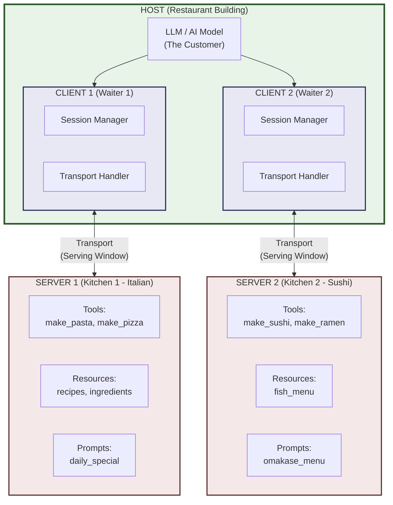
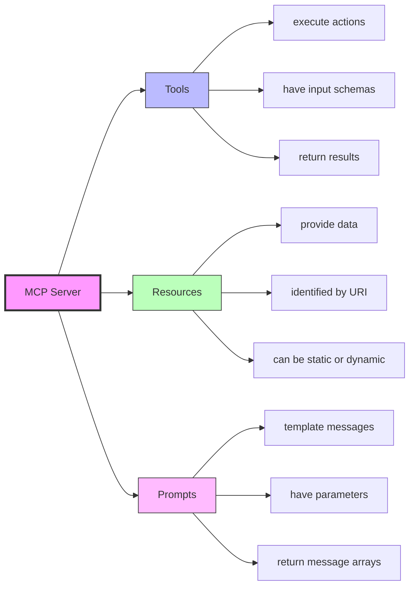
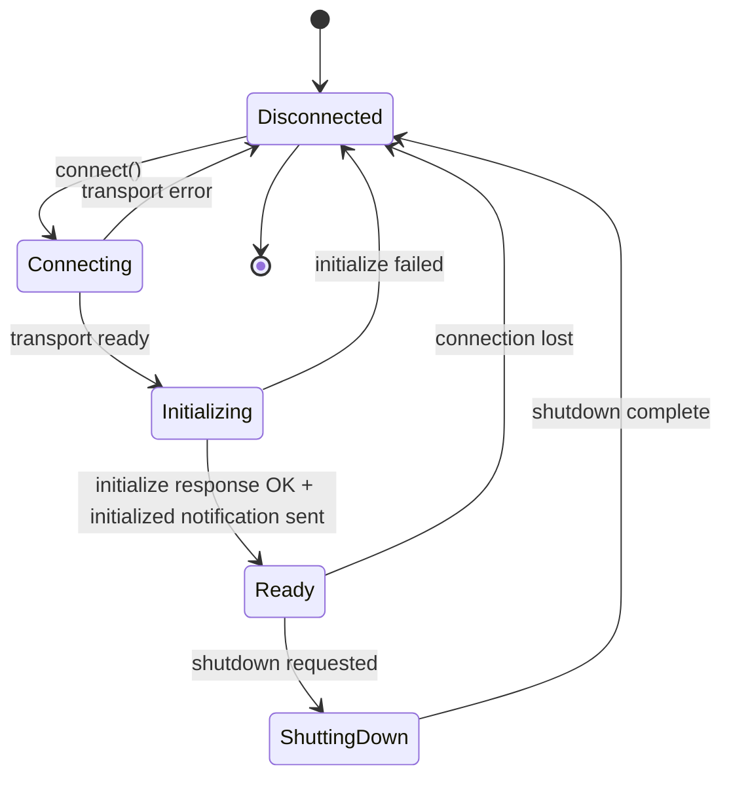
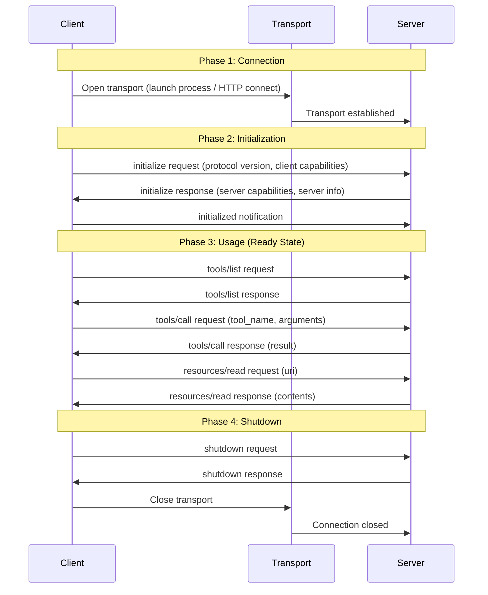
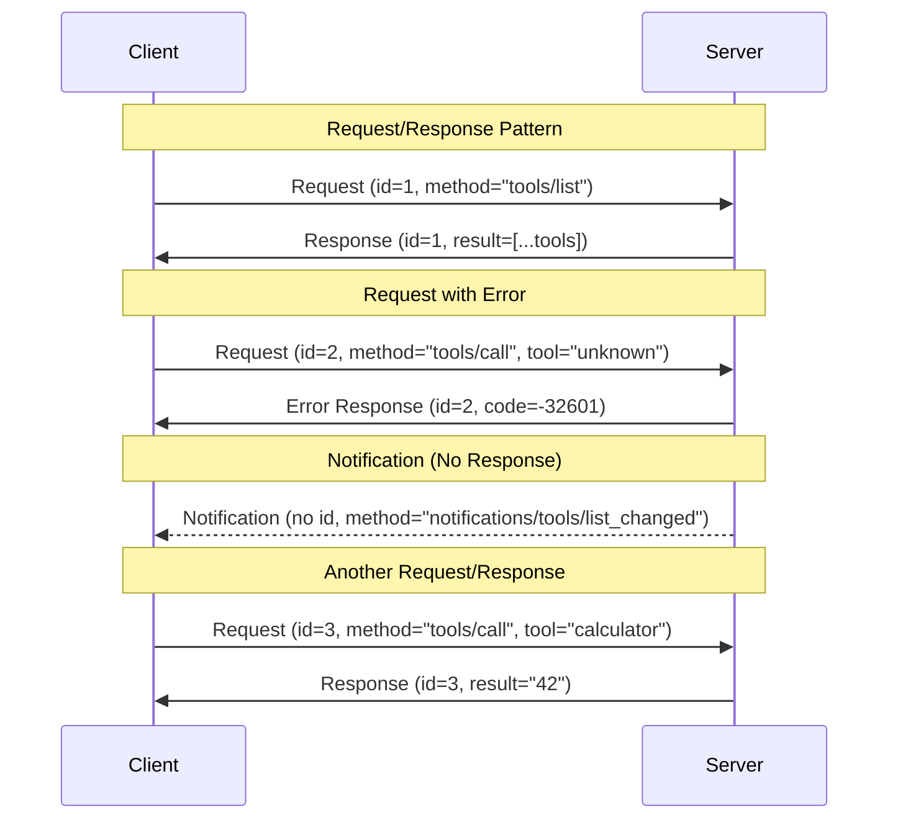
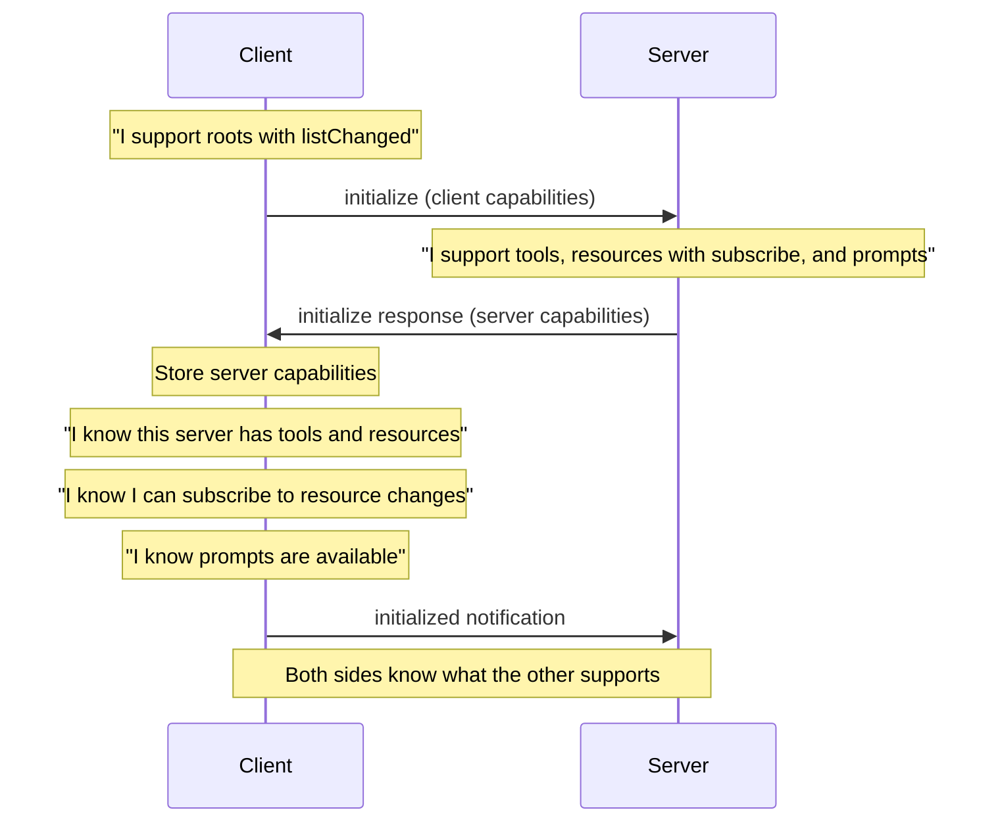

# Chapter 2: MCP Architecture Deep Dive

---

## Learning Objectives

By the end of this chapter, you will be able to:

1. Explain the three-layer architecture of MCP: Host, Client, and Server
2. Describe the responsibilities of each component in detail
3. Understand how the transport layer moves messages between client and server
4. Trace the full connection lifecycle from connect to shutdown
5. Read and write JSON-RPC 2.0 request/response messages
6. Handle MCP-specific error codes correctly
7. Explain capability negotiation and why it matters
8. Describe the security model and authentication concepts
9. Design systems using MCP architecture patterns
10. Answer interview questions about MCP internals

---

## 2.1 The Big Picture: MCP Architecture Overview

MCP follows a **client-server architecture** with three distinct layers. Before we dive into each layer, let us see how they fit together.

### Real-World Analogy: The Restaurant

Imagine a restaurant. This analogy will guide us through the entire chapter.

| MCP Component | Restaurant Equivalent | Role |
|---|---|---|
| **Host** | The restaurant building | Contains everything. Provides the environment. |
| **Client** | The waiter | Takes orders from the customer, brings them to the kitchen, returns food. |
| **Server** | The kitchen | Has the tools (ovens, knives), resources (ingredients), and recipes (prompts). |
| **Transport** | The serving window | The physical channel through which orders and food pass between waiter and kitchen. |
| **JSON-RPC Messages** | Order slips | Standardized paper slips with order number, items, and special instructions. |
| **Tools** | Kitchen equipment | Things the kitchen can DO (grill, bake, fry). |
| **Resources** | Ingredients | Things the kitchen HAS (flour, meat, vegetables). |
| **Prompts** | Menu items / recipes | Pre-defined combinations the kitchen OFFERS. |

When a customer (the LLM) wants something:

1. The customer tells the waiter (client) what they want
2. The waiter writes it on an order slip (JSON-RPC message)
3. The waiter passes the slip through the serving window (transport)
4. The kitchen (server) processes the order using its equipment (tools) and ingredients (resources)
5. The kitchen sends the result back through the serving window
6. The waiter delivers it to the customer

This is exactly how MCP works.

### Architecture Diagram



### Key Architecture Rules

1. **One Host, Many Clients**: A host can contain multiple clients. Claude Desktop is a host that might have clients connected to a GitHub server, a filesystem server, and a database server simultaneously.

2. **One Client, One Server**: Each client connects to exactly one server. If you need three servers, you need three clients.

3. **Servers Are Independent**: Servers do not talk to each other. They do not know about each other. Each server only knows about its own tools, resources, and prompts.

4. **The Host Controls Everything**: The host decides which servers to connect to, manages the lifecycle of clients, and routes LLM requests to the right client.

---

## 2.2 Host Architecture

### What Is a Host?

The **host** is the outermost container. It is the application the user interacts with directly. The host creates and manages MCP clients.

### Host Responsibilities

| Responsibility | Description | Example |
|---|---|---|
| **User Interface** | Provides the UI the user sees | Claude Desktop's chat window |
| **LLM Integration** | Contains or connects to the AI model | Claude model inside Claude Desktop |
| **Client Management** | Creates, configures, and destroys MCP clients | Starting a client for each configured server |
| **Security Boundary** | Enforces security policies | Deciding which servers are trusted |
| **Configuration** | Stores server connection settings | `claude_desktop_config.json` |
| **Consent Management** | Asks user for permission before tool calls | "Allow this tool to read files?" dialog |
| **Request Routing** | Directs LLM tool requests to the correct client | Sending a GitHub request to the GitHub client |

### Examples of Hosts

| Host Application | Type | LLM |
|---|---|---|
| Claude Desktop | Desktop app | Claude (Anthropic) |
| Cursor | IDE | Claude / GPT |
| VS Code + Continue.dev | IDE extension | Various |
| Cline | VS Code extension | Various |
| Open WebUI | Web app | Ollama models |
| Your custom Python app | Custom | Any |

### How a Host Works Internally

```
User types: "What files are in my project?"

Step 1: Host receives user message
Step 2: Host sends message to LLM
Step 3: LLM decides it needs the filesystem tool
Step 4: Host finds which client is connected to the filesystem server
Step 5: Host tells that client to call the tool
Step 6: Client sends JSON-RPC request to server
Step 7: Server executes the tool and returns result
Step 8: Client receives response, passes it to host
Step 9: Host passes result back to LLM
Step 10: LLM generates final answer for user
Step 11: Host displays the answer
```

### Host Configuration Example (Claude Desktop)

In Claude Desktop, the host is configured via a JSON file. This tells the host which servers to launch and how to connect to them:

```json
{
  "mcpServers": {
    "filesystem": {
      "command": "python",
      "args": ["filesystem_server.py"],
      "env": {
        "ALLOWED_DIRS": "/home/user/projects"
      }
    },
    "github": {
      "command": "python",
      "args": ["github_server.py"],
      "env": {
        "GITHUB_TOKEN": "your-token-here"
      }
    }
  }
}
```

When Claude Desktop starts, it reads this configuration. For each entry under `mcpServers`, it creates a new MCP client, launches the server process, and establishes a connection.

---

## 2.3 Client Architecture

### What Is a Client?

The **client** is the middleman between the host and a server. Each client manages exactly one connection to exactly one server.

Think of it as the waiter in our restaurant. The waiter does not cook (that is the server's job). The waiter does not own the building (that is the host). The waiter carries messages back and forth and keeps track of the conversation.

### Client Responsibilities

| Responsibility | Description |
|---|---|
| **Connection Management** | Opens and closes connections to servers |
| **Session Tracking** | Maintains the session state (connected, initializing, ready, etc.) |
| **Message Sending** | Sends JSON-RPC requests to the server |
| **Response Handling** | Receives and processes JSON-RPC responses |
| **Capability Tracking** | Remembers what the server can do |
| **Request ID Management** | Assigns unique IDs to each request |
| **Error Handling** | Processes error responses from the server |
| **Notification Listening** | Handles server notifications (one-way messages) |

### Client Lifecycle

```
1. Created by host
2. Connects to server via transport
3. Sends "initialize" request
4. Receives server capabilities
5. Sends "initialized" notification (confirms ready)
6. Ready for use (calls tools, reads resources, uses prompts)
7. Sends shutdown request
8. Disconnects
9. Destroyed by host
```

### What a Client Tracks

A client keeps an internal record of:

- **Server capabilities**: Which tools, resources, and prompts the server offers
- **Protocol version**: The MCP version the server supports
- **Session state**: Whether the connection is active, initializing, or closed
- **Pending requests**: Requests sent but not yet answered (matched by request ID)
- **Server info**: Name and version of the server

---

## 2.4 Server Architecture

### What Is a Server?

The **server** is where the real work happens. It exposes capabilities (tools, resources, prompts) that clients can use. The server is like the kitchen -- it has the equipment, ingredients, and recipes.

### Server Responsibilities

| Responsibility | Description |
|---|---|
| **Tool Execution** | Runs tools when requested (e.g., read a file, query a database) |
| **Resource Serving** | Provides data resources (e.g., file contents, database records) |
| **Prompt Serving** | Provides prompt templates |
| **Capability Advertisement** | Tells clients what it can do during initialization |
| **Input Validation** | Validates tool arguments before execution |
| **Error Reporting** | Returns proper error codes when things go wrong |
| **Notification Sending** | Sends one-way notifications to clients (e.g., resource changed) |

### Server Capability Categories



### How a Server Advertises Capabilities

During initialization, the server sends back a response that describes everything it can do. Here is what that response looks like conceptually:

```json
{
  "serverInfo": {
    "name": "my-data-server",
    "version": "1.0.0"
  },
  "capabilities": {
    "tools": {
      "listChanged": true
    },
    "resources": {
      "subscribe": true,
      "listChanged": true
    },
    "prompts": {
      "listChanged": true
    }
  }
}
```

This tells the client:

- "I have tools, and I will notify you if the list changes"
- "I have resources, you can subscribe to changes, and I will notify you if the list changes"
- "I have prompts, and I will notify you if the list changes"

The client does NOT yet know what specific tools or resources exist. It only knows that the server supports these categories. The client must then call `tools/list`, `resources/list`, or `prompts/list` to get the actual items.

---

## 2.5 Transport Layer Deep Dive

### What Is the Transport Layer?

The transport layer is HOW messages physically travel between client and server. It is the serving window in our restaurant analogy -- the physical mechanism for passing order slips.

MCP supports two main transport types:

### Transport Type 1: STDIO (Standard Input/Output)

**How it works**: The client launches the server as a child process. Messages are sent through the process's stdin (input) and stdout (output).

```
Client Process                    Server Process
     |                                 |
     |--- writes to server stdin ----->|
     |                                 |
     |<--- reads from server stdout ---|
     |                                 |
```

**When to use STDIO**:
- Local servers running on the same machine
- Development and testing
- Desktop applications like Claude Desktop
- When you want process isolation

**Advantages**:
- Simple to implement
- No network configuration needed
- Automatic process lifecycle management
- Secure (no network exposure)

**Disadvantages**:
- Only works locally (same machine)
- Cannot share a server across multiple clients easily
- Server stops when client stops

### Transport Type 2: HTTP with SSE (Server-Sent Events)

**How it works**: The client connects to the server over HTTP. The client sends requests via HTTP POST. The server sends responses and notifications via Server-Sent Events (a streaming HTTP connection).

```
Client                           Server (HTTP)
  |                                   |
  |--- HTTP POST (request) --------->|
  |                                   |
  |<--- SSE stream (responses) ------|
  |     (long-lived connection)       |
  |                                   |
```

**When to use HTTP+SSE**:
- Remote servers on different machines
- Cloud-deployed servers
- Shared servers serving multiple clients
- Web-based applications

**Advantages**:
- Works over network
- Multiple clients can connect to one server
- Standard HTTP infrastructure (load balancers, proxies)

**Disadvantages**:
- More complex setup
- Requires network configuration
- Must handle authentication explicitly

### Streamable HTTP (New in 2025)

The MCP specification also introduced **Streamable HTTP** as a newer transport option. It uses standard HTTP requests and responses with optional streaming support. This simplifies the architecture compared to SSE while still supporting real-time communication.

### Transport Comparison Table

| Feature | STDIO | HTTP + SSE | Streamable HTTP |
|---|---|---|---|
| Network support | Local only | Yes | Yes |
| Setup complexity | Very simple | Moderate | Moderate |
| Multiple clients | No | Yes | Yes |
| Security | Process isolation | Needs auth | Needs auth |
| Use case | Desktop apps, dev | Production, cloud | Production, cloud |
| Process management | Automatic | Manual | Manual |

### Message Format on the Wire

Regardless of transport, messages are always JSON-RPC 2.0 format. Each message is a JSON object terminated by a newline character.

```
{"jsonrpc":"2.0","id":1,"method":"tools/list","params":{}}\n
```

The transport layer does NOT interpret these messages. It just moves bytes. The session layer above it handles parsing and meaning.

---

## 2.6 Connection Lifecycle

The connection lifecycle describes the states a connection goes through from start to finish. This is one of the most important concepts to understand because errors often happen during state transitions.

### Lifecycle State Machine



### State Descriptions

| State | Description | What Happens |
|---|---|---|
| **Disconnected** | No connection exists | Starting state and ending state |
| **Connecting** | Transport is being established | Client is launching server process (STDIO) or opening HTTP connection |
| **Initializing** | Protocol handshake in progress | Client sends `initialize` request, server responds with capabilities |
| **Ready** | Connection is active and usable | Client can call tools, read resources, use prompts |
| **ShuttingDown** | Graceful shutdown in progress | Client sends shutdown, waits for confirmation |

### The Initialization Handshake (Step by Step)

This is the most critical part of the lifecycle. Let us trace it message by message.

**Step 1: Client sends `initialize` request**

```json
{
  "jsonrpc": "2.0",
  "id": 1,
  "method": "initialize",
  "params": {
    "protocolVersion": "2025-03-26",
    "capabilities": {
      "roots": {
        "listChanged": true
      }
    },
    "clientInfo": {
      "name": "my-client",
      "version": "1.0.0"
    }
  }
}
```

The client says: "I speak MCP version 2025-03-26, I support these capabilities, and here is my name."

**Step 2: Server responds with its capabilities**

```json
{
  "jsonrpc": "2.0",
  "id": 1,
  "result": {
    "protocolVersion": "2025-03-26",
    "capabilities": {
      "tools": { "listChanged": true },
      "resources": { "subscribe": true, "listChanged": true },
      "prompts": { "listChanged": true }
    },
    "serverInfo": {
      "name": "my-data-server",
      "version": "1.0.0"
    }
  }
}
```

The server says: "I also speak version 2025-03-26, here are my capabilities, and here is my name."

**Step 3: Client sends `initialized` notification**

```json
{
  "jsonrpc": "2.0",
  "method": "notifications/initialized"
}
```

The client says: "Got it. I am ready to start working."

Notice this is a **notification**, not a request. It has no `id` field. The server does not respond to it. It is a one-way acknowledgment.

**After this, the connection is in the Ready state.**

### Lifecycle Sequence Diagram



---

## 2.7 Request/Response Patterns with JSON-RPC

MCP uses JSON-RPC 2.0 for all communication. There are three types of messages:

### Message Type 1: Request

A request asks the server to do something and expects a response.

```json
{
  "jsonrpc": "2.0",
  "id": 42,
  "method": "tools/call",
  "params": {
    "name": "get_weather",
    "arguments": {
      "city": "Mumbai"
    }
  }
}
```

Key fields:
- `jsonrpc`: Always "2.0"
- `id`: A unique identifier. The response will have the same `id` so you can match them.
- `method`: The method to call
- `params`: Arguments for the method (optional)

### Message Type 2: Response (Success)

A successful response returns a result.

```json
{
  "jsonrpc": "2.0",
  "id": 42,
  "result": {
    "content": [
      {
        "type": "text",
        "text": "The weather in Mumbai is 32C, humid."
      }
    ]
  }
}
```

Key fields:
- `id`: Matches the request's `id`
- `result`: The return value

### Message Type 3: Response (Error)

An error response indicates something went wrong.

```json
{
  "jsonrpc": "2.0",
  "id": 42,
  "error": {
    "code": -32601,
    "message": "Method not found",
    "data": {
      "method": "tools/call",
      "detail": "Tool 'get_weather' is not registered"
    }
  }
}
```

Key fields:
- `id`: Matches the request's `id`
- `error.code`: A numeric error code
- `error.message`: Human-readable error description
- `error.data`: Optional additional error details

### Message Type 4: Notification

A notification is a one-way message. It has no `id` and expects no response.

```json
{
  "jsonrpc": "2.0",
  "method": "notifications/resources/updated",
  "params": {
    "uri": "file:///data/report.csv"
  }
}
```

Notifications are used for events like:
- `notifications/initialized` -- client tells server it is ready
- `notifications/resources/updated` -- server tells client a resource changed
- `notifications/tools/list_changed` -- server tells client the tool list changed
- `notifications/progress` -- server sends progress updates

### Request/Response Flow Diagram



### MCP Methods Reference

| Method | Direction | Description |
|---|---|---|
| `initialize` | Client to Server | Start initialization handshake |
| `notifications/initialized` | Client to Server | Confirm initialization complete |
| `tools/list` | Client to Server | List available tools |
| `tools/call` | Client to Server | Execute a tool |
| `resources/list` | Client to Server | List available resources |
| `resources/read` | Client to Server | Read a resource |
| `resources/subscribe` | Client to Server | Subscribe to resource changes |
| `prompts/list` | Client to Server | List available prompts |
| `prompts/get` | Client to Server | Get a prompt template |
| `ping` | Either direction | Check if connection is alive |
| `notifications/resources/updated` | Server to Client | Resource has changed |
| `notifications/tools/list_changed` | Server to Client | Tool list has changed |
| `notifications/prompts/list_changed` | Server to Client | Prompt list has changed |
| `notifications/progress` | Server to Client | Progress update for long operations |

---

## 2.8 Events and Notifications

### What Are Notifications?

Notifications are one-way messages that do not require a response. They are used for events -- things that happen that the other side should know about but does not need to acknowledge.

### Why Notifications Matter

In a real system, things change. A file gets modified. A new tool gets added. A long operation makes progress. The server needs a way to tell the client about these changes without the client asking.

### Common Notification Patterns

**Pattern 1: Resource Changed**

When a file or data source the client is watching changes, the server sends:

```json
{
  "jsonrpc": "2.0",
  "method": "notifications/resources/updated",
  "params": {
    "uri": "file:///data/users.csv"
  }
}
```

The client can then re-read the resource to get the updated contents.

**Pattern 2: Tool List Changed**

When the server adds or removes a tool dynamically:

```json
{
  "jsonrpc": "2.0",
  "method": "notifications/tools/list_changed"
}
```

The client should then call `tools/list` again to get the updated list.

**Pattern 3: Progress Update**

For long-running tool calls, the server can send progress updates:

```json
{
  "jsonrpc": "2.0",
  "method": "notifications/progress",
  "params": {
    "progressToken": "abc123",
    "progress": 50,
    "total": 100
  }
}
```

---

## 2.9 Error Handling

Error handling in MCP follows JSON-RPC 2.0 conventions with additional MCP-specific error codes.

### Standard JSON-RPC Error Codes

| Code | Name | Description | When It Happens |
|---|---|---|---|
| `-32700` | Parse Error | Invalid JSON received | Malformed JSON message |
| `-32600` | Invalid Request | JSON is valid but not a proper request | Missing required fields |
| `-32601` | Method Not Found | Method does not exist | Calling a method the server does not have |
| `-32602` | Invalid Params | Method params are wrong | Wrong argument types or missing required args |
| `-32603` | Internal Error | Something went wrong inside the server | Unhandled exception, bug |

### Error Response Structure

Every error response follows this format:

```json
{
  "jsonrpc": "2.0",
  "id": 5,
  "error": {
    "code": -32602,
    "message": "Invalid params",
    "data": {
      "param": "temperature",
      "expected": "number between 0 and 100",
      "received": "hot"
    }
  }
}
```

The `data` field is optional but extremely useful for debugging. Always include it in production servers.

### Error Handling Best Practices

1. **Always return proper error codes**: Do not return a success response with an error message inside. Use the error field.

2. **Include helpful error data**: The `data` field should help the caller fix the problem.

3. **Never expose internal details**: Do not include stack traces, file paths, or database credentials in error responses.

4. **Log errors server-side**: Always log the full error with stack trace on the server, but send a sanitized version to the client.

5. **Use specific error codes**: Do not use `-32603` (internal error) for everything. Use the most specific code that applies.

---

## 2.10 Capability Negotiation

### What Is Capability Negotiation?

Capability negotiation is the process where the client and server tell each other what features they support. This happens during the initialization phase.

### Why Capability Negotiation Matters

Not all clients support all features. Not all servers offer all capabilities. Capability negotiation ensures both sides know what they can and cannot do.

For example:
- A server might offer tools but not resources
- A client might not support resource subscriptions
- A server might not support prompt templates

Without negotiation, a client might try to subscribe to resource changes on a server that does not support subscriptions, leading to confusing errors.

### Capability Negotiation Flow



### Client Capabilities

These are the features a client can advertise:

| Capability | Description |
|---|---|
| `roots` | Client can provide root URIs (workspace folders) |
| `roots.listChanged` | Client will notify when roots change |
| `sampling` | Client supports LLM sampling requests from the server |

### Server Capabilities

These are the features a server can advertise:

| Capability | Sub-capability | Description |
|---|---|---|
| `tools` | | Server offers tools |
| `tools.listChanged` | | Server will notify when tool list changes |
| `resources` | | Server offers resources |
| `resources.subscribe` | | Server supports resource subscriptions |
| `resources.listChanged` | | Server will notify when resource list changes |
| `prompts` | | Server offers prompts |
| `prompts.listChanged` | | Server will notify when prompt list changes |
| `logging` | | Server supports logging |

### What Happens After Negotiation

After negotiation, the client knows exactly what it can do:

```
If server has "tools" capability:
    Client CAN call tools/list and tools/call

If server has "resources" capability:
    Client CAN call resources/list and resources/read

If server has "resources.subscribe" capability:
    Client CAN call resources/subscribe

If server has "prompts" capability:
    Client CAN call prompts/list and prompts/get

If server does NOT have "tools" capability:
    Client MUST NOT call tools/list or tools/call
```

---

## 2.11 Authentication and Authorization

### Authentication vs Authorization

| Concept | Question It Answers | Example |
|---|---|---|
| **Authentication** | "Who are you?" | Verifying your identity with a username and password |
| **Authorization** | "What are you allowed to do?" | Checking if you have permission to delete files |

### How MCP Handles Auth

MCP's approach to authentication and authorization depends on the transport:

**STDIO Transport**: Authentication is implicit. The client launched the server, so it trusts it. The server runs as a child process of the client, inheriting its permissions.

**HTTP Transport**: Authentication must be handled explicitly. The MCP specification supports OAuth 2.0 for HTTP-based servers.

### OAuth 2.0 in MCP

For HTTP-based MCP servers, OAuth 2.0 provides:

1. **Client Registration**: The client registers with the server and gets a client ID
2. **Authorization**: The user authorizes the client to access the server
3. **Token Exchange**: The client gets an access token
4. **Token Usage**: The client includes the token in requests
5. **Token Refresh**: The client refreshes expired tokens

### Environment Variable Pattern

For simpler scenarios (especially during development), many MCP servers use environment variables for authentication:

```json
{
  "mcpServers": {
    "github": {
      "command": "python",
      "args": ["github_server.py"],
      "env": {
        "GITHUB_TOKEN": "ghp_xxxxxxxxxxxx"
      }
    }
  }
}
```

The server reads `GITHUB_TOKEN` from its environment to authenticate with the GitHub API. This is NOT MCP-level authentication (it is application-level), but it is the most common pattern you will see.

---

## 2.12 Security Model Overview

### Security Principles in MCP

| Principle | Description |
|---|---|
| **Least Privilege** | Servers should only have access to what they need |
| **User Consent** | Users must approve sensitive operations (tool calls) |
| **Process Isolation** | STDIO servers run as separate processes |
| **Input Validation** | All inputs must be validated before processing |
| **No Implicit Trust** | Even local servers should validate requests |

### Security Boundaries

```
+--------------------------------------------------+
|  HOST (Security Controller)                       |
|                                                   |
|  +--------------------+  +--------------------+  |
|  | CLIENT 1           |  | CLIENT 2           |  |
|  | (sandboxed)        |  | (sandboxed)        |  |
|  +--------+-----------+  +--------+-----------+  |
|           |                        |              |
+-----------|------------------------|------ -------+
            |                        |
   +--------v-----------+  +--------v-----------+
   | SERVER 1           |  | SERVER 2           |
   | (own process)      |  | (own process)      |
   | (limited perms)    |  | (limited perms)    |
   +--------------------+  +--------------------+
```

### Common Security Risks

| Risk | Description | Mitigation |
|---|---|---|
| **Prompt Injection** | Malicious input tricks the LLM into calling dangerous tools | Input validation, user consent |
| **Over-privileged Servers** | Server has more access than it needs | Least privilege, environment scoping |
| **Secret Exposure** | API keys leaked in responses | Never include secrets in tool responses |
| **Arbitrary Code Execution** | Server executes untrusted code | Sandboxing, input validation |
| **Data Exfiltration** | Server sends sensitive data to external services | Network restrictions, monitoring |

### Production Security Checklist

- [ ] All server environment variables are stored securely (not in code)
- [ ] Servers run with minimum required permissions
- [ ] User consent is required before sensitive tool calls
- [ ] All tool inputs are validated and sanitized
- [ ] Error responses do not leak internal details
- [ ] Network access is restricted to required endpoints
- [ ] Logging captures security-relevant events
- [ ] Regular security audits of server code

---

## 2.13 Putting It All Together

### Complete Message Flow Example

Let us trace a complete real-world scenario. A user asks Claude Desktop: "How many lines are in my README.md file?"

```
1. User types question in Claude Desktop (HOST)

2. HOST sends question to Claude LLM

3. LLM decides it needs to use the "read_file" tool

4. HOST finds the CLIENT connected to the filesystem SERVER

5. CLIENT sends JSON-RPC request:
   {
     "jsonrpc": "2.0",
     "id": 7,
     "method": "tools/call",
     "params": {
       "name": "read_file",
       "arguments": {"path": "README.md"}
     }
   }

6. Message travels through TRANSPORT (STDIO)

7. SERVER receives the request
   - Validates the method (tools/call -- yes, it is supported)
   - Validates the tool name (read_file -- yes, it exists)
   - Validates the arguments (path is a string -- correct)
   - Executes the tool (reads README.md from disk)

8. SERVER sends JSON-RPC response:
   {
     "jsonrpc": "2.0",
     "id": 7,
     "result": {
       "content": [
         {
           "type": "text",
           "text": "# My Project\n\nThis is a sample project..."
         }
       ]
     }
   }

9. Response travels back through TRANSPORT

10. CLIENT receives response, passes to HOST

11. HOST passes file contents to LLM

12. LLM counts lines and generates response:
    "Your README.md file has 42 lines."

13. HOST displays response to user
```

---

## 2.14 Hands-On Exercises

See the `code/` directory for the following exercises:

| File | Description |
|---|---|
| `example1_client_server_model.py` | Simulate client-server communication |
| `example2_capability_negotiation.py` | Simulate capability exchange |
| `example3_request_response.py` | Build JSON-RPC request/response handler |
| `example4_error_handling.py` | Demonstrate MCP error codes |
| `example5_connection_lifecycle.py` | Full lifecycle simulation |
| `exercise1_build_state_machine.py` | Exercise: Build a connection state machine |
| `exercise1_solution.py` | Solution |
| `exercise2_error_handler.py` | Exercise: Build comprehensive error handler |
| `exercise2_solution.py` | Solution |
| `exercise3_capability_matcher.py` | Exercise: Build capability matching system |
| `exercise3_solution.py` | Solution |
| `mini_project_architecture_simulator.py` | Complete MCP architecture simulator |

---

## 2.15 Summary

### What We Learned

| Concept | Key Takeaway |
|---|---|
| **Host** | The outermost container (e.g., Claude Desktop). Manages clients and enforces security. |
| **Client** | Middleman between host and server. One client per server connection. |
| **Server** | Exposes tools, resources, and prompts. Does the actual work. |
| **Transport** | How messages travel. STDIO for local, HTTP+SSE for remote. |
| **Lifecycle** | Disconnected, Connecting, Initializing, Ready, ShuttingDown, Disconnected. |
| **JSON-RPC** | Message format. Requests have IDs, responses match them, notifications have no ID. |
| **Capabilities** | Negotiated during initialization. Both sides advertise what they support. |
| **Security** | Least privilege, user consent, process isolation, input validation. |

### Key Architecture Rules to Remember

1. One host can have many clients
2. One client connects to exactly one server
3. Servers are independent and do not communicate with each other
4. All messages use JSON-RPC 2.0 format
5. Initialization must complete before any tool/resource/prompt calls
6. Capability negotiation happens during initialization, not after
7. Notifications are one-way (no response expected)
8. Error codes follow JSON-RPC 2.0 standard

---

## 2.16 Interview Questions

### Question 1: Explain the three layers of MCP architecture.

**Answer**: MCP has three layers: Host, Client, and Server. The Host is the outermost container (like Claude Desktop or Cursor) that manages the user interface, LLM integration, and creates MCP clients. The Client is the middleman that manages a single connection to a single server, handles session state, sends requests, and receives responses. The Server exposes capabilities (tools, resources, prompts) and does the actual work like reading files, querying databases, or executing code.

### Question 2: Why does each client connect to exactly one server?

**Answer**: This is a deliberate design choice for simplicity and isolation. Each client maintains its own session state, capability tracking, and request ID management for one server. If a client connected to multiple servers, it would need to track multiple capability sets, route requests to the right server, and handle conflicting capabilities. By keeping it one-to-one, the architecture stays clean. If you need multiple servers, you create multiple clients, all managed by the host.

### Question 3: What happens during the initialization handshake?

**Answer**: Three messages are exchanged. First, the client sends an `initialize` request with its protocol version, capabilities, and client info. Second, the server responds with its own protocol version, capabilities, and server info. Third, the client sends an `initialized` notification (not a request) to confirm it received the server's capabilities and is ready. Only after this three-step handshake can the client call tools, read resources, or use prompts.

### Question 4: What is the difference between a request and a notification in JSON-RPC?

**Answer**: A request has an `id` field and expects a response. A notification has no `id` field and expects no response. Requests are used for operations where the sender needs a result (like calling a tool). Notifications are used for one-way events (like telling the server the client is initialized, or the server telling the client a resource changed).

### Question 5: Explain capability negotiation. Why is it important?

**Answer**: Capability negotiation is the process during initialization where the client and server tell each other what features they support. The client says what it can do (like providing roots or supporting sampling), and the server says what it offers (like tools, resources, or prompts). This is important because not all servers support all features. Without negotiation, a client might try to use a feature the server does not support, causing errors. After negotiation, the client knows exactly what methods it can safely call.

### Question 6: What are the five standard JSON-RPC error codes used in MCP?

**Answer**: (1) -32700 Parse Error: invalid JSON received. (2) -32600 Invalid Request: JSON is valid but not a proper request structure. (3) -32601 Method Not Found: the requested method does not exist. (4) -32602 Invalid Params: method parameters are wrong type or missing required fields. (5) -32603 Internal Error: an unexpected error occurred inside the server.

### Question 7: Compare STDIO and HTTP+SSE transport. When would you use each?

**Answer**: STDIO launches the server as a child process and communicates through stdin/stdout. It is simple, secure (no network exposure), and ideal for local development and desktop apps like Claude Desktop. HTTP+SSE connects over the network, allowing the server to run on a different machine. It supports multiple clients connecting to one server and uses standard HTTP infrastructure. Use STDIO for local/development scenarios and HTTP+SSE for production, cloud, or shared-server scenarios.

### Question 8: What security principles does MCP follow?

**Answer**: MCP follows five key security principles. Least Privilege: servers should only access what they need. User Consent: users must approve sensitive operations. Process Isolation: STDIO servers run as separate processes with their own permissions. Input Validation: all inputs must be validated before processing. No Implicit Trust: even local servers should validate requests rather than trusting all input blindly.

### Question 9: Describe the connection lifecycle states and transitions.

**Answer**: The lifecycle has five states. Disconnected (initial state) transitions to Connecting when connect() is called. Connecting transitions to Initializing when the transport is established, or back to Disconnected if the transport fails. Initializing transitions to Ready when the initialization handshake completes, or to Disconnected if initialization fails. Ready transitions to ShuttingDown when a shutdown is requested, or to Disconnected if the connection is lost unexpectedly. ShuttingDown transitions to Disconnected when shutdown completes.

### Question 10: How does MCP handle authentication for HTTP-based servers?

**Answer**: For HTTP-based MCP servers, the specification supports OAuth 2.0. The flow involves client registration (getting a client ID), user authorization, token exchange (getting an access token), including the token in requests, and refreshing expired tokens. For simpler scenarios, especially during development, many servers use environment variables (like GITHUB_TOKEN) for application-level authentication. For STDIO transport, authentication is implicit because the client launched the server process and trusts it.

---

## 2.17 Common Mistakes

### Mistake 1: Calling tools before initialization completes

**Wrong**: Sending a `tools/call` request immediately after connecting.

**Right**: Wait for the full initialization handshake (initialize request, initialize response, initialized notification) before calling any tools.

### Mistake 2: Treating notifications as requests

**Wrong**: Including an `id` field in a notification and waiting for a response.

**Right**: Notifications have no `id` field. They are fire-and-forget. Do not wait for a response.

### Mistake 3: Using the wrong error code

**Wrong**: Returning `-32603` (Internal Error) for everything.

**Right**: Use the most specific error code. If the method does not exist, use `-32601`. If the params are wrong, use `-32602`.

### Mistake 4: Ignoring capability negotiation

**Wrong**: Trying to subscribe to resource changes on a server that does not support subscriptions.

**Right**: Check the server's capabilities after initialization. Only use features the server advertises.

### Mistake 5: Exposing secrets in error responses

**Wrong**: Including stack traces with file paths and database credentials in error messages sent to the client.

**Right**: Log full errors server-side. Send sanitized, helpful error messages to the client.

---

## 2.18 Production Tips

1. **Always implement timeouts**: If the server does not respond to the initialize request within a reasonable time (e.g., 30 seconds), disconnect and retry.

2. **Implement reconnection logic**: Connections can drop. Your client should detect disconnects and attempt to reconnect automatically.

3. **Cache capability information**: After initialization, cache the server's capabilities. Do not re-negotiate unless the connection drops.

4. **Monitor connection health**: Use `ping` requests periodically to check if the connection is still alive.

5. **Handle graceful shutdown**: Always try to send a shutdown request before killing the connection. This gives the server a chance to clean up resources.

6. **Log all JSON-RPC messages in development**: During development, log every message sent and received. This is invaluable for debugging.

7. **Validate all inputs server-side**: Never trust client inputs. Always validate tool arguments, resource URIs, and prompt parameters on the server.

8. **Use structured logging**: Log messages with context (session ID, request ID, method name) so you can trace issues across the lifecycle.

---

## 2.19 Further Reading

- [MCP Specification](https://spec.modelcontextprotocol.io/) -- The official specification
- [JSON-RPC 2.0 Specification](https://www.jsonrpc.org/specification) -- The messaging format MCP uses
- [MCP Python SDK](https://github.com/modelcontextprotocol/python-sdk) -- Official Python SDK
- [MCP TypeScript SDK](https://github.com/modelcontextprotocol/typescript-sdk) -- Official TypeScript SDK
- [Claude Desktop MCP Setup](https://modelcontextprotocol.io/quickstart) -- Setting up MCP with Claude Desktop
- [OAuth 2.0 RFC](https://tools.ietf.org/html/rfc6749) -- OAuth standard used by MCP for HTTP auth

---

**Next Chapter**: [Chapter 3: Installing MCP](../03_Installing_MCP/03_Installing_MCP.md) -- Set up your development environment and run your first MCP server.
