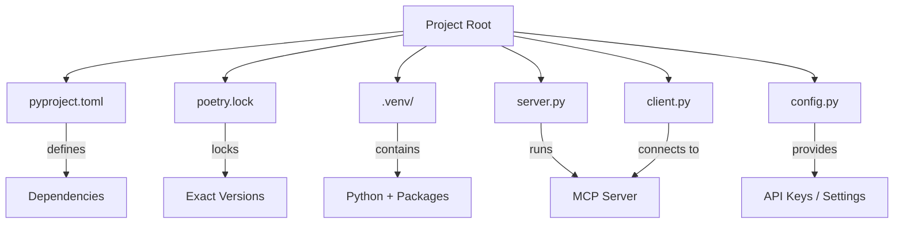
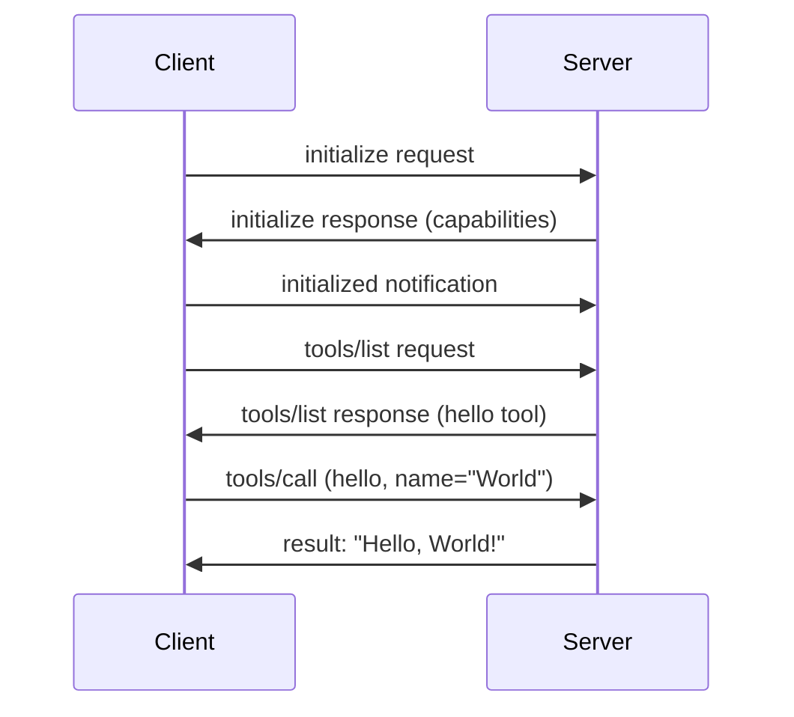

# Chapter 3: Installing MCP

## Learning Objectives

By the end of this chapter, you will be able to:

1. Install Python 3.10+ and verify the installation
2. Install and configure Poetry for package management
3. Create a new MCP project from scratch
4. Install the MCP Python SDK and all dependencies
5. Understand pyproject.toml configuration
6. Run your first MCP server (Hello World)
7. Run your first MCP client
8. Test the server-client connection
9. Use MCP Inspector for debugging
10. Troubleshoot common installation issues

---

## Why Poetry?

Before we install anything, let us understand WHY we use Poetry instead of pip.

**The Problem with pip:**
- pip installs packages globally (can cause conflicts)
- No automatic virtual environment management
- No lock file by default (builds are not reproducible)
- No dependency resolution (can install conflicting versions)

**Why Poetry solves this:**
- Creates isolated virtual environments automatically
- Lock file ensures reproducible builds
- Resolves dependency conflicts before installing
- Single tool for init, install, build, publish

### Real-World Analogy

Think of pip as buying ingredients from different stores with no shopping list. You might end up with conflicting brands or wrong quantities. Poetry is like having a professional meal kit service — everything is pre-measured, compatible, and delivered together.

---

## Step 1: Install Python 3.10+

MCP requires Python 3.10 or higher because it uses modern Python features like pattern matching and improved type hints.

### Check Your Python Version

```bash
python --version
```

You need to see `Python 3.10.x` or higher. If not, download from https://www.python.org/downloads/

### Verify pip Is Available

```bash
pip --version
```

---

## Step 2: Install Poetry

### On Windows (PowerShell)

```powershell
(Invoke-WebRequest -Uri https://install.python-poetry.org -UseBasicParsing).Content | py -
```

### On macOS / Linux

```bash
curl -sSL https://install.python-poetry.org | python3 -
```

### Add Poetry to PATH

**Windows:** Add `C:\Users\<your_username>\AppData\Roaming\Python\Scripts` to your PATH.

**macOS/Linux:** Add `$HOME/.local/bin` to your PATH by adding this line to `~/.bashrc` or `~/.zshrc`:

```bash
export PATH="$HOME/.local/bin:$PATH"
```

### Verify Poetry Installation

```bash
poetry --version
```

You should see something like `Poetry (version 1.8.x)`.

### Configure Poetry to Create Virtual Environments in Project

This is important — it keeps your virtual environment inside your project folder:

```bash
poetry config virtualenvs.in-project true
```

This creates a `.venv` folder inside your project, making it easy to find and manage.

---

## Step 3: Create Your First MCP Project

### Create the Project Directory

```bash
mkdir my_first_mcp_server
cd my_first_mcp_server
```

### Initialize with Poetry

```bash
poetry init
```

Poetry will ask you several questions:

```
Package name [my_first_mcp_server]:  (press Enter)
Version [0.1.0]:  (press Enter)
Description []:  My first MCP server
Author [Your Name <you@example.com>]:  (press Enter)
License []:  (press Enter)
Compatible Python versions [^3.10]:  (press Enter)
```

When it asks about dependencies, say "no" for now — we will add them manually.

This creates a `pyproject.toml` file.

---

## Step 4: Understanding pyproject.toml

After `poetry init`, you get a file like this:

```toml
[tool.poetry]
name = "my-first-mcp-server"
version = "0.1.0"
description = "My first MCP server"
authors = ["Your Name <you@example.com>"]

[tool.poetry.dependencies]
python = "^3.10"

[build-system]
requires = ["poetry-core"]
build-backend = "poetry.core.masonry.api"
```

### Line-by-Line Explanation

| Line | What It Does |
|------|-------------|
| `[tool.poetry]` | Section header for Poetry metadata |
| `name` | Your project's name (used when publishing) |
| `version` | Semantic version of your project |
| `description` | Short description of what this project does |
| `authors` | Who created this project |
| `[tool.poetry.dependencies]` | Section for project dependencies |
| `python = "^3.10"` | Requires Python 3.10 or higher |
| `[build-system]` | Tells Python how to build this project |

---

## Step 5: Install MCP SDK

Now install the MCP Python SDK:

```bash
poetry add mcp
```

This does several things:
1. Downloads the `mcp` package and all its dependencies
2. Creates a virtual environment (in `.venv/`)
3. Updates `pyproject.toml` with the new dependency
4. Creates/updates `poetry.lock` with exact versions

### Install Additional Useful Dependencies

```bash
poetry add httpx pydantic
```

- **httpx** — HTTP client for making API calls from your MCP tools
- **pydantic** — Data validation (MCP uses this internally)

### Verify Installation

```bash
poetry shell
python -c "import mcp; print('MCP installed successfully!')"
```

---

## Step 6: Project Structure

A well-organized MCP project looks like this:

```
my_first_mcp_server/
├── pyproject.toml          # Project configuration and dependencies
├── poetry.lock             # Exact dependency versions (auto-generated)
├── .venv/                  # Virtual environment (auto-generated)
├── server.py               # Your MCP server code
├── client.py               # Your MCP client code (for testing)
└── config.py               # Configuration and secrets (API keys)
```



---

## Step 7: Hello World MCP Server

Here is the simplest possible MCP server:

```python
from mcp.server.fastmcp import FastMCP

server = FastMCP("hello-server")

@server.tool()
def hello(name: str) -> str:
    return f"Hello, {name}! Welcome to MCP!"

if __name__ == "__main__":
    server.run()
```

This server:
1. Creates a FastMCP server named "hello-server"
2. Registers one tool called "hello" that takes a name and returns a greeting
3. Runs the server using STDIO transport (the default)

### How It Works Internally



---

## Step 8: Hello World MCP Client

To test your server, you need a client:

```python
import asyncio
from mcp.client.stdio import stdio_client
from mcp.client.session import ClientSession
from mcp import StdioServerParameters

async def main():
    server_params = StdioServerParameters(
        command="python",
        args=["server.py"]
    )
    
    async with stdio_client(server_params) as (read, write):
        async with ClientSession(read, write) as session:
            await session.initialize()
            result = await session.call_tool("hello", {"name": "World"})
            print(result)

if __name__ == "__main__":
    asyncio.run(main())
```

The client must use `async` because MCP communication is asynchronous. This is one of the few places where async is necessary.

---

## Step 9: Running and Testing

### Run the Server

```bash
poetry run python server.py
```

The server starts and waits for messages via stdin/stdout (STDIO transport).

### Run the Client (in another terminal)

```bash
poetry run python client.py
```

### Expected Output

```
Hello, World! Welcome to MCP!
```

---

## Step 10: Using MCP Inspector

MCP Inspector is a debugging tool that lets you interact with your server through a web interface.

### Install MCP Inspector

```bash
npx @modelcontextprotocol/inspector python server.py
```

This opens a web interface where you can:
- See all available tools
- Call tools with custom arguments
- View request/response messages
- Debug issues

---

## Troubleshooting Common Issues

### Issue 1: "ModuleNotFoundError: No module named 'mcp'"

**Cause:** You are not in the Poetry virtual environment.

**Fix:**
```bash
poetry shell
# or
poetry run python your_script.py
```

### Issue 2: "Python version not compatible"

**Cause:** Your Python is older than 3.10.

**Fix:** Install Python 3.10+ from python.org.

### Issue 3: "Poetry command not found"

**Cause:** Poetry is not in your PATH.

**Fix:** Add the Poetry bin directory to your PATH (see Step 2).

### Issue 4: "Connection refused" or "Server not responding"

**Cause:** The server is not running, or there is a port conflict.

**Fix:** Make sure the server is running before starting the client. For STDIO, the client starts the server automatically.

### Issue 5: "Permission denied" on Windows

**Fix:**
```powershell
Set-ExecutionPolicy -Scope CurrentUser -ExecutionPolicy RemoteSigned
```

---

## Summary

| Step | What You Did |
|------|-------------|
| 1 | Verified Python 3.10+ is installed |
| 2 | Installed Poetry for package management |
| 3 | Created project with `poetry init` |
| 4 | Understood pyproject.toml structure |
| 5 | Installed MCP SDK with `poetry add mcp` |
| 6 | Set up proper project structure |
| 7 | Built Hello World server |
| 8 | Built Hello World client |
| 9 | Tested server-client connection |
| 10 | Learned to use MCP Inspector |

---

## Interview Questions

1. **Why does MCP require Python 3.10+?** — It uses modern features like pattern matching and improved type hints that are only available in 3.10+.

2. **Why use Poetry instead of pip?** — Poetry provides dependency resolution, lock files for reproducible builds, and automatic virtual environment management.

3. **What does `poetry config virtualenvs.in-project true` do?** — It creates the virtual environment inside the project folder (.venv/) instead of a global cache, making it easier to find and manage.

4. **What is pyproject.toml?** — It is the project configuration file that defines metadata, dependencies, and build settings. It replaces setup.py and requirements.txt.

5. **What is poetry.lock?** — It locks exact versions of all dependencies (including transitive ones) to ensure reproducible builds across machines.

6. **What transport does the default MCP server use?** — STDIO (Standard Input/Output). Messages are sent via stdin and received via stdout.

7. **Why does the MCP client use async?** — MCP communication is inherently asynchronous (request-response over a transport), so the client must use Python's asyncio.

8. **What is MCP Inspector?** — A debugging tool that provides a web interface to interact with MCP servers, call tools, and view messages.

9. **What is FastMCP?** — It is a high-level API in the MCP Python SDK that simplifies creating MCP servers. It handles protocol details automatically.

10. **How do you verify the MCP SDK is installed?** — Run `python -c "import mcp; print('OK')"` inside the Poetry virtual environment.

---

## Common Mistakes

1. **Running Python outside Poetry environment** — Always use `poetry run python` or activate with `poetry shell` first.

2. **Using pip instead of Poetry** — Pip does not manage virtual environments or lock files. Stick with Poetry.

3. **Forgetting to set `virtualenvs.in-project true`** — Without this, the virtual environment goes to a global cache and is hard to find.

4. **Not checking Python version** — MCP fails with cryptic errors on Python < 3.10.

5. **Hardcoding API keys in source code** — Always use config.py or environment variables.

---

## Production Tips

1. **Always commit poetry.lock** — This ensures every developer and CI server uses the same dependency versions.

2. **Use .python-version file** — Create a file containing `3.10` (or your version) so tools like pyenv pick the right Python.

3. **Pin major versions** — Use `poetry add mcp@^1.0` to pin the major version and avoid breaking changes.

4. **Create a Makefile** — Simplify common commands: `make install`, `make run`, `make test`.

5. **Use .env files for secrets** — Never commit secrets. Use python-dotenv to load them from `.env` files.

---

## Further Reading

- [MCP Python SDK Documentation](https://github.com/modelcontextprotocol/python-sdk)
- [Poetry Documentation](https://python-poetry.org/docs/)
- [MCP Specification](https://spec.modelcontextprotocol.io/)
- [MCP Inspector](https://github.com/modelcontextprotocol/inspector)
