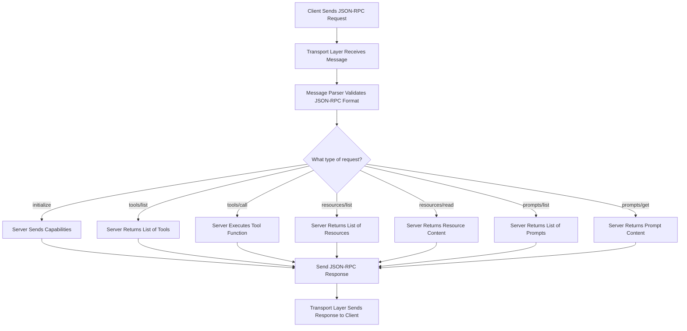
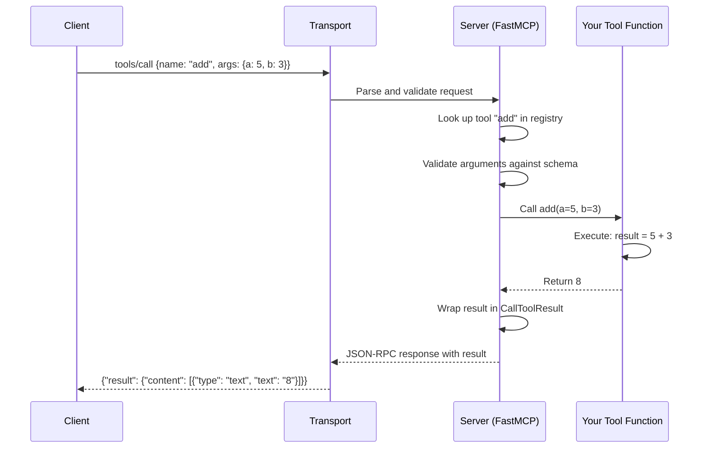
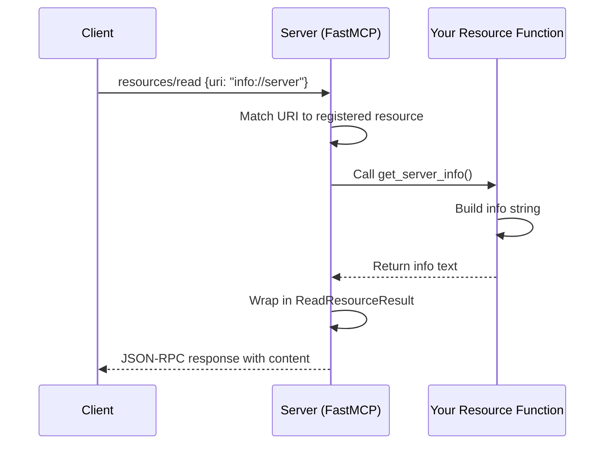
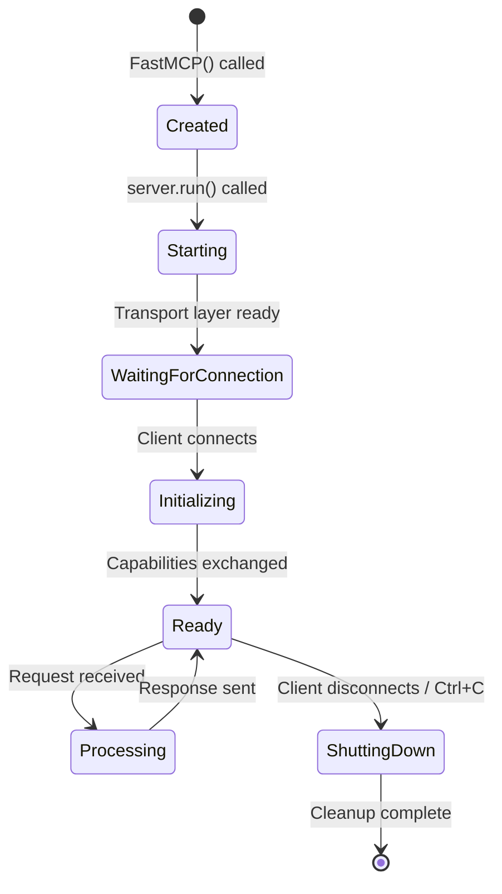
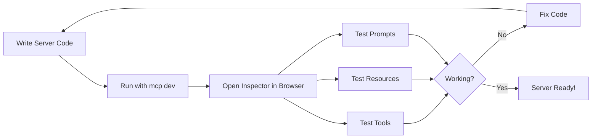

# Chapter 4: Build Your First MCP Server

## Learning Objectives

By the end of this chapter, you will be able to:

1. Create an MCP server from scratch using the Python `mcp` SDK
2. Expose a tool that performs a computation (calculator add)
3. Expose a resource that returns data (server info)
4. Expose a prompt template (summarize text)
5. Understand how the server handles incoming requests internally
6. Understand the server lifecycle and event handling
7. Test your server using MCP Inspector
8. Combine tools, resources, and prompts in a single server
9. Add input validation to your tools
10. Build a complete note-taking MCP server as a mini project

---

## Prerequisites

Before starting this chapter, make sure you have:

- Python 3.10+ installed
- Poetry installed
- Basic understanding of MCP architecture (Chapters 1-3)
- A terminal / command prompt ready

---

## Project Setup

Before writing any code, let us set up the project with Poetry.

```bash
# Navigate to the chapter directory
cd tutorials/04_Build_First_MCP_Server/code

# Initialize a new Poetry project
poetry init --name "mcp-first-server" --python "^3.10" --no-interaction

# Add the MCP SDK dependency
poetry add "mcp[cli]"

# Install everything
poetry install

# Activate the virtual environment
poetry shell
```

Your directory structure should look like this:

```
04_Build_First_MCP_Server/
    04_Build_First_MCP_Server.md     <-- This theory file
    code/
        pyproject.toml               <-- Poetry config
        example1_minimal_server.py
        example2_server_with_resource.py
        example3_server_with_prompt.py
        example4_server_all_features.py
        example5_server_with_validation.py
        exercise1_calculator_server.py
        exercise1_solution.py
        exercise2_info_server.py
        exercise2_solution.py
        exercise3_prompt_server.py
        exercise3_solution.py
        mini_project_note_server.py
```

---

## Real-World Analogy: The Restaurant Kitchen

Before we write any code, let us understand MCP servers with a real-world analogy.

**An MCP server is like a restaurant kitchen.**

Think about how a restaurant works:

| Restaurant Concept | MCP Concept | What It Does |
|---|---|---|
| The Kitchen | MCP Server | Where all the work happens |
| Menu Items | Tools | Actions the kitchen can perform (cook a steak, make pasta) |
| Display Board (specials, hours) | Resources | Information the kitchen shares (today's specials, opening hours) |
| Recipe Templates | Prompts | Pre-made templates for orders (combo meals, set menus) |
| The Waiter | MCP Client | Takes requests from customers, brings them to the kitchen |
| The Order Slip | JSON-RPC Message | The standardized format for requests |
| The Customer | Host Application | The one who actually wants something done (Claude Desktop, VS Code) |

When a customer (host) wants food:

1. The customer tells the waiter (client) what they want
2. The waiter writes it on an order slip (JSON-RPC message)
3. The waiter brings the order to the kitchen (server)
4. The kitchen processes the order (executes the tool)
5. The kitchen hands the finished dish to the waiter (response)
6. The waiter brings it to the customer (host receives result)

The kitchen does not care WHO the customer is. It just processes orders that come in the correct format. This is exactly how MCP servers work -- they do not care which host application is calling them. They just process valid requests.

---

## Theory: What Happens Inside an MCP Server?

### The FastMCP Class

The `mcp` Python SDK provides a class called `FastMCP` that makes building servers easy. Think of `FastMCP` as a pre-built kitchen that comes with all the plumbing, wiring, and equipment. You just need to add your recipes (tools), display boards (resources), and menu templates (prompts).

Here is what `FastMCP` does for you automatically:

- Sets up JSON-RPC message handling
- Manages the connection lifecycle
- Handles capability negotiation with clients
- Routes incoming requests to the correct handler
- Serializes responses back to the client
- Manages errors and sends proper error responses

### Server Internal Flow

When a request arrives at your MCP server, here is what happens internally:



### Tool Execution Flow

When a client calls a tool, here is exactly what happens step by step:



### Resource Serving Flow

When a client reads a resource:



### Server Lifecycle

An MCP server goes through several stages during its lifetime:



1. **Created**: You create the server object with `FastMCP("name")`
2. **Starting**: You call `server.run()` and the transport layer starts
3. **Waiting for Connection**: The server waits for a client to connect
4. **Initializing**: A client connects and they exchange capabilities (what the server can do, what the client supports)
5. **Ready**: The server is ready to handle requests
6. **Processing**: The server is actively handling a request
7. **Shutting Down**: The server is cleaning up and closing connections

---

## Theory: The Three Building Blocks

### 1. Tools

Tools are **actions** that the server can perform. They take inputs and produce outputs.

Think of tools as functions you can call remotely:

- `add(a=5, b=3)` returns `8`
- `search_files(query="report")` returns a list of files
- `send_email(to="bob@example.com", subject="Hi")` sends an email

Key properties of tools:

- They have a **name** (e.g., "add")
- They have a **description** (what they do)
- They have **input parameters** with types (JSON Schema)
- They **return a result** (text, data, or error)
- They can have **side effects** (write to disk, call an API)

### 2. Resources

Resources are **data** that the server exposes. They are read-only.

Think of resources as files or documents the server shares:

- `info://server` returns server information
- `file:///path/to/data.csv` returns CSV content
- `db://users/count` returns the number of users

Key properties of resources:

- They have a **URI** (unique resource identifier, like a URL)
- They have a **name** (human-readable)
- They have a **description** (what data they contain)
- They have a **MIME type** (text/plain, application/json, etc.)
- They are **read-only** (the client cannot modify them)

### 3. Prompts

Prompts are **reusable templates** for LLM interactions.

Think of prompts as pre-written scripts the client can fill in:

- `summarize(text="long article...")` returns a summarization prompt
- `analyze_code(code="def foo():...", language="python")` returns a code review prompt
- `translate(text="Hello", target_language="Spanish")` returns a translation prompt

Key properties of prompts:

- They have a **name** (e.g., "summarize")
- They have a **description** (what the prompt does)
- They have **parameters** (inputs to fill in the template)
- They return **messages** (a list of user/assistant messages for the LLM)

---

## Hands-On Coding

Now let us build servers! Each example file is in the `code/` directory.

### Example 1: Minimal Server (example1_minimal_server.py)

This is the absolute minimum MCP server. It has one tool that adds two numbers.

**What you will learn:**
- How to import `FastMCP`
- How to create a server instance
- How to register a tool
- How to run the server

**How to run:**
```bash
# Run with MCP Inspector (recommended for testing)
mcp dev example1_minimal_server.py

# Or run directly via stdio
python example1_minimal_server.py
```

### Example 2: Server with Resource (example2_server_with_resource.py)

This server exposes a static resource -- server information that clients can read.

**What you will learn:**
- How to register a resource with a URI
- How resources differ from tools (read-only, no side effects)
- How clients discover and read resources

### Example 3: Server with Prompt (example3_server_with_prompt.py)

This server exposes a prompt template that helps LLMs summarize text.

**What you will learn:**
- How to register a prompt
- How prompts return messages (user/assistant format)
- How clients use prompts to interact with LLMs

### Example 4: All Features Combined (example4_server_all_features.py)

This server has tools + resources + prompts all together.

**What you will learn:**
- How to combine all three building blocks
- How clients discover all capabilities
- A realistic server structure

### Example 5: Server with Validation (example5_server_with_validation.py)

This server validates all inputs before processing them.

**What you will learn:**
- Why input validation is crucial
- How to validate inputs inside your tool functions
- How to return meaningful error messages

---

## Testing with MCP Inspector

MCP Inspector is a web-based tool for testing MCP servers. It is the easiest way to verify your server works correctly.

### How to Use MCP Inspector

```bash
# Make sure the mcp CLI is installed (comes with mcp[cli])
# Run your server with the Inspector
mcp dev example1_minimal_server.py
```

This opens a web interface (usually at http://localhost:5173) where you can:

1. **See all registered tools** -- their names, descriptions, and input schemas
2. **Call tools** -- fill in arguments and see results
3. **See all resources** -- their URIs and descriptions
4. **Read resources** -- click to view their content
5. **See all prompts** -- their names and parameters
6. **Get prompts** -- fill in parameters and see the generated messages
7. **View raw JSON-RPC messages** -- see exactly what goes over the wire

### Testing Workflow



### Example Inspector Session

When you run `mcp dev example4_server_all_features.py`, the Inspector shows:

**Tools Tab:**
```
Tool: add
Description: Add two numbers together
Input Schema:
  - a (number, required): First number
  - b (number, required): Second number
```

**Resources Tab:**
```
Resource: info://server
Name: Server Information
Description: Get information about this MCP server
```

**Prompts Tab:**
```
Prompt: summarize
Description: Summarize the given text
Parameters:
  - text (string, required): The text to summarize
```

---

## How the Server Handles Requests Internally

Let us trace through a complete request to understand every step.

### Step 1: Client Sends Request

The client sends a JSON-RPC message over stdio:

```json
{
    "jsonrpc": "2.0",
    "id": 1,
    "method": "tools/call",
    "params": {
        "name": "add",
        "arguments": {
            "a": 5,
            "b": 3
        }
    }
}
```

### Step 2: Transport Receives Message

The transport layer (stdio in our case) reads the message from stdin. It reads the complete JSON message and passes it to the server.

### Step 3: Server Parses Request

The server checks:
- Is this valid JSON? (Yes)
- Is this valid JSON-RPC 2.0? (Yes, has "jsonrpc", "id", "method")
- Is the method recognized? (Yes, "tools/call" is a valid method)

### Step 4: Server Finds the Tool

The server looks in its internal registry:
- Is there a tool named "add"? (Yes, we registered it)
- Does the tool have an input schema? (Yes, {a: number, b: number})

### Step 5: Server Validates Arguments

The server checks the arguments against the schema:
- Is `a` provided? (Yes, it is 5)
- Is `a` a number? (Yes)
- Is `b` provided? (Yes, it is 3)
- Is `b` a number? (Yes)

### Step 6: Server Calls Your Function

The server calls your Python function: `add(a=5, b=3)`

### Step 7: Your Function Returns

Your function computes `5 + 3 = 8` and returns `8`.

### Step 8: Server Wraps the Result

The server wraps your return value in a proper response:

```json
{
    "jsonrpc": "2.0",
    "id": 1,
    "result": {
        "content": [
            {
                "type": "text",
                "text": "8"
            }
        ]
    }
}
```

### Step 9: Transport Sends Response

The transport layer writes this JSON to stdout, and the client receives it.

---

## Server Event Handling

The MCP server handles several types of events:

| Event | When It Happens | What the Server Does |
|---|---|---|
| Connection | Client connects | Exchange capabilities |
| Initialize | After connection | Set up session state |
| Tool List | Client asks for tools | Return all registered tools |
| Tool Call | Client calls a tool | Execute the function, return result |
| Resource List | Client asks for resources | Return all registered resources |
| Resource Read | Client reads a resource | Execute the function, return content |
| Prompt List | Client asks for prompts | Return all registered prompts |
| Prompt Get | Client gets a prompt | Execute the function, return messages |
| Error | Something goes wrong | Return error response with details |
| Disconnect | Client disconnects | Clean up session state |

---

## Exercises

### Exercise 1: Calculator Server (exercise1_calculator_server.py)

Build a calculator server with four tools: add, subtract, multiply, and divide.

**Requirements:**
- All tools take two numbers as input
- The divide tool should handle division by zero
- Each tool should have a clear description

### Exercise 2: Info Server (exercise2_info_server.py)

Build an info server that exposes system information as resources.

**Requirements:**
- Expose at least 3 resources (current time, Python version, platform info)
- Each resource should have a descriptive name and URI

### Exercise 3: Prompt Server (exercise3_prompt_server.py)

Build a server with multiple prompt templates.

**Requirements:**
- At least 3 different prompts (summarize, translate, explain)
- Each prompt should take at least one parameter
- Prompts should return properly formatted messages

---

## Mini Project: Note-Taking Server (mini_project_note_server.py)

Build a complete note-taking MCP server with the following features:

**Tools:**
- `add_note` -- Add a new note with a title and content
- `list_notes` -- List all notes with their titles
- `search_notes` -- Search notes by keyword
- `delete_note` -- Delete a note by title

**Resources:**
- `notes://count` -- The total number of notes
- `notes://recent` -- The 5 most recently added notes

**Prompts:**
- `organize_notes` -- A prompt template that helps organize notes into categories

This mini project combines everything you learned in this chapter: tools with state management, resources that reflect current state, and prompts that help the user.

---

## Summary

In this chapter, we learned:

1. **FastMCP** is the main class for building MCP servers in Python
2. **Tools** are actions the server can perform (functions with inputs and outputs)
3. **Resources** are read-only data the server exposes (identified by URIs)
4. **Prompts** are reusable templates for LLM interactions
5. The server handles the **entire JSON-RPC lifecycle** automatically
6. The server goes through **lifecycle stages**: created, starting, waiting, initializing, ready, processing, shutting down
7. **MCP Inspector** is the best way to test your server during development
8. **Input validation** should always be done in your tool functions
9. **State management** allows tools to maintain data between calls
10. A single server can expose **tools + resources + prompts** together

---

## Interview Questions

### 1. What is FastMCP and why do we use it?

**Answer:** FastMCP is a high-level class in the Python MCP SDK that simplifies building MCP servers. It handles all the low-level details like JSON-RPC message parsing, transport management, capability negotiation, and request routing. Without FastMCP, you would need to manually handle all of these, which is error-prone and tedious. FastMCP lets you focus on your business logic (tools, resources, prompts) while it handles the protocol.

### 2. What is the difference between a tool and a resource in MCP?

**Answer:** Tools are actions that can be executed -- they take inputs, perform computations, and return results. They can have side effects (write files, call APIs). Resources are read-only data that the server exposes. They are identified by URIs and have MIME types. A tool is like a function you call; a resource is like a file you read. The key distinction: tools DO things, resources PROVIDE information.

### 3. How does an MCP server handle an incoming tool call request?

**Answer:** When a tool call request arrives: (1) The transport layer receives the JSON-RPC message. (2) The server parses and validates the message format. (3) The server looks up the tool name in its internal registry. (4) The server validates the arguments against the tool's JSON Schema. (5) The server calls the registered Python function with the validated arguments. (6) The function executes and returns a result. (7) The server wraps the result in a proper JSON-RPC response. (8) The transport sends the response back to the client.

### 4. What happens during the MCP server initialization phase?

**Answer:** During initialization, the client sends an `initialize` request containing its capabilities (what features it supports). The server responds with its own capabilities (what tools, resources, and prompts it offers). This is called "capability negotiation." Both sides learn what the other can do. After this exchange, the server is ready to handle normal requests. This prevents errors from calling unsupported features.

### 5. Why is input validation important in MCP tools?

**Answer:** Input validation is important because: (1) MCP tools can be called by any client, including LLMs that might pass unexpected values. (2) Without validation, invalid inputs could crash the server or produce wrong results silently. (3) Validation provides clear error messages that help clients (and LLMs) understand what went wrong and how to fix it. (4) In production, unvalidated inputs can be a security risk (injection attacks, resource exhaustion). Always validate before processing.

### 6. What transport does a basic MCP server use by default?

**Answer:** By default, a basic MCP server uses **stdio** (standard input/output) transport. The server reads JSON-RPC messages from stdin and writes responses to stdout. This is the simplest transport and works well for local servers that are launched as child processes by the client. Other transports like HTTP with SSE (Server-Sent Events) are available for remote servers, but stdio is the standard starting point.

### 7. What are MCP prompts and how do they differ from tools?

**Answer:** MCP prompts are reusable message templates for LLM interactions. They take parameters and return a list of messages (user/assistant format) that can be sent to an LLM. Unlike tools, prompts do not perform actions or have side effects -- they generate text. A tool might "search a database," while a prompt might "generate a template for asking the LLM to analyze search results." Prompts help standardize how users interact with LLMs through the server.

### 8. How can you test an MCP server during development?

**Answer:** The primary testing tool is **MCP Inspector**, which you run with `mcp dev your_server.py`. It opens a web interface where you can see all registered tools, resources, and prompts. You can call tools with custom arguments, read resources, and get prompts -- all through a graphical interface. You can also see the raw JSON-RPC messages for debugging. For automated testing, you can write a client script that connects to your server and makes programmatic calls.

### 9. Can an MCP server maintain state between requests? How?

**Answer:** Yes. Since the server is a long-running process, you can maintain state using Python variables at the module or class level. For example, you can use a dictionary to store notes, a list to track history, or a counter. This state persists as long as the server process is running. However, this state is lost when the server restarts. For persistent state, you should use a database or file system. In-memory state is fine for development but should be backed by persistent storage in production.

### 10. What is the role of JSON Schema in MCP tool definitions?

**Answer:** JSON Schema defines the expected structure of tool inputs. When you register a tool with FastMCP, it automatically generates a JSON Schema from your Python function's type hints and parameter names. This schema tells clients: (1) What arguments the tool expects. (2) What types each argument should be (string, number, boolean). (3) Which arguments are required vs. optional. (4) Descriptions of each argument. Clients use this schema to validate inputs before sending them, and LLMs use it to understand how to call the tool correctly.

---

## Common Mistakes

### Mistake 1: Forgetting to Call server.run()

```python
# WRONG - Server is created but never started
server = FastMCP("my_server")

# RIGHT - Server is created AND started
server = FastMCP("my_server")
server.run()
```

Without `server.run()`, your server object exists but never starts listening for connections. Nothing happens.

### Mistake 2: Not Adding Type Hints to Tool Parameters

```python
# WRONG - No type hints, MCP cannot generate proper schema
def add(a, b):
    return a + b

# RIGHT - Type hints tell MCP the expected types
def add(a: int, b: int) -> int:
    return a + b
```

Without type hints, the MCP SDK cannot generate a proper JSON Schema for your tool. Clients and LLMs will not know what types to pass.

### Mistake 3: Printing Debug Output to stdout

```python
# WRONG - print() writes to stdout, which is the transport channel!
def my_tool(x: int) -> str:
    print(f"Processing {x}")  # This corrupts the JSON-RPC stream!
    return str(x * 2)

# RIGHT - Use stderr for debug output, or use logging
import sys
def my_tool(x: int) -> str:
    print(f"Processing {x}", file=sys.stderr)  # Safe: goes to stderr
    return str(x * 2)
```

When using stdio transport, stdout IS the communication channel. Any `print()` call writes to stdout and corrupts the JSON-RPC message stream. Always use stderr for debug output.

### Mistake 4: Returning Complex Objects Without Serialization

```python
# WRONG - Returning a dict directly may not serialize properly
def get_data() -> dict:
    return {"key": "value", "nested": {"a": 1}}

# RIGHT - Return a string (JSON-formatted if needed)
import json
def get_data() -> str:
    data = {"key": "value", "nested": {"a": 1}}
    return json.dumps(data, indent=2)
```

MCP tool results are wrapped in text content. Returning simple strings is the safest approach. For complex data, serialize to JSON string.

### Mistake 5: Not Handling Errors in Tools

```python
# WRONG - Division by zero crashes the tool
def divide(a: float, b: float) -> float:
    return a / b  # Crashes if b is 0!

# RIGHT - Handle errors gracefully
def divide(a: float, b: float) -> str:
    if b == 0:
        return "Error: Cannot divide by zero"
    result = a / b
    return str(result)
```

Always handle potential errors in your tool functions. An unhandled exception will result in an error response, but the error message may not be helpful to the client or LLM.

---

## Production Tips

### Tip 1: Use Logging, Not Print Statements

```python
import logging
logging.basicConfig(level=logging.INFO)
logger = logging.getLogger("my_server")

# Use logger throughout your code
logger.info("Server starting...")
logger.error("Tool failed: %s", error_message)
```

In production, you need structured, leveled logging. Print statements cannot be filtered, searched, or sent to monitoring systems.

### Tip 2: Validate All Inputs

Never trust inputs from clients. Even though JSON Schema provides basic type checking, you should validate business rules in your tool functions (e.g., "age must be between 0 and 150", "email must contain @").

### Tip 3: Keep Tools Focused

Each tool should do ONE thing well. Instead of one big "process_data" tool, create smaller focused tools: "validate_data", "transform_data", "save_data". This makes tools easier to understand for LLMs and easier to test.

### Tip 4: Add Timeouts to Long-Running Operations

If a tool calls an external API or processes a large file, add a timeout. A hanging tool blocks the client and wastes resources.

### Tip 5: Document Everything

Write clear descriptions for every tool, resource, and prompt. These descriptions are what LLMs use to decide which tool to call. Poor descriptions lead to wrong tool selection.

### Tip 6: Use Environment Variables for Configuration

Never hardcode file paths, API keys, or server settings. Use environment variables or a configuration file. This makes your server portable and secure.

### Tip 7: Test with MCP Inspector Before Deploying

Always test your server with MCP Inspector before connecting it to a real client. It is much easier to debug issues in the Inspector than in a production client.

---

## Further Reading

- [MCP Python SDK Documentation](https://github.com/modelcontextprotocol/python-sdk)
- [MCP Specification](https://spec.modelcontextprotocol.io/)
- [MCP Inspector Guide](https://modelcontextprotocol.io/docs/tools/inspector)
- [FastMCP API Reference](https://github.com/modelcontextprotocol/python-sdk/tree/main/src/mcp/server/fastmcp)
- [JSON-RPC 2.0 Specification](https://www.jsonrpc.org/specification)

---

## What is Next?

In Chapter 5, we will build an MCP client that connects to the servers we built in this chapter. You will learn how to call tools, read resources, and use prompts from the client side.
