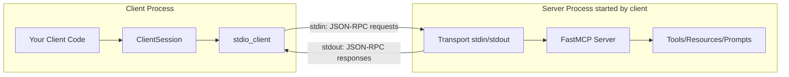
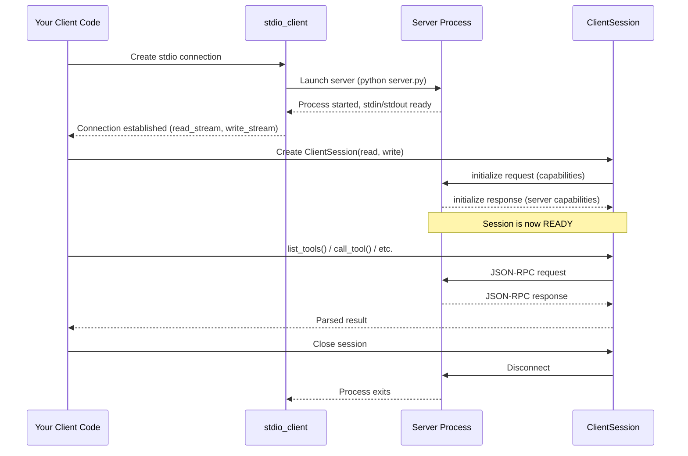
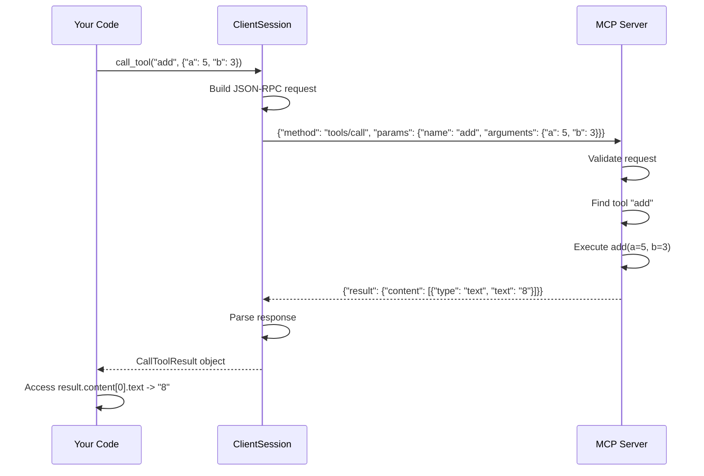
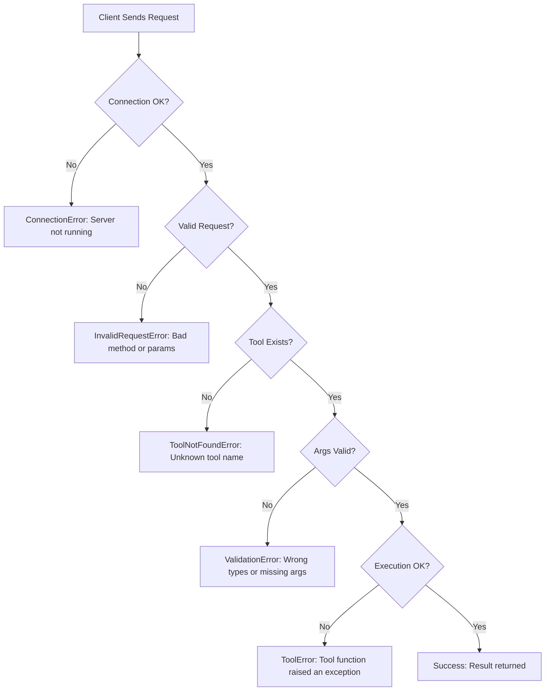
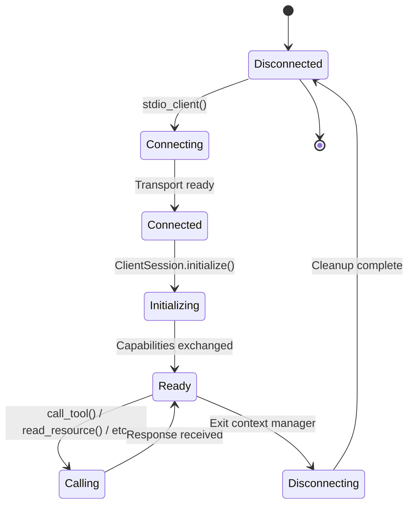

# Chapter 5: Build an MCP Client

## Learning Objectives

By the end of this chapter, you will be able to:

1. Understand what an MCP client is and its role in the MCP architecture
2. Create a client that connects to an MCP server via stdio transport
3. Discover server capabilities (list tools, resources, prompts)
4. Call tools on the server and process the results
5. Read resources from the server
6. Get and use prompts from the server
7. Handle errors properly on the client side
8. Manage client sessions (connect, interact, disconnect)
9. Build an interactive CLI client for any MCP server
10. Build a universal client that can connect to any MCP server

---

## Prerequisites

Before starting this chapter, make sure you have:

- Completed Chapter 4 (Build First MCP Server)
- At least one working MCP server to connect to
- Python 3.10+ and Poetry installed

---

## Project Setup

```bash
# Navigate to the chapter directory
cd tutorials/05_Build_MCP_Client/code

# Initialize a new Poetry project
poetry init --name "mcp-client" --python "^3.10" --no-interaction

# Add the MCP SDK dependency
poetry add "mcp[cli]"

# Install everything
poetry install

# Activate the virtual environment
poetry shell
```

Your directory structure:

```
05_Build_MCP_Client/
    05_Build_MCP_Client.md           <-- This theory file
    code/
        pyproject.toml
        example1_simple_client.py
        example2_call_tool.py
        example3_read_resource.py
        example4_use_prompt.py
        example5_client_error_handling.py
        exercise1_multi_tool_client.py
        exercise1_solution.py
        exercise2_resource_reader.py
        exercise2_solution.py
        exercise3_interactive_client.py
        exercise3_solution.py
        mini_project_universal_client.py
```

---

## Real-World Analogy: The Restaurant Customer

In Chapter 4, we built the restaurant kitchen (server). Now we are the customer (client).

| Restaurant Concept | MCP Concept | What It Does |
|---|---|---|
| Customer | MCP Client | Wants something done |
| Walking into restaurant | Connecting to server | Establishing a connection |
| Reading the menu | Listing capabilities | Discovering what the server offers |
| Ordering food | Calling a tool | Requesting the server to do something |
| Checking the specials board | Reading a resource | Getting information from the server |
| Asking for combo meal | Using a prompt | Using a pre-defined template |
| The bill / receipt | Response | Getting the result back |
| Leaving the restaurant | Disconnecting | Closing the session |

Here is the key insight: **the customer (client) does not know how the kitchen (server) cooks the food. They just send orders and receive results.** This separation is exactly how MCP works. The client does not need to know how the server implements its tools -- it just needs to know the tool name, arguments, and what to expect back.

---

## Theory: What Is an MCP Client?

An MCP client is a program that:

1. **Connects** to an MCP server (via stdio, HTTP, or other transport)
2. **Discovers** what the server can do (tools, resources, prompts)
3. **Sends requests** (call tool, read resource, get prompt)
4. **Receives responses** (results, errors)
5. **Manages the session** (connect, interact, disconnect)

### Client vs Host

This is a common confusion point. Let us clarify:

- **Host**: The top-level application (Claude Desktop, VS Code, Cursor). The host contains the LLM and makes decisions about what to do.
- **Client**: The component inside the host that handles the MCP protocol. It manages connections to servers.

Think of it this way:
- The **host** is the person sitting at the restaurant table
- The **client** is their voice and hands -- the mechanism that communicates with the kitchen

In our examples, we are building standalone clients (without a host application). This is great for learning and testing, but in production, the client is usually embedded inside a larger application.

### The MCP Python SDK Client Classes

The `mcp` SDK provides these key classes for building clients:

| Class | Import Path | Purpose |
|---|---|---|
| `ClientSession` | `mcp.client.session` | Manages the session with a server |
| `stdio_client` | `mcp.client.stdio` | Connects via stdio transport |
| `StdioServerParameters` | `mcp.client.stdio` | Configuration for stdio connection |

### How stdio Client Works

When you use `stdio_client`, here is what happens:

1. Your client **launches the server** as a child process (using `python server.py`)
2. Your client communicates with the server via **stdin/stdout** of that child process
3. The client sends JSON-RPC messages to the server's stdin
4. The server sends JSON-RPC responses to its stdout, which the client reads

This is why stdio is called "standard input/output" transport -- it uses the standard I/O streams of the child process.



---

## Theory: Client Connection Flow

Here is the complete flow when a client connects to a server:



### Understanding the Async Pattern

MCP clients in Python use `async/await` because:

1. **Network I/O is inherently asynchronous** -- you send a request and wait for a response
2. **The MCP SDK uses asyncio** -- this is a design decision by the SDK authors
3. **It prevents blocking** -- your client can do other things while waiting

If you are not familiar with async Python, here is the simple version:

- `async def` means "this function can pause and resume"
- `await` means "pause here until this operation completes"
- `asyncio.run()` means "start the async event loop and run this function"

You do not need to understand all the details of asyncio. Just follow the pattern in the examples.

---

## Theory: Tool Calling Sequence

When your client calls a tool, here is what happens at each step:



---

## Theory: Error Handling Flow

Things can go wrong at many points. Here is what errors look like:



### Types of Errors

| Error Type | When It Happens | How to Handle |
|---|---|---|
| Connection Error | Server not running, wrong path | Check server path, ensure server is installed |
| Timeout | Server takes too long to respond | Set reasonable timeouts, check server performance |
| Tool Not Found | Wrong tool name | List tools first, check spelling |
| Validation Error | Wrong argument types or missing args | Check tool schema, validate before calling |
| Tool Execution Error | Tool function crashed | Check server logs, report to server developer |
| Transport Error | Communication broken mid-request | Reconnect and retry |

---

## Hands-On Coding

Each example builds on the previous one. Make sure you have a server to connect to -- we will use the servers from Chapter 4.

### Important: Server File Path

All client examples need to know WHERE the server file is. In the examples, we use a path to the Chapter 4 server files. You may need to adjust this path based on your setup.

### Example 1: Simple Client (example1_simple_client.py)

Connects to a server and lists all available tools.

**What you will learn:**
- How to set up a stdio client connection
- How to create a ClientSession
- How to initialize the session
- How to list tools

**How to run:**
```bash
# Make sure you are in the code directory
poetry run python example1_simple_client.py
```

### Example 2: Call a Tool (example2_call_tool.py)

Connects to a server and calls a specific tool.

**What you will learn:**
- How to call a tool with arguments
- How to read the result from the response
- The structure of a CallToolResult

### Example 3: Read a Resource (example3_read_resource.py)

Connects to a server and reads a resource.

**What you will learn:**
- How to list resources
- How to read a resource by URI
- The structure of a ReadResourceResult

### Example 4: Use a Prompt (example4_use_prompt.py)

Connects to a server and gets a prompt template.

**What you will learn:**
- How to list prompts
- How to get a prompt with arguments
- The structure of a GetPromptResult

### Example 5: Error Handling (example5_client_error_handling.py)

A client with proper error handling for all operations.

**What you will learn:**
- How to catch and handle connection errors
- How to handle tool call failures
- How to handle resource read failures
- Best practices for robust clients

---

## Client Session Management

### The Session Lifecycle

A client session has three phases:

1. **Connect**: Establish the transport connection and create a session
2. **Interact**: Send requests and receive responses
3. **Disconnect**: Close the session and clean up



### Context Managers

The MCP SDK uses Python context managers (`async with`) to manage connections:

```python
# The connection is automatically opened and closed
async with stdio_client(params) as (read, write):
    # Connection is open here
    async with ClientSession(read, write) as session:
        # Session is active here
        await session.initialize()
        # Now you can use the session
    # Session is closed here
# Connection is closed here
```

This pattern ensures that connections are always properly closed, even if an error occurs. You do not need to manually close anything.

---

## Exercises

### Exercise 1: Multi-Tool Client (exercise1_multi_tool_client.py)

Build a client that calls multiple tools on the calculator server from Chapter 4.

**Requirements:**
- Connect to the calculator server
- Call add, subtract, multiply, and divide
- Print each result with a descriptive message
- Handle the division by zero case

### Exercise 2: Resource Reader (exercise2_resource_reader.py)

Build a client that reads and displays all resources from a server.

**Requirements:**
- Connect to the info server from Chapter 4
- List all available resources
- Read each resource and print its content
- Format the output nicely

### Exercise 3: Interactive Client (exercise3_interactive_client.py)

Build an interactive CLI client that lets the user choose what to do.

**Requirements:**
- Connect to a server
- Show a menu (list tools, call tool, list resources, read resource, quit)
- Let the user interact with the server through the menu
- Handle invalid input gracefully

---

## Mini Project: Universal MCP Client

Build a universal client that can connect to ANY MCP server and:

1. Discover all capabilities (tools, resources, prompts)
2. Let the user explore and interact with everything
3. Handle errors gracefully
4. Display results in a readable format

This is a practical tool you can use to test any MCP server you build in the future.

---

## Summary

In this chapter, we learned:

1. **MCP clients** connect to servers and send requests
2. **stdio_client** launches the server as a child process and communicates via stdin/stdout
3. **ClientSession** manages the protocol-level communication
4. The client must **initialize** the session before making requests
5. **list_tools()** discovers available tools; **call_tool()** executes them
6. **list_resources()** discovers resources; **read_resource()** reads them
7. **list_prompts()** discovers prompts; **get_prompt()** retrieves them
8. **Error handling** is critical -- wrap all operations in try/except
9. **Context managers** ensure connections are always properly closed
10. The client uses **async/await** because I/O operations are asynchronous

---

## Interview Questions

### 1. What is the difference between an MCP client and an MCP host?

**Answer:** A host is the top-level application that contains the LLM and makes decisions (e.g., Claude Desktop, VS Code, Cursor). A client is the component inside the host that handles the MCP protocol -- it manages connections to servers, sends requests, and receives responses. In our examples, we build standalone clients without a host, which is useful for testing. In production, the client is embedded inside a host application.

### 2. How does stdio transport work for MCP clients?

**Answer:** With stdio transport, the client launches the server as a child process (e.g., `python server.py`). The client sends JSON-RPC messages to the server's stdin (standard input) and reads responses from the server's stdout (standard output). This means the server and client are separate processes on the same machine, communicating through their I/O streams. The `stdio_client` helper handles all the process management automatically.

### 3. Why do MCP clients in Python use async/await?

**Answer:** MCP clients use async/await because: (1) Network I/O is inherently asynchronous -- you send a request and wait for a response. (2) The MCP SDK is built on asyncio by design. (3) Async prevents blocking -- your client can potentially do other things while waiting for a server response. (4) Context managers for connections (`async with`) integrate cleanly with asyncio. Even though our simple examples could work synchronously, the SDK requires async patterns.

### 4. What happens during session initialization?

**Answer:** During initialization, the client sends an `initialize` request to the server containing the client's capabilities (what features it supports). The server responds with its own capabilities (what tools, resources, and prompts it offers). This is called "capability negotiation." Both sides learn what the other can do. The client must call `session.initialize()` before making any other requests, or those requests will fail.

### 5. How do you discover what tools a server offers?

**Answer:** You call `session.list_tools()`, which returns a `ListToolsResult` containing a list of tool objects. Each tool object has a `name` (the identifier to use when calling), a `description` (human-readable explanation of what it does), and an `inputSchema` (a JSON Schema describing the expected arguments). This information is enough to understand how to call each tool.

### 6. What is the structure of a tool call result?

**Answer:** When you call `session.call_tool(name, arguments)`, it returns a `CallToolResult` object. This object has a `content` list, where each item has a `type` (usually "text") and the actual data (in the `text` field). For a simple tool, the result typically has one content item of type "text". The result may also have an `isError` flag indicating whether the tool execution failed.

### 7. How should a client handle a server that is not running?

**Answer:** The client should wrap the connection attempt in a try/except block to catch connection errors. Common errors include: FileNotFoundError (server script not found), ConnectionRefusedError (server not accepting connections), and TimeoutError (server not responding). The client should provide a clear error message to the user and suggest corrective actions (check the server path, ensure the server is installed, verify dependencies).

### 8. What is the difference between reading a resource and calling a tool?

**Answer:** Reading a resource is a read-only operation -- you request data identified by a URI, and the server returns it. Resources do not modify state and have no side effects. Calling a tool is an action -- you provide arguments, the tool executes logic, and may modify state or produce side effects. Resources are like reading a file; tools are like running a function. The API calls are different: `read_resource(uri)` vs `call_tool(name, arguments)`.

### 9. How do MCP prompts work from the client side?

**Answer:** The client first calls `list_prompts()` to discover available prompts and their parameters. Then it calls `get_prompt(name, arguments)` with the required parameters. The server returns a `GetPromptResult` containing a list of messages (with role and content) that can be sent to an LLM. The client typically passes these messages to its LLM for processing. Prompts are templates -- the server fills in the parameters and returns ready-to-use LLM messages.

### 10. Why do MCP clients use context managers for connections?

**Answer:** Context managers (`async with`) ensure that connections are always properly closed, even if an error occurs during communication. Without context managers, if an exception happened mid-request, the connection would be left open (resource leak) and the server process would keep running (process leak). Context managers guarantee cleanup by calling the appropriate close/disconnect methods in their `__aexit__` handler. This is a Python best practice for any resource that needs cleanup.

---

## Common Mistakes

### Mistake 1: Forgetting to Initialize the Session

```python
# WRONG - Session is created but not initialized
async with ClientSession(read, write) as session:
    result = await session.list_tools()  # FAILS!

# RIGHT - Initialize before making requests
async with ClientSession(read, write) as session:
    await session.initialize()  # Must do this first!
    result = await session.list_tools()  # Works!
```

The session must be initialized to exchange capabilities with the server. Without initialization, all requests will fail.

### Mistake 2: Using Wrong Server Path

```python
# WRONG - Path does not exist or is wrong
params = StdioServerParameters(
    command="python",
    args=["wrong_path/server.py"]  # File not found!
)

# RIGHT - Use the correct absolute or relative path
params = StdioServerParameters(
    command="python",
    args=["../04_Build_First_MCP_Server/code/example1_minimal_server.py"]
)
```

Double-check your server file path. The client launches the server as a subprocess, so the path must be correct from the client's working directory.

### Mistake 3: Not Handling Async Properly

```python
# WRONG - Calling async function without await
result = session.list_tools()  # Returns a coroutine, not the result!

# RIGHT - Use await
result = await session.list_tools()  # Actually executes and returns result
```

Every `session.method()` call is async and must be awaited. Forgetting `await` returns a coroutine object instead of the actual result.

### Mistake 4: Not Reading Result Content Correctly

```python
# WRONG - Trying to use result directly as a string
result = await session.call_tool("add", {"a": 5, "b": 3})
print(result)  # Prints the object representation, not the value

# RIGHT - Access the content properly
result = await session.call_tool("add", {"a": 5, "b": 3})
print(result.content[0].text)  # Prints "8"
```

Tool results are wrapped in a structured object. You need to access `.content[0].text` to get the actual text value.

### Mistake 5: Not Closing Connections

```python
# WRONG - Connection and session never closed
read, write = await stdio_client(params).__aenter__()
session = ClientSession(read, write)
# If an error happens here, connection stays open forever!

# RIGHT - Use context managers for automatic cleanup
async with stdio_client(params) as (read, write):
    async with ClientSession(read, write) as session:
        await session.initialize()
        # Everything is cleaned up automatically
```

Always use `async with` to ensure connections are properly closed.

---

## Production Tips

### Tip 1: Add Connection Timeouts

In production, always set timeouts on connections. A server that never responds will hang your client forever.

### Tip 2: Implement Retry Logic

Network operations can fail temporarily. Implement retry logic with exponential backoff for transient errors (connection refused, timeout). Do not retry permanent errors (tool not found, validation error).

### Tip 3: Log All Interactions

Log every request and response for debugging. In production, you need to trace exactly what happened when something goes wrong.

### Tip 4: Validate Server Responses

Do not assume server responses are always correct. Validate that the response has the expected structure before accessing fields. A buggy server might return unexpected formats.

### Tip 5: Handle Server Crashes Gracefully

If the server process crashes mid-request, the client should detect this (via broken pipe or EOF) and provide a clear error message. Consider restarting the server automatically.

### Tip 6: Pool Connections

If your application needs to call tools frequently, keep the connection open and reuse the session instead of creating new connections for each request. Connection setup has overhead (process launch, initialization handshake).

### Tip 7: Use Environment Variables for Server Paths

Do not hardcode server paths. Use environment variables or configuration files so the same client code works in different environments (development, staging, production).

---

## Further Reading

- [MCP Client SDK Documentation](https://github.com/modelcontextprotocol/python-sdk)
- [asyncio Documentation](https://docs.python.org/3/library/asyncio.html)
- [MCP Transport Specification](https://spec.modelcontextprotocol.io/specification/2024-11-05/basic/transports/)
- [stdio Transport Details](https://spec.modelcontextprotocol.io/specification/2024-11-05/basic/transports/#stdio)

---

## What is Next?

In Chapter 6, we will take a deep dive into MCP Tools -- the most commonly used feature. You will learn about tool schemas, input validation, error handling, stateful tools, and best practices for building production-quality tools.
