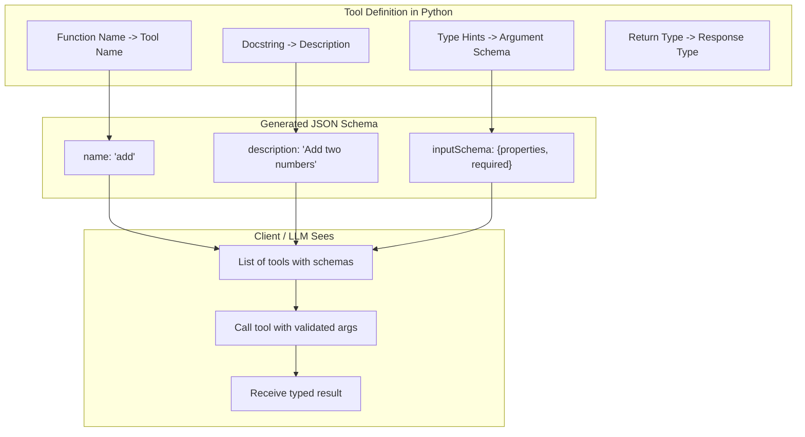
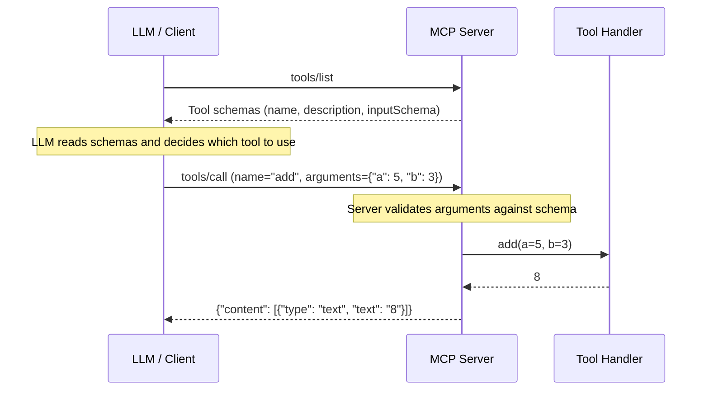
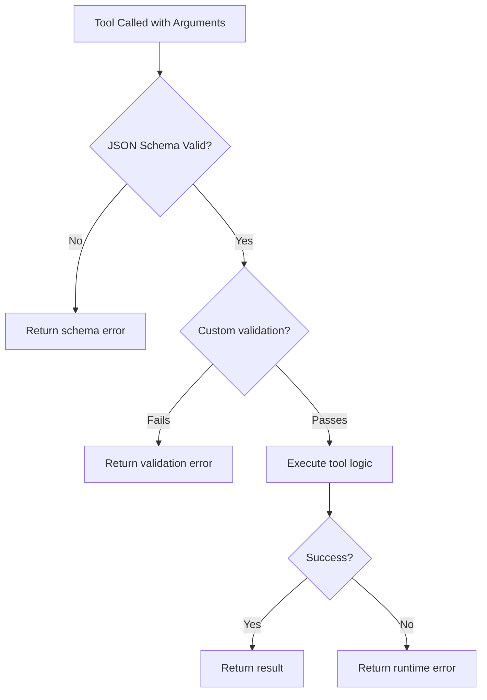
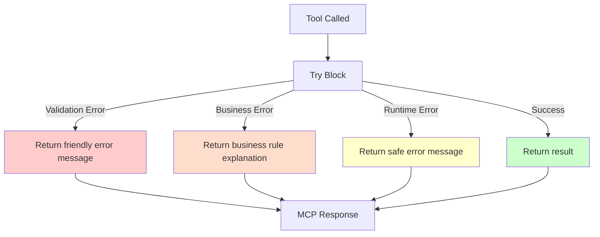
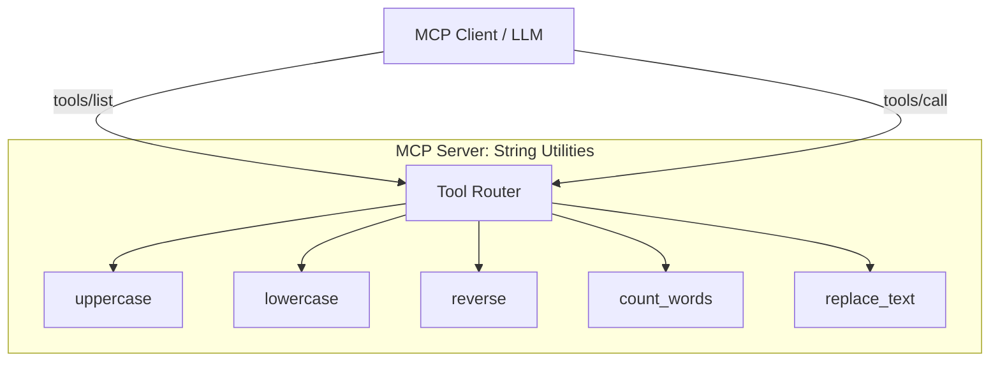
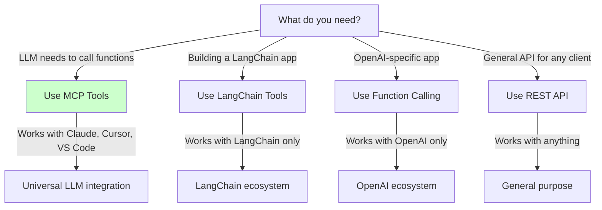
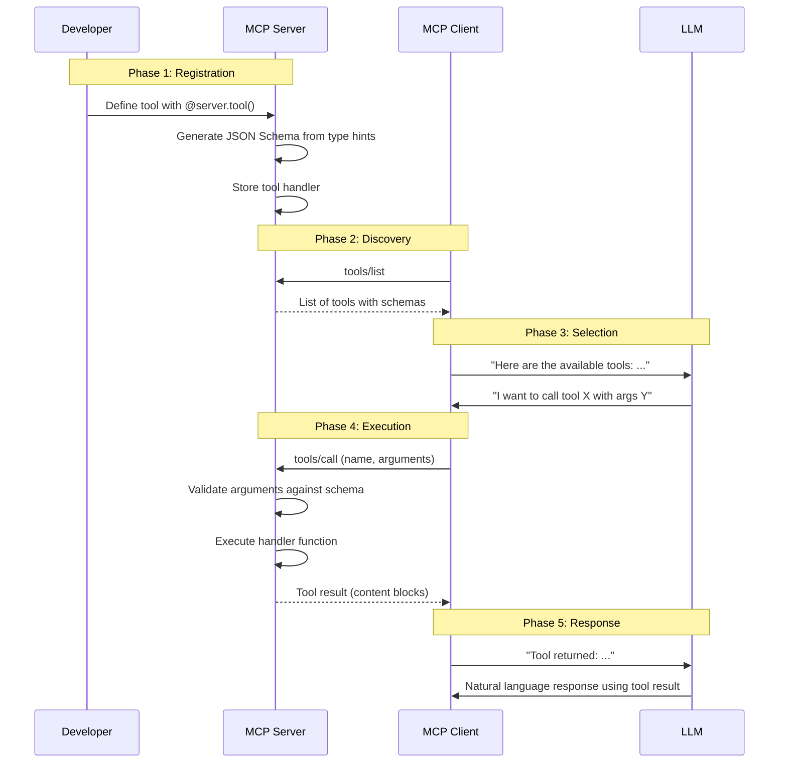

# Chapter 6: Understanding Tools

## Learning Objectives

By the end of this chapter, you will be able to:

1. Understand what MCP tools are and how they differ from resources and prompts
2. Define tool schemas using JSON Schema with proper argument types
3. Implement tools with different argument types (string, int, float, bool)
4. Validate tool inputs before processing
5. Handle errors gracefully in tool implementations
6. Build servers with multiple tools that work together
7. Manage state across tool calls (stateful tools)
8. Compare MCP tools with function calling, LangChain tools, and REST APIs
9. Build production-ready tool servers with robust error handling
10. Design complex tools for real-world applications

---

## 1. What Are MCP Tools?

### The Core Concept

Tools are **functions that an MCP server exposes for clients and LLMs to execute**. They are the "action" side of MCP -- they let the LLM do things. While resources let the LLM read data, tools let the LLM perform computations, modify state, call APIs, and interact with the world.

Every tool has three parts:

1. **A name** -- how the tool is identified (e.g., `calculate_sum`)
2. **A schema** -- what arguments the tool accepts and their types
3. **A handler** -- the Python function that runs when the tool is called

### Why Tools Matter

Before MCP tools, LLMs had limited ways to take action:

```
Before MCP Tools:
- Custom function calling (different for every provider)
- LangChain tool wrappers (framework-specific)
- REST API calls (no standardization)
- Plugin systems (platform-locked)

With MCP Tools:
- Standardized tool definition with JSON Schema
- Works with any MCP-compatible client
- Consistent error handling
- Automatic type validation
- Universal across Claude, Cursor, VS Code, etc.
```

### Tools vs Resources vs Prompts

| Feature | Tools | Resources | Prompts |
|---------|-------|-----------|---------|
| Purpose | Perform actions | Expose data | Provide templates |
| Direction | Client -> Server (execute) | Server -> Client (read) | Server -> Client (template) |
| Side effects | Can modify state | None (read-only) | None |
| Arguments | Yes, with JSON Schema | None or URI parameters | Template parameters |
| Analogy | Workshop tools | Library books | Recipe cards |
| Example | Calculate a sum | Read a config file | "Summarize this" template |

---

## 2. Real-World Analogy: The Workshop

Imagine a professional workshop:

- **The Workshop** = Your MCP Server
- **The Tools** = MCP Tools (hammers, drills, saws)
- **The Tool Manual** = JSON Schema (instructions for each tool)
- **The Worker** = The LLM (reads the manual, picks the right tool)
- **The Workbench** = The MCP Client (where the work happens)
- **Raw Materials** = Tool arguments (inputs to each tool)
- **Finished Product** = Tool result (output from the tool)

When a worker needs to build something:

1. They look at the **tool catalog** to see what is available (listing tools)
2. They read the **manual** for the right tool (reading the schema)
3. They check they have the right **materials** (validating arguments)
4. They use the tool **correctly** (executing the handler)
5. If something goes wrong, they get a **clear error message** (error handling)
6. Some tools need to **remember previous work** (stateful tools)

This is exactly how MCP tools work.

---

## 3. Tool Schema: The Blueprint

### What is a Tool Schema?

Every MCP tool has a schema that describes:
- What the tool is called
- What it does (description)
- What arguments it accepts
- What types those arguments are
- Which arguments are required vs optional

MCP uses **JSON Schema** for this. When you define a tool in FastMCP, the framework automatically generates the JSON Schema from your Python function's type hints and docstring.

### How FastMCP Generates Schemas

```
Python Function:
    def add(a: int, b: int) -> int:
        """Add two numbers together."""
        return a + b

Generated JSON Schema:
    {
        "name": "add",
        "description": "Add two numbers together.",
        "inputSchema": {
            "type": "object",
            "properties": {
                "a": {"type": "integer"},
                "b": {"type": "integer"}
            },
            "required": ["a", "b"]
        }
    }
```

### Schema Architecture



### JSON Schema Type Mapping

Python type hints map to JSON Schema types:

| Python Type | JSON Schema Type | Example Value |
|-------------|-----------------|---------------|
| `str` | `"string"` | `"hello"` |
| `int` | `"integer"` | `42` |
| `float` | `"number"` | `3.14` |
| `bool` | `"boolean"` | `true` |
| `list` | `"array"` | `[1, 2, 3]` |
| `dict` | `"object"` | `{"key": "value"}` |
| `Optional[str]` | `"string"` (not required) | `"hello"` or `null` |

### Why Schemas Matter

1. **LLMs read schemas** to understand what tools are available and how to use them
2. **Clients validate** arguments before sending them to the server
3. **Servers validate** arguments before processing them
4. **Documentation** is automatically generated from schemas
5. **Type safety** prevents common errors like passing a string where a number is expected

---

## 4. Tool Arguments and Types

### Supported Argument Types

MCP tools support all standard JSON types. Let us look at each one:

#### String Arguments

Strings are the most common argument type. Use them for text input, names, file paths, and identifiers.

```
def greet(name: str) -> str:
    """Greet a person by name."""
    return "Hello, " + name
```

#### Integer Arguments

Integers are for whole numbers. Use them for counts, IDs, indices, and quantities.

```
def repeat(text: str, count: int) -> str:
    """Repeat text a given number of times."""
    return text * count
```

#### Float Arguments

Floats are for decimal numbers. Use them for prices, measurements, percentages, and calculations.

```
def celsius_to_fahrenheit(celsius: float) -> float:
    """Convert Celsius to Fahrenheit."""
    return celsius * 9.0 / 5.0 + 32.0
```

#### Boolean Arguments

Booleans are for true/false flags. Use them for options, toggles, and conditional behavior.

```
def format_name(name: str, uppercase: bool) -> str:
    """Format a name, optionally in uppercase."""
    if uppercase:
        return name.upper()
    return name.lower()
```

#### Optional Arguments

Optional arguments have default values. The client does not need to provide them.

```
def search(query: str, max_results: int = 10) -> str:
    """Search with optional result limit."""
    # max_results defaults to 10 if not provided
    ...
```

### Argument Flow



---

## 5. Input Validation

### Why Validate?

Even though JSON Schema provides type checking, you often need additional validation:

- Is the number positive?
- Is the string non-empty?
- Is the value within an allowed range?
- Does the combination of arguments make sense?

### Validation Strategy



### Validation Patterns

**Pattern 1: Range Checking**
```
# Check that a number is within a valid range
if temperature < -273.15:
    return "Error: Temperature cannot be below absolute zero"
```

**Pattern 2: String Validation**
```
# Check that a string is not empty
if not name or name.strip() == "":
    return "Error: Name cannot be empty"
```

**Pattern 3: Business Rule Validation**
```
# Check that a discount is between 0 and 100
if discount < 0 or discount > 100:
    return "Error: Discount must be between 0 and 100 percent"
```

**Pattern 4: Cross-Argument Validation**
```
# Check that start date is before end date
if start_date > end_date:
    return "Error: Start date must be before end date"
```

---

## 6. Return Types and Tool Results

### How Tools Return Results

In MCP, tools return results as content blocks. FastMCP handles the conversion for you:

| Python Return | MCP Content Type | Notes |
|---------------|-----------------|-------|
| `str` | `TextContent` | Most common |
| `int`, `float` | `TextContent` | Converted to string |
| `dict` | `TextContent` (JSON) | Serialized to JSON string |
| `list` | `TextContent` (JSON) | Serialized to JSON string |
| `bool` | `TextContent` | Converted to "true"/"false" |

### Best Practices for Return Values

1. **Return strings** for simple results -- they are easiest for LLMs to understand
2. **Return JSON strings** for structured data -- use `json.dumps()` with `indent=2`
3. **Include context** in results -- not just the answer, but helpful context
4. **Return error messages** as strings -- do not raise exceptions for business errors

### Good vs Bad Return Values

```
# BAD: Just the raw number
return 42

# GOOD: Descriptive result
return "The sum of 20 and 22 is 42"

# BAD: Unformatted dictionary
return {"result": 42}

# GOOD: Formatted JSON with context
return json.dumps({
    "operation": "addition",
    "operands": [20, 22],
    "result": 42
}, indent=2)
```

---

## 7. Error Handling in Tools

### Types of Errors

Tools can encounter several types of errors:

1. **Validation errors** -- invalid arguments (e.g., negative count)
2. **Business logic errors** -- valid arguments but impossible operation (e.g., divide by zero)
3. **Runtime errors** -- unexpected failures (e.g., file not found, network error)
4. **Timeout errors** -- operation takes too long

### Error Handling Strategy



### Error Handling Best Practices

1. **Never expose internal details** -- do not show stack traces or file paths to clients
2. **Always return a message** -- even on error, return a helpful string
3. **Use try/except** -- wrap risky operations in try/except blocks
4. **Log errors server-side** -- use Python logging to record full error details
5. **Suggest fixes** -- when possible, tell the user what they should do differently

### Error vs Exception

In MCP tools, there are two ways to signal errors:

**Returning an error message** (preferred for expected errors):
```
if divisor == 0:
    return "Error: Cannot divide by zero. Please provide a non-zero divisor."
```

**Raising an exception** (for unexpected errors):
```
try:
    result = complex_operation()
except Exception as e:
    return "Error: An unexpected error occurred. Please try again."
```

The key principle: **expected errors should return messages, unexpected errors should be caught and wrapped**.

---

## 8. Multiple Tools: Building a Tool Collection

### Organizing Multiple Tools

A real MCP server typically has many tools. Good organization is important:

1. **Group related tools** -- string tools together, math tools together
2. **Consistent naming** -- use verb_noun format (e.g., `convert_temperature`, `calculate_area`)
3. **Consistent return format** -- all tools should return results in a similar format
4. **Clear descriptions** -- each tool's docstring should be specific and helpful

### Example: A String Utility Server

A good example of multiple tools is a string utility server. It provides tools like:

- `uppercase` -- convert text to uppercase
- `lowercase` -- convert text to lowercase
- `reverse` -- reverse the characters
- `count_words` -- count the number of words
- `replace_text` -- replace occurrences of a substring

These tools are related, consistently named, and each does one thing well.

### Tool Collection Architecture



---

## 9. Stateful Tools

### What is State?

Most tools are **stateless** -- they take inputs, produce outputs, and forget everything. But some tools need to **remember things between calls**. This is called state.

Examples of stateful tools:

- A **counter** that increments each time it is called
- A **shopping cart** that remembers added items
- A **conversation tracker** that counts messages
- A **task list** that persists between calls

### How State Works in MCP

State is stored in Python variables that persist for the lifetime of the server process. When the server restarts, state is lost (unless you save it to a file or database).

```
# This variable lives as long as the server runs
counter = 0

def increment():
    global counter
    counter = counter + 1
    return counter
```

### State Management Strategies

| Strategy | How It Works | Persistence | Use Case |
|----------|-------------|-------------|----------|
| Global variables | Variables in module scope | Until server restart | Simple counters, caches |
| Dictionaries | Store key-value pairs | Until server restart | User sessions, collections |
| Files | Write to disk | Survives restart | Important data, logs |
| Database | Use SQLite or similar | Survives restart | Production applications |

### Important Warning About State

State in MCP servers is **per-server-process**. If you run multiple server instances, they do not share state. For production applications, use a database or file-based storage.

---

## 10. Comparing MCP Tools with Other Approaches

### MCP Tools vs OpenAI Function Calling

| Aspect | MCP Tools | OpenAI Function Calling |
|--------|-----------|------------------------|
| Standard | Open protocol | Proprietary to OpenAI |
| Discovery | Client queries server | Defined in API request |
| Schema | JSON Schema via protocol | JSON Schema in request body |
| Execution | Server-side | Client-side (you implement) |
| Transport | STDIO, SSE, HTTP | HTTPS only |
| State | Server manages state | You manage state |
| Multi-client | Any MCP client | OpenAI API only |

### MCP Tools vs LangChain Tools

| Aspect | MCP Tools | LangChain Tools |
|--------|-----------|-----------------|
| Framework | Protocol (framework-agnostic) | Python framework |
| Definition | Type hints + decorator | Tool class or decorator |
| Schema | Auto-generated JSON Schema | Pydantic models |
| Transport | Network protocol | In-process |
| Reusability | Any MCP client | LangChain only |
| State | Server-side | In-process variables |
| Integration | Universal | LangChain ecosystem |

### MCP Tools vs REST APIs

| Aspect | MCP Tools | REST APIs |
|--------|-----------|-----------|
| Purpose | LLM interaction | General purpose |
| Discovery | Built-in tool listing | Swagger/OpenAPI docs |
| Schema | JSON Schema (automatic) | OpenAPI (manual) |
| Protocol | JSON-RPC over various transports | HTTP |
| Authentication | MCP capability negotiation | Various (OAuth, API keys) |
| LLM optimized | Yes | No (needs wrapping) |

### When to Use What



### What Happens in Real Companies?

- **Anthropic** uses MCP tools in Claude Desktop to let Claude interact with local files, databases, and services
- **Cursor** uses MCP tools to give its AI assistant access to project tools, linters, and build systems
- **GitHub** exposes repository operations (create issue, search code) as MCP tools
- **Sourcegraph** uses MCP tools for code search and navigation
- **Companies with internal tools** wrap their existing APIs as MCP tools for LLM access

---

## 11. Tool Lifecycle: From Registration to Execution

### Complete Tool Lifecycle



---

## 12. Hands-On Coding

Now let us build tools step by step. All code files are in the `code/` directory.

### Project Setup

```bash
# Create project directory
mkdir chapter-06-tools
cd chapter-06-tools

# Initialize Poetry project
poetry init --name chapter-06-tools \
            --description "MCP Tools Examples" \
            --author "Your Name" \
            --python "^3.11" \
            --no-interaction

# Add dependencies
poetry add mcp
poetry add fastmcp

# Install everything
poetry install
```

### Directory Structure

```
chapter-06-tools/
    pyproject.toml
    code/
        example1_tool_with_types.py
        example2_tool_validation.py
        example3_multiple_tools.py
        example4_tool_error_handling.py
        example5_stateful_tools.py
        exercise1_math_tools.py
        exercise1_solution.py
        exercise2_text_tools.py
        exercise2_solution.py
        exercise3_data_tools.py
        exercise3_solution.py
        mini_project_swiss_army_server.py
```

### Example 1: Tools with Different Argument Types

See `code/example1_tool_with_types.py`

This example shows how to define tools with different argument types: string, integer, float, and boolean. FastMCP uses your Python type hints to automatically generate the JSON Schema for each tool.

### Example 2: Tool Input Validation

See `code/example2_tool_validation.py`

This example shows how to validate tool inputs before processing them. It demonstrates range checking, string validation, and cross-argument validation.

### Example 3: Multiple Tools Server

See `code/example3_multiple_tools.py`

This example builds a server with 5+ string utility tools. It shows how to organize multiple related tools in a single server.

### Example 4: Error Handling

See `code/example4_tool_error_handling.py`

This example demonstrates proper error handling patterns in MCP tools, including validation errors, business logic errors, and runtime errors.

### Example 5: Stateful Tools

See `code/example5_stateful_tools.py`

This example shows tools that maintain state between calls, including a counter, a list, and a key-value store.

---

## 13. Exercises

### Exercise 1: Math Tools Server

**Task**: Build an MCP server with comprehensive math tools.

Requirements:
- Addition, subtraction, multiplication, division
- Power (exponentiation) and square root
- Percentage calculation
- Proper error handling (division by zero, negative square root)
- All tools should return descriptive string results

See `code/exercise1_math_tools.py` for the exercise and `code/exercise1_solution.py` for the solution.

### Exercise 2: Text Processing Tools Server

**Task**: Build an MCP server with text processing tools.

Requirements:
- Count characters, words, and sentences in text
- Extract all emails from text (simple pattern matching)
- Truncate text to a given length with ellipsis
- Wrap text to a given line width
- Remove extra whitespace from text

See `code/exercise2_text_tools.py` for the exercise and `code/exercise2_solution.py` for the solution.

### Exercise 3: Data Manipulation Tools Server

**Task**: Build an MCP server with data manipulation tools.

Requirements:
- Sort a comma-separated list of values
- Filter numbers from a comma-separated list (above/below a threshold)
- Calculate aggregate statistics (sum, average, min, max, count)
- Remove duplicate values from a list
- Merge two comma-separated lists

See `code/exercise3_data_tools.py` for the exercise and `code/exercise3_solution.py` for the solution.

---

## 14. Mini Project: Swiss Army Knife Server

See `code/mini_project_swiss_army_server.py`

Build a comprehensive utility server with 10+ tools covering:
1. String operations (uppercase, lowercase, reverse, title case)
2. Math operations (add, multiply, percentage, average)
3. Conversion tools (temperature, length, weight)
4. Utility tools (random number, current time, UUID generator)

This mini project demonstrates how to build a real-world utility server that a development team might actually use.

---

## 15. Running the Examples

### How to Run Each Example

```bash
# Activate Poetry environment
poetry shell

# Run any example (it will start the MCP server)
python code/example1_tool_with_types.py

# In another terminal, test with the MCP Inspector
npx @modelcontextprotocol/inspector python code/example1_tool_with_types.py
```

### Testing with MCP Inspector

The MCP Inspector is a development tool for testing MCP servers:

```bash
# Start the inspector with any example
npx @modelcontextprotocol/inspector python code/example3_multiple_tools.py
```

This opens a web interface where you can:
1. See all registered tools and their schemas
2. Call tools with custom arguments
3. See tool results
4. Test error handling

### Expected Output

When you list tools for Example 3 (multiple tools), you should see:

```
Available Tools:
1. uppercase
   Description: Convert text to uppercase
   Arguments: text (string, required)

2. lowercase
   Description: Convert text to lowercase
   Arguments: text (string, required)

3. reverse_text
   Description: Reverse the characters in a text string
   Arguments: text (string, required)

4. count_words
   Description: Count the number of words in a text string
   Arguments: text (string, required)

5. replace_text
   Description: Replace all occurrences of a search term
   Arguments: text (string), search (string), replacement (string)
```

When you call a tool:

```
Tool: uppercase
Arguments: {"text": "hello world"}
Result: "The uppercase version is: HELLO WORLD"

Tool: count_words
Arguments: {"text": "MCP tools are powerful and flexible"}
Result: "The text contains 6 words"
```

---

## 16. Summary

### Key Concepts

1. **Tools** are actions that MCP servers expose for clients and LLMs to execute
2. **JSON Schema** defines what arguments each tool accepts and their types
3. **Type hints** in Python are automatically converted to JSON Schema by FastMCP
4. **Input validation** ensures arguments are valid before processing
5. **Error handling** provides clear messages for expected and unexpected errors
6. **Multiple tools** should be organized by domain with consistent naming
7. **Stateful tools** maintain data between calls using server-side variables
8. **MCP tools** are protocol-level, making them universal across LLM clients

### What We Built

| Example | What It Does |
|---------|-------------|
| Example 1 | Tools with string, int, float, bool arguments |
| Example 2 | Input validation (range, format, cross-argument) |
| Example 3 | Multiple string utility tools in one server |
| Example 4 | Error handling for all error types |
| Example 5 | Stateful tools (counter, list, key-value store) |
| Exercise 1 | Comprehensive math tools server |
| Exercise 2 | Text processing tools server |
| Exercise 3 | Data manipulation tools server |
| Mini Project | Swiss army knife server with 10+ tools |

---

## 17. Interview Questions

### Q1: What is an MCP tool and how does it differ from a resource?

**Answer**: An MCP tool is a function that a server exposes for clients and LLMs to execute. Tools perform actions and can have side effects -- they can modify data, call external services, or perform calculations. Resources, on the other hand, are read-only data that clients can retrieve. The key distinction is that tools are like verbs (do something) while resources are like nouns (read something). For example, "calculate_sum" is a tool, while "config://database" is a resource.

### Q2: How does FastMCP generate tool schemas from Python functions?

**Answer**: FastMCP inspects the Python function's type hints to determine argument types and maps them to JSON Schema types (str -> string, int -> integer, float -> number, bool -> boolean). The function name becomes the tool name. The docstring becomes the tool description. Required arguments (those without default values) are listed in the schema's "required" array. Optional arguments (those with defaults) are included in "properties" but not in "required".

### Q3: What are the best practices for tool input validation?

**Answer**: Best practices include: (1) Validate types using JSON Schema (handled automatically by FastMCP). (2) Validate ranges -- check that numbers are within acceptable bounds. (3) Validate string content -- check for empty strings, length limits, and format requirements. (4) Validate cross-argument consistency -- ensure combinations of arguments make sense. (5) Return clear error messages that tell the user exactly what was wrong and how to fix it. (6) Validate early -- check inputs before doing any processing.

### Q4: How should errors be handled in MCP tools?

**Answer**: There are two categories: (1) Expected errors (validation failures, business rule violations) should return a helpful error message as the tool's result string. The LLM can read this and respond appropriately. (2) Unexpected errors (network failures, file system errors) should be caught with try/except blocks and return a safe error message without exposing internal details. Always log the full error details server-side for debugging. Never let an unhandled exception crash the server.

### Q5: What is the difference between stateless and stateful tools?

**Answer**: Stateless tools produce output based solely on their inputs -- calling them with the same arguments always gives the same result. Stateful tools maintain data between calls -- they remember previous interactions. State is stored in server-side variables (global variables, dictionaries, files, or databases). Stateful tools are useful for counters, shopping carts, session management, and task lists. The trade-off is complexity: stateful tools are harder to test and do not scale across multiple server instances without shared storage.

### Q6: How do MCP tools compare to OpenAI function calling?

**Answer**: MCP tools are part of an open protocol that works with any MCP-compatible client (Claude, Cursor, VS Code). The server defines and executes tools. OpenAI function calling is proprietary to OpenAI's API -- you define the schema in the API request and implement execution on the client side. MCP tools are discovered dynamically (the client queries the server), while OpenAI functions are defined statically in each request. MCP tools support multiple transport mechanisms, while OpenAI only supports HTTPS.

### Q7: How do MCP tools compare to LangChain tools?

**Answer**: MCP tools operate at the protocol level -- they run on a server and any MCP client can use them. LangChain tools operate at the framework level -- they run in-process within a LangChain application. MCP tools are defined with type hints and FastMCP decorators, while LangChain tools use Pydantic models or the @tool decorator. MCP tools are reusable across any client; LangChain tools are tied to the LangChain ecosystem. However, LangChain can use MCP tools via adapters, making them complementary.

### Q8: What are the best practices for naming and organizing multiple tools?

**Answer**: Best practices: (1) Use verb_noun naming (calculate_area, convert_temperature). (2) Group related tools on the same server (all math tools together). (3) Keep each tool focused on one task -- do not create "god tools" that do everything. (4) Use consistent return formats across all tools. (5) Write clear, specific docstrings that help the LLM choose the right tool. (6) Limit the number of tools per server to avoid overwhelming the LLM -- research shows LLMs perform best with fewer than 20 tools.

### Q9: How does state persistence work in MCP tool servers?

**Answer**: State in MCP servers exists at four levels: (1) In-memory (global variables, dictionaries) -- lost when the server restarts. (2) File-based (JSON files, text files) -- survives restarts but limited to single-server deployments. (3) Database (SQLite, PostgreSQL) -- survives restarts and can be shared across instances. (4) External services (Redis, message queues) -- for distributed, production-scale state management. Choose the level based on durability requirements and deployment architecture.

### Q10: When should you use MCP tools vs a REST API?

**Answer**: Use MCP tools when: the primary consumers are LLMs and AI applications, you want automatic schema generation and validation, you need the tool to work across multiple AI platforms (Claude, Cursor, VS Code), or you are building an AI-first application. Use REST APIs when: you need to serve non-AI clients (browsers, mobile apps), you need fine-grained HTTP controls (caching headers, status codes), you have an existing API infrastructure, or you need standard HTTP authentication. Many organizations expose the same functionality through both MCP tools and REST APIs.

---

## 18. Common Mistakes

### Mistake 1: Missing Type Hints

**Wrong**: Defining tools without type hints. FastMCP cannot generate the schema.

```python
# BAD - no type hints
@server.tool()
def add(a, b):
    return a + b
```

**Right**: Always include type hints for all arguments.

```python
# GOOD - clear type hints
@server.tool()
def add(a: int, b: int) -> int:
    return a + b
```

### Mistake 2: No Error Handling

**Wrong**: Letting tools crash on invalid input.

```python
# BAD - crashes on division by zero
@server.tool()
def divide(a: float, b: float) -> float:
    return a / b
```

**Right**: Handle expected errors gracefully.

```python
# GOOD - handles division by zero
@server.tool()
def divide(a: float, b: float) -> str:
    if b == 0:
        return "Error: Cannot divide by zero"
    result = a / b
    return "Result: " + str(result)
```

### Mistake 3: Vague Docstrings

**Wrong**: Docstrings that do not help the LLM understand the tool.

```python
# BAD - vague description
@server.tool()
def process(data: str) -> str:
    """Process the data."""
    ...
```

**Right**: Specific docstrings that explain what the tool does, its inputs, and its outputs.

```python
# GOOD - clear description
@server.tool()
def count_words(text: str) -> str:
    """Count the number of words in the given text. Returns the word count as a descriptive string."""
    ...
```

### Mistake 4: Returning Raw Data Without Context

**Wrong**: Returning just a number without explanation.

```python
# BAD - no context
return 42
```

**Right**: Return a descriptive result.

```python
# GOOD - includes context
return "The word count is 42"
```

### Mistake 5: Too Many Arguments

**Wrong**: Tools with 10+ arguments that confuse the LLM.

**Right**: Keep tools focused. If a tool needs many arguments, consider splitting it into multiple tools or using optional arguments with sensible defaults.

---

## 19. Production Tips

### Tip 1: Limit Tool Count

Research shows that LLMs perform best when they have fewer than 15-20 tools to choose from. If you have more, consider splitting them across multiple servers or grouping them into categories.

### Tip 2: Use Descriptive Tool Names

Tool names should clearly indicate what they do. An LLM choosing between `process_data` and `calculate_monthly_revenue` will always pick the right one for a revenue question.

### Tip 3: Version Your Tools

When changing a tool's schema (adding or removing arguments), consider backward compatibility. In production, maintain versioned tools (e.g., `search_v1`, `search_v2`) during transition periods.

### Tip 4: Log All Tool Calls

In production, log every tool call with its arguments and results. This is essential for:
- Debugging issues
- Auditing LLM behavior
- Measuring tool usage and performance
- Detecting misuse or unexpected patterns

### Tip 5: Set Timeouts

Tools that call external services should have timeouts. A hanging tool can block the entire LLM conversation. Set reasonable timeouts (e.g., 30 seconds for API calls) and return error messages when timeouts occur.

### Tip 6: Test Tools in Isolation

Each tool should be testable as a standalone Python function. This makes unit testing straightforward:

```python
# Test the tool function directly
result = add(5, 3)
assert result == 8
```

### Tip 7: Document Side Effects

If a tool modifies state (writes to a file, updates a database), clearly document this in the docstring. LLMs need to understand the consequences of calling a tool.

---

## 20. Further Reading

- [MCP Specification: Tools](https://spec.modelcontextprotocol.io/specification/server/tools/)
- [FastMCP Documentation](https://github.com/modelcontextprotocol/python-sdk)
- [JSON Schema Reference](https://json-schema.org/understanding-json-schema/)
- [MCP Tool Examples Repository](https://github.com/modelcontextprotocol/servers)

---

**Next Chapter**: Chapter 7 covers Resources -- the read-only data side of MCP that complements tools.
