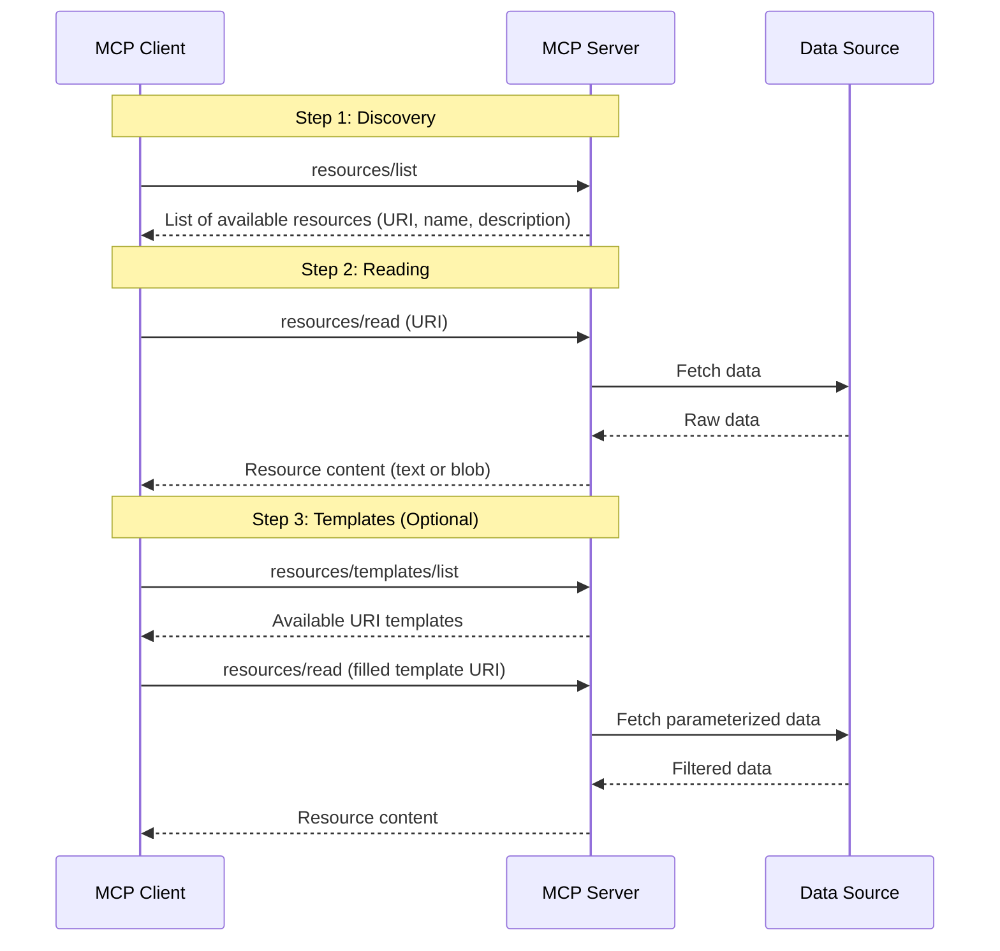
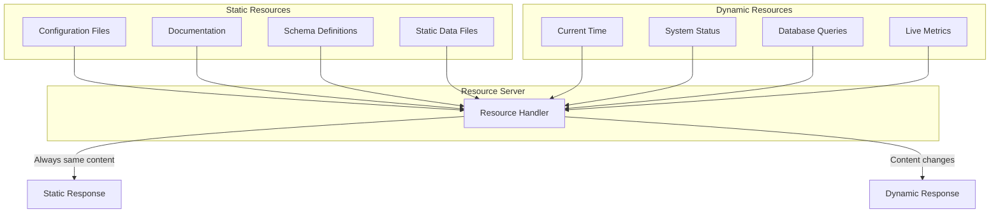
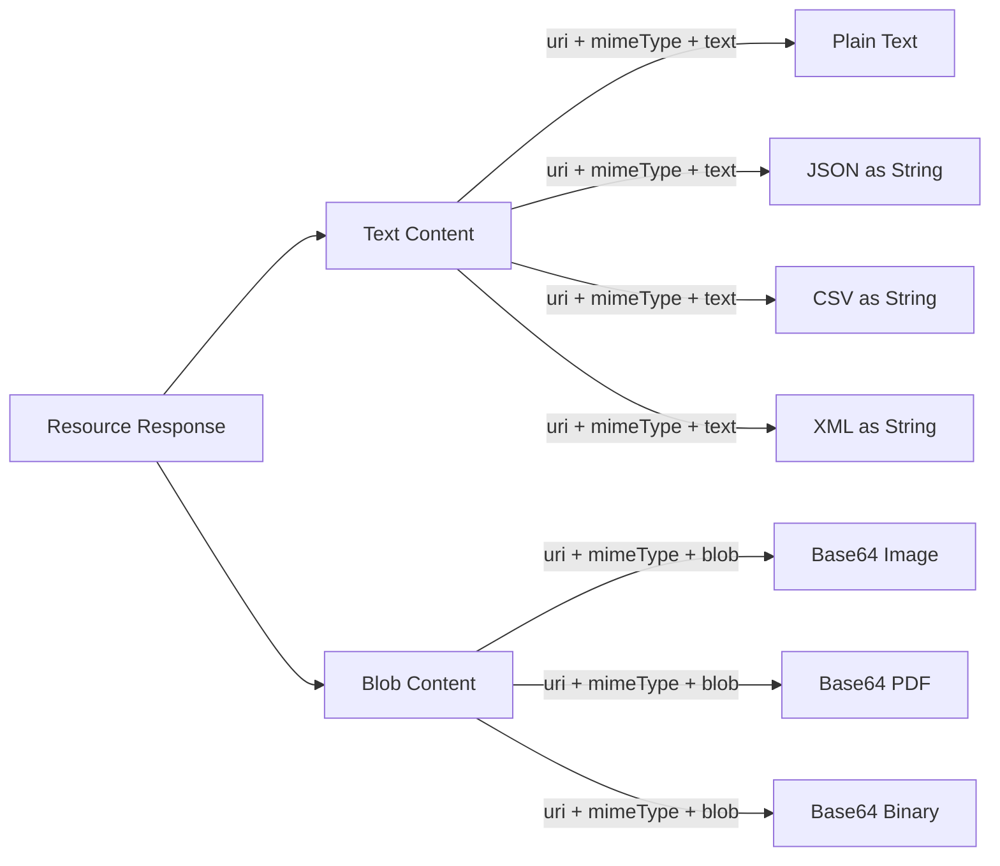
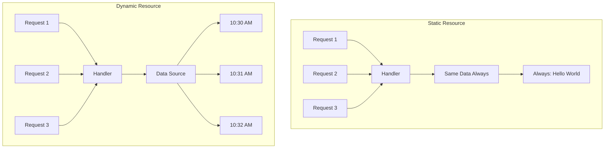
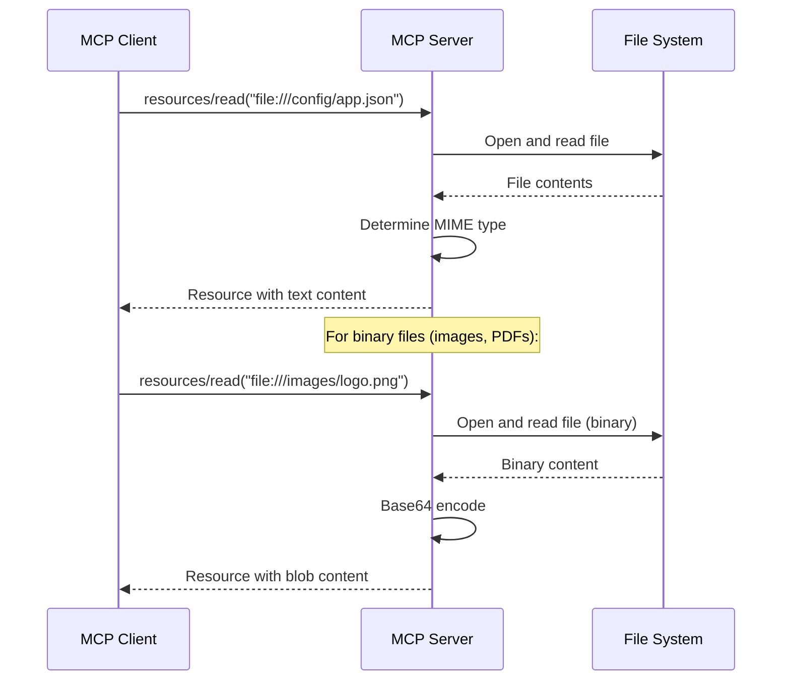
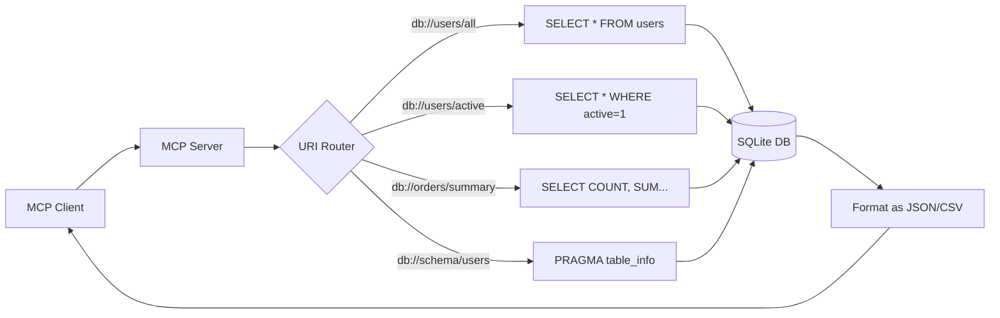
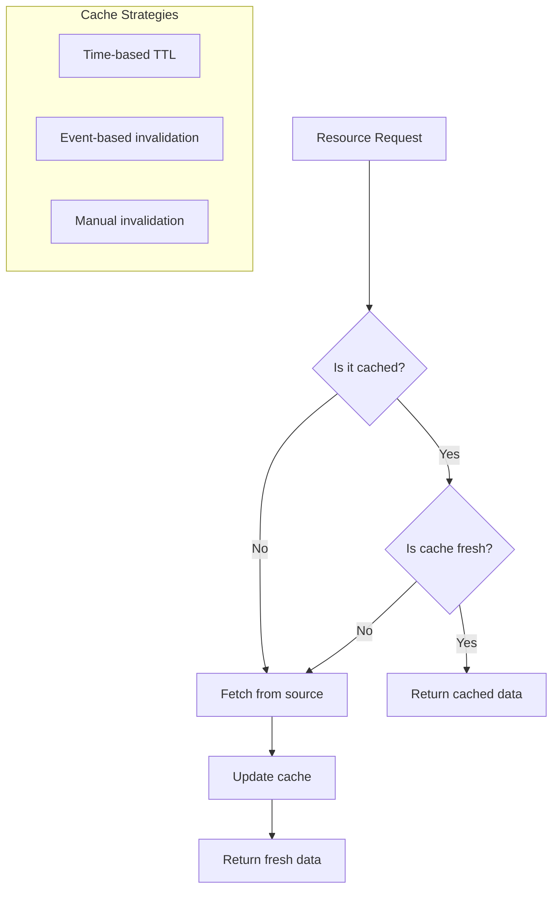
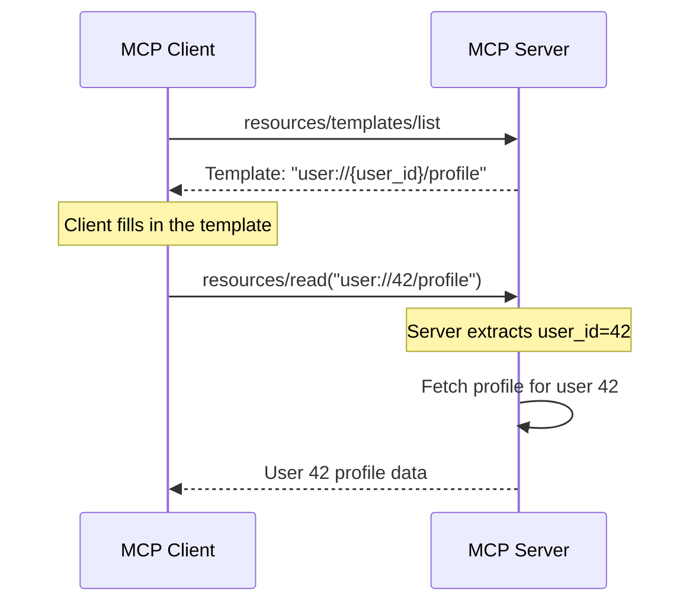

# Chapter 7: Resources

## Learning Objectives

By the end of this chapter, you will be able to:

1. Understand what MCP resources are and why they exist
2. Distinguish between static and dynamic resources
3. Design proper resource URIs using naming conventions
4. Serve text, JSON, CSV, and file-based resources
5. Implement resource templates with parameterized URIs
6. Build servers that expose database data as resources
7. Handle large resources with pagination strategies
8. Apply caching strategies for resource performance
9. Build a complete document library server

---

## 1. What Are MCP Resources?

### The Core Concept

Resources are **data that an MCP server exposes for clients and LLMs to read**. Think of them as the "GET" side of MCP -- they let the LLM look at data without changing anything.

While **tools** let the LLM take actions (like writing a file or querying an API), **resources** let the LLM read and understand data. This is a fundamental distinction in MCP's design.

### Why Resources Matter

Before MCP resources, if an LLM needed to read data, it had to:

1. Call a tool that returned the data (mixing reading and acting)
2. Receive data in the system prompt (static, no updates)
3. Use RAG (complex setup for simple data)

Resources solve this by providing a clean, standardized way to expose readable data.

```
Without Resources:
- LLM calls "read_file" tool -> Gets data as tool result
- Data and actions are mixed together
- No way to browse available data

With Resources:
- Client browses available resources
- LLM reads specific resources by URI
- Clean separation between reading (resources) and acting (tools)
```

### Resources vs Tools vs Prompts

| Feature | Resources | Tools | Prompts |
|---------|-----------|-------|---------|
| Purpose | Expose data for reading | Perform actions | Provide templates |
| Direction | Server -> Client (read) | Client -> Server (execute) | Server -> Client (template) |
| Side effects | None (read-only) | Can have side effects | None |
| Analogy | Library books | Workshop tools | Recipe cards |
| Example | Read a config file | Create a database entry | "Summarize this data" template |

---

## 2. Real-World Analogy: The Library Catalog

Imagine a large public library:

- **The Library** = Your MCP Server
- **The Catalog** = The list of available resources
- **Each Book** = An individual resource
- **The Dewey Decimal System** = Resource URI scheme
- **The Librarian** = The MCP protocol handling requests
- **A Library Card Holder** = The MCP client

When you visit a library:

1. You browse the **catalog** to see what is available (listing resources)
2. Each book has a **unique identifier** (resource URI)
3. Some books are always the same (**static resources** -- like an encyclopedia)
4. Some sections update daily (**dynamic resources** -- like the newspaper rack)
5. You can ask for "books by author X" (**resource templates** -- parameterized queries)
6. Large reference books have chapters (**pagination** for large resources)
7. Popular books are kept near the front (**caching** for frequently accessed resources)

This is exactly how MCP resources work.

---

## 3. Resource Architecture

### How Resource Serving Works



### Static vs Dynamic Resources



---

## 4. Resource URIs and Naming Conventions

### What is a Resource URI?

Every resource has a unique URI (Uniform Resource Identifier). This is how clients refer to specific resources. MCP uses custom URI schemes.

### URI Structure

```
scheme://authority/path
```

Examples:
```
file:///config/app.json          -- A configuration file
data://reports/sales-2024        -- A data resource
db://users/active                -- Database resource
docs://api/reference             -- Documentation resource
```

### Naming Convention Best Practices

| Convention | Good Example | Bad Example | Why |
|-----------|-------------|-------------|-----|
| Use lowercase | `config://app/settings` | `Config://App/Settings` | Consistency |
| Use hyphens for spaces | `data://sales-report` | `data://sales_report` | URL convention |
| Be descriptive | `db://users/active-count` | `db://u/ac` | Readability |
| Use hierarchy | `docs://api/v2/endpoints` | `docs://api-v2-endpoints` | Organization |
| Include version if needed | `schema://v1/user-model` | `schema://user-model` | Compatibility |

### Common URI Schemes in MCP

| Scheme | Purpose | Example |
|--------|---------|---------|
| `file://` | Local files | `file:///home/user/data.csv` |
| `config://` | Configuration | `config://app/database` |
| `data://` | Application data | `data://metrics/cpu-usage` |
| `db://` | Database content | `db://users/table` |
| `docs://` | Documentation | `docs://api/reference` |
| `log://` | Log files | `log://app/errors` |
| `template://` | Templates | `template://emails/welcome` |

---

## 5. Resource Types

### Text Resources

The simplest type. The server returns plain text content.

```
Content type: text/plain
Use case: Configuration files, logs, documentation
```

### JSON Resources

Structured data returned as JSON strings.

```
Content type: application/json
Use case: API responses, configuration, structured data
```

### CSV Resources

Tabular data returned as CSV-formatted text.

```
Content type: text/csv
Use case: Reports, data exports, tabular data
```

### Binary Resources (Blobs)

For non-text data like images, PDFs, etc. These are base64-encoded.

```
Content type: application/octet-stream, image/png, etc.
Use case: Images, PDFs, compiled files
```

### Resource Content Model



---

## 6. Static vs Dynamic Resources

### Static Resources

Static resources return the **same content every time** they are read. The data does not change between reads (or changes very rarely).

**Examples:**
- Application configuration
- Documentation files
- Schema definitions
- Help text
- License information

**Characteristics:**
- Content is defined at server startup
- Easy to cache
- Predictable behavior
- Low server load

### Dynamic Resources

Dynamic resources **generate content at read time**. The data can be different each time the resource is read.

**Examples:**
- Current system time
- Database query results
- Live metrics
- Log file contents (growing)
- Random data generators

**Characteristics:**
- Content is computed on each read
- Caching needs careful consideration
- May depend on external systems
- Higher server load

### Comparison Diagram



---

## 7. Serving Files as Resources

One of the most common use cases is serving local files as MCP resources. This lets an LLM read configuration files, documentation, data files, and more.

### File Serving Flow



### Important Considerations

1. **Security**: Never serve files outside a designated directory
2. **Path validation**: Always validate and sanitize file paths
3. **File size**: Check file sizes before reading to avoid memory issues
4. **Error handling**: Handle missing files, permission errors gracefully
5. **MIME types**: Set correct MIME types for proper client handling

---

## 8. Serving Database Data as Resources

Database tables and queries can be exposed as resources. This is powerful for letting LLMs understand your data.

### Common Patterns

| Pattern | URI Example | What It Returns |
|---------|-------------|-----------------|
| Full table | `db://users/all` | All rows from users table |
| Filtered data | `db://users/active` | Only active users |
| Aggregated data | `db://orders/summary` | Order statistics |
| Schema info | `db://schema/users` | Table column definitions |
| Single record | `db://users/{id}` | One specific user (template) |

### Database Resource Architecture



---

## 9. Large Resources and Pagination

When resources contain a lot of data, you should not return everything at once. This can overwhelm the LLM's context window and cause performance issues.

### Pagination Strategies

**Strategy 1: URI-based Pagination**
```
data://users/page/1      -- First 50 users
data://users/page/2      -- Next 50 users
data://users/page/3      -- Next 50 users
```

**Strategy 2: Offset in Template**
```
data://users?offset=0&limit=50
data://users?offset=50&limit=50
```

**Strategy 3: Cursor-based**
```
data://users/after/user_abc123
data://users/after/user_def456
```

### Best Practices for Large Resources

1. **Default page size**: Use 50-100 items per page
2. **Include metadata**: Return total count and next page info
3. **Consistent ordering**: Always sort results the same way
4. **Maximum limit**: Cap the maximum items per request
5. **Indicate completeness**: Tell the client if there is more data

---

## 10. Resource Caching Strategies

Caching is important for resource performance, especially for data that does not change frequently.

### Caching Strategy Diagram



### Cache Strategy Comparison

| Strategy | How It Works | Best For | Drawback |
|----------|-------------|----------|----------|
| Time-based (TTL) | Cache expires after N seconds | Metrics, status data | May serve stale data |
| Event-based | Cache invalidated on data change | Database resources | Complex to implement |
| Manual | Cache cleared by admin action | Configuration data | Requires intervention |
| No cache | Always fetch fresh data | Real-time data | Higher load |

### What Happens in Real Companies?

- **GitHub's MCP server** caches repository metadata but fetches file contents fresh
- **Cursor** caches project structure resources but re-reads file contents
- **Claude Desktop** relies on server-side caching decisions
- Large organizations use Redis or Memcached for MCP resource caching in production

---

## 11. Resource Templates (Parameterized URIs)

Resource templates let you define patterns for resources where part of the URI is a parameter. This is like having a function that takes arguments.

### How Templates Work

Instead of registering every possible resource URI, you register a template:

```
Template:  user://{user_id}/profile
Usage:     user://123/profile     -- Gets profile for user 123
           user://456/profile     -- Gets profile for user 456
```

### Template URI Syntax

Templates use curly braces `{}` to mark parameters:

```
{parameter_name}     -- Required parameter
```

Examples:
```
db://users/{user_id}                    -- Single parameter
reports://{year}/{month}/sales          -- Multiple parameters
docs://{category}/{document_name}       -- Hierarchical parameters
```

### Template Flow



---

## 12. Hands-On Coding

Now let us build resources step by step. All code files are in the `code/` directory.

### Project Setup

```bash
# Create project directory
mkdir chapter-07-resources
cd chapter-07-resources

# Initialize Poetry project
poetry init --name chapter-07-resources \
            --description "MCP Resources Examples" \
            --author "Your Name" \
            --python "^3.11" \
            --no-interaction

# Add dependencies
poetry add mcp
poetry add fastmcp

# Install everything
poetry install
```

### Directory Structure

```
chapter-07-resources/
    pyproject.toml
    code/
        example1_static_resources.py
        example2_dynamic_resources.py
        example3_file_resources.py
        example4_csv_resource.py
        example5_resource_templates.py
        exercise1_config_resource.py
        exercise1_solution.py
        exercise2_database_resource.py
        exercise2_solution.py
        exercise3_multi_format_resource.py
        exercise3_solution.py
        mini_project_document_server.py
        sample_data.csv
        sample_data.json
```

### Example 1: Static Resources

See `code/example1_static_resources.py`

This example shows the simplest possible resources: static text and JSON data that never changes. You register resources using the `@server.resource()` decorator from FastMCP.

### Example 2: Dynamic Resources

See `code/example2_dynamic_resources.py`

Dynamic resources compute their content each time they are read. This example shows resources that return the current time, a random quote, and system information.

### Example 3: File Resources

See `code/example3_file_resources.py`

This example reads actual files from the filesystem and serves them as resources. It handles both text files and JSON files.

### Example 4: CSV Resource

See `code/example4_csv_resource.py`

This example reads a CSV file and serves the data as a formatted resource. It shows how to parse CSV data and present it in a useful way.

### Example 5: Resource Templates

See `code/example5_resource_templates.py`

Resource templates use parameterized URIs. Instead of registering one resource per item, you register a template that handles many items.

---

## 13. Exercises

### Exercise 1: Configuration Resource Server

**Task**: Build an MCP server that serves application configuration files as resources.

Requirements:
- Serve a main application config
- Serve a database config
- Serve a logging config
- Each config should be in JSON format
- Include a resource that lists all available configs

See `code/exercise1_config_resource.py` for the exercise and `code/exercise1_solution.py` for the solution.

### Exercise 2: Database Resource Server

**Task**: Build an MCP server that serves SQLite database data as resources.

Requirements:
- Create a SQLite database with sample data
- Expose table listing as a resource
- Expose table contents as a resource
- Expose table schema as a resource
- Use resource templates for per-table access

See `code/exercise2_database_resource.py` for the exercise and `code/exercise2_solution.py` for the solution.

### Exercise 3: Multi-Format Resource Server

**Task**: Build an MCP server that serves the same data in multiple formats (text, JSON, CSV).

Requirements:
- Store employee data internally
- Serve the data as plain text
- Serve the data as JSON
- Serve the data as CSV
- Each format should be a separate resource

See `code/exercise3_multi_format_resource.py` for the exercise and `code/exercise3_solution.py` for the solution.

---

## 14. Mini Project: Document Library Server

See `code/mini_project_document_server.py`

Build a complete document library server that:
1. Scans a directory for markdown, text, and JSON files
2. Exposes each file as a resource
3. Provides a catalog resource listing all documents
4. Supports searching documents by name
5. Includes document metadata (size, modification date)
6. Uses resource templates for individual document access

---

## 15. Running the Examples

### How to Run Each Example

```bash
# Activate Poetry environment
poetry shell

# Run any example (it will start the MCP server)
python code/example1_static_resources.py

# In another terminal, you can test with the MCP Inspector
# or connect using an MCP client
```

### Testing with MCP Inspector

The MCP Inspector is a development tool for testing MCP servers:

```bash
# Install the MCP Inspector
npx @modelcontextprotocol/inspector python code/example1_static_resources.py
```

This opens a web interface where you can:
1. See all registered resources
2. Read individual resources
3. Test resource templates
4. View resource content

### Expected Output

When you run Example 1 and list resources, you should see:

```
Available Resources:
1. info://app/name
   Name: Application Name
   Description: The name of this application

2. info://app/version
   Name: Application Version
   Description: The current version of the application

3. data://app/stats
   Name: Application Statistics
   Description: Current application statistics in JSON format
```

When you read a resource:

```
Resource: info://app/name
Content: MCP Resources Demo Server

Resource: data://app/stats
Content: {
    "total_users": 1250,
    "active_sessions": 42,
    "uptime_hours": 720,
    "version": "2.1.0"
}
```

---

## 16. Summary

### Key Concepts

1. **Resources** are read-only data that MCP servers expose to clients and LLMs
2. **Static resources** return the same content every time
3. **Dynamic resources** compute content at read time
4. **Resource URIs** uniquely identify each resource using scheme://path format
5. **Resource templates** use parameterized URIs for flexible resource access
6. **File resources** serve local files through the MCP protocol
7. **Database resources** expose query results as readable data
8. **Pagination** handles large datasets by breaking them into pages
9. **Caching** improves performance by storing frequently accessed data

### What We Built

| Example | What It Does |
|---------|-------------|
| Example 1 | Static text and JSON resources |
| Example 2 | Dynamic resources (time, random data) |
| Example 3 | File-based resources |
| Example 4 | CSV data as a resource |
| Example 5 | Resource templates with parameters |
| Exercise 1 | Configuration file server |
| Exercise 2 | SQLite database resource server |
| Exercise 3 | Multi-format data server |
| Mini Project | Document library with search |

---

## 17. Interview Questions

### Q1: What are MCP resources and how do they differ from tools?

**Answer**: Resources are read-only data that an MCP server exposes for clients and LLMs to read. Unlike tools, resources have no side effects -- they only provide data. Tools perform actions and can change state, while resources are purely for data retrieval. Think of resources as "GET" operations and tools as "POST/PUT/DELETE" operations.

### Q2: Explain the difference between static and dynamic resources.

**Answer**: Static resources return the same content every time they are read. Their data is defined when the server starts and does not change. Dynamic resources compute their content at read time, so the data can be different on each read. Static resources are like encyclopedia entries (unchanging), while dynamic resources are like a clock (always showing the current time).

### Q3: What is a resource URI and what are the naming conventions?

**Answer**: A resource URI is a unique identifier for each resource, following the format `scheme://path`. Conventions include: use lowercase, use hyphens instead of underscores, be descriptive, use hierarchical paths for organization, and include version numbers when needed. Common schemes include `file://`, `config://`, `data://`, `db://`, and `docs://`.

### Q4: How do resource templates work?

**Answer**: Resource templates define URI patterns with parameters in curly braces, like `user://{user_id}/profile`. Instead of registering individual resources for every possible value, you register one template. When a client requests `user://42/profile`, the server extracts `user_id=42` and generates the response dynamically. This is similar to URL routing in web frameworks.

### Q5: What are the two types of resource content in MCP?

**Answer**: MCP supports two content types: (1) Text content, which includes plain text, JSON strings, CSV, XML, and any text-based format, returned with a `text` field. (2) Blob content, which is for binary data like images, PDFs, and compiled files, returned as base64-encoded strings in a `blob` field. Both include a `uri` and `mimeType`.

### Q6: How would you handle large resources that could overwhelm an LLM's context window?

**Answer**: Use pagination strategies: (1) URI-based pagination like `data://users/page/1`, (2) Offset/limit parameters like `data://users?offset=0&limit=50`, or (3) Cursor-based pagination. Always include metadata about total count and whether more data is available. Set reasonable default page sizes (50-100 items) and enforce maximum limits.

### Q7: What caching strategies can be used for MCP resources?

**Answer**: Three main strategies: (1) Time-based TTL where cache expires after a set duration, good for metrics and status data. (2) Event-based invalidation where cache is cleared when underlying data changes, good for database resources. (3) Manual invalidation where an admin clears the cache, good for configuration data. The choice depends on how frequently the data changes and how acceptable stale data is.

### Q8: How would you securely serve files as MCP resources?

**Answer**: Key security practices: (1) Restrict file access to a designated directory and validate that requested paths do not escape it (prevent path traversal attacks). (2) Sanitize file paths to remove `..` and other escape sequences. (3) Check file sizes before reading to prevent memory issues. (4) Set correct MIME types. (5) Handle errors gracefully without exposing internal paths in error messages. (6) Use allowlists for permitted file extensions.

### Q9: When would you use resources vs tools for data access?

**Answer**: Use resources when: the data is read-only, the LLM needs to understand or analyze the data, you want to expose data for browsing, or the data does not change based on user action. Use tools when: the operation has side effects, the data retrieval requires complex parameters, the operation needs to modify state, or the result depends on multiple steps. For example, reading a user profile is a resource; creating a user is a tool.

### Q10: How do MCP resources compare to REST API GET endpoints?

**Answer**: Both serve read-only data, but MCP resources are designed for LLM consumption with features like: standardized listing (clients can discover all available resources), URI templates for parameterized access, built-in content types optimized for LLMs (text and blob), and integration with the MCP protocol's capability negotiation. REST APIs are more flexible but require custom documentation and client implementation for each endpoint.

---

## 18. Common Mistakes

### Mistake 1: Returning Too Much Data

**Wrong**: Returning an entire database table with 100,000 rows as a single resource.

**Right**: Implement pagination and return a reasonable amount of data per request. Include metadata about total available data.

### Mistake 2: Not Validating File Paths

**Wrong**: Accepting any file path from the client without validation.

```python
# DANGEROUS - allows path traversal
path = requested_path
content = open(path).read()
```

**Right**: Validate that the path stays within an allowed directory.

```python
# SAFE - validates path
import os
safe_path = os.path.realpath(requested_path)
if not safe_path.startswith(allowed_directory):
    raise ValueError("Access denied")
```

### Mistake 3: No Error Handling for Missing Resources

**Wrong**: Letting the server crash when a resource does not exist.

**Right**: Return a clear error message when a resource is not found. Use try/except blocks and provide helpful error messages.

### Mistake 4: Confusing Resources with Tools

**Wrong**: Using resources to perform actions that change state.

**Right**: Resources should be read-only. If you need to modify data, use a tool instead.

### Mistake 5: Ignoring MIME Types

**Wrong**: Returning JSON data with `text/plain` MIME type.

**Right**: Always set the correct MIME type so clients can properly handle the content. Use `application/json` for JSON, `text/csv` for CSV, etc.

---

## 19. Production Tips

### Tip 1: Monitor Resource Access

In production, log which resources are accessed most frequently. This helps you:
- Optimize caching for popular resources
- Identify unused resources that can be removed
- Detect unusual access patterns (security)

### Tip 2: Set Resource Size Limits

Always limit the maximum size of resource responses. A good default is 1MB for text resources and 10MB for blob resources. This prevents:
- Memory exhaustion on the server
- Context window overflow for the LLM
- Network timeout issues

### Tip 3: Use Connection Pooling for Database Resources

If your resources query a database, use connection pooling instead of opening a new connection for each read. This significantly improves performance under load.

### Tip 4: Version Your Resource URIs

When resource formats change, use versioned URIs:
```
data://v1/users/summary    -- Original format
data://v2/users/summary    -- New format with additional fields
```

This allows clients to migrate at their own pace without breaking changes.

### Tip 5: Implement Health Check Resources

Create a `health://status` resource that returns the server's health status. This is useful for monitoring and load balancers.

### Tip 6: Cache at the Right Level

- **Server-level cache**: For data shared across all clients
- **Client-level cache**: For data specific to a client session
- **No cache**: For real-time data that must always be fresh

### Tip 7: Use Resource Subscriptions in Production

MCP supports resource subscriptions where clients can be notified when a resource changes. In production, this is more efficient than polling:
```
Client subscribes to "data://metrics/cpu"
Server notifies client when CPU metrics change
Client only re-reads when notified
```

### Tip 8: Document Your Resources

Create a `docs://resources/index` resource that lists all available resources with their descriptions, expected formats, and usage examples. This helps both human developers and LLMs understand what is available.

---

## 20. Further Reading

- [MCP Specification - Resources](https://modelcontextprotocol.io/docs/concepts/resources)
- [FastMCP Documentation](https://github.com/jlowin/fastmcp)
- [MCP Python SDK](https://github.com/modelcontextprotocol/python-sdk)
- [URI Template RFC 6570](https://tools.ietf.org/html/rfc6570)

---

## 21. What's Next?

In the next chapter, we will explore **Prompts** -- reusable prompt templates that MCP servers can offer to clients. While resources let the LLM read data, prompts help the LLM know how to process that data effectively.
