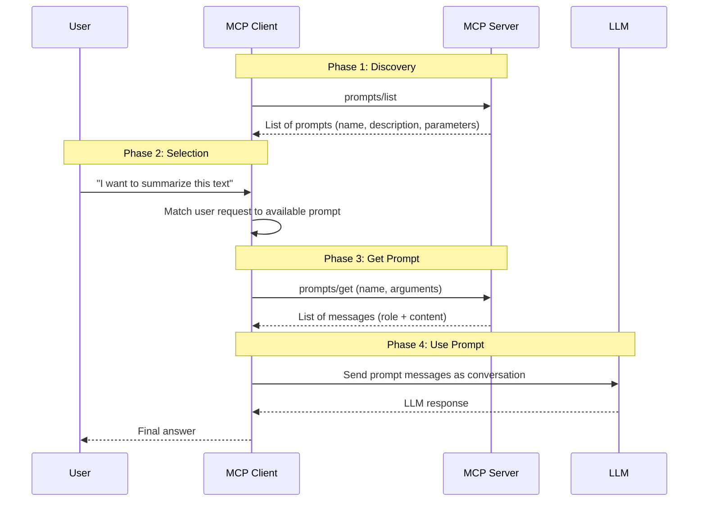
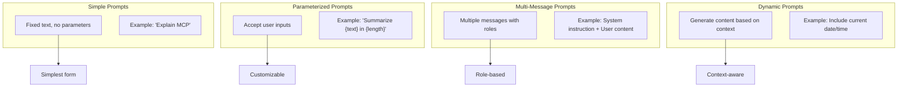
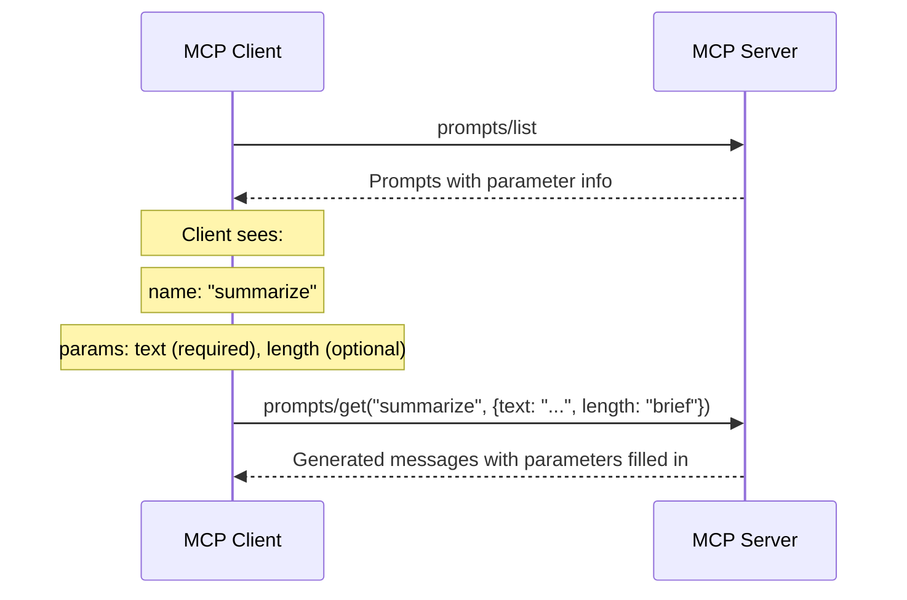
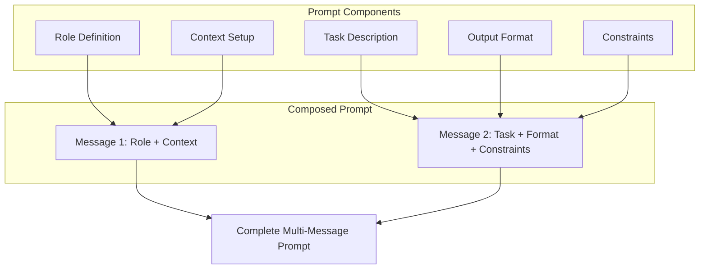

# Chapter 8: Prompts

## Learning Objectives

By the end of this chapter, you will be able to:

1. Understand what MCP prompts are and how they differ from tools and resources
2. Create simple prompt templates using FastMCP
3. Build parameterized prompts that accept user inputs
4. Design multi-message prompts with system and user messages
5. Generate dynamic prompts that adapt based on context
6. Build a reusable prompt library for common tasks
7. Apply prompt composition patterns for complex workflows
8. Follow best practices for prompt design and organization
9. Build a prompt management server for production use

---

## 1. What Are MCP Prompts?

### The Core Concept

Prompts are **reusable message templates that an MCP server exposes for clients**. They provide pre-built conversation starters, instructions, and workflows that the LLM can use.

Think of prompts as **recipe cards** in a kitchen. A recipe card does not cook the food -- it tells the chef (the LLM) exactly what to do, in what order, with what ingredients. The chef follows the recipe and produces the result.

### Why Prompts Matter

Without MCP prompts, users and applications had to:

1. Write the same instructions repeatedly for common tasks
2. Copy and paste prompt templates from documents
3. Maintain prompt libraries in separate systems
4. Hope that everyone uses the same prompt format

MCP prompts solve this by making prompt templates a first-class part of the protocol:

```
Without MCP Prompts:
- User types the same "summarize this document" instruction every time
- Each team member writes slightly different prompts
- No standardization or version control for prompts
- Hard to share and reuse prompts across projects

With MCP Prompts:
- Server provides pre-built prompt templates
- Clients discover and list available prompts
- Prompts accept parameters for customization
- Consistent, tested, and versioned prompt templates
```

### Prompts vs Tools vs Resources

| Feature | Prompts | Tools | Resources |
|---------|---------|-------|-----------|
| Purpose | Provide message templates | Perform actions | Expose data |
| Direction | Server -> Client (template) | Client -> Server (execute) | Server -> Client (read) |
| Side effects | None | Can modify state | None (read-only) |
| Output | Messages for the LLM | Action results | Data content |
| Analogy | Recipe cards | Workshop tools | Library books |
| Example | "Summarize this text" template | Calculate a sum | Read a config file |

---

## 2. Real-World Analogy: Recipe Cards

Imagine a professional kitchen with a recipe card system:

- **The Kitchen** = Your MCP Server
- **The Recipe Card Box** = The collection of prompts
- **Each Recipe Card** = An individual prompt template
- **Ingredients Listed on Card** = Prompt parameters
- **The Chef** = The LLM (follows the recipe)
- **The Diner** = The end user (requests a dish/task)

How recipe cards work in the kitchen:

1. The diner asks for "pasta carbonara" (user requests a task)
2. The chef checks the **recipe card box** for the recipe (client lists prompts)
3. The recipe card says "You need: pasta, eggs, cheese, bacon" (prompt parameters)
4. The diner provides the specific ingredients (user fills in parameters)
5. The chef follows the recipe step by step (LLM follows the prompt)
6. Some recipes have multiple steps: "First prepare sauce, then cook pasta" (multi-message prompts)
7. Some recipes adapt: "For spicy version, add chili" (dynamic prompts)

This is exactly how MCP prompts work.

---

## 3. Prompt Architecture

### How Prompts Work in MCP



### Prompt Structure

Every MCP prompt returns a list of messages. Each message has:

- **role**: Either `"user"` or `"assistant"` (system messages use the `"user"` role with special formatting)
- **content**: The text content of the message

```
Prompt: "summarize"
Parameters: text, length

Returns:
[
    {
        "role": "user",
        "content": "Please summarize the following text in 3 sentences:\n\n<text>"
    }
]
```

### Prompt Types



---

## 4. Simple Prompts

### What is a Simple Prompt?

A simple prompt is a fixed message template with no parameters. It always returns the same content. Simple prompts are useful for:

- Standard instructions that do not change
- Boilerplate text that is used frequently
- Default conversation starters

### How to Define Simple Prompts

In FastMCP, you define prompts using the `@server.prompt()` decorator. The function returns a string (for a single user message) or a list of messages.

```
@server.prompt()
def explain_mcp():
    """Explain what MCP is."""
    return "Please explain the Model Context Protocol (MCP) in simple terms."
```

### Simple Prompt Flow

When a client requests this prompt:

1. Client calls `prompts/get` with name `"explain_mcp"`
2. Server runs the function
3. Function returns the string
4. FastMCP wraps it in a message: `{"role": "user", "content": "..."}`
5. Client sends this message to the LLM

---

## 5. Parameterized Prompts

### What are Parameterized Prompts?

Parameterized prompts accept inputs that customize the message. The parameters are defined as function arguments, just like tool arguments.

```
@server.prompt()
def summarize(text: str, length: str = "short"):
    """Summarize text with a given length."""
    return "Summarize the following text. Length: " + length + "\n\n" + text
```

### How Parameters Work

Parameters work exactly like tool arguments:

- **Required parameters**: Function arguments without default values
- **Optional parameters**: Function arguments with default values
- **Type hints**: Define the type of each parameter

The client discovers parameters through `prompts/list` and provides values through `prompts/get`.

### Parameter Discovery



---

## 6. Multi-Message Prompts

### What are Multi-Message Prompts?

Multi-message prompts return a sequence of messages, typically combining a system-level instruction with user content. This is useful for:

- Setting the LLM's behavior (system message)
- Providing context (first user message)
- Asking the actual question (second user message)

### Message Structure

In MCP, prompts return messages with roles:

- **"user"**: Content from the user's perspective
- **"assistant"**: Content from the assistant's perspective (for few-shot examples)

Note: MCP prompts use `"user"` role for system-like instructions since MCP does not have a dedicated "system" role in prompt messages. The client application decides how to map these to actual LLM roles.

### Multi-Message Pattern

```
Prompt: code_review

Returns:
[
    Message(role="user", content="You are an expert code reviewer..."),
    Message(role="user", content="Please review this code:\n\n<code>")
]
```

The first message sets up the context and instructions. The second message provides the specific content to act on.

---

## 7. Dynamic Prompts

### What are Dynamic Prompts?

Dynamic prompts generate different content each time they are called, based on context such as:

- Current date and time
- System information
- Data from files or databases
- Random selections
- Computed values

```
@server.prompt()
def daily_report():
    """Generate a daily report prompt with today's date."""
    today = datetime.now().strftime("%Y-%m-%d")
    return "Generate a summary report for " + today
```

### Static vs Dynamic Comparison

| Aspect | Static Prompt | Dynamic Prompt |
|--------|---------------|----------------|
| Content | Always the same | Changes per call |
| Parameters | None or user-provided | Can include computed values |
| Use case | Standard instructions | Context-dependent tasks |
| Example | "Review this code" | "Review today's commits (2024-01-15)" |

---

## 8. Prompt Composition

### Building Complex Prompts

Prompt composition is the practice of combining smaller prompts into larger, more complex ones. This is like building with LEGO blocks -- each piece is simple, but together they create something powerful.

### Composition Patterns

**Pattern 1: Role + Task + Format**
```
Role:   "You are a senior data scientist..."
Task:   "Analyze the following dataset..."
Format: "Present your findings as a numbered list..."
```

**Pattern 2: Context + Question**
```
Context: "The following code is a Python Flask application..."
Question: "What security vulnerabilities exist?"
```

**Pattern 3: Examples + Task (Few-Shot)**
```
Example 1: "Input: 'hello' -> Output: 'HELLO'"
Example 2: "Input: 'world' -> Output: 'WORLD'"
Task:       "Input: 'python' -> Output: ?"
```

### Composition Architecture



---

## 9. Prompt Best Practices

### Writing Effective Prompts

1. **Be specific**: "Summarize in 3 bullet points" is better than "Summarize"
2. **Define the role**: Tell the LLM who it is acting as
3. **Set constraints**: Specify length, format, and boundaries
4. **Provide examples**: When the output format matters, show examples
5. **Use clear structure**: Separate instructions from content with blank lines

### Naming Conventions

| Convention | Good Example | Bad Example |
|-----------|-------------|-------------|
| Use verb_noun | `summarize_text` | `text_summary` |
| Be descriptive | `review_python_code` | `review` |
| Use lowercase | `analyze_data` | `AnalyzeData` |
| Use underscores | `generate_report` | `generate-report` |

### Parameter Design

1. **Required parameters first**: Put required params before optional ones
2. **Sensible defaults**: Optional params should have useful defaults
3. **Clear naming**: `text` not `t`, `max_length` not `ml`
4. **Type hints**: Always include type hints for parameters

### Documentation

Every prompt should have a clear docstring that explains:
- What the prompt does
- What parameters it accepts
- What kind of output to expect

---

## 10. Prompt Use Cases in Production

### Common Prompt Categories

| Category | Examples | Use Case |
|----------|---------|----------|
| Code Review | Review code, find bugs, suggest improvements | Development teams |
| Writing | Summarize, translate, rewrite, proofread | Content teams |
| Analysis | Analyze data, find patterns, generate insights | Data teams |
| Documentation | Generate docs, write READMEs, create guides | Technical writing |
| Domain-Specific | ML workflow, SQL queries, DevOps tasks | Specialized teams |

### What Happens in Real Companies?

- **Anthropic** uses MCP prompts in Claude Desktop to provide pre-built conversation starters for common tasks
- **Cursor** uses prompts to set up coding contexts (e.g., "Explain this function", "Refactor this code")
- **Development teams** create prompt libraries for their specific codebases and workflows
- **Data teams** build prompts for standard analysis tasks (weekly reports, anomaly detection)
- **Support teams** use prompts for ticket categorization, response templates, and escalation decisions

---

## 11. Hands-On Coding

Now let us build prompts step by step. All code files are in the `code/` directory.

### Project Setup

```bash
# Create project directory
mkdir chapter-08-prompts
cd chapter-08-prompts

# Initialize Poetry project
poetry init --name chapter-08-prompts \
            --description "MCP Prompts Examples" \
            --author "Your Name" \
            --python "^3.11" \
            --no-interaction

# Add dependencies
poetry add mcp
poetry add fastmcp

# Install everything
poetry install
```

### Directory Structure

```
chapter-08-prompts/
    pyproject.toml
    code/
        example1_simple_prompts.py
        example2_parameterized_prompts.py
        example3_multi_message_prompts.py
        example4_dynamic_prompts.py
        example5_prompt_library.py
        exercise1_writing_prompts.py
        exercise1_solution.py
        exercise2_analysis_prompts.py
        exercise2_solution.py
        exercise3_domain_prompts.py
        exercise3_solution.py
        mini_project_prompt_manager.py
```

### Example 1: Simple Prompts

See `code/example1_simple_prompts.py`

This example shows the simplest possible prompts: fixed message templates with no parameters. You register prompts using the `@server.prompt()` decorator from FastMCP.

### Example 2: Parameterized Prompts

See `code/example2_parameterized_prompts.py`

This example shows prompts that accept parameters, allowing the user to customize the prompt output. Parameters work just like function arguments.

### Example 3: Multi-Message Prompts

See `code/example3_multi_message_prompts.py`

This example shows prompts that return multiple messages, combining role-setting instructions with task-specific content.

### Example 4: Dynamic Prompts

See `code/example4_dynamic_prompts.py`

This example shows prompts that generate different content based on dynamic context like the current time, computed values, or data lookups.

### Example 5: Prompt Library

See `code/example5_prompt_library.py`

This example builds a complete library of useful prompts for common tasks: code review, bug analysis, explanation, and translation.

---

## 12. Exercises

### Exercise 1: Writing Style Prompts

**Task**: Build an MCP server with prompts for different writing styles.

Requirements:
- A prompt for formal business writing
- A prompt for casual/friendly writing
- A prompt for technical documentation
- A prompt for creative storytelling
- Each prompt should accept the topic as a parameter

See `code/exercise1_writing_prompts.py` for the exercise and `code/exercise1_solution.py` for the solution.

### Exercise 2: Data Analysis Prompts

**Task**: Build an MCP server with prompts for data analysis tasks.

Requirements:
- A prompt for exploratory data analysis
- A prompt for statistical summary
- A prompt for anomaly detection
- A prompt for trend analysis
- Each prompt should accept the data description as a parameter

See `code/exercise2_analysis_prompts.py` for the exercise and `code/exercise2_solution.py` for the solution.

### Exercise 3: Domain-Specific Prompts (ML Workflow)

**Task**: Build an MCP server with prompts for machine learning workflows.

Requirements:
- A prompt for data preprocessing guidance
- A prompt for model selection advice
- A prompt for hyperparameter tuning strategy
- A prompt for model evaluation interpretation
- Each prompt should accept relevant parameters (dataset info, model type, etc.)

See `code/exercise3_domain_prompts.py` for the exercise and `code/exercise3_solution.py` for the solution.

---

## 13. Mini Project: Prompt Management Server

See `code/mini_project_prompt_manager.py`

Build a comprehensive prompt management server that:
1. Organizes prompts into categories (coding, writing, analysis, general)
2. Provides a search prompt that helps find the right prompt by keyword
3. Includes 10+ prompts across all categories
4. Supports parameterization for all prompts
5. Uses consistent naming and documentation

---

## 14. Running the Examples

### How to Run Each Example

```bash
# Activate Poetry environment
poetry shell

# Run any example (it will start the MCP server)
python code/example1_simple_prompts.py

# In another terminal, test with the MCP Inspector
npx @modelcontextprotocol/inspector python code/example1_simple_prompts.py
```

### Testing with MCP Inspector

The MCP Inspector is a development tool for testing MCP servers:

```bash
# Start the inspector with any example
npx @modelcontextprotocol/inspector python code/example5_prompt_library.py
```

This opens a web interface where you can:
1. See all registered prompts and their parameters
2. Fill in parameters and get prompt messages
3. View the generated messages
4. Test different parameter combinations

### Expected Output

When you list prompts for Example 2 (parameterized prompts), you should see:

```
Available Prompts:
1. summarize_text
   Description: Summarize text with a given length preference
   Parameters: text (required), length (optional, default: "short")

2. translate_text
   Description: Translate text to a target language
   Parameters: text (required), target_language (required)

3. explain_concept
   Description: Explain a concept at a given difficulty level
   Parameters: concept (required), level (optional, default: "beginner")
```

When you get a prompt:

```
Prompt: summarize_text
Arguments: {"text": "MCP is a protocol for LLM integration...", "length": "brief"}

Generated Messages:
[
    {
        "role": "user",
        "content": "Please summarize the following text. Keep the summary brief.\n\nText to summarize:\nMCP is a protocol for LLM integration..."
    }
]
```

---

## 15. Summary

### Key Concepts

1. **Prompts** are reusable message templates that servers expose to clients
2. **Simple prompts** return fixed messages with no parameters
3. **Parameterized prompts** accept inputs to customize the message
4. **Multi-message prompts** return multiple messages with different roles
5. **Dynamic prompts** generate content based on runtime context
6. **Prompt composition** combines simple components into complex prompts
7. **Prompt libraries** organize related prompts for easy discovery

### What We Built

| Example | What It Does |
|---------|-------------|
| Example 1 | Simple fixed-text prompts |
| Example 2 | Parameterized prompts with inputs |
| Example 3 | Multi-message prompts (system + user) |
| Example 4 | Dynamic prompts with runtime data |
| Example 5 | Prompt library for common tasks |
| Exercise 1 | Writing style prompts |
| Exercise 2 | Data analysis prompts |
| Exercise 3 | ML workflow prompts |
| Mini Project | Prompt management server |

---

## 16. Interview Questions

### Q1: What are MCP prompts and how do they differ from tools and resources?

**Answer**: MCP prompts are reusable message templates that a server exposes for clients to use when communicating with an LLM. Unlike tools, prompts do not perform actions or modify state -- they generate messages. Unlike resources, prompts are not data to be read -- they are instructions for the LLM. Prompts are like recipe cards: they tell the LLM what to do, while tools are the kitchen equipment and resources are the raw ingredients.

### Q2: How do you define a prompt in FastMCP?

**Answer**: In FastMCP, you define a prompt using the `@server.prompt()` decorator on a function. The function name becomes the prompt name. The docstring becomes the description. The function can return a string (for a single user message), or a list of `Message` objects (for multi-message prompts). Function parameters become prompt parameters that clients can fill in. Type hints and default values work the same as with tools.

### Q3: What is the difference between simple and parameterized prompts?

**Answer**: Simple prompts return fixed content with no user input -- they always produce the same messages. Parameterized prompts accept arguments that customize the output, like a `summarize` prompt that takes `text` and `length` parameters. Parameterized prompts are more flexible and reusable because the same prompt template can serve many different inputs. The parameters are defined as function arguments and discovered by clients through `prompts/list`.

### Q4: How do multi-message prompts work?

**Answer**: Multi-message prompts return a list of messages, each with a role ("user" or "assistant") and content. This allows setting up context with one message and providing the task in another. For example, the first message might define the LLM's role ("You are an expert code reviewer"), and the second message provides the code to review. The client sends all messages to the LLM as part of the conversation, giving the LLM both the behavioral instructions and the task content.

### Q5: What are dynamic prompts and when would you use them?

**Answer**: Dynamic prompts generate different content each time they are called, incorporating runtime context such as the current date, system information, file contents, or database queries. Use dynamic prompts when the prompt needs to be aware of the current state of the world. For example, a "daily standup" prompt might include today's date and the list of yesterday's completed tasks. A "review recent changes" prompt might include the latest git commits.

### Q6: What are the best practices for writing MCP prompts?

**Answer**: Key best practices: (1) Be specific and clear in instructions. (2) Define the LLM's role (e.g., "You are a senior data scientist"). (3) Set constraints on output format and length. (4) Provide examples for complex output formats. (5) Use consistent naming with verb_noun format. (6) Write clear docstrings for prompt discovery. (7) Put required parameters before optional ones. (8) Use sensible defaults for optional parameters. (9) Separate instructions from content with blank lines.

### Q7: How does prompt composition work?

**Answer**: Prompt composition combines smaller, focused prompt components into larger prompts. Common patterns include: Role + Task + Format (define who the LLM is, what to do, and how to format output), Context + Question (provide background then ask the question), and Examples + Task (show examples then present the actual task). This modular approach makes prompts maintainable and testable because each component can be developed and validated independently.

### Q8: How would you organize a prompt library for a production team?

**Answer**: Organize prompts by category (coding, writing, analysis, domain-specific). Use consistent naming conventions within each category. Document every prompt with clear descriptions of purpose, parameters, and expected output. Version prompts when making breaking changes. Include search functionality so users can discover prompts by keyword. Test prompts regularly with different LLMs to ensure they produce good results. Collect feedback from users to improve prompts over time.

### Q9: How do MCP prompts compare to system prompts in direct LLM APIs?

**Answer**: MCP prompts are discoverable and parameterized -- clients can list available prompts and fill in parameters. System prompts in direct APIs are static strings defined in the API call. MCP prompts are server-side, meaning updates take effect immediately for all clients without client-side changes. MCP prompts can return multiple messages while system prompts are typically a single string. MCP prompts are standardized across clients while system prompts are API-specific.

### Q10: What role do prompts play in an MCP server alongside tools and resources?

**Answer**: Prompts, tools, and resources form the three pillars of MCP. Resources provide data (the "what"), tools provide actions (the "do"), and prompts provide instructions (the "how"). Together, they give an LLM everything it needs: data to understand the context, actions to accomplish tasks, and instructions to guide its approach. For example, a code review server might have: a resource for reading code files, a tool for running tests, and a prompt that instructs the LLM on how to conduct the review.

---

## 17. Common Mistakes

### Mistake 1: Prompts That Are Too Vague

**Wrong**: A prompt that gives no clear direction.

```python
@server.prompt()
def analyze(data: str):
    """Analyze data."""
    return "Analyze this: " + data
```

**Right**: A prompt with clear role, task, and format instructions.

```python
@server.prompt()
def analyze(data: str):
    """Analyze data with structured output."""
    return ("You are a data analyst. Analyze the following data "
            "and provide: 1) Key patterns 2) Anomalies 3) Recommendations.\n\n"
            "Data:\n" + data)
```

### Mistake 2: Hardcoding Values That Should Be Parameters

**Wrong**: Hardcoding values that users might want to change.

```python
@server.prompt()
def summarize(text: str):
    """Summarize text."""
    return "Summarize in exactly 3 sentences:\n\n" + text
```

**Right**: Making variable parts into parameters.

```python
@server.prompt()
def summarize(text: str, num_sentences: int = 3):
    """Summarize text in a given number of sentences."""
    return ("Summarize in exactly " + str(num_sentences)
            + " sentences:\n\n" + text)
```

### Mistake 3: Confusing Prompts with Tools

**Wrong**: Using a prompt where a tool is more appropriate.

If the operation performs an action (calculate, search, create), use a tool. If the operation provides instructions for the LLM, use a prompt.

**Right**: Use prompts for LLM instructions, tools for actions.

### Mistake 4: No Docstrings

**Wrong**: Prompts without descriptions. Clients cannot show meaningful information.

**Right**: Always include a clear docstring explaining what the prompt does and what kind of output it produces.

### Mistake 5: Too Many Messages in a Multi-Message Prompt

**Wrong**: Returning 10+ messages in a single prompt. This overwhelms the LLM's context.

**Right**: Keep multi-message prompts to 2-4 messages. If you need more context, consider using resources instead.

---

## 18. Production Tips

### Tip 1: Version Your Prompts

When improving prompts, keep the old version available during transition:

```python
@server.prompt()
def code_review(code: str):
    """Code review prompt (v2 - includes security check)."""
    ...
```

### Tip 2: A/B Test Prompts

In production, run two versions of a prompt and measure which produces better results. Track metrics like user satisfaction, task completion rate, and output quality.

### Tip 3: Include Format Instructions

Always specify the desired output format in your prompts. LLMs produce more consistent output when they know exactly what format to use (bullet points, JSON, numbered list, etc.).

### Tip 4: Monitor Prompt Usage

Track which prompts are used most frequently. This helps you:
- Prioritize improvements for popular prompts
- Identify unused prompts that can be removed
- Understand how your team uses the AI assistant

### Tip 5: Separate Data from Instructions

Keep the instruction part of the prompt separate from the data/content. This makes it easier to update instructions without touching the data handling, and vice versa.

### Tip 6: Test Prompts with Multiple LLMs

Different LLMs respond differently to the same prompt. Test your prompts with the LLMs your team uses (Claude, GPT, Llama) to ensure consistent results across models.

### Tip 7: Collect Prompt Feedback

Build a mechanism for users to rate prompt quality. This feedback loop is essential for continuously improving your prompt library.

---

## 19. Further Reading

- [MCP Specification: Prompts](https://spec.modelcontextprotocol.io/specification/server/prompts/)
- [FastMCP Documentation](https://github.com/modelcontextprotocol/python-sdk)
- [Prompt Engineering Guide](https://www.promptingguide.ai/)
- [Anthropic Prompt Engineering Best Practices](https://docs.anthropic.com/en/docs/build-with-claude/prompt-engineering)

---

**Next Chapter**: Chapter 9 covers Transport -- how MCP clients and servers communicate over different channels (STDIO, SSE, HTTP).
