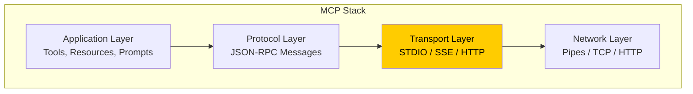
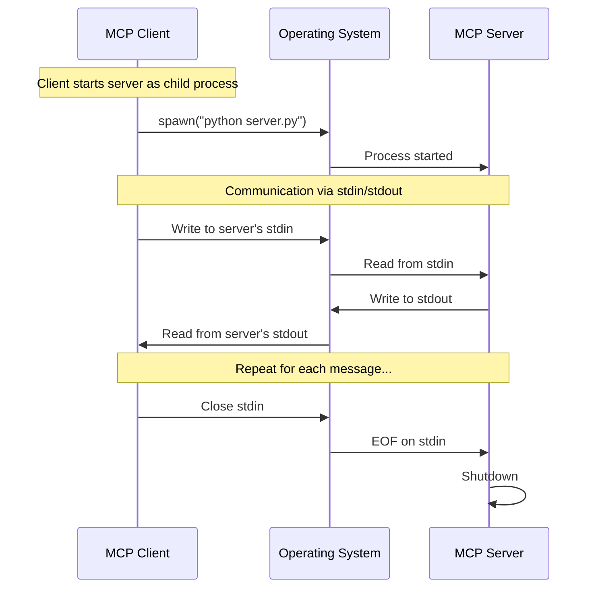
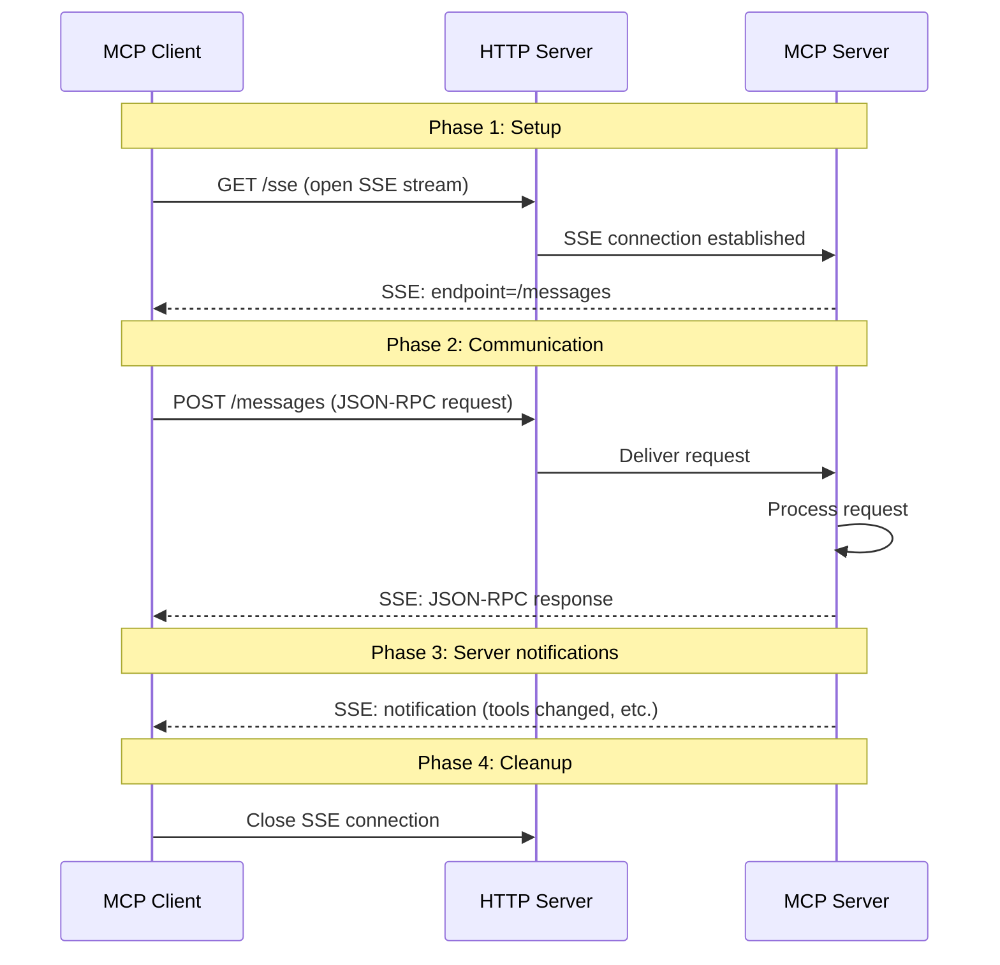
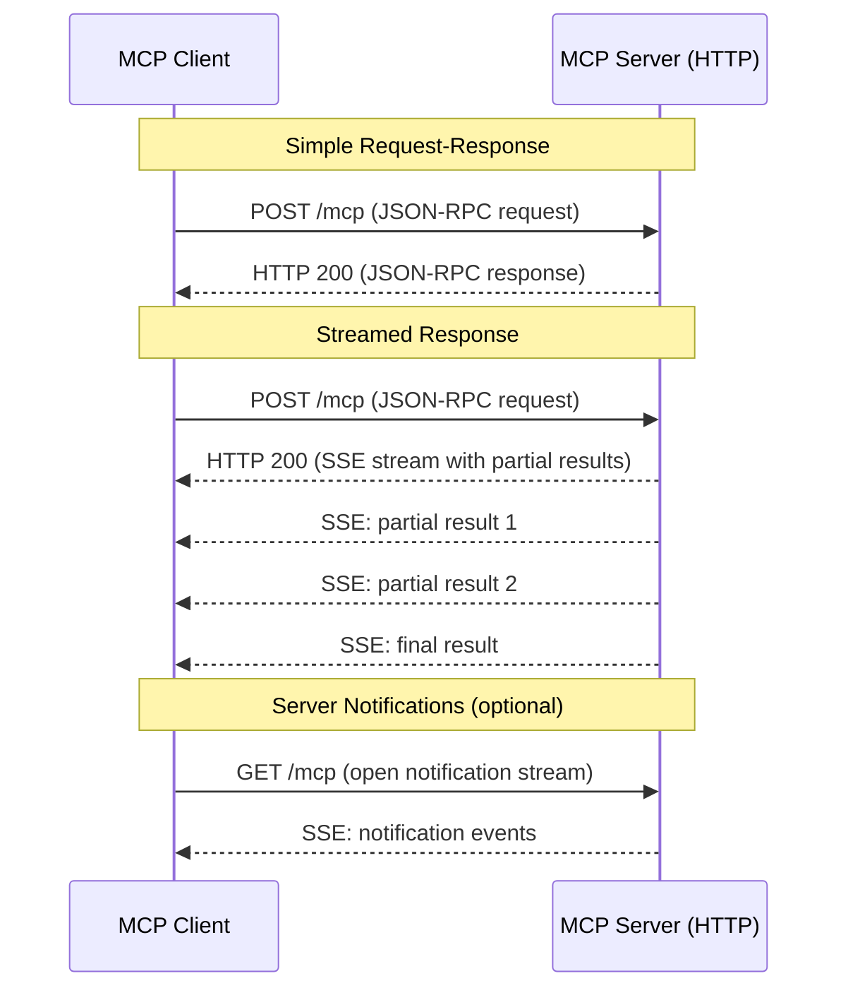
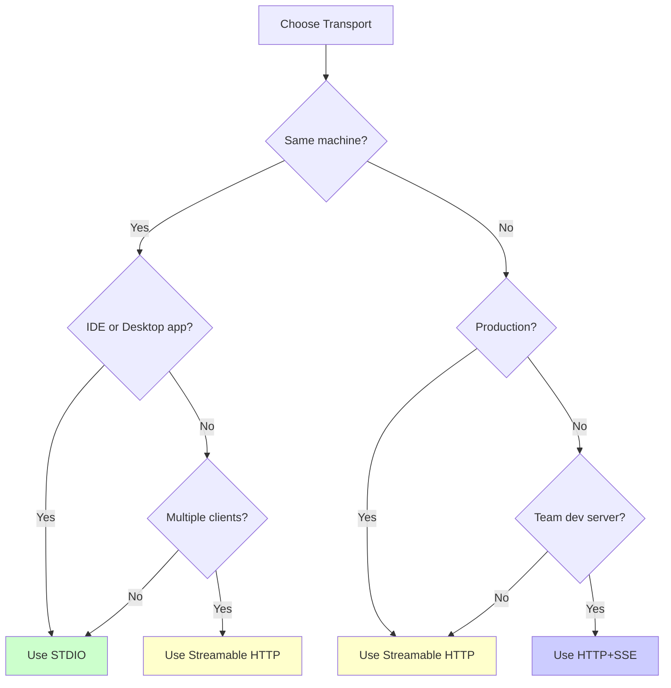
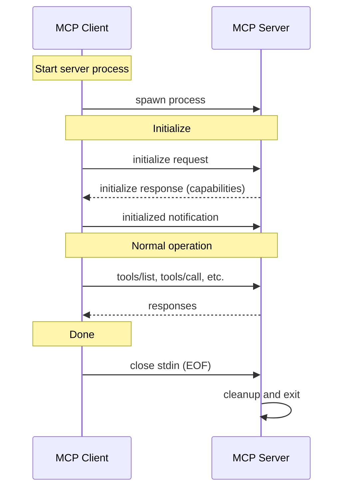

# Chapter 9: Transport

## Learning Objectives

By the end of this chapter, you will be able to:

1. Understand what transport layers are in MCP and why they matter
2. Implement STDIO transport for local server-client communication
3. Implement SSE (Server-Sent Events) transport for HTTP-based communication
4. Understand Streamable HTTP transport and its advantages
5. Compare transport mechanisms and choose the right one for your use case
6. Configure transport options for development and production
7. Handle transport-level errors and reconnection
8. Build servers that support multiple transport modes
9. Apply security best practices for each transport type

---

## 1. What is Transport in MCP?

### The Core Concept

Transport is the **communication layer** between an MCP client and an MCP server. It defines **how** messages travel between the two sides. Think of it as the delivery system for MCP messages.

The MCP protocol itself defines **what** messages look like (JSON-RPC format). The transport layer defines **how** those messages get from one place to another.

### Why Transport Matters

Different use cases need different transport mechanisms:

```
Local development:
    You run the server and client on the same machine
    -> Use STDIO transport (simplest, fastest)

Remote server:
    The server runs on a different machine or in the cloud
    -> Use HTTP+SSE or Streamable HTTP transport

Web application:
    The client is a web browser or web app
    -> Use SSE or Streamable HTTP transport

Production deployment:
    You need reliability, security, and scalability
    -> Use Streamable HTTP with proper configuration
```

### Transport in the MCP Stack



The transport layer sits between the MCP protocol (JSON-RPC messages) and the actual network communication. It handles:

1. **Serialization**: Converting messages to bytes for transmission
2. **Framing**: Marking where one message ends and another begins
3. **Connection management**: Opening, maintaining, and closing connections
4. **Error recovery**: Handling connection drops and timeouts

---

## 2. Real-World Analogy: Communication Methods

Think of different transport types as different ways to communicate:

### STDIO = Walkie-Talkie

- **Direct, local communication** -- both parties must be nearby
- **Simple** -- press button, talk, release
- **Fast** -- no network delay
- **Private** -- only the two radios on the same channel hear it
- **Limitation** -- both parties must be in range (same machine)

### HTTP+SSE = Phone Call

- **Remote communication** -- can call anyone with a phone number
- **Bidirectional** -- both parties can speak and listen
- **Connection-based** -- the call must be established first
- **Reliable** -- the phone network handles delivery
- **Limitation** -- requires infrastructure (phone network = HTTP server)

### Streamable HTTP = Email with Read Receipts

- **Request-response** -- send a message, get a reply
- **No persistent connection needed** -- send when ready
- **Can include streaming** -- like a live email thread
- **Scalable** -- email servers handle millions of messages
- **Modern** -- the recommended approach for production

---

## 3. STDIO Transport

### What is STDIO Transport?

STDIO (Standard Input/Output) transport uses the operating system's standard streams:

- **stdin** (standard input): For receiving messages
- **stdout** (standard output): For sending messages

The client starts the server as a child process and communicates through these streams. This is the simplest transport and the default in FastMCP.

### How STDIO Works



### STDIO Message Format

Messages are sent as JSON-RPC strings, one per line, through stdin/stdout:

```
Client sends to server's stdin:
{"jsonrpc": "2.0", "id": 1, "method": "tools/list"}

Server writes to stdout:
{"jsonrpc": "2.0", "id": 1, "result": {"tools": [...]}}
```

### Advantages of STDIO Transport

| Advantage | Details |
|-----------|---------|
| Simplest setup | No network configuration needed |
| No port conflicts | Does not use network ports |
| Secure by default | No network exposure |
| Fast | No network overhead |
| Process isolation | Server runs in its own process |

### Disadvantages of STDIO Transport

| Disadvantage | Details |
|--------------|---------|
| Local only | Client and server must be on the same machine |
| Single client | Only one client can connect to a server |
| No web access | Cannot be used from browsers |
| Process management | Client must manage server lifecycle |
| Debugging harder | stdout is used for messages, not logging |

### When to Use STDIO

- **Local development and testing**
- **IDE integrations** (Cursor, VS Code, Claude Desktop)
- **Command-line tools** that embed MCP servers
- **Simple single-user setups**

### STDIO in the Real World

- **Claude Desktop** uses STDIO to communicate with local MCP servers
- **Cursor** starts MCP servers as child processes using STDIO
- **VS Code** extensions use STDIO for language servers (similar concept)
- **Most MCP tutorials** use STDIO because it is the simplest

---

## 4. HTTP+SSE Transport

### What is SSE Transport?

SSE (Server-Sent Events) is a web technology that allows a server to push events to a client over HTTP. In MCP, the SSE transport works like this:

- **Client to Server**: Regular HTTP POST requests
- **Server to Client**: SSE stream (long-lived HTTP connection)

This gives you bidirectional communication over HTTP.

### How SSE Transport Works



### SSE Message Format

The SSE connection sends events in the standard SSE format:

```
event: message
data: {"jsonrpc": "2.0", "id": 1, "result": {"tools": [...]}}

event: message
data: {"jsonrpc": "2.0", "method": "notifications/tools/list_changed"}
```

### Advantages of SSE Transport

| Advantage | Details |
|-----------|---------|
| Remote access | Server can run on a different machine |
| Web compatible | Works with browsers and web applications |
| Server push | Server can send notifications without polling |
| Standard HTTP | Works through firewalls and proxies |
| Multiple clients | Multiple clients can connect to one server |

### Disadvantages of SSE Transport

| Disadvantage | Details |
|--------------|---------|
| More complex setup | Requires HTTP server configuration |
| Network dependency | Requires network connectivity |
| Security concerns | Exposed on network, needs authentication |
| Connection management | Must handle disconnects and reconnects |
| Two channels | Uses separate channels for send and receive |

### When to Use SSE

- **Remote MCP servers** running on a different machine
- **Web applications** that need MCP access
- **Multi-user scenarios** where multiple clients connect to one server
- **Development servers** shared by a team

---

## 5. Streamable HTTP Transport

### What is Streamable HTTP?

Streamable HTTP is the modern replacement for the SSE transport in MCP. It simplifies the architecture by using standard HTTP for all communication:

- **Client to Server**: HTTP POST requests
- **Server to Client**: HTTP responses (optionally streamed via SSE within the response)

The key difference from the older SSE transport: there is no separate SSE endpoint. Everything goes through a single HTTP endpoint.

### How Streamable HTTP Works



### Streamable HTTP vs SSE Transport

| Aspect | SSE Transport | Streamable HTTP |
|--------|---------------|-----------------|
| Endpoints | Two (/sse + /messages) | One (/mcp) |
| Client-to-server | POST to /messages | POST to /mcp |
| Server-to-client | SSE stream from /sse | In HTTP response |
| Connection | Long-lived SSE | Per-request (optional streaming) |
| Stateless option | No | Yes |
| Simpler to deploy | No | Yes |
| Load balancer friendly | Harder | Easier |

### When to Use Streamable HTTP

- **Production deployments** -- simpler architecture, better scaling
- **Cloud deployment** -- works well with load balancers
- **Modern applications** -- the recommended approach going forward
- **Stateless architectures** -- does not require persistent connections

---

## 6. Transport Comparison

### Complete Comparison Table

| Feature | STDIO | HTTP+SSE | Streamable HTTP |
|---------|-------|----------|-----------------|
| **Communication** | stdin/stdout | HTTP POST + SSE stream | HTTP POST (with optional SSE) |
| **Location** | Same machine | Any network | Any network |
| **Setup complexity** | Minimal | Moderate | Moderate |
| **Multiple clients** | No (1 client) | Yes | Yes |
| **Web compatible** | No | Yes | Yes |
| **Firewall friendly** | N/A (local) | Yes (HTTP) | Yes (HTTP) |
| **Streaming** | Native | Yes (SSE) | Yes (in response) |
| **Reconnection** | Restart process | Reconnect SSE | New request |
| **Scalability** | Single process | Moderate | High |
| **Security** | Process isolation | HTTP auth needed | HTTP auth needed |
| **Best for** | Local dev, IDEs | Remote servers | Production |
| **Used by** | Claude Desktop, Cursor | Web apps | Cloud deployments |

### Decision Flowchart



---

## 7. Transport Configuration

### Configuring STDIO Transport

STDIO is the default transport in FastMCP. No special configuration is needed:

```python
server = FastMCP("MyServer")

# STDIO is the default
if __name__ == "__main__":
    server.run()
```

For clients, you need to specify how to start the server process:

```json
{
    "mcpServers": {
        "my-server": {
            "command": "python",
            "args": ["server.py"]
        }
    }
}
```

### Configuring SSE Transport

For SSE transport, you need to specify the host and port:

```python
server = FastMCP("MyServer")

if __name__ == "__main__":
    server.run(transport="sse")
```

This starts an HTTP server that accepts SSE connections. The default host is `0.0.0.0` (all interfaces) and the default port is a random available port.

### Client Configuration for SSE

For clients connecting to an SSE server:

```json
{
    "mcpServers": {
        "my-server": {
            "url": "http://localhost:8000/sse"
        }
    }
}
```

### Environment Variables

Common transport-related environment variables:

| Variable | Purpose | Example |
|----------|---------|---------|
| `MCP_TRANSPORT` | Select transport type | `stdio`, `sse` |
| `MCP_HOST` | Server host for HTTP transports | `0.0.0.0`, `localhost` |
| `MCP_PORT` | Server port for HTTP transports | `8000` |

---

## 8. Transport Security

### STDIO Security

STDIO is inherently secure because:
- Communication stays within the local machine
- No network exposure
- Process isolation (the server runs as a child process)
- Only the parent process can communicate with the server

However, you still need to consider:
- **What the server can access** -- file system, environment variables
- **Process permissions** -- run the server with minimal privileges
- **Input validation** -- always validate tool arguments

### HTTP Transport Security

HTTP transports (SSE and Streamable HTTP) require additional security:

1. **Authentication**: Verify client identity
2. **Authorization**: Check what the client is allowed to do
3. **Encryption**: Use HTTPS (TLS) for all production traffic
4. **CORS**: Configure Cross-Origin Resource Sharing for web clients
5. **Rate limiting**: Prevent abuse by limiting request frequency
6. **Input validation**: Validate all incoming messages

### Security Comparison

| Security Aspect | STDIO | HTTP+SSE | Streamable HTTP |
|----------------|-------|----------|-----------------|
| Network exposure | None | Yes | Yes |
| Authentication needed | No | Yes | Yes |
| Encryption needed | No | Yes (HTTPS) | Yes (HTTPS) |
| CORS needed | No | For web clients | For web clients |
| Rate limiting | Not typically | Yes | Yes |
| Process isolation | Yes | Depends | Depends |

### Production Security Checklist

For HTTP-based transports in production:

```
[ ] Use HTTPS (TLS) -- never plain HTTP in production
[ ] Implement authentication (API keys, OAuth, JWT)
[ ] Set up authorization (who can call which tools)
[ ] Configure CORS properly (restrict origins)
[ ] Add rate limiting (prevent abuse)
[ ] Validate all inputs (prevent injection attacks)
[ ] Log all requests (audit trail)
[ ] Set connection timeouts (prevent resource exhaustion)
[ ] Use a reverse proxy (nginx, caddy) for additional security
[ ] Keep the MCP SDK updated (security patches)
```

---

## 9. Connection Lifecycle

### STDIO Connection Lifecycle



### SSE Connection Lifecycle

```
1. Client opens SSE connection: GET /sse
2. Server responds with SSE stream
3. Server sends endpoint URL via SSE event
4. Client sends initialization: POST /messages
5. Server responds via SSE: capabilities
6. Client sends initialized notification: POST /messages
7. Normal operation: POST requests, SSE responses
8. Client closes SSE connection
9. Server cleans up session
```

### Handling Disconnections

For STDIO:
- If the server process crashes, the client must restart it
- If the client exits, the server's stdin gets EOF and it shuts down

For HTTP transports:
- If the SSE connection drops, the client should reconnect
- The server should maintain session state for reconnecting clients
- Use heartbeat/keepalive messages to detect dead connections

---

## 10. Hands-On Coding

Now let us build servers with different transports. All code files are in the `code/` directory.

### Project Setup

```bash
# Create project directory
mkdir chapter-09-transport
cd chapter-09-transport

# Initialize Poetry project
poetry init --name chapter-09-transport \
            --description "MCP Transport Examples" \
            --author "Your Name" \
            --python "^3.11" \
            --no-interaction

# Add dependencies
poetry add mcp
poetry add fastmcp

# Install everything
poetry install
```

### Directory Structure

```
chapter-09-transport/
    pyproject.toml
    code/
        example1_stdio_server.py
        example2_stdio_client.py
        example3_sse_server.py
        example4_sse_client.py
        example5_transport_comparison.py
        exercise1_stdio_pair.py
        exercise1_solution.py
        exercise2_sse_pair.py
        exercise2_solution.py
        exercise3_transport_switcher.py
        exercise3_solution.py
        mini_project_multi_transport_server.py
```

### Example 1: STDIO Server

See `code/example1_stdio_server.py`

This example shows a simple MCP server that uses the default STDIO transport. It is the simplest way to create an MCP server.

### Example 2: STDIO Client

See `code/example2_stdio_client.py`

This example shows an MCP client that connects to a STDIO server by launching it as a child process.

### Example 3: SSE Server

See `code/example3_sse_server.py`

This example shows an MCP server that uses SSE transport, making it accessible over HTTP.

### Example 4: SSE Client

See `code/example4_sse_client.py`

This example shows an MCP client that connects to an SSE server over HTTP.

### Example 5: Transport Comparison

See `code/example5_transport_comparison.py`

This example documents the differences between transports with a comprehensive comparison and prints the information for reference.

---

## 11. Exercises

### Exercise 1: STDIO Server-Client Pair

**Task**: Build a complete STDIO server-client pair.

Requirements:
- Server with at least 3 tools (greet, add, current_time)
- Client that connects, lists tools, and calls each tool
- Proper error handling in both server and client

See `code/exercise1_stdio_pair.py` for the exercise and `code/exercise1_solution.py` for the solution.

### Exercise 2: SSE Server-Client Pair

**Task**: Build a complete SSE server-client pair.

Requirements:
- Server running on SSE transport with 3 tools
- Client that connects via SSE, lists tools, and calls each tool
- Server should work on a configurable port

See `code/exercise2_sse_pair.py` for the exercise and `code/exercise2_solution.py` for the solution.

### Exercise 3: Transport Switcher

**Task**: Build a server that can switch between STDIO and SSE transport based on a command-line argument or environment variable.

Requirements:
- Same server code works with both transports
- Use command-line argument to select transport
- Default to STDIO if no argument is provided
- Print which transport is being used

See `code/exercise3_transport_switcher.py` for the exercise and `code/exercise3_solution.py` for the solution.

---

## 12. Mini Project: Multi-Transport Server

See `code/mini_project_multi_transport_server.py`

Build a production-ready server that:
1. Supports both STDIO and SSE transports
2. Has 5+ useful tools
3. Uses command-line argument to select transport
4. Includes proper logging
5. Handles errors gracefully
6. Prints configuration information on startup

---

## 13. Running the Examples

### Running STDIO Examples

```bash
# Activate Poetry environment
poetry shell

# Run the STDIO server (it waits for input on stdin)
python code/example1_stdio_server.py

# Test with MCP Inspector
npx @modelcontextprotocol/inspector python code/example1_stdio_server.py
```

### Running SSE Examples

```bash
# Start the SSE server (it listens on a port)
python code/example3_sse_server.py

# In another terminal, run the SSE client
python code/example4_sse_client.py

# Or test with MCP Inspector using the server URL
```

### Expected Output

When you run the STDIO server with MCP Inspector:

```
Starting MCP server with STDIO transport...
Server "STDIO Demo Server" is ready.

Available Tools:
1. greet - Greet a person by name
2. add - Add two numbers together
3. get_server_info - Get information about this server
```

When you run the SSE server:

```
Starting MCP server with SSE transport...
Server "SSE Demo Server" is listening on http://localhost:8000
Connect to http://localhost:8000/sse to start an SSE session.
```

---

## 14. Summary

### Key Concepts

1. **Transport** is the communication layer between MCP clients and servers
2. **STDIO transport** uses stdin/stdout for local, single-client communication
3. **HTTP+SSE transport** uses HTTP POST + Server-Sent Events for remote access
4. **Streamable HTTP** is the modern approach using a single HTTP endpoint
5. **STDIO is best** for local development, IDEs, and single-user setups
6. **HTTP transports are best** for remote servers, web apps, and multi-user setups
7. **Security** requirements increase when using HTTP transports
8. **Connection lifecycle** varies by transport type

### What We Built

| Example | What It Does |
|---------|-------------|
| Example 1 | STDIO server (default transport) |
| Example 2 | STDIO client (connects as child process) |
| Example 3 | SSE server (HTTP-based) |
| Example 4 | SSE client (connects via HTTP) |
| Example 5 | Transport comparison reference |
| Exercise 1 | Complete STDIO server-client pair |
| Exercise 2 | Complete SSE server-client pair |
| Exercise 3 | Server with configurable transport |
| Mini Project | Multi-transport production server |

---

## 15. Interview Questions

### Q1: What are the three transport mechanisms in MCP and when would you use each?

**Answer**: (1) STDIO transport uses stdin/stdout for local communication between a client and a server running on the same machine. Use it for local development, IDE integrations, and single-user setups. (2) HTTP+SSE transport uses HTTP POST for client-to-server and Server-Sent Events for server-to-client. Use it for remote servers and web applications. (3) Streamable HTTP uses a single HTTP endpoint with optional SSE streaming in responses. Use it for production deployments because it is simpler, more scalable, and load-balancer-friendly.

### Q2: How does STDIO transport work in MCP?

**Answer**: The client starts the MCP server as a child process. Communication happens through the process's stdin (client writes, server reads) and stdout (server writes, client reads). Messages are JSON-RPC strings, one per line. The client manages the server's lifecycle -- starting it, communicating, and eventually closing stdin to signal shutdown. This transport is secure by default because there is no network exposure.

### Q3: How does SSE transport differ from Streamable HTTP?

**Answer**: SSE transport requires two separate channels: a long-lived SSE connection from the server (GET /sse) for server-to-client messages, and HTTP POST requests to a separate endpoint (/messages) for client-to-server messages. Streamable HTTP simplifies this to a single endpoint (/mcp) -- clients POST requests and receive responses in the same HTTP response, with optional SSE streaming for long-running operations. Streamable HTTP is stateless-friendly and works better with load balancers.

### Q4: What security considerations differ between STDIO and HTTP transports?

**Answer**: STDIO is inherently secure because it operates through process pipes with no network exposure. Only the parent process can communicate with the server. HTTP transports expose the server to the network, requiring: (1) HTTPS encryption, (2) authentication (API keys, OAuth), (3) authorization, (4) CORS configuration for web clients, (5) rate limiting, (6) input validation. Both transports need input validation, but HTTP adds the entire network security layer.

### Q5: How does connection lifecycle differ across transports?

**Answer**: STDIO: Client spawns server process, communicates via pipes, and closes stdin to signal shutdown. If the server crashes, the client must restart the process. SSE: Client opens a long-lived SSE connection and sends requests via POST. If the SSE connection drops, the client reconnects. Streamable HTTP: Each request is independent -- no persistent connection is needed. The client can reconnect transparently. This makes Streamable HTTP the most resilient to network issues.

### Q6: How do Claude Desktop and Cursor use MCP transport?

**Answer**: Both Claude Desktop and Cursor primarily use STDIO transport. They start MCP servers as child processes and communicate through stdin/stdout. This is configured in their settings files (e.g., claude_desktop_config.json) where you specify the command and arguments to start each server. STDIO is the natural choice for desktop applications because the server runs locally, there is no network configuration, and the IDE manages the server lifecycle automatically.

### Q7: What are the challenges of using SSE transport in production?

**Answer**: Key challenges: (1) Long-lived connections consume server resources. (2) Load balancers may terminate idle SSE connections. (3) Proxies may buffer SSE events, adding latency. (4) Connection drops require reconnection logic. (5) Session state must be maintained across reconnections. (6) Scaling requires sticky sessions or shared state. (7) Security requires additional layers (authentication, encryption). This is why Streamable HTTP is recommended for production.

### Q8: How would you handle transport failover in a production MCP setup?

**Answer**: Implement a transport abstraction layer that tries multiple transports in priority order. For example: try STDIO first (fastest, simplest), fall back to Streamable HTTP if the server is remote, and use SSE as a last resort. Implement health checks to detect transport failures quickly. Use exponential backoff for reconnection attempts. Log all transport-level events for debugging. Consider using a reverse proxy that handles failover transparently.

### Q9: What logging considerations differ between STDIO and HTTP transports?

**Answer**: With STDIO, stdout is used for MCP messages, so you cannot log to stdout. Use stderr for logging instead, or write logs to a file. With HTTP transports, stdout is free for logging, and you can also use standard HTTP access logs. In all cases, log tool calls, errors, and transport events. For production HTTP servers, use structured logging (JSON format) that can be ingested by monitoring systems like Datadog or CloudWatch.

### Q10: How does transport choice affect MCP server testing?

**Answer**: STDIO servers are easiest to test -- you can pipe messages through stdin and read stdout. The MCP Inspector supports STDIO directly. HTTP servers need a running HTTP endpoint, which requires starting the server in a test fixture. For unit testing, test tool logic directly as Python functions, independent of transport. For integration testing, use the MCP Inspector or write client scripts. For end-to-end testing, test with the actual client (Claude Desktop, Cursor) and transport combination your users will use.

---

## 16. Common Mistakes

### Mistake 1: Logging to stdout with STDIO Transport

**Wrong**: Using print() or logging to stdout when using STDIO transport. This corrupts the MCP message stream.

```python
# BAD - print goes to stdout, breaking STDIO transport
print("Processing request...")
```

**Right**: Use stderr for logging when using STDIO transport.

```python
# GOOD - use stderr for logging
import sys
print("Processing request...", file=sys.stderr)
```

### Mistake 2: Not Handling SSE Disconnections

**Wrong**: Assuming the SSE connection never drops.

**Right**: Implement reconnection logic with exponential backoff. Detect connection loss through heartbeat timeouts.

### Mistake 3: Using HTTP Transport Without Authentication

**Wrong**: Exposing an MCP server on HTTP without any authentication.

```python
# BAD - no authentication, anyone can call tools
server.run(transport="sse")
```

**Right**: Add authentication for any network-exposed server. Use API keys, OAuth, or other mechanisms.

### Mistake 4: Hardcoding Transport Configuration

**Wrong**: Hardcoding host and port values.

```python
# BAD - hardcoded values
server.run(transport="sse", host="192.168.1.100", port=8000)
```

**Right**: Use environment variables or command-line arguments.

```python
# GOOD - configurable
import os
host = os.environ.get("MCP_HOST", "localhost")
port = int(os.environ.get("MCP_PORT", "8000"))
```

### Mistake 5: Not Considering Firewall Rules

**Wrong**: Deploying an SSE server without checking if the port is accessible.

**Right**: Always verify network connectivity. Check firewall rules. Use standard HTTP ports (80, 443) when possible. Test from the client's network.

---

## 17. Production Tips

### Tip 1: Start with STDIO, Graduate to HTTP

During development, use STDIO for simplicity. When you need remote access or multiple clients, switch to HTTP-based transport. Your tool code does not change -- only the transport configuration.

### Tip 2: Use a Reverse Proxy

In production, put your HTTP-based MCP server behind a reverse proxy (nginx, Caddy, or a cloud load balancer). The proxy handles:
- TLS termination (HTTPS)
- Rate limiting
- Request buffering
- Health checks
- Load balancing across multiple server instances

### Tip 3: Implement Health Checks

For HTTP servers, implement a health check endpoint that monitoring systems can poll:

```
GET /health -> 200 OK {"status": "healthy"}
```

### Tip 4: Use Connection Timeouts

Set reasonable timeouts for all transport connections:
- STDIO: Set a timeout for waiting on responses
- SSE: Set a keepalive interval and connection timeout
- HTTP: Set request and response timeouts

### Tip 5: Monitor Transport Metrics

Track these metrics in production:
- Connection count (how many clients are connected)
- Message throughput (messages per second)
- Error rate (failed messages)
- Latency (time from request to response)
- Reconnection frequency (how often clients reconnect)

### Tip 6: Test Both Transports

Even if you deploy with one transport, test your server with both STDIO and HTTP. This catches transport-specific bugs early and ensures your server is portable.

---

## 18. Further Reading

- [MCP Specification: Transports](https://spec.modelcontextprotocol.io/specification/basic/transports/)
- [Server-Sent Events (SSE) Standard](https://developer.mozilla.org/en-US/docs/Web/API/Server-sent_events)
- [FastMCP Transport Configuration](https://github.com/modelcontextprotocol/python-sdk)
- [MCP Transport Security Best Practices](https://spec.modelcontextprotocol.io/specification/basic/transports/#security)

---

**Next Chapter**: Chapter 10 covers MCP Security -- authentication, authorization, input validation, and securing your MCP servers for production.
