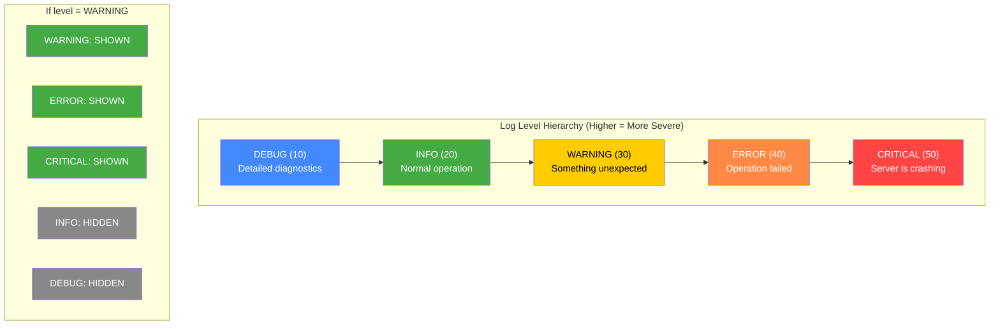
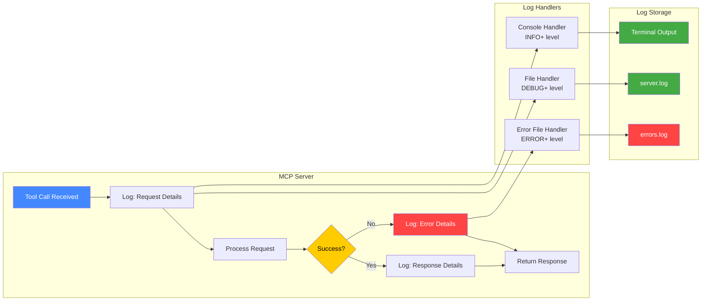
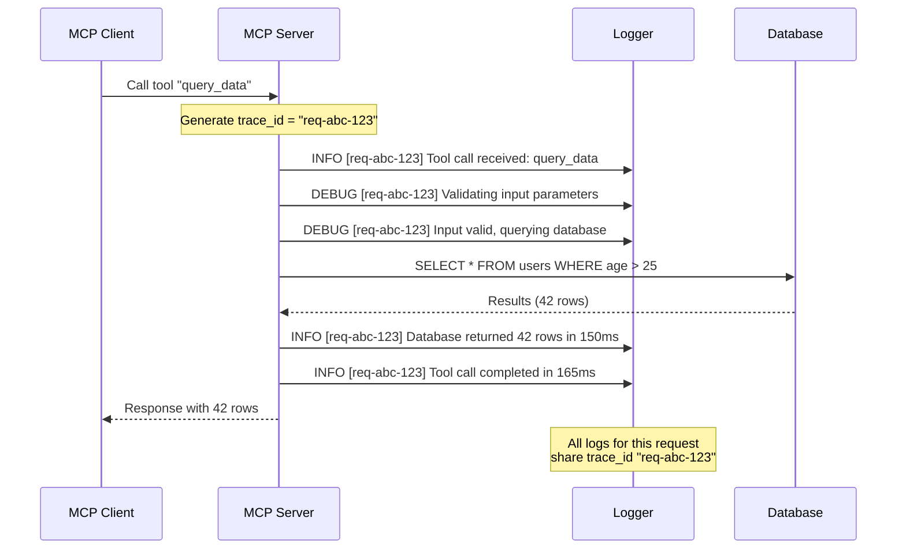
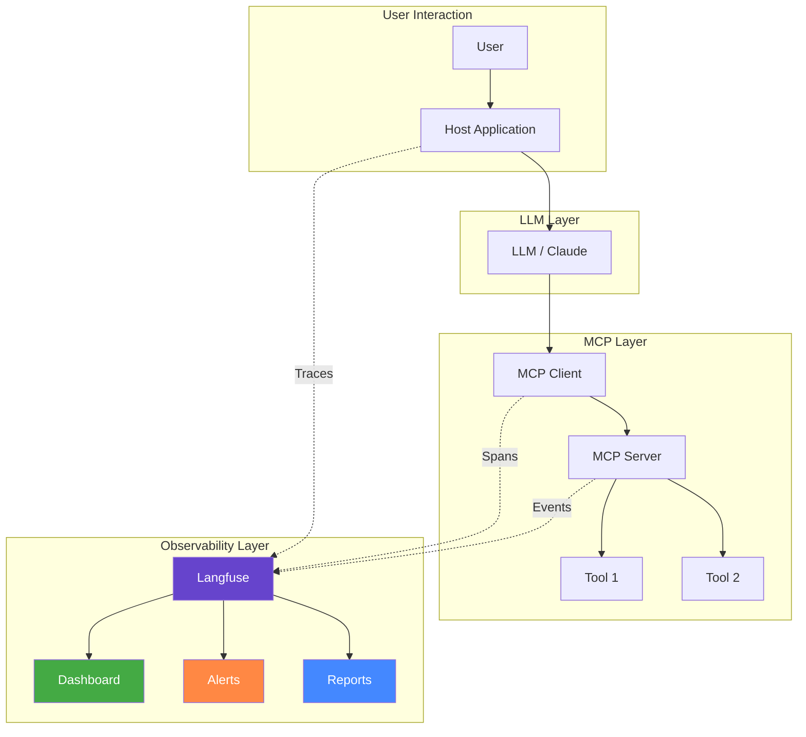
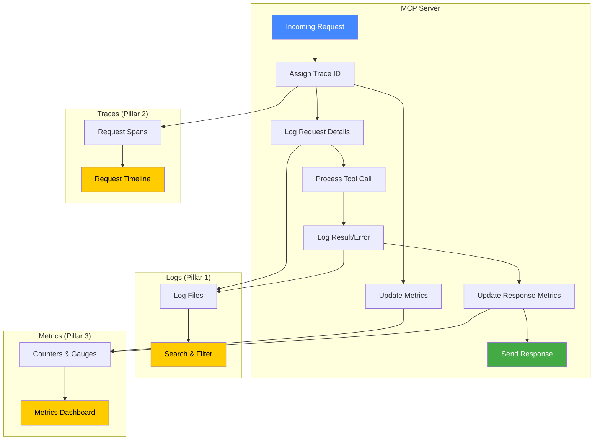

# Chapter 11: Logging and Observability for MCP Servers

---

## Learning Objectives

By the end of this chapter, you will be able to:

1. Set up Python logging for MCP servers with file and console handlers
2. Implement structured logging using JSON format for machine-readable logs
3. Add request tracing with unique IDs to track requests through your MCP server
4. Configure debug-level logging for troubleshooting MCP server issues
5. Collect and expose server metrics (call counts, response times, error rates)
6. Understand the role of observability platforms like Langfuse in MCP monitoring
7. Design a fully observable MCP server with logging, tracing, and metrics combined
8. Apply production logging patterns used by real companies

---

## 11.1 Why Logging and Observability Matter

### The Invisible Problem

When you build an MCP server and it works perfectly on your laptop, everything feels great. But what happens when:

- A user reports that the server is "slow" -- but which tool call was slow?
- The server crashes at 3 AM -- what was it doing when it crashed?
- A tool returns wrong results -- what input did it receive?
- Memory usage keeps growing -- which requests are causing it?
- The server handles 1000 requests per day -- which tools are most popular?

Without logging and observability, you are **flying blind**. You have no idea what your server is doing, why it failed, or how it is performing.

### Real-World Analogy: Security Cameras in a Building

Think of your MCP server as a large building:

- **Logging** is like security cameras. They record everything that happens. If something goes wrong, you can rewind the footage and see exactly what happened, when, and where.

- **Tracing** is like following a specific person through the building using all the cameras. You can see their complete journey -- which door they entered, which rooms they visited, how long they stayed in each room, and when they left.

- **Metrics** are like the building's dashboard. They show you summary numbers: how many people are in the building right now, average time spent in each room, which rooms are most popular, how many fire alarms triggered this month.

- **Observability** is having ALL of these together -- cameras, tracking, and dashboards -- so you have complete visibility into your building at all times.

Without security cameras, when something goes wrong, all you can say is "something bad happened." With cameras, you can say "at 2:47 PM, a person entered through door 3, went to room 12, and knocked over the server rack."

```
Building Security System          MCP Server Observability
============================      ============================
Security Cameras        -->       Logging (record events)
Person Tracking         -->       Tracing (follow requests)
Building Dashboard      -->       Metrics (summary numbers)
All Together            -->       Observability (complete view)
```

---

## 11.2 Python Logging Fundamentals for MCP

### What Is Python Logging?

Python has a built-in `logging` module that provides a flexible framework for recording events in your application. It is much better than `print()` statements because:

| Feature | print() | logging |
|---------|---------|---------|
| Can be turned off without removing code | No | Yes |
| Supports severity levels | No | Yes (DEBUG, INFO, WARNING, ERROR, CRITICAL) |
| Can write to files | No (without extra code) | Yes |
| Can write to multiple destinations | No | Yes |
| Includes timestamps automatically | No | Yes |
| Includes source file and line number | No | Yes |
| Thread-safe | No | Yes |
| Can be configured without changing code | No | Yes |

### Log Levels Explained

Python logging has 5 built-in severity levels. Each level has a number and a purpose:

| Level | Number | When to Use |
|-------|--------|-------------|
| DEBUG | 10 | Detailed diagnostic information. Use during development. "Tool received input: {data}" |
| INFO | 20 | Confirmation that things are working as expected. "Server started on port 8080" |
| WARNING | 30 | Something unexpected happened but the server still works. "Config file not found, using defaults" |
| ERROR | 40 | Something failed. A specific operation could not complete. "Database connection failed" |
| CRITICAL | 50 | The entire server is about to crash. "Out of memory, shutting down" |

The key rule: **when you set a log level, you see that level AND everything above it.**

If you set the level to WARNING, you see WARNING, ERROR, and CRITICAL messages. You do NOT see DEBUG or INFO.

```
CRITICAL  (50)  <-- Always shown (most severe)
ERROR     (40)  <-- Shown if level <= ERROR
WARNING   (30)  <-- Shown if level <= WARNING (default)
INFO      (20)  <-- Shown if level <= INFO
DEBUG     (10)  <-- Shown if level <= DEBUG (most verbose)
```

### Mermaid Diagram: Log Level Hierarchy



### Handlers: Where Do Logs Go?

A **handler** determines where your log messages are sent:

- **StreamHandler**: Sends logs to the console (stdout/stderr)
- **FileHandler**: Sends logs to a file on disk
- **RotatingFileHandler**: Sends logs to a file, but creates new files when the current one gets too big
- **TimedRotatingFileHandler**: Creates new log files based on time (daily, hourly, etc.)

You can have **multiple handlers** at the same time. For example, you might want:
- DEBUG messages to go to a file (for detailed troubleshooting)
- INFO and above to go to the console (for quick monitoring)

### Formatters: What Do Logs Look Like?

A **formatter** controls the format of each log message. Common fields:

| Field | Code | Example |
|-------|------|---------|
| Timestamp | `%(asctime)s` | 2025-01-15 14:30:22,345 |
| Logger name | `%(name)s` | mcp_server |
| Log level | `%(levelname)s` | INFO |
| Message | `%(message)s` | Server started |
| File name | `%(filename)s` | server.py |
| Line number | `%(lineno)d` | 42 |
| Function name | `%(funcName)s` | start_server |

A typical format string:

```
%(asctime)s - %(name)s - %(levelname)s - %(message)s
```

Produces:

```
2025-01-15 14:30:22,345 - mcp_server - INFO - Server started
```

---

## 11.3 Logging Architecture for MCP Servers

### Mermaid Diagram: MCP Server Logging Architecture



### What to Log in an MCP Server

Here is a checklist of what you should log at each level:

**DEBUG Level (Development Only)**
- Raw request data received from client
- Internal processing steps
- Variable values during computation
- Full response data before sending

**INFO Level (Normal Operations)**
- Server startup and shutdown
- Tool registration
- Successful tool calls (tool name, execution time)
- Client connections and disconnections
- Configuration loaded

**WARNING Level (Potential Issues)**
- Deprecated tool usage
- Slow response times (above threshold)
- Configuration fallback to defaults
- High memory usage
- Rate limit approaching

**ERROR Level (Operation Failed)**
- Tool execution failures
- Invalid input received
- Database connection failures
- External API failures
- File not found errors

**CRITICAL Level (Server Dying)**
- Out of memory
- Cannot bind to port
- Required service unavailable
- Unrecoverable state corruption

---

## 11.4 Structured Logging

### What Is Structured Logging?

Traditional logging produces human-readable text:

```
2025-01-15 14:30:22 - INFO - Tool calculator called with args: {"a": 5, "b": 3}
```

This is easy for humans to read but **hard for machines to parse**. If you want to search for all calculator calls, or find all calls that took more than 1 second, you need complex regex patterns.

**Structured logging** produces machine-readable JSON:

```json
{
    "timestamp": "2025-01-15T14:30:22.345Z",
    "level": "INFO",
    "message": "Tool called",
    "tool_name": "calculator",
    "args": {"a": 5, "b": 3},
    "duration_ms": 12,
    "request_id": "req-abc-123"
}
```

This is easy for machines to parse. You can search, filter, aggregate, and visualize structured logs using tools like:

- **ELK Stack** (Elasticsearch, Logstash, Kibana)
- **Grafana Loki**
- **Datadog**
- **Splunk**
- **CloudWatch Logs** (AWS)

### Why Structured Logging for MCP?

MCP servers handle many different types of operations:
- Tool calls with varying parameters
- Resource reads with different URIs
- Prompt template expansions
- Error conditions with different causes

Structured logging lets you:

1. **Filter**: "Show me all ERROR logs for the calculator tool"
2. **Aggregate**: "How many times was each tool called today?"
3. **Alert**: "Notify me if error rate exceeds 5% in any 5-minute window"
4. **Analyze**: "What is the average response time for database queries?"

### Comparison: Traditional vs Structured

```
Traditional Log:
2025-01-15 14:30:22 - ERROR - Tool calculator failed: division by zero

Questions you cannot easily answer:
- How many calculator errors today? (need regex)
- What was the input? (not logged)
- How long did it take? (not logged)
- Which request caused this? (not logged)

Structured Log:
{
    "timestamp": "2025-01-15T14:30:22.345Z",
    "level": "ERROR",
    "tool": "calculator",
    "operation": "divide",
    "input": {"a": 10, "b": 0},
    "error": "division by zero",
    "duration_ms": 2,
    "request_id": "req-xyz-789",
    "client_id": "claude-desktop"
}

Now you can easily answer ALL those questions.
```

---

## 11.5 Request Tracing

### What Is Request Tracing?

When a client sends a request to your MCP server, that request might trigger multiple internal operations:

1. Validate input
2. Check cache
3. Query database
4. Transform data
5. Format response

If something goes wrong at step 3, you need to know which original request caused it. **Request tracing** assigns a unique ID to each incoming request and includes that ID in every log message related to that request.

### Mermaid Diagram: Request Tracing Flow



### Why Tracing Matters

Without tracing, your logs look like this when multiple clients call simultaneously:

```
14:30:22 INFO Tool query_data called
14:30:22 INFO Tool calculator called
14:30:22 DEBUG Validating input
14:30:22 DEBUG Querying database
14:30:22 DEBUG Computing result
14:30:22 ERROR Database timeout
14:30:22 INFO Result computed: 42
```

Which request caused the database timeout? Was it query_data or calculator? You cannot tell.

With tracing:

```
14:30:22 INFO  [req-001] Tool query_data called
14:30:22 INFO  [req-002] Tool calculator called
14:30:22 DEBUG [req-001] Validating input
14:30:22 DEBUG [req-001] Querying database
14:30:22 DEBUG [req-002] Computing result
14:30:22 ERROR [req-001] Database timeout      <-- Now we know!
14:30:22 INFO  [req-002] Result computed: 42
```

Now it is crystal clear: `req-001` (query_data) caused the database timeout.

---

## 11.6 Debugging MCP Servers

### Common MCP Server Issues

When developing MCP servers, you will encounter these common issues:

| Issue | Symptom | How Logging Helps |
|-------|---------|-------------------|
| Tool not found | Client gets error "unknown tool" | Log all registered tools at startup |
| Invalid arguments | Tool crashes with TypeError | Log raw arguments before processing |
| Timeout | Client hangs or gets timeout error | Log start and end times for each operation |
| Memory leak | Server uses more memory over time | Log memory usage periodically |
| Transport error | Connection drops | Log connection events and errors |
| Serialization error | Response cannot be sent | Log response data before serialization |

### Debug Logging Strategy

When debugging, follow this strategy:

1. **Reproduce**: Find steps to reliably trigger the bug
2. **Enable DEBUG level**: Set logging to DEBUG to see everything
3. **Check the logs**: Look for the first ERROR or unexpected WARNING
4. **Trace backwards**: Use the request ID to find all related log messages
5. **Identify the cause**: The DEBUG messages before the error usually reveal the cause
6. **Fix and verify**: Fix the bug, then verify the error no longer appears in logs

### What Happens in Real Companies?

**Anthropic** uses structured logging extensively for their Claude API servers. Every request gets a unique ID that flows through all internal services. When a customer reports an issue, support engineers use that request ID to find every log message related to that specific request across dozens of microservices.

**Cursor** (the AI code editor) logs MCP server interactions to help developers debug issues with their custom MCP servers. When a tool call fails, Cursor shows the error logs in its developer tools panel.

**GitHub Copilot** uses request tracing to monitor the performance of their AI completions pipeline. Each completion request gets a trace ID that follows the request through model inference, post-processing, and response formatting.

---

## 11.7 Metrics Collection

### What Are Metrics?

Metrics are **numerical measurements** collected over time. While logs record individual events, metrics track trends and patterns.

Common metrics for MCP servers:

| Metric | Type | Example |
|--------|------|---------|
| Total tool calls | Counter | 1,523 calls since startup |
| Active connections | Gauge | 3 clients connected right now |
| Response time | Histogram | Average 45ms, 95th percentile 200ms |
| Error rate | Ratio | 2.1% of calls resulted in errors |
| Calls per tool | Counter per tool | calculator: 500, weather: 300, database: 723 |

### Counter vs Gauge vs Histogram

- **Counter**: Only goes up. Examples: total requests, total errors, total bytes processed
- **Gauge**: Goes up and down. Examples: current connections, current memory usage, queue size
- **Histogram**: Records the distribution of values. Examples: response times, request sizes

```
Counter:     0 → 1 → 2 → 3 → 4 → 5 → 6  (only increases)
Gauge:       0 → 3 → 2 → 5 → 1 → 4 → 2  (goes up and down)
Histogram:   [10ms, 12ms, 45ms, 11ms, 200ms, 15ms]  (distribution)
```

### Simple Metrics Without External Tools

You do not need Prometheus or Grafana to start collecting metrics. You can use simple Python dictionaries and the `time` module. This is exactly what we will do in the code examples.

Later, when you move to production, you can replace these simple dictionaries with proper metrics libraries like `prometheus_client`.

---

## 11.8 Introduction to Langfuse for MCP Observability

### What Is Langfuse?

**Langfuse** is an open-source observability platform designed specifically for LLM applications. It provides:

- **Tracing**: Track the complete flow of LLM interactions
- **Metrics**: Monitor latency, cost, and quality
- **Evaluation**: Score and compare outputs
- **Prompt Management**: Version and test prompts
- **Dashboard**: Visualize all of the above

### Why Langfuse for MCP?

MCP servers are often part of larger LLM pipelines. A typical flow might be:

1. User sends message to Claude
2. Claude decides to use a tool
3. Claude sends tool call to MCP server
4. MCP server processes the request
5. MCP server returns result
6. Claude incorporates the result into its response

Langfuse can trace this entire flow, showing you:
- How long each step took
- What data was passed between steps
- Whether the final result was good or bad
- How much the LLM call cost

### Langfuse Architecture with MCP



### Setting Up Langfuse (Self-Hosted)

Langfuse can be self-hosted for free using Docker:

```bash
# Clone Langfuse
git clone https://github.com/langfuse/langfuse.git
cd langfuse

# Start with Docker Compose
docker compose up -d
```

Then set your keys in a `config.py` file:

```python
# config.py -- never commit this file to git!
LANGFUSE_PUBLIC_KEY = "pk-lf-..."
LANGFUSE_SECRET_KEY = "sk-lf-..."
LANGFUSE_HOST = "http://localhost:3000"  # self-hosted
```

> **Note**: In this course, we show the Langfuse integration pattern but focus on built-in Python logging since it requires no external services. Langfuse is optional but recommended for production.

---

## 11.9 Putting It All Together: The Observability Stack

### The Three Pillars of Observability

The industry recognizes three pillars of observability:

1. **Logs**: Detailed records of individual events
2. **Traces**: Connected chains of events showing request flow
3. **Metrics**: Aggregated numerical measurements over time

A fully observable MCP server implements all three.

### Mermaid Diagram: Complete Observability Stack



---

## 11.10 Hands-On Coding

The code examples for this chapter are in the `code/` folder:

| File | Description |
|------|-------------|
| `example1_basic_logging.py` | MCP server with Python logging configured (file + console handlers) |
| `example2_structured_logging.py` | MCP server with JSON structured logging |
| `example3_request_tracing.py` | Server tracing each request with a unique ID |
| `example4_debug_server.py` | Server with verbose debug logging for troubleshooting |
| `example5_metrics_collection.py` | Server collecting metrics (call counts, response times) |
| `exercise1_logged_server.py` | Exercise: Add comprehensive logging to a server |
| `exercise1_solution.py` | Solution for exercise 1 |
| `exercise2_trace_server.py` | Exercise: Build a server with request tracing |
| `exercise2_solution.py` | Solution for exercise 2 |
| `exercise3_metrics_server.py` | Exercise: Build a server with a metrics dashboard |
| `exercise3_solution.py` | Solution for exercise 3 |
| `mini_project_observable_server.py` | Fully observable server combining logging, tracing, and metrics |

### Setting Up the Project

```bash
# Create project directory
mkdir chapter11_logging
cd chapter11_logging

# Initialize Poetry project
poetry init --name chapter11-logging \
    --description "MCP Server Logging and Observability" \
    --author "Your Name" \
    --python "^3.11" \
    --no-interaction

# Add dependencies
poetry add mcp
poetry add python-json-logger

# Install everything
poetry install

# Activate the virtual environment
poetry shell
```

### Expected Output

When you run the examples, you will see output like:

```
=== Example 1: Basic Logging ===
2025-01-15 14:30:22,345 - mcp_server - INFO - MCP Server starting up...
2025-01-15 14:30:22,346 - mcp_server - INFO - Registered tool: add_numbers
2025-01-15 14:30:22,346 - mcp_server - INFO - Registered tool: multiply_numbers
2025-01-15 14:30:22,347 - mcp_server - INFO - Server ready, waiting for connections

=== Example 2: Structured Logging ===
{"timestamp": "2025-01-15T14:30:22.345", "level": "INFO", "message": "Tool called", "tool": "add_numbers"}

=== Example 3: Request Tracing ===
2025-01-15 14:30:22 [req-a1b2c3] INFO  Tool call received: calculator
2025-01-15 14:30:22 [req-a1b2c3] DEBUG Validating input: {"a": 5, "b": 3}
2025-01-15 14:30:22 [req-a1b2c3] INFO  Tool completed in 2ms
```

---

## 11.11 Exercises

### Exercise 1: Add Comprehensive Logging

**Task**: You are given a basic MCP server with no logging. Add:
- Console handler (INFO level)
- File handler (DEBUG level)
- Proper log messages at each stage of tool execution
- Error logging with exception details

See `exercise1_logged_server.py` for the starter code and `exercise1_solution.py` for the solution.

### Exercise 2: Build a Server with Request Tracing

**Task**: Build an MCP server where:
- Each request gets a unique trace ID
- All log messages include the trace ID
- You can follow any single request through the entire log file

See `exercise2_trace_server.py` for the starter code and `exercise2_solution.py` for the solution.

### Exercise 3: Build a Server with Metrics Dashboard

**Task**: Build an MCP server that:
- Counts how many times each tool is called
- Tracks response times for each tool
- Exposes a "get_metrics" tool that returns the current metrics

See `exercise3_metrics_server.py` for the starter code and `exercise3_solution.py` for the solution.

---

## 11.12 Mini Project: Fully Observable MCP Server

Build a complete MCP server that combines:

1. **Structured JSON logging** to files and console
2. **Request tracing** with unique IDs for every request
3. **Metrics collection** tracking call counts, response times, error rates
4. **Multiple tools** (calculator, text processor, data validator)
5. **A metrics endpoint** (tool) that returns all collected metrics
6. **A health check endpoint** (tool) that reports server status

See `mini_project_observable_server.py` for the complete implementation.

---

## 11.13 Summary

| Concept | Key Takeaway |
|---------|-------------|
| Python Logging | Use the `logging` module instead of `print()` -- it supports levels, handlers, and formatters |
| Log Levels | DEBUG < INFO < WARNING < ERROR < CRITICAL. Set level based on environment |
| Handlers | Use multiple handlers: console for real-time monitoring, files for persistence |
| Structured Logging | Use JSON format for machine-readable logs that can be searched and aggregated |
| Request Tracing | Assign a unique ID to each request and include it in all related log messages |
| Debug Logging | Enable DEBUG level during development, use INFO or WARNING in production |
| Metrics | Collect counters (total calls), gauges (current state), and histograms (response times) |
| Langfuse | Open-source observability platform designed for LLM applications, works well with MCP |
| Three Pillars | Logs + Traces + Metrics = Complete Observability |

---

## 11.14 Interview Questions

### Q1: Why should you use Python's logging module instead of print() in an MCP server?
**A**: The logging module provides severity levels (DEBUG, INFO, WARNING, ERROR, CRITICAL), multiple output destinations (console, file, network), timestamps, source information, and can be configured without changing code. print() offers none of these. In production, you need to control verbosity, persist logs to files, and filter by severity -- all impossible with print().

### Q2: What is structured logging and why is it important for MCP servers?
**A**: Structured logging outputs log messages in a machine-readable format like JSON, where each piece of information (timestamp, level, tool name, arguments, duration) is a separate field. This is important because MCP servers handle diverse operations (tool calls, resource reads, prompt expansions) with different parameters. Structured logs allow you to filter ("show all errors for tool X"), aggregate ("average response time per tool"), and alert ("notify if error rate > 5%") -- which is extremely difficult with plain text logs.

### Q3: Explain the difference between a log Counter, Gauge, and Histogram.
**A**: A Counter only increases (total requests: 0, 1, 2, 3...). A Gauge goes up and down (active connections: 0, 3, 2, 5, 1...). A Histogram records the distribution of values (response times: [10ms, 12ms, 45ms, 200ms, 11ms]). Counters track totals, Gauges track current state, and Histograms track distributions.

### Q4: What is request tracing and why does it matter for concurrent MCP servers?
**A**: Request tracing assigns a unique ID to each incoming request and includes that ID in every log message related to that request. When multiple clients call the MCP server simultaneously, logs from different requests get interleaved. Without tracing, you cannot tell which log messages belong to which request. With tracing, you can filter by request ID and see the complete journey of any single request.

### Q5: What are the three pillars of observability?
**A**: Logs (detailed records of individual events), Traces (connected chains of events showing request flow), and Metrics (aggregated numerical measurements over time). A fully observable system implements all three, giving you the ability to understand what happened (logs), how it happened (traces), and how the system is performing overall (metrics).

### Q6: How would you configure different log levels for development vs production?
**A**: In development, set the root logger to DEBUG level to see all messages, including detailed diagnostic information. In production, set it to INFO or WARNING to reduce log volume and noise. Use environment variables (e.g., LOG_LEVEL=DEBUG) to control this without changing code. You might also have different handlers: a verbose file handler at DEBUG level and a console handler at WARNING level in production.

### Q7: What is Langfuse and how does it relate to MCP observability?
**A**: Langfuse is an open-source observability platform designed for LLM applications. It provides tracing, metrics, evaluation, and prompt management. For MCP servers, Langfuse can trace the complete flow from user request through LLM processing, MCP tool calls, and back. It can measure latency at each step, track costs, and help evaluate output quality. It can be self-hosted for free using Docker.

### Q8: What should you log at each severity level in an MCP server?
**A**: DEBUG: raw request data, internal processing steps, variable values. INFO: server startup/shutdown, successful tool calls, client connections. WARNING: slow responses, deprecated tool usage, config fallbacks. ERROR: tool execution failures, invalid input, database errors. CRITICAL: out of memory, cannot bind to port, unrecoverable state.

### Q9: How would you implement a simple metrics collection system without external libraries?
**A**: Use Python dictionaries to store counters and lists. For call counts, use a dictionary mapping tool names to integers and increment on each call. For response times, use a dictionary mapping tool names to lists of floats and append each duration. For error rates, track both total calls and error counts per tool. Expose these metrics through a dedicated "get_metrics" tool or HTTP endpoint.

### Q10: What logging strategy would you recommend for debugging an MCP server that occasionally returns wrong results?
**A**: First, enable DEBUG level logging. Log the exact input received by each tool (to verify the client sent the right data). Log intermediate computation steps (to find where the logic goes wrong). Log the exact output before returning (to verify the response format). Use request tracing so you can follow a specific failing request through all processing steps. Add structured fields for input/output so you can search for specific patterns. Keep at least 7 days of DEBUG logs during investigation, then reduce to INFO after fixing the issue.

---

## 11.15 Common Mistakes

### Mistake 1: Using print() Instead of Logging
```python
# BAD -- cannot control, no levels, no timestamps
print("Server started")
print(f"Error: {e}")

# GOOD -- proper logging with levels and formatting
logger.info("Server started")
logger.error("Tool execution failed", exc_info=True)
```

### Mistake 2: Logging Sensitive Data
```python
# BAD -- logs passwords, API keys, personal data
logger.debug(f"User credentials: {username}:{password}")
logger.info(f"API key used: {api_key}")

# GOOD -- redact sensitive information
logger.debug(f"User authenticated: {username}")
logger.info("API key used: ...{last_4_chars}")
```

### Mistake 3: Not Including Context in Error Logs
```python
# BAD -- no context, impossible to debug
logger.error("Something went wrong")

# GOOD -- includes what, where, why, and how to reproduce
logger.error(
    "Tool execution failed",
    extra={
        "tool": "calculator",
        "operation": "divide",
        "input": {"a": 10, "b": 0},
        "error": "ZeroDivisionError"
    }
)
```

### Mistake 4: Not Using Request IDs
```python
# BAD -- logs from concurrent requests are mixed together
logger.info("Processing tool call")
logger.info("Database query completed")

# GOOD -- each request has a unique ID
logger.info(f"[{request_id}] Processing tool call")
logger.info(f"[{request_id}] Database query completed")
```

### Mistake 5: Setting DEBUG Level in Production
```python
# BAD -- DEBUG in production creates massive log files and can leak sensitive data
logging.basicConfig(level=logging.DEBUG)

# GOOD -- use INFO or WARNING in production, control via environment variable
import os
log_level = os.environ.get("LOG_LEVEL", "INFO")
logging.basicConfig(level=getattr(logging, log_level))
```

---

## 11.16 Production Tips

### Tip 1: Log Rotation
In production, logs can grow to gigabytes. Use `RotatingFileHandler` to automatically create new log files when the current one reaches a size limit (e.g., 10 MB) and keep only the last N files.

### Tip 2: Centralized Logging
In production with multiple server instances, send all logs to a centralized logging service (ELK Stack, Grafana Loki, Datadog) so you can search across all instances from one place.

### Tip 3: Structured Logging from Day One
Start with structured (JSON) logging even in development. It costs nothing extra and makes it much easier to transition to production logging tools later.

### Tip 4: Use Environment Variables for Configuration
Never hardcode log levels or file paths. Use environment variables so you can change logging behavior without redeploying:

```bash
export LOG_LEVEL=DEBUG
export LOG_FILE=/var/log/mcp/server.log
export LOG_FORMAT=json
```

### Tip 5: Monitor Log Volume
Track how many log lines per minute your server produces. A sudden spike in log volume often indicates a problem (like a retry loop or error storm). A sudden drop might mean your server stopped processing requests.

### Tip 6: Separate Access Logs from Application Logs
Keep request/response logs (access logs) in a separate file from application logic logs. This makes it easier to analyze traffic patterns without wading through internal debug messages.

### Tip 7: Include Build/Version Information
Log your server version at startup. When debugging production issues, the first question is always "which version is running?" Having it in the logs saves time.

```python
logger.info(f"MCP Server v{VERSION} starting up")
logger.info(f"Python {sys.version}")
logger.info(f"MCP SDK {mcp.__version__}")
```

### Tip 8: Set Up Alerts
Do not just collect logs and metrics -- set up alerts for critical conditions:
- Error rate above 5% for 5 minutes
- Response time above 2 seconds for 10 requests
- No requests received for 30 minutes (server might be down)
- Disk space below 1 GB (logs might stop writing)

---

## 11.17 Further Reading

- [Python Logging Documentation](https://docs.python.org/3/library/logging.html)
- [Python Logging Cookbook](https://docs.python.org/3/howto/logging-cookbook.html)
- [Langfuse Documentation](https://langfuse.com/docs)
- [The Three Pillars of Observability](https://www.oreilly.com/library/view/distributed-systems-observability/9781492033431/)
- [python-json-logger Library](https://github.com/madzak/python-json-logger)
- [MCP Server Specification](https://modelcontextprotocol.io/)

---

**Next Chapter**: [Chapter 12: Production MCP Server](../12_Production_MCP_Server/12_Production_MCP_Server.md) -- Learn how to structure, configure, test, dockerize, and deploy production-grade MCP servers.
