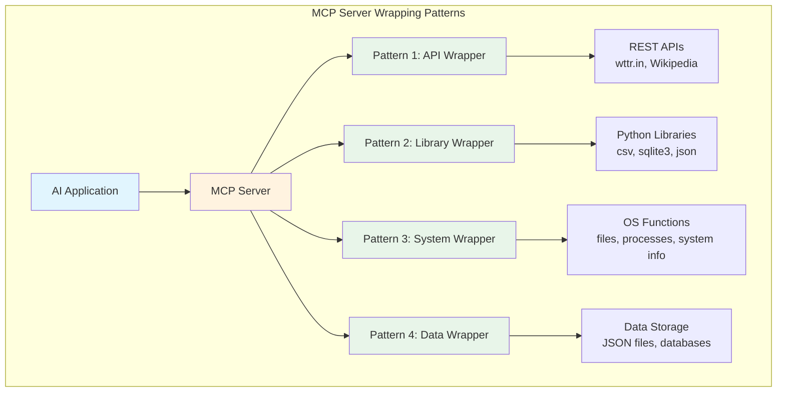
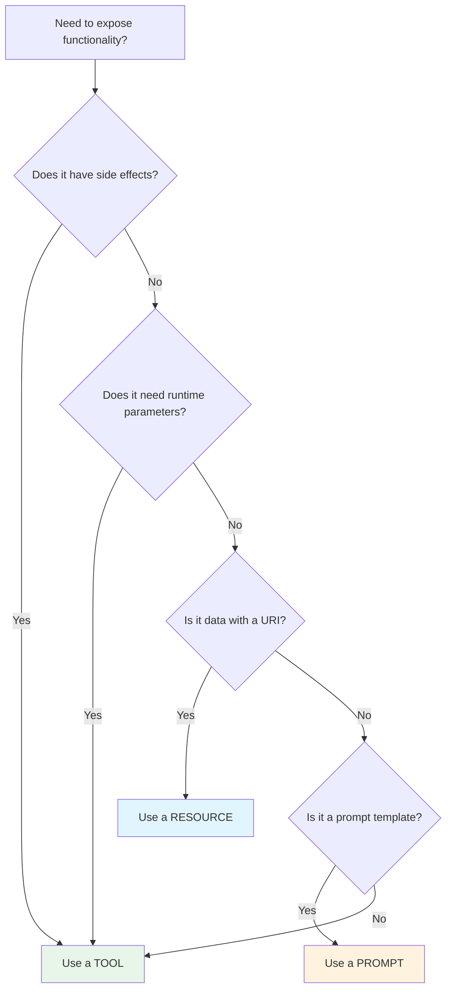
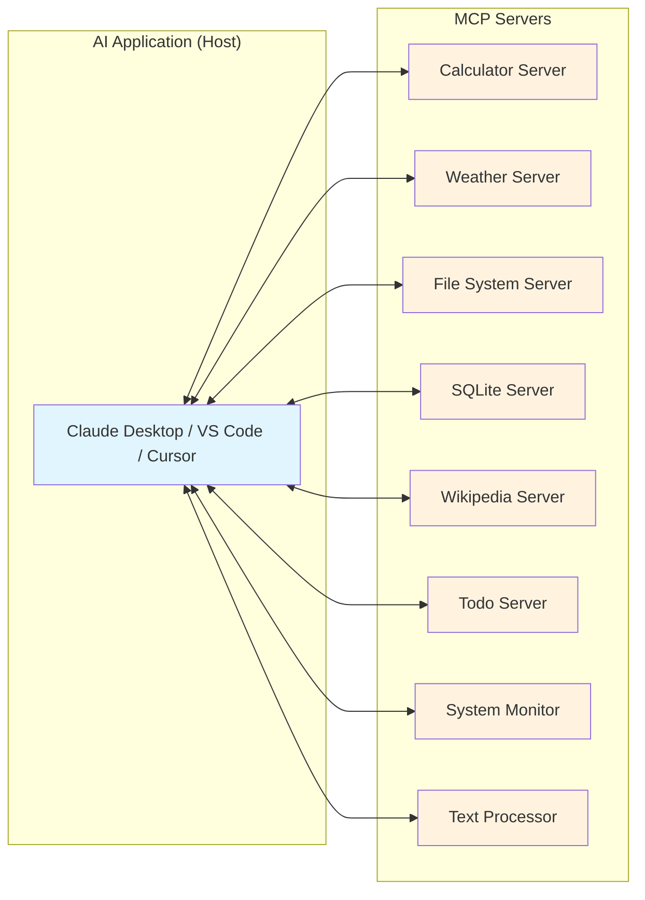
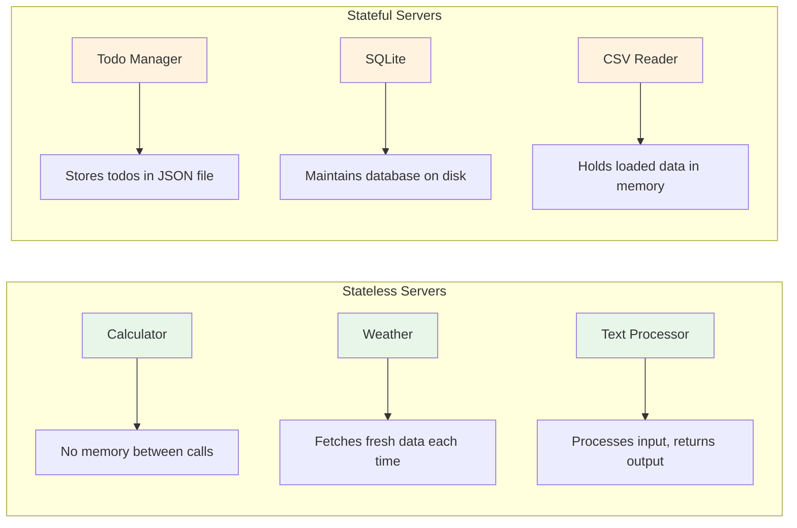

# Chapter 13: Useful MCP Servers

## Learning Objectives

By the end of this chapter, you will be able to:

1. Design practical MCP servers that solve real-world problems
2. Understand patterns for wrapping existing services as MCP tools
3. Apply best practices for tool naming, parameter design, and error handling
4. Decide when to use tools vs resources vs prompts for a given use case
5. Build 12 complete, runnable MCP servers covering common utility domains
6. Integrate multiple tools into a single cohesive server
7. Handle state, persistence, and external API calls within MCP servers

---

## 13.1 Introduction: Why Build Practical MCP Servers?

In previous chapters, you learned the fundamentals of MCP -- what servers are, how tools work, how resources and prompts function, and how to build and deploy servers. Now it is time to put all of that knowledge to work.

This chapter is the "cookbook" chapter. We will build **12 practical MCP servers** that you can actually use in your daily work. Each server is a complete, standalone application that you can plug into Claude Desktop, VS Code, Cursor, or any other MCP-compatible application.

### Real-World Analogy

Think of MCP servers like kitchen appliances. You have learned how electricity works (the protocol), how to wire an outlet (transport), and how to read a manual (tools/resources/prompts). Now we are going to build actual appliances -- a toaster, a blender, a coffee maker. Each appliance does one thing well, and your kitchen (your AI application) becomes more powerful with each one you add.

---

## 13.2 How to Design Practical MCP Servers

Before we start building, let us establish design principles that will guide every server we create.

### Principle 1: Single Responsibility

Each MCP server should focus on one domain. A calculator server does math. A weather server gets weather. Do not build a server that does everything -- that is what the AI application layer is for.

**Why?** Because MCP servers are composable. The AI application can connect to many servers simultaneously. Each server being focused makes it easier to maintain, test, and reuse.

### Principle 2: Descriptive Tool Names

Tool names should be verbs that describe what they do. The AI model reads these names to decide which tool to call.

```
Good: calculate_percentage, get_weather, search_wikipedia
Bad: func1, do_thing, helper
```

### Principle 3: Rich Descriptions

Every tool needs a clear description. The AI model uses this description to understand WHEN to call the tool and WHAT it does.

```
Good: "Calculate the percentage of a value. For example, 15% of 200 returns 30."
Bad: "Percentage function"
```

### Principle 4: Meaningful Error Messages

When something goes wrong, return a helpful error message. The AI model will relay this to the user, so make it human-readable.

```
Good: "Cannot divide by zero. Please provide a non-zero divisor."
Bad: "Error"
```

### Principle 5: Sensible Defaults

Where possible, provide default values for optional parameters. This makes tools easier to call.

---

## 13.3 Patterns for Wrapping Existing Services

Most practical MCP servers are wrappers around existing functionality. Here are the common patterns:

### Pattern 1: API Wrapper

Wrap a REST API (like wttr.in for weather) as MCP tools. The server handles the HTTP call and formats the response.

### Pattern 2: Library Wrapper

Wrap a Python library (like sqlite3 or csv) as MCP tools. The server provides a simplified interface.

### Pattern 3: System Wrapper

Wrap operating system functionality (like file system operations or process monitoring) as MCP tools.

### Pattern 4: Data Wrapper

Wrap data storage (like JSON files or SQLite databases) as MCP tools with CRUD operations.



---

## 13.4 When to Use Tools vs Resources vs Prompts

This is a critical design decision. Here is a simple decision framework:

### Use Tools When:

- The operation has **side effects** (creates, updates, or deletes something)
- The operation requires **parameters** from the user
- The operation involves **computation** or **external API calls**
- The result depends on **runtime input**

**Examples:** calculate something, search Wikipedia, write a file, add a todo item

### Use Resources When:

- You are exposing **static or semi-static data**
- The data can be identified by a **URI**
- The data does not require complex parameters
- You want the AI to have **background context**

**Examples:** configuration files, database schemas, documentation, templates

### Use Prompts When:

- You want to provide **reusable prompt templates**
- The template has **fill-in-the-blank parameters**
- You want to guide the AI's behavior for specific tasks

**Examples:** code review template, data analysis template, report generator



---

## 13.5 Integration Architecture

When you build multiple MCP servers, they all connect to the same AI application. Here is how the architecture looks:



Each server runs as an independent process. The AI application manages multiple connections and routes tool calls to the appropriate server. This is the power of MCP -- composability.

---

## 13.6 Best Practices for Tool Design

### Naming Conventions

| Pattern | Example | When to Use |
|---------|---------|-------------|
| `verb_noun` | `add_expense` | Actions that create |
| `get_noun` | `get_weather` | Actions that retrieve |
| `search_noun` | `search_wikipedia` | Actions that search |
| `list_noun` | `list_files` | Actions that enumerate |
| `delete_noun` | `delete_todo` | Actions that remove |
| `update_noun` | `update_habit` | Actions that modify |

### Parameter Design

1. Use **descriptive parameter names** -- `city_name` not `c`
2. Always include **type annotations** in your schema
3. Mark parameters as **required** only if they truly are
4. Provide **descriptions** for every parameter
5. Use **enums** when there is a fixed set of valid values

### Response Design

1. Return **structured text** that the AI can parse
2. Include **relevant context** in the response
3. Format numbers and dates **consistently**
4. Use **newlines** and **sections** for readability

---

## 13.7 Overview of Servers Built in This Chapter

Here is a brief description of each server we will build:

| # | Server | Description | Key Concepts |
|---|--------|-------------|--------------|
| 1 | Calculator | Basic and scientific math operations | Pure computation, no side effects |
| 2 | Weather | Current weather from wttr.in API | External API wrapper, no API key |
| 3 | File System | Read, write, list files and directories | System wrapper, safety checks |
| 4 | CSV Reader | Load and analyze CSV files | Library wrapper, data processing |
| 5 | SQLite | Database CRUD operations | Persistent state, SQL execution |
| 6 | Wikipedia | Search and read Wikipedia articles | API wrapper, text processing |
| 7 | Web Scraper | Fetch and parse web pages | HTTP requests, HTML parsing |
| 8 | Todo Manager | Task management with JSON storage | CRUD, file-based persistence |
| 9 | System Monitor | CPU, memory, disk monitoring | OS-level information |
| 10 | Text Processor | Word count, text analysis | String processing |
| 11 | JSON Tools | Validate, format, query JSON | Data manipulation |
| 12 | Date/Time | Time zones, date math, countdowns | Datetime operations |

---

## 13.8 Project Setup

All servers in this chapter use the same basic dependencies. Here is how to set up the project:

```bash
# Create the project directory
mkdir chapter_13_useful_servers
cd chapter_13_useful_servers

# Initialize Poetry project
poetry init --name "useful-mcp-servers" \
            --description "Collection of practical MCP servers" \
            --author "Your Name" \
            --python "^3.10" \
            --no-interaction

# Add dependencies
poetry add mcp             # MCP SDK
poetry add httpx            # For HTTP requests (weather, wikipedia, scraper)

# Install everything
poetry install

# Activate the virtual environment
poetry shell
```

### Directory Structure

```
chapter_13_useful_servers/
    pyproject.toml
    calculator_server.py
    weather_server.py
    filesystem_server.py
    csv_reader_server.py
    sqlite_server.py
    wikipedia_server.py
    web_scraper_server.py
    todo_server.py
    system_monitor_server.py
    text_processor_server.py
    json_tools_server.py
    datetime_server.py
```

### Running Any Server

Every server in this chapter can be run the same way:

```bash
# Run with Python directly
python calculator_server.py

# Or run with MCP inspector for testing
npx @modelcontextprotocol/inspector python calculator_server.py
```

---

## 13.9 Code Files Reference

The following code files accompany this chapter. Each is a complete, runnable MCP server:

1. **calculator_server.py** -- Mathematical operations (add, subtract, multiply, divide, power, square root, percentage)
2. **weather_server.py** -- Weather data from wttr.in (no API key required)
3. **filesystem_server.py** -- File system operations (list, read, write, create directory, file info)
4. **csv_reader_server.py** -- CSV file operations (load, get columns, filter, statistics)
5. **sqlite_server.py** -- SQLite database operations (create table, insert, query, list tables)
6. **wikipedia_server.py** -- Wikipedia search and article retrieval
7. **web_scraper_server.py** -- Web page fetching and content extraction
8. **todo_server.py** -- Todo list management with JSON file persistence
9. **system_monitor_server.py** -- System resource monitoring (CPU, memory, disk)
10. **text_processor_server.py** -- Text analysis and processing utilities
11. **json_tools_server.py** -- JSON validation, formatting, querying, and comparison
12. **datetime_server.py** -- Date/time utilities, timezone conversion, date arithmetic

---

## 13.10 Design Patterns Deep Dive

### Stateless vs Stateful Servers

Some servers are **stateless** -- they compute a result and return it without remembering anything. The calculator is a perfect example. Every call is independent.

Other servers are **stateful** -- they maintain data between calls. The todo server remembers your todos. The SQLite server maintains a database.



### Error Handling Pattern

Every server in this chapter follows the same error handling pattern:

```python
# 1. Validate inputs
# 2. Try the operation
# 3. Return a clear error message if anything goes wrong
# 4. Never crash the server
```

This is critical for production servers. An unhandled exception can crash the MCP server process, disconnecting the AI application.

### Response Formatting Pattern

All servers return plain text responses formatted for readability:

```
=== Result Title ===

Key: Value
Key: Value

--- Section ---

Details here...
```

This format is easy for both humans and AI models to read.

---

## 13.11 Exercises

### Exercise 1: Currency Converter Server

Build an MCP server that converts between currencies using hardcoded exchange rates. Tools needed:
- `convert_currency` -- Convert an amount from one currency to another
- `list_currencies` -- Show all supported currencies
- `get_exchange_rate` -- Get the exchange rate between two currencies

See `exercise1_currency_server.py` for the starter code and `exercise1_solution.py` for the solution.

### Exercise 2: Bookmark Manager Server

Build an MCP server that manages bookmarks with categories. Tools needed:
- `add_bookmark` -- Add a URL with title and category
- `list_bookmarks` -- List all bookmarks, optionally filtered by category
- `search_bookmarks` -- Search bookmarks by keyword
- `delete_bookmark` -- Remove a bookmark

See `exercise2_bookmark_server.py` for the starter code and `exercise2_solution.py` for the solution.

### Exercise 3: Quiz/Flashcard Server

Build an MCP server for studying with flashcards. Tools needed:
- `add_flashcard` -- Add a question/answer pair
- `get_random_card` -- Get a random flashcard for studying
- `list_cards` -- List all flashcards
- `check_answer` -- Check if an answer is correct

See `exercise3_quiz_server.py` for the starter code and `exercise3_solution.py` for the solution.

---

## 13.12 Mini Project: Personal Assistant Server

The mini project combines multiple tool categories into a single "Personal Assistant" MCP server. This server includes:

- **Notes** -- Take and search notes
- **Todos** -- Manage tasks
- **Calculator** -- Quick math
- **Weather** -- Check weather
- **Time** -- Current time and date math

This demonstrates the pattern of building a multi-domain server for personal productivity.

See `mini_project_personal_assistant.py` for the complete implementation.

---

## 13.13 Summary

In this chapter, we learned:

1. **Design Principles** -- Single responsibility, descriptive naming, rich descriptions, meaningful errors, sensible defaults
2. **Wrapping Patterns** -- API wrappers, library wrappers, system wrappers, data wrappers
3. **Tools vs Resources vs Prompts** -- Tools for actions, resources for data, prompts for templates
4. **Stateless vs Stateful** -- When to maintain state and how to persist it
5. **12 Practical Servers** -- Calculator, weather, filesystem, CSV, SQLite, Wikipedia, web scraper, todo, system monitor, text processor, JSON tools, datetime
6. **Error Handling** -- Always validate, never crash, return helpful messages
7. **Response Formatting** -- Structured plain text that is easy for AI models to parse
8. **Integration** -- Each server is composable; connect many to one AI application

---

## 13.14 Interview Questions

### Q1: How would you decide whether to implement functionality as a tool vs a resource?

**Answer:** Tools are for operations that have side effects, require runtime parameters, or involve computation. Resources are for static or semi-static data that can be identified by a URI. If the user needs to provide input and the server needs to compute something, use a tool. If you are exposing reference data that the AI can read for context, use a resource.

### Q2: What is the single responsibility principle for MCP servers?

**Answer:** Each MCP server should focus on one domain (e.g., weather, file system, database). This makes servers easier to maintain, test, and reuse. The composability of MCP allows an AI application to connect to multiple focused servers simultaneously.

### Q3: How do you handle errors in MCP server tools?

**Answer:** Validate inputs first, wrap operations in try-except blocks, and return human-readable error messages as the tool result (not as exceptions). The AI model will relay these messages to the user, so they should be clear and actionable. Never let an unhandled exception crash the server.

### Q4: What makes a good tool description?

**Answer:** A good description clearly states what the tool does, when to use it, and ideally includes an example. The AI model reads descriptions to decide which tool to call, so vague descriptions lead to incorrect tool selection.

### Q5: How do you persist state in an MCP server?

**Answer:** Common approaches include: JSON files for simple data (like todo lists), SQLite for structured data, in-memory dictionaries for session-scoped data. The choice depends on data complexity and whether data needs to survive server restarts.

### Q6: What is the difference between a stateless and stateful MCP server?

**Answer:** A stateless server (like a calculator) computes results without maintaining any data between calls. A stateful server (like a todo manager) maintains data that persists across calls, typically using file storage or a database.

### Q7: How do you wrap an external REST API as an MCP server?

**Answer:** Create a tool for each API endpoint you want to expose. The tool function makes an HTTP request to the API, processes the response, and returns formatted text. Handle API errors, timeouts, and rate limits gracefully.

### Q8: What naming conventions should you use for MCP tools?

**Answer:** Use verb_noun format (e.g., `add_todo`, `get_weather`, `search_wikipedia`). The verb should describe the action (add, get, search, list, delete, update) and the noun should describe the target. This makes tool purpose clear to both the AI model and developers.

### Q9: How do you handle file path security in a file system MCP server?

**Answer:** Restrict operations to an allowed directory, validate paths to prevent directory traversal attacks (e.g., `../../../etc/passwd`), never follow symbolic links outside the allowed directory, and limit file sizes for read/write operations.

### Q10: How would you design an MCP server that needs to interact with a database?

**Answer:** Create tools for common operations (query, insert, update, delete, list tables, describe schema). Use parameterized queries to prevent SQL injection. Return results as formatted text. Consider read-only vs read-write access based on security requirements.

---

## 13.15 Common Mistakes

### Mistake 1: Building a God Server

**Wrong:** One MCP server with 50 tools covering every possible domain.

**Right:** Multiple focused servers, each covering one domain. The AI application connects to all of them.

**Why it matters:** Large servers are hard to maintain, test, and debug. They also make tool selection harder for the AI model.

### Mistake 2: Vague Tool Descriptions

**Wrong:** `description="Does calculation"`

**Right:** `description="Add two numbers together. Takes two numeric inputs and returns their sum. Example: add(3, 5) returns 8."`

**Why it matters:** The AI model uses descriptions to decide which tool to call. Vague descriptions lead to wrong tool calls.

### Mistake 3: Not Validating Inputs

**Wrong:** Passing user input directly to file system operations or SQL queries.

**Right:** Always validate, sanitize, and constrain inputs before using them.

**Why it matters:** MCP servers can be called with any input. Without validation, you risk security vulnerabilities, crashes, or data corruption.

### Mistake 4: Crashing on Errors Instead of Returning Error Messages

**Wrong:** Letting exceptions propagate and crash the server.

**Right:** Catching exceptions and returning a helpful error message as the tool result.

**Why it matters:** A crashed server disconnects the AI application. Users lose the ability to use all tools from that server.

### Mistake 5: Hardcoding Paths and Configuration

**Wrong:** `db_path = "C:/Users/me/todos.json"`

**Right:** Use environment variables, configuration files, or default to a known directory like the user's home folder.

**Why it matters:** Hardcoded paths break when the server runs on a different machine or as a different user.

---

## 13.16 Production Tips

### Tip 1: Add Health Check Tools

Include a `health_check` or `ping` tool that returns server status. This helps AI applications verify that the server is running.

### Tip 2: Version Your Servers

Include a `get_version` tool or metadata that returns the server version. This helps with debugging when multiple versions might be deployed.

### Tip 3: Log All Tool Calls

Log every tool call with its parameters and result. This is invaluable for debugging issues in production.

### Tip 4: Set Resource Limits

For servers that read files or query databases, set limits on result sizes. An AI application does not need a 10 MB file dumped into the conversation.

### Tip 5: Use Environment Variables for Configuration

Database paths, API endpoints, allowed directories -- all should be configurable via environment variables, not hardcoded.

### Tip 6: Test with MCP Inspector

Before connecting a server to an AI application, test it with the MCP Inspector tool. This lets you call tools manually and verify responses.

```bash
npx @modelcontextprotocol/inspector python your_server.py
```

### Tip 7: Document Your Tools

Keep a README or documentation for each server listing all tools, their parameters, and example usage. This helps other developers who want to use your servers.

### Tip 8: Consider Concurrency

If your server handles multiple simultaneous connections, ensure your tools are thread-safe. File operations and database writes are common sources of race conditions.

---

## 13.17 What Happens in Real Companies?

In production environments, companies build MCP servers for:

- **Internal APIs**: Wrapping internal microservices so AI assistants can query them
- **Knowledge bases**: Exposing documentation, wikis, and runbooks
- **Monitoring**: Letting AI assistants check system health, logs, and metrics
- **Data analysis**: Querying databases, generating reports, analyzing trends
- **Workflow automation**: Creating tickets, sending notifications, managing deployments

The pattern is always the same: identify a capability, wrap it as an MCP tool with clear inputs/outputs, deploy the server, and connect it to the AI application.

Companies like Anthropic (Claude Desktop), GitHub (Copilot), and Cursor have built their products around MCP, making it the standard protocol for AI tool integration.

---

## 13.18 Further Reading

- MCP Specification: https://spec.modelcontextprotocol.io
- MCP Server Registry: https://github.com/modelcontextprotocol/servers
- MCP Python SDK: https://github.com/modelcontextprotocol/python-sdk
- wttr.in API: https://wttr.in/:help
- Wikipedia API: https://www.mediawiki.org/wiki/API:Main_page

---

## Next Chapter

In Chapter 14, we will learn how to use these MCP servers inside various AI applications -- Claude Desktop, VS Code, Cursor, Continue.dev, and more. You will learn the configuration format for each application and how to debug integration issues.
