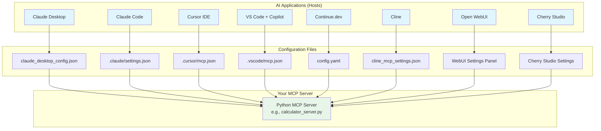
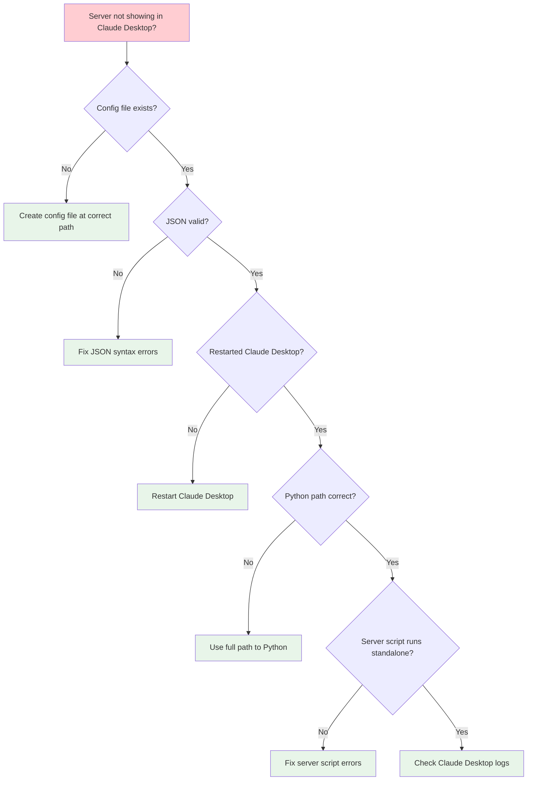
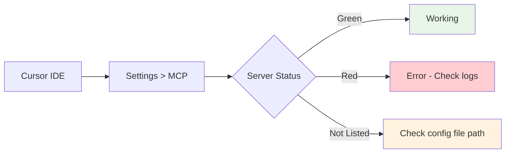
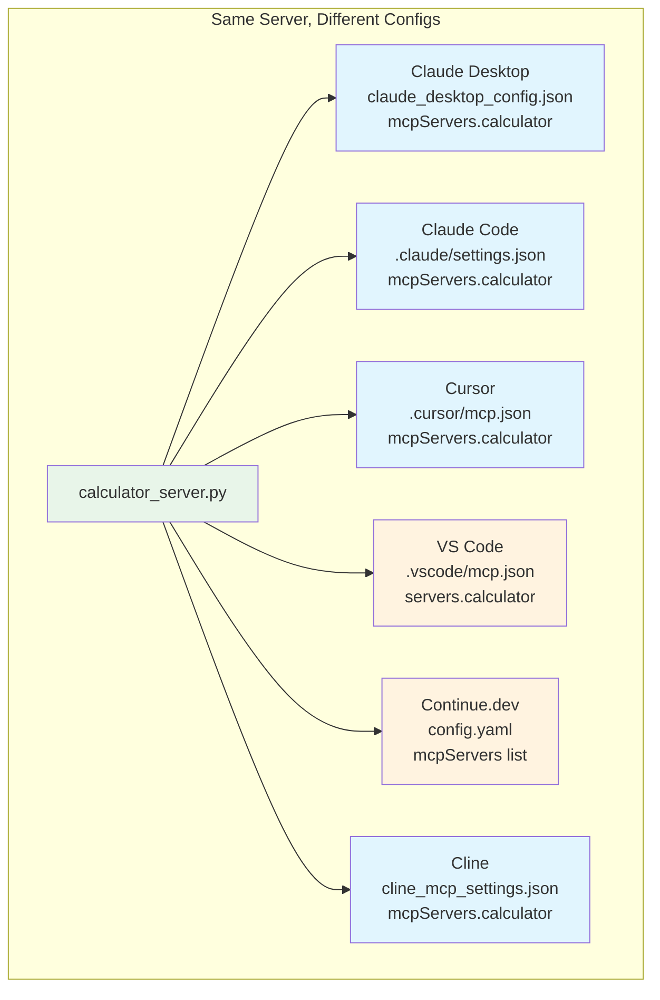
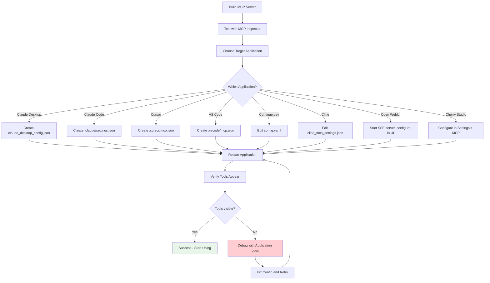

# Chapter 14: MCP in AI Applications

## Learning Objectives

By the end of this chapter, you will be able to:

1. Configure MCP servers in Claude Desktop, Claude Code, Cursor, VS Code, Continue.dev, Cline, Open WebUI, and Cherry Studio
2. Understand the configuration file format for each application
3. Debug common MCP integration issues across different applications
4. Build a universal MCP server that works with any AI application
5. Generate configuration files programmatically for all supported applications
6. Troubleshoot connectivity, authentication, and tool discovery problems
7. Choose the right AI application for your MCP workflow

---

## 14.1 Introduction: One Server, Many Applications

The beauty of MCP is that you build a server once and use it everywhere. The same calculator server you built in Chapter 13 can be used in Claude Desktop, VS Code with Copilot, Cursor, and any other MCP-compatible application.

But each application has its own configuration format. Some use JSON files. Some use YAML. Some expect the config in one directory, others in a different one. This chapter is your definitive guide to configuring MCP servers in every major AI application.

### Real-World Analogy

Think of MCP servers like USB devices. A USB keyboard works with any computer -- Windows, Mac, or Linux. But each operating system might need slightly different driver settings. The keyboard itself does not change; only the configuration on the host changes. MCP servers work the same way.

---

## 14.2 Architecture Overview

Before diving into specific applications, let us understand the general architecture:



### Transport Types by Application

| Application | Supported Transport | Default |
|------------|-------------------|---------|
| Claude Desktop | stdio, SSE | stdio |
| Claude Code | stdio | stdio |
| Cursor | stdio, SSE | stdio |
| VS Code (Copilot) | stdio, SSE | stdio |
| Continue.dev | stdio, SSE | stdio |
| Cline | stdio, SSE | stdio |
| Open WebUI | SSE, stdio | SSE |
| Cherry Studio | stdio, SSE | stdio |

---

## 14.3 Claude Desktop

Claude Desktop is Anthropic's desktop application for Claude. It was one of the first applications to support MCP, making it the reference implementation.

### Configuration File Location

| OS | Path |
|----|------|
| macOS | `~/Library/Application Support/Claude/claude_desktop_config.json` |
| Windows | `%APPDATA%\Claude\claude_desktop_config.json` |
| Linux | `~/.config/Claude/claude_desktop_config.json` |

### Configuration Format

```json
{
  "mcpServers": {
    "calculator": {
      "command": "python",
      "args": ["C:/path/to/calculator_server.py"],
      "env": {
        "OPTIONAL_ENV_VAR": "value"
      }
    },
    "weather": {
      "command": "python",
      "args": ["C:/path/to/weather_server.py"]
    },
    "my-sse-server": {
      "url": "http://localhost:8080/sse"
    }
  }
}
```

### Key Points

- Each server has a **unique name** (the key in `mcpServers`)
- `command` is the executable to run (usually `python` or `node`)
- `args` is an array of command-line arguments
- `env` is optional -- environment variables passed to the server process
- For SSE servers, use `url` instead of `command`/`args`
- Claude Desktop restarts servers automatically if they crash
- Changes require restarting Claude Desktop

### Debugging Claude Desktop

1. Check logs: `~/Library/Logs/Claude/` (macOS) or `%APPDATA%\Claude\logs\` (Windows)
2. Use Developer Tools: `Ctrl+Shift+I` (Windows) or `Cmd+Option+I` (macOS)
3. Look for MCP connection errors in the console
4. Verify the Python path is correct and accessible



---

## 14.4 Claude Code

Claude Code is Anthropic's CLI tool for coding with Claude. It supports MCP servers through its settings file.

### Configuration

Claude Code uses a settings file that can be at the project level or user level:

- **Project level**: `.claude/settings.json` in your project root
- **User level**: `~/.claude/settings.json`

### Configuration Format

```json
{
  "mcpServers": {
    "calculator": {
      "command": "python",
      "args": ["/path/to/calculator_server.py"]
    },
    "weather": {
      "command": "python",
      "args": ["/path/to/weather_server.py"],
      "env": {
        "API_KEY": "your-key"
      }
    }
  }
}
```

### Adding Servers via CLI

You can also add servers using the Claude Code CLI:

```bash
# Add a server using the command line
claude mcp add calculator python /path/to/calculator_server.py

# List configured servers
claude mcp list

# Remove a server
claude mcp remove calculator
```

### Debugging Claude Code

```bash
# Test if the server starts correctly
python /path/to/calculator_server.py

# Check Claude Code logs
claude --debug

# Verify MCP servers are loaded
# (In a Claude Code session, ask: "What tools do you have?")
```

---

## 14.5 Cursor IDE

Cursor is an AI-powered code editor built on VS Code. It has native MCP support.

### Configuration File Location

- **Project level**: `.cursor/mcp.json` in your project root
- **Global level**: `~/.cursor/mcp.json`

### Configuration Format

```json
{
  "mcpServers": {
    "calculator": {
      "command": "python",
      "args": ["C:/path/to/calculator_server.py"]
    },
    "remote-server": {
      "url": "http://localhost:8080/sse"
    }
  }
}
```

### Key Points

- Cursor uses the same format as Claude Desktop
- Project-level configs override global configs
- Cursor's Agent mode has full MCP tool access
- Composer mode may have limited MCP access depending on the version
- Restart Cursor after config changes

### Debugging Cursor

1. Open Cursor Settings > MCP to see server status
2. Check the Output panel (View > Output > MCP)
3. Look for green/red indicators next to server names
4. Use the "Restart" button next to each server



---

## 14.6 VS Code with GitHub Copilot

VS Code supports MCP through GitHub Copilot Chat (agent mode).

### Configuration File Location

- **Project level**: `.vscode/mcp.json` in your project root
- **User level**: Settings > search "MCP"

### Configuration Format

```json
{
  "servers": {
    "calculator": {
      "type": "stdio",
      "command": "python",
      "args": ["C:/path/to/calculator_server.py"]
    },
    "remote-server": {
      "type": "sse",
      "url": "http://localhost:8080/sse"
    }
  }
}
```

Note that VS Code uses `servers` (not `mcpServers`) and requires a `type` field.

### Alternative: settings.json Configuration

You can also configure MCP servers in VS Code's `settings.json`:

```json
{
  "github.copilot.chat.mcpServers": {
    "calculator": {
      "type": "stdio",
      "command": "python",
      "args": ["C:/path/to/calculator_server.py"]
    }
  }
}
```

### Key Points

- Requires GitHub Copilot extension with agent mode enabled
- Use `#` prefix to reference tools in chat (e.g., `#calculator`)
- VS Code may prompt you to approve MCP tool usage
- Supports both stdio and SSE transport

### Debugging VS Code

1. Open the Output panel: View > Output
2. Select "GitHub Copilot Chat - MCP" from the dropdown
3. Check for connection errors
4. Verify the Copilot extension is up to date
5. Ensure agent mode is enabled in settings

---

## 14.7 Continue.dev

Continue.dev is an open-source AI code assistant that works as a VS Code and JetBrains extension.

### Configuration File Location

- `~/.continue/config.yaml` (or `config.json` for older versions)

### Configuration Format (YAML)

```yaml
mcpServers:
  - name: calculator
    command: python
    args:
      - /path/to/calculator_server.py
    env:
      OPTIONAL_VAR: value

  - name: weather
    command: python
    args:
      - /path/to/weather_server.py
```

### Configuration Format (JSON)

```json
{
  "mcpServers": [
    {
      "name": "calculator",
      "command": "python",
      "args": ["/path/to/calculator_server.py"]
    }
  ]
}
```

### Key Points

- Continue.dev uses a **list** format (not an object/dictionary) for MCP servers in YAML
- Each server entry must have a `name` field
- Supports both stdio and SSE transport
- Works with Ollama, OpenAI, Anthropic, and other model providers
- You can use MCP tools with local models via Ollama

### Debugging Continue.dev

1. Check the Continue output panel in VS Code
2. Verify config file syntax with a YAML validator
3. Restart the Continue extension after config changes
4. Test the server standalone first

---

## 14.8 Cline

Cline (formerly Claude Dev) is a VS Code extension that acts as an autonomous coding agent.

### Configuration

Cline manages MCP servers through its settings panel in VS Code:

1. Open VS Code
2. Click the Cline icon in the sidebar
3. Click the Settings/MCP icon
4. Add servers through the UI or edit the settings file

### Settings File Location

- `~/Library/Application Support/Code/User/globalStorage/saoudrizwan.claude-dev/settings/cline_mcp_settings.json` (macOS)
- `%APPDATA%\Code\User\globalStorage\saoudrizwan.claude-dev\settings\cline_mcp_settings.json` (Windows)

### Configuration Format

```json
{
  "mcpServers": {
    "calculator": {
      "command": "python",
      "args": ["/path/to/calculator_server.py"],
      "disabled": false
    },
    "weather": {
      "command": "python",
      "args": ["/path/to/weather_server.py"],
      "disabled": false
    }
  }
}
```

### Key Points

- Cline can install MCP servers from the MCP marketplace
- Servers can be enabled/disabled individually
- Cline shows tool usage approval prompts
- Supports both stdio and SSE

### Debugging Cline

1. Check the Cline output panel
2. Look for tool approval prompts
3. Verify server status in Cline settings
4. Restart the extension after config changes

---

## 14.9 Open WebUI

Open WebUI is a self-hosted web interface for AI models. It supports MCP through its Tools/Functions system.

### Setup Method

Open WebUI integrates MCP differently from desktop applications. It typically uses SSE transport since the web UI runs as a separate service.

### Configuration

1. Start your MCP server with SSE transport (not stdio)
2. In Open WebUI, go to Settings > Tools
3. Add a new MCP connection with the server URL

### Running Your Server with SSE

```python
# When using with Open WebUI, run your server with SSE transport
# Example: python server.py --transport sse --port 8080
```

### Configuration in Open WebUI Settings

```
Server URL: http://localhost:8080/sse
Name: Calculator Server
Description: Mathematical operations
```

### Key Points

- Open WebUI prefers SSE transport over stdio
- You may need to configure CORS if running on different hosts
- Open WebUI can connect to multiple MCP servers
- Works with Ollama, OpenAI-compatible APIs, and other backends

### Debugging Open WebUI

1. Check the Open WebUI logs (Docker logs if running in Docker)
2. Verify the SSE endpoint is accessible from the WebUI host
3. Test the SSE endpoint with curl: `curl http://localhost:8080/sse`
4. Check browser developer tools for connection errors

---

## 14.10 Cherry Studio

Cherry Studio is a desktop AI chat application that supports multiple AI providers and MCP.

### Configuration

Cherry Studio configures MCP servers through its settings interface:

1. Open Cherry Studio
2. Go to Settings > MCP Servers
3. Add a new server configuration

### Configuration Format

Cherry Studio uses a JSON configuration similar to Claude Desktop:

```json
{
  "mcpServers": {
    "calculator": {
      "command": "python",
      "args": ["/path/to/calculator_server.py"]
    }
  }
}
```

### Key Points

- Cherry Studio supports multiple AI providers (Ollama, OpenAI, Anthropic, etc.)
- MCP tools work across all providers
- Supports stdio transport primarily
- Configuration is managed through the UI

### Debugging Cherry Studio

1. Check the application logs
2. Verify server status in the MCP settings panel
3. Test the server standalone first
4. Ensure Python is in the system PATH

---

## 14.11 Configuration Comparison

Here is a side-by-side comparison of how the same server is configured in each application:



### Format Differences Summary

| Application | Root Key | Server Key | Type Field | Transport |
|-------------|----------|------------|------------|-----------|
| Claude Desktop | `mcpServers` | server name | No | Inferred from `command` vs `url` |
| Claude Code | `mcpServers` | server name | No | Inferred |
| Cursor | `mcpServers` | server name | No | Inferred |
| VS Code | `servers` | server name | Yes (`type`) | Explicit |
| Continue.dev | `mcpServers` | `name` field | No | Inferred |
| Cline | `mcpServers` | server name | No | Inferred |

---

## 14.12 Universal Server Configuration Flow

Here is the process for making any MCP server work with any application:



---

## 14.13 Common Configuration Patterns

### Pattern 1: Python Virtual Environment

When using Poetry or venv, you need to specify the correct Python path:

```json
{
  "mcpServers": {
    "my-server": {
      "command": "C:/Users/you/projects/my-server/.venv/Scripts/python.exe",
      "args": ["C:/Users/you/projects/my-server/server.py"]
    }
  }
}
```

### Pattern 2: Using Poetry Run

```json
{
  "mcpServers": {
    "my-server": {
      "command": "poetry",
      "args": ["run", "python", "server.py"],
      "cwd": "C:/Users/you/projects/my-server"
    }
  }
}
```

### Pattern 3: Using UV (Python Package Manager)

```json
{
  "mcpServers": {
    "my-server": {
      "command": "uvx",
      "args": ["--from", "my-mcp-server", "my-server"]
    }
  }
}
```

### Pattern 4: Environment Variables

```json
{
  "mcpServers": {
    "my-server": {
      "command": "python",
      "args": ["server.py"],
      "env": {
        "DATABASE_PATH": "/path/to/db.sqlite",
        "LOG_LEVEL": "DEBUG",
        "MAX_RESULTS": "100"
      }
    }
  }
}
```

### Pattern 5: Node.js MCP Server

```json
{
  "mcpServers": {
    "node-server": {
      "command": "npx",
      "args": ["-y", "@modelcontextprotocol/server-filesystem", "/allowed/path"]
    }
  }
}
```

---

## 14.14 Debugging Tips for All Applications

### Step 1: Test the Server Independently

Before configuring any application, make sure your server runs:

```bash
# Test with MCP Inspector
npx @modelcontextprotocol/inspector python your_server.py

# Or just run it to check for import errors
python your_server.py
```

### Step 2: Use Full Paths

Always use full, absolute paths for both the Python executable and the server script. Relative paths are the number one cause of "server not found" errors.

### Step 3: Check Python Path

```bash
# Find your Python path
which python    # Linux/macOS
where python    # Windows
```

### Step 4: Verify JSON Syntax

Use a JSON validator to check your configuration file. A single missing comma or bracket will break everything.

### Step 5: Check Application Logs

Every application has logs. Find them and read them. They almost always tell you exactly what went wrong.

### Step 6: Restart the Application

After any config change, restart the application completely. Most applications do not hot-reload MCP configurations.

### Common Error Messages and Solutions

| Error | Cause | Solution |
|-------|-------|----------|
| "Server not found" | Wrong path to Python or script | Use absolute paths |
| "Connection refused" | Server crashed on startup | Run server standalone to check for errors |
| "No tools available" | Server started but tools not registered | Check server code for tool registration |
| "Timeout" | Server taking too long to start | Check for slow imports or initialization |
| "Permission denied" | File permissions issue | Check script has execute permission |

---

## 14.15 Project Setup

```bash
# Create the project directory
mkdir chapter_14_mcp_in_apps
cd chapter_14_mcp_in_apps

# Initialize Poetry project
poetry init --name "mcp-in-apps" \
            --description "MCP configuration for AI applications" \
            --author "Your Name" \
            --python "^3.10" \
            --no-interaction

# Add dependencies
poetry add mcp
poetry add httpx

# Install
poetry install
poetry shell
```

---

## 14.16 Code Files Reference

The following code files accompany this chapter:

1. **example1_claude_desktop_config.py** -- Generate Claude Desktop configuration file
2. **example2_vscode_config.py** -- Generate VS Code MCP configuration
3. **example3_cursor_config.py** -- Generate Cursor MCP configuration
4. **example4_continue_config.py** -- Generate Continue.dev MCP configuration
5. **example5_test_server_for_apps.py** -- Test server for verifying integration with any AI app
6. **config_generator.py** -- Universal config generator for all supported applications
7. **exercise1_multi_app_server.py** -- Exercise: Server for Claude Desktop and VS Code
8. **exercise1_solution.py** -- Solution
9. **exercise2_debug_server.py** -- Exercise: Server with debugging endpoints
10. **exercise2_solution.py** -- Solution
11. **exercise3_app_tester.py** -- Exercise: Server testing tool
12. **exercise3_solution.py** -- Solution
13. **mini_project_universal_server.py** -- Mini project: Universal server with config generator

---

## 14.17 Exercises

### Exercise 1: Multi-App Server

Build an MCP server that includes a tool to generate its own configuration for both Claude Desktop and VS Code. The server should have a `generate_config` tool that takes an app name and returns the appropriate JSON configuration.

### Exercise 2: Debug Server

Build an MCP server with debugging endpoints -- tools like `ping`, `echo`, `server_info`, `list_tools`, and `test_error` that help troubleshoot integration issues.

### Exercise 3: App Tester

Build a tool that tests whether an MCP server is properly configured and working. It should verify the server starts, responds to initialization, and returns tool listings.

---

## 14.18 Mini Project: Universal MCP Server

The mini project is a comprehensive MCP server that:
- Provides useful tools (calculator, notes, weather)
- Includes a `generate_config` tool for every supported application
- Has built-in debugging tools
- Self-documents with a `help` tool

---

## 14.19 Summary

In this chapter, we learned:

1. **Claude Desktop** uses `claude_desktop_config.json` with `mcpServers` key
2. **Claude Code** uses `.claude/settings.json` or CLI commands
3. **Cursor** uses `.cursor/mcp.json` with the same format as Claude Desktop
4. **VS Code** uses `.vscode/mcp.json` with `servers` key and `type` field
5. **Continue.dev** uses `config.yaml` with a list format for servers
6. **Cline** uses `cline_mcp_settings.json` through its settings UI
7. **Open WebUI** prefers SSE transport, configured through its web UI
8. **Cherry Studio** uses a similar format to Claude Desktop, configured in settings
9. **Debugging** follows a consistent pattern: test standalone, use full paths, check logs, restart
10. **Configuration generation** can be automated with Python scripts

---

## 14.20 Interview Questions

### Q1: What are the main differences between configuring MCP in Claude Desktop vs VS Code?

**Answer:** Claude Desktop uses `mcpServers` as the root key and infers transport type from whether `command` or `url` is specified. VS Code uses `servers` as the root key and requires an explicit `type` field ("stdio" or "sse"). Both support the same transport mechanisms, but the JSON structure differs.

### Q2: How do you debug an MCP server that is not showing tools in Claude Desktop?

**Answer:** Follow this sequence: (1) Verify the JSON config file is valid and at the correct path, (2) Check that all paths are absolute, (3) Run the server standalone to verify it starts without errors, (4) Restart Claude Desktop completely, (5) Check Claude Desktop logs for error messages, (6) Test with MCP Inspector first.

### Q3: Why should you always use absolute paths in MCP configurations?

**Answer:** AI applications launch server processes from their own working directory, which is usually not the directory where your server script lives. Relative paths resolve relative to the application's working directory, not the script's location, causing "file not found" errors.

### Q4: How does MCP server configuration differ between stdio and SSE transport?

**Answer:** For stdio transport, you specify `command` and `args` -- the application launches the server as a child process and communicates via stdin/stdout. For SSE transport, you specify a `url` -- the server must already be running, and the application connects to it over HTTP. SSE is preferred for remote servers and web-based applications.

### Q5: How does Continue.dev's MCP configuration differ from other applications?

**Answer:** Continue.dev uses YAML format (not JSON) and represents servers as a list with a `name` field, rather than as an object with server names as keys. This is a structural difference that affects how you generate configurations programmatically.

### Q6: What is the recommended way to test an MCP server before connecting it to an AI application?

**Answer:** Use the MCP Inspector tool: `npx @modelcontextprotocol/inspector python your_server.py`. This provides a web interface where you can see all registered tools, call them manually with test inputs, and verify the responses. Always do this before configuring any AI application.

### Q7: How do you configure environment variables for MCP servers?

**Answer:** Most applications support an `env` field in the server configuration where you can specify key-value pairs. These variables are passed to the server process at startup. Use this for API keys, database paths, and other configuration that should not be hardcoded.

### Q8: What are the advantages of using SSE transport over stdio?

**Answer:** SSE allows the server to run independently of the AI application, supports multiple simultaneous clients, works across network boundaries, and can be deployed as a web service. However, stdio is simpler to configure and more secure since the server is isolated as a child process.

### Q9: How do you handle MCP server configuration in a team environment?

**Answer:** Use project-level configuration files (e.g., `.vscode/mcp.json`, `.cursor/mcp.json`) committed to version control. Use environment variables for user-specific values like paths and API keys. Document the required servers and setup steps in the project README.

### Q10: What happens when an MCP server crashes while connected to an AI application?

**Answer:** The behavior depends on the application. Claude Desktop automatically restarts crashed servers. Cursor shows a red indicator and may need manual restart. Most applications will show an error when the user tries to use a tool from a crashed server. Robust servers should have error handling to prevent crashes.

---

## 14.21 Common Mistakes

### Mistake 1: Using Relative Paths

**Wrong:** `"args": ["./server.py"]`

**Right:** `"args": ["C:/Users/you/projects/server.py"]`

**Why it matters:** The application launches the server from its own directory, not yours.

### Mistake 2: Forgetting to Restart the Application

**Wrong:** Editing the config file and expecting changes to take effect immediately.

**Right:** Always restart the application after config changes.

**Why it matters:** Most applications read the config file only at startup.

### Mistake 3: Wrong Configuration File Format

**Wrong:** Using `mcpServers` in VS Code (which expects `servers`).

**Right:** Check the exact format for each application.

**Why it matters:** The application will silently ignore improperly formatted configurations.

### Mistake 4: Not Testing the Server Standalone First

**Wrong:** Going directly to configuring the application without testing the server.

**Right:** Always run `python server.py` first to check for import errors and syntax issues.

**Why it matters:** If the server crashes on startup, the application will not show any tools, and the error message may be unhelpful.

### Mistake 5: Using the Wrong Python Environment

**Wrong:** System Python when your dependencies are in a virtual environment.

**Right:** Use the full path to the Python executable in your virtual environment.

**Why it matters:** Import errors will crash the server if the required packages are not installed in the Python environment being used.

---

## 14.22 Production Tips

### Tip 1: Create a Setup Script

Write a script that generates configuration files for all applications your team uses. This saves time and prevents configuration errors.

### Tip 2: Use Docker for Consistent Environments

Package your MCP server in a Docker container to eliminate "works on my machine" issues. Configure the application to run the Docker container.

### Tip 3: Monitor Server Health

Add a health check tool to your servers. Periodically verify that configured servers are responding.

### Tip 4: Version Lock Dependencies

Use Poetry lock files to ensure consistent package versions across all environments where the server runs.

### Tip 5: Document Configuration

Maintain a configuration reference document that lists all servers, their required environment variables, and the configuration snippets for each application.

---

## 14.23 What Happens in Real Companies?

In enterprise environments:

- **Anthropic** uses MCP extensively in Claude Desktop and Claude Code, with dozens of internal MCP servers for code search, documentation, and internal tools
- **GitHub** integrates MCP into Copilot for VS Code, allowing extensions to provide context through the protocol
- **Cursor** built their entire tool system around MCP, making it the primary way to extend the IDE's AI capabilities
- **Development teams** often maintain a shared repository of MCP server configurations that developers clone and customize for their environment
- **DevOps teams** deploy MCP servers as services and distribute SSE connection URLs to developers

---

## 14.24 Further Reading

- Claude Desktop MCP docs: https://docs.anthropic.com/en/docs/claude-desktop/mcp
- VS Code MCP docs: https://code.visualstudio.com/docs/copilot/chat/mcp-servers
- Cursor MCP docs: https://docs.cursor.com/context/model-context-protocol
- Continue.dev MCP docs: https://docs.continue.dev/customize/model-context-protocol
- Cline MCP docs: https://docs.cline.bot/mcp-servers/overview
- Open WebUI docs: https://docs.openwebui.com

---

## Next Chapter

In Chapter 15, we will build MCP servers for daily life -- expense tracking, recipe management, fitness tracking, habit building, journaling, and more. These servers demonstrate how MCP can become your personal AI-powered productivity system.
