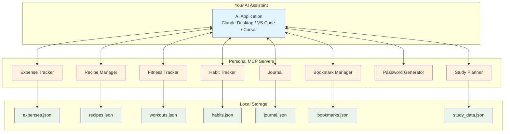
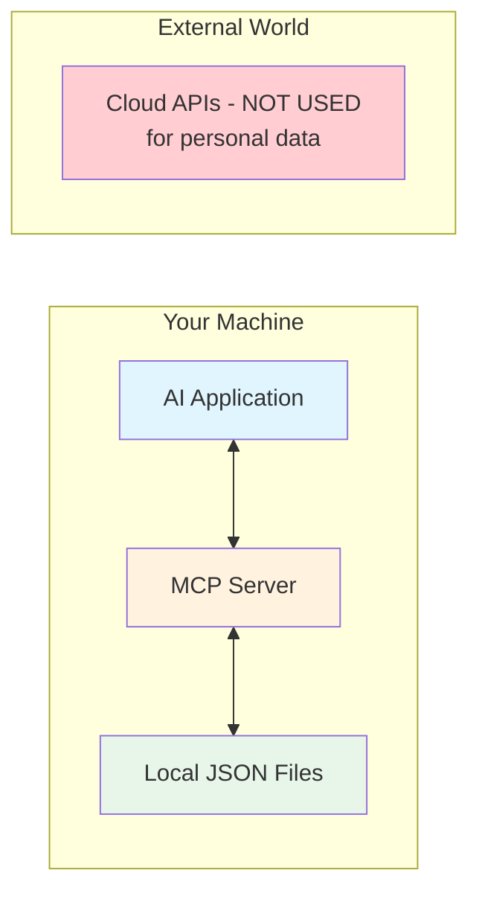
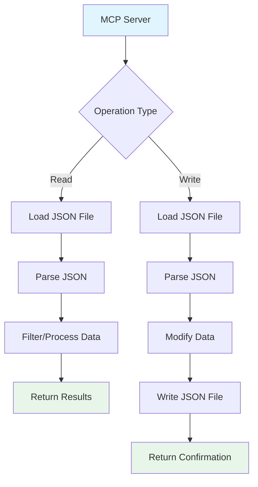
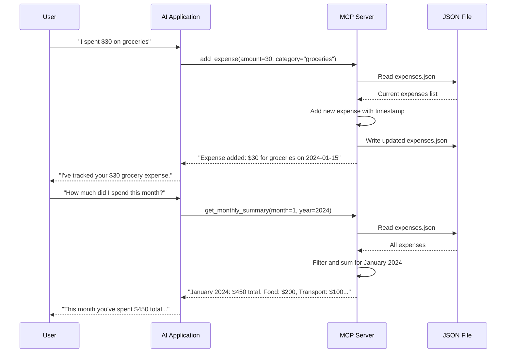

# Chapter 15: Daily Life MCP Servers

## Learning Objectives

By the end of this chapter, you will be able to:

1. Design MCP servers that solve personal productivity problems
2. Build servers for expense tracking, recipes, fitness, habits, journaling, and more
3. Implement local-first data storage with JSON files
4. Handle privacy and data security in personal MCP servers
5. Design intuitive tool interfaces for daily-use applications
6. Combine multiple life management tools into a unified dashboard
7. Apply spaced repetition and streak tracking algorithms

---

## 15.1 Introduction: Your AI-Powered Life Operating System

In Chapter 13, we built utility servers -- calculators, file managers, and data tools. In this chapter, we go personal. We will build MCP servers that help you manage your daily life -- tracking expenses, planning meals, staying fit, building habits, and journaling.

The vision is simple: instead of using ten different apps for ten different things, you have one AI assistant (Claude, Copilot, or any MCP-compatible AI) that connects to your personal servers. You talk to the AI naturally, and it manages your life data behind the scenes.

### Real-World Analogy

Think of these servers as your personal staff. You have an accountant (expense tracker), a chef (recipe manager), a personal trainer (fitness tracker), a life coach (habit tracker), and a therapist (journal). They all work for you, they all keep your data private (stored locally), and they all respond to your natural language requests through the AI.

---

## 15.2 Philosophy of Personal Productivity with AI

### Why MCP for Personal Tools?

Traditional productivity apps have fixed interfaces. You tap buttons, fill forms, and navigate menus. With MCP servers connected to an AI, you just talk:

- "Add an expense: $45 for groceries at Walmart"
- "What did I spend on food this month?"
- "Plan my meals for the week using what I have in the fridge"
- "Log today's workout: 30 minutes running, 5km"
- "How's my exercise streak going?"

The AI understands your intent and calls the right tools with the right parameters.

### The Personal AI Stack



---

## 15.3 Designing Servers for Your Workflow

### Design Principle 1: Natural Language Friendly

Tool names and descriptions should map to how people naturally talk about the domain.

```
Natural: "Track that I spent $30 on lunch"
Tool: add_expense(amount=30, category="food", description="lunch")

Natural: "What's my workout streak?"
Tool: get_streak(activity="workout")
```

### Design Principle 2: Sensible Defaults

Most daily life operations have obvious defaults. Use them:

- Date defaults to today
- Category defaults to "general"
- Currency defaults to user's local currency
- Time defaults to current time

### Design Principle 3: Rich Summaries

People do not want raw data. They want insights:

```
Bad:  [{"amount": 30}, {"amount": 45}, {"amount": 12}]
Good: "This month you spent $87 on food (3 transactions).
       That's 15% less than last month ($102)."
```

### Design Principle 4: Encourage Positive Behavior

Streak counters, progress bars, and positive messages encourage continued use:

```
"Great job! You've maintained your exercise habit for 14 days straight!"
"You're on track with your budget. $213 remaining for the month."
```

---

## 15.4 Data Privacy Considerations

Personal data is sensitive. Here is how to keep it safe:

### Local-First Architecture

All data stays on your machine. No cloud sync, no external APIs for personal data storage.



### Privacy Best Practices

1. **Store data in the user's home directory** -- Use `~/mcp_data/` or similar
2. **Never log sensitive data** -- Do not log expense amounts, journal entries, or passwords
3. **No external API calls for personal data** -- Process everything locally
4. **File permissions** -- Set appropriate file permissions on data files
5. **Encryption** (advanced) -- Consider encrypting JSON files at rest
6. **Backup reminders** -- Remind users to back up their data files

### Data Storage Pattern

All servers in this chapter use JSON files for storage. Here is the common pattern:

```python
# 1. Define a data directory in the user's home folder
# 2. Create it if it does not exist
# 3. Load data from JSON on startup
# 4. Save data to JSON after every write operation
# 5. Use atomic writes (write to temp file, then rename)
```

---

## 15.5 Local-First Approach

### Why Local-First?

1. **Privacy** -- Your expense data, journal entries, and health data stay on your machine
2. **Speed** -- No network latency for data operations
3. **Offline** -- Works without internet
4. **Control** -- You own your data, in a format you can read and export
5. **Simplicity** -- JSON files are human-readable and easy to back up

### JSON Storage Architecture



### Data File Conventions

| Server | Data File | Location |
|--------|-----------|----------|
| Expense Tracker | expenses.json | ~/mcp_data/expenses.json |
| Recipe Manager | recipes.json | ~/mcp_data/recipes.json |
| Fitness Tracker | workouts.json | ~/mcp_data/workouts.json |
| Habit Tracker | habits.json | ~/mcp_data/habits.json |
| Journal | journal.json | ~/mcp_data/journal.json |
| Bookmark Manager | bookmarks.json | ~/mcp_data/bookmarks.json |
| Study Planner | study_data.json | ~/mcp_data/study_data.json |

---

## 15.6 Overview of Servers Built in This Chapter

| # | Server | Description | Key Features |
|---|--------|-------------|-------------|
| 1 | Expense Tracker | Track daily expenses | Add, categorize, monthly summary, budget check |
| 2 | Recipe Manager | Manage recipes and meal planning | Add recipes, search by ingredient, meal plan, shopping list |
| 3 | Fitness Tracker | Log workouts and track progress | Log exercises, view history, weekly summary, personal records |
| 4 | Habit Tracker | Build and maintain habits | Add habits, log completions, streak tracking, weekly report |
| 5 | Journal | Personal journaling with mood tracking | Write entries, search, mood analytics, word count stats |
| 6 | Bookmark Manager | Save and organize web bookmarks | Add, categorize, search, tag bookmarks |
| 7 | Password Generator | Create secure passwords | Generate passwords, check strength, customizable rules |
| 8 | Study Planner | Plan study sessions | Add topics, schedule reviews, track progress, spaced repetition |

---

## 15.7 Data Flow Architecture

Here is how data flows through a typical daily life MCP server:



---

## 15.8 Project Setup

```bash
# Create the project directory
mkdir chapter_15_daily_life
cd chapter_15_daily_life

# Initialize Poetry project
poetry init --name "daily-life-mcp-servers" \
            --description "MCP servers for daily life management" \
            --author "Your Name" \
            --python "^3.10" \
            --no-interaction

# Add dependencies
poetry add mcp         # MCP SDK
poetry add httpx       # For any HTTP requests (weather in dashboard)

# Install
poetry install
poetry shell
```

### Directory Structure

```
chapter_15_daily_life/
    pyproject.toml
    expense_tracker_server.py
    recipe_server.py
    fitness_server.py
    habit_tracker_server.py
    journal_server.py
    bookmark_manager_server.py
    password_generator_server.py
    study_planner_server.py
    mini_project_life_dashboard.py
```

---

## 15.9 Code Files Reference

The following code files accompany this chapter:

1. **expense_tracker_server.py** -- Track expenses with categories, monthly summaries, and budget checking
2. **recipe_server.py** -- Manage recipes, search by ingredient, create meal plans and shopping lists
3. **fitness_server.py** -- Log workouts, track exercise history, weekly summaries, personal records
4. **habit_tracker_server.py** -- Track habits, maintain streaks, generate weekly reports
5. **journal_server.py** -- Write journal entries, search by keyword, track mood, view statistics
6. **bookmark_manager_server.py** -- Save bookmarks with categories and tags, search and organize
7. **password_generator_server.py** -- Generate secure passwords with customizable rules, check strength
8. **study_planner_server.py** -- Plan study sessions, schedule spaced repetition reviews, track progress

---

## 15.10 Key Algorithms

### Streak Calculation

Streaks are used in the habit tracker and fitness tracker. The algorithm is:

1. Sort completion dates in reverse order (most recent first)
2. Check if today (or yesterday) has a completion
3. Walk backwards, checking if each previous day has a completion
4. The streak is the count of consecutive days

### Spaced Repetition

The study planner uses a simplified spaced repetition algorithm:

1. New topics are reviewed after 1 day
2. After a successful review, double the interval (1, 2, 4, 8, 16 days)
3. After a failed review, reset the interval to 1 day
4. Topics due for review are those where current_date >= last_review + interval

### Budget Tracking

The expense tracker uses simple budget checking:

1. User sets a monthly budget per category or overall
2. Sum expenses for the current month
3. Calculate remaining budget and percentage used
4. Warn when approaching or exceeding the budget

---

## 15.11 Exercises

### Exercise 1: Medicine Reminder Server

Build an MCP server that helps track medications. Tools needed:
- `add_medicine` -- Add a medicine with dosage and schedule
- `log_taken` -- Log that a medicine was taken
- `check_due` -- Check which medicines are due now
- `view_history` -- View medication history

### Exercise 2: Project/Task Tracker

Build an MCP server for managing projects and tasks. Tools needed:
- `create_project` -- Create a new project
- `add_task` -- Add a task to a project
- `update_task_status` -- Mark task as in-progress or done
- `get_project_summary` -- Get project overview with task counts

### Exercise 3: Shopping List Manager

Build an MCP server for managing shopping lists. Tools needed:
- `add_item` -- Add an item to the shopping list
- `check_off_item` -- Mark an item as purchased
- `view_list` -- View the current shopping list
- `clear_completed` -- Remove purchased items

---

## 15.12 Mini Project: Life Dashboard Server

The mini project combines multiple life management tools into a single "Life Dashboard" MCP server:

- **Expenses** -- Quick expense tracking and monthly overview
- **Habits** -- Daily habit logging and streak tracking
- **Fitness** -- Workout logging and weekly summary
- **Journal** -- Quick journal entries and mood tracking
- **Dashboard** -- Unified daily/weekly report across all domains

This demonstrates how a single MCP server can serve as a comprehensive personal productivity tool.

---

## 15.13 Summary

In this chapter, we learned:

1. **Personal Productivity with AI** -- Using MCP servers to replace traditional productivity apps with conversational AI
2. **Local-First Design** -- Keeping personal data on the user's machine with JSON file storage
3. **Privacy Considerations** -- Never sending personal data to external APIs, using local storage and processing
4. **Natural Language Design** -- Making tools that map to how people naturally talk about daily activities
5. **Streak Algorithms** -- Calculating consecutive day streaks for habit and fitness tracking
6. **Spaced Repetition** -- Implementing review schedules for the study planner
7. **Budget Tracking** -- Categorizing expenses and checking against budgets
8. **8 Practical Servers** -- Expense tracker, recipe manager, fitness tracker, habit tracker, journal, bookmark manager, password generator, study planner
9. **Life Dashboard** -- Combining multiple domains into a unified server

---

## 15.14 Interview Questions

### Q1: Why use a local-first approach for personal MCP servers?

**Answer:** Personal data (expenses, health data, journal entries) is sensitive. Local-first means data stays on the user's machine -- no cloud sync, no external API calls for storage. This provides privacy, speed (no network latency), offline capability, and full user control over their data.

### Q2: How do you design tool names and descriptions for daily life servers?

**Answer:** Map tool names to natural language patterns. Use verb_noun format that matches how people talk: `add_expense` (not `insert_financial_record`), `log_workout` (not `create_exercise_entry`). Descriptions should include examples of natural language queries that would trigger the tool.

### Q3: What is the streak calculation algorithm?

**Answer:** Sort completion dates in reverse chronological order. Check if today or yesterday has a completion (to allow for end-of-day logging). Walk backwards through consecutive days, counting each day that has a completion. The streak breaks when a day is missing.

### Q4: How do you handle data persistence in personal MCP servers?

**Answer:** Use JSON files stored in the user's home directory (e.g., `~/mcp_data/`). Load the file at the start of each operation, modify the data, and write back to the file. This is simple, human-readable, and easy to back up. For more complex data, consider SQLite.

### Q5: What is spaced repetition and how do you implement it in an MCP server?

**Answer:** Spaced repetition is a learning technique that reviews material at increasing intervals. Implementation: track each topic's last review date and current interval. After a successful review, double the interval (1, 2, 4, 8, 16 days). After failure, reset to 1 day. A tool returns topics where current_date >= last_review_date + interval.

### Q6: How do you handle concurrent access to JSON data files?

**Answer:** For personal single-user servers, concurrent access is rare. However, best practices include: read the file fresh for each operation (do not cache), use atomic writes (write to a temp file then rename), and consider file locking for critical operations. For multi-user scenarios, switch to SQLite or a proper database.

### Q7: What are the advantages of combining multiple tools in a single server vs separate servers?

**Answer:** Single server: simpler configuration (one server entry), shared data directory, can create cross-domain features (e.g., a dashboard that combines expense and habit data). Separate servers: better isolation, independent deployment, clearer separation of concerns. For personal use, a single combined server is often more convenient.

### Q8: How do you make personal MCP servers portable across machines?

**Answer:** Use a consistent data directory relative to the home folder (e.g., `~/mcp_data/`). Store all configuration as environment variables. Keep data files in a format that can be easily copied (JSON). Consider adding export/import tools to the server itself.

### Q9: What privacy considerations are important when building personal MCP servers?

**Answer:** (1) Never send personal data to external APIs, (2) Do not log sensitive data like expense amounts or journal content, (3) Store data in user-accessible locations, (4) Set appropriate file permissions, (5) Do not include personal data in error messages that might be sent to AI model providers, (6) Consider encryption for especially sensitive data.

### Q10: How would you add a backup/restore feature to a personal MCP server?

**Answer:** Add two tools: `backup_data` that copies all JSON files to a timestamped backup directory (e.g., `~/mcp_data/backups/2024-01-15/`), and `restore_data` that copies files from a specified backup back to the data directory. Include a `list_backups` tool to show available backups.

---

## 15.15 Common Mistakes

### Mistake 1: Storing Sensitive Data Without Encryption

**Wrong:** Storing passwords or financial data in plain text JSON files.

**Right:** For truly sensitive data, use encryption at rest. For moderately sensitive data (expenses, habits), plain JSON is acceptable if file permissions are set correctly.

**Why it matters:** If the machine is compromised, plain text data files are immediately readable.

### Mistake 2: Not Handling Missing Data Files

**Wrong:** Assuming the data file always exists and crashing on first run.

**Right:** Always check if the file exists. If not, create it with an empty initial structure.

**Why it matters:** First-time users will get a crash instead of a welcome experience.

### Mistake 3: Losing Data on Write Errors

**Wrong:** Opening the file, truncating it, then writing. If writing fails, data is lost.

**Right:** Write to a temporary file first, then rename (atomic write). If writing fails, the original file is intact.

**Why it matters:** A power outage or crash during write can corrupt or destroy the data file.

### Mistake 4: Hardcoding Date Formats

**Wrong:** Using `"01/15/2024"` format in storage and hoping everyone uses the same format.

**Right:** Use ISO 8601 format (`"2024-01-15"`) for storage and convert to user-friendly formats for display.

**Why it matters:** Date format ambiguity causes bugs. Is `01/02/2024` January 2nd or February 1st?

### Mistake 5: Not Providing Summary Tools

**Wrong:** Only providing tools to add and list raw data.

**Right:** Include summary tools (monthly overview, weekly report, streak count) that provide insights.

**Why it matters:** Users want insights, not raw data. "You spent $450 this month" is more useful than a list of 30 transactions.

---

## 15.16 Production Tips

### Tip 1: Add Data Migration Tools

As you evolve your server, the JSON schema may change. Include tools or scripts that migrate data from old formats to new ones.

### Tip 2: Implement Data Export

Add a `export_data` tool that exports data in common formats (CSV for expenses, iCal for schedules). This prevents vendor lock-in.

### Tip 3: Set Data Size Limits

Personal data files can grow large over time. Consider archiving old data (e.g., expenses older than a year) to separate files.

### Tip 4: Add Undo Functionality

Track the last N operations so users can undo mistakes. "Oops, I logged the wrong amount" should be recoverable.

### Tip 5: Use ISO 8601 for All Dates

Store all dates as `"2024-01-15T14:30:00"` format. This is sortable, unambiguous, and universally parseable.

### Tip 6: Include a Data Health Check

Add a tool that validates the data file structure, checks for corruption, and reports statistics (number of records, file size, date range).

### Tip 7: Consider Sqlite for Complex Queries

If you find yourself doing complex filtering and aggregation on JSON data, consider switching to SQLite. It is still local-first and file-based, but supports SQL queries.

### Tip 8: Document the Data Format

Include a schema description or example in the server itself. This helps users who want to manually inspect or modify their data files.

---

## 15.17 What Happens in Real Companies?

Personal productivity MCP servers are increasingly common in the developer community:

- **Individual developers** build custom servers for their specific workflows -- personal CRM, project time tracking, note-taking systems
- **Teams** share server templates for common tasks -- standup notes, sprint tracking, incident logging
- **Companies** build internal servers that wrap company-specific tools -- internal HR systems, expense reporting, leave management
- **The MCP community** maintains a growing collection of open-source daily life servers on GitHub

The trend is moving toward "personal AI operating systems" where every aspect of daily life has an MCP server behind it, all accessible through a single AI conversation.

---

## 15.18 Further Reading

- MCP Server Examples: https://github.com/modelcontextprotocol/servers
- Spaced Repetition Theory: https://en.wikipedia.org/wiki/Spaced_repetition
- JSON File Storage Best Practices: https://docs.python.org/3/library/json.html
- Local-First Software: https://www.inkandswitch.com/local-first/

---

## Next Chapter

In Chapter 16, we will explore MCP with AI Agents -- integrating MCP servers with LangGraph, LangChain, CrewAI, and other agent frameworks. This is where MCP becomes the backbone of autonomous AI systems.
