# Chapter 16: MCP and AI Agents

## Learning Objectives

By the end of this chapter, you will be able to:

1. Understand how MCP integrates with popular AI agent frameworks
2. Use MCP tools with LangChain agents and Ollama
3. Build LangGraph workflows that leverage MCP servers
4. Integrate MCP tools with LlamaIndex, CrewAI, and Pydantic AI
5. Compare different agent frameworks for MCP integration
6. Choose the right framework for your specific use case
7. Design architecture patterns that combine agents with MCP
8. Build a research agent that uses multiple MCP tools

---

## Prerequisites

Before starting this chapter, make sure you have completed:

- Chapters 1-6 (MCP fundamentals, tools, server/client)
- Chapter 12 (Production MCP Server)
- Basic understanding of LangChain, LangGraph, and AI agents
- Ollama installed with at least one model (e.g., `llama3.2` or `mistral`)

---

## 1. Why Combine MCP with AI Agents?

### The Problem

AI agents need tools to interact with the real world. Every agent framework has its own way of defining tools:

- LangChain has `Tool` and `StructuredTool`
- LangGraph has `ToolNode`
- LlamaIndex has `FunctionTool`
- CrewAI has `@tool` decorator
- Pydantic AI has `tool` decorator

This means if you build a tool for LangChain, you cannot use it in CrewAI without rewriting it.

### The Solution: MCP as a Universal Tool Layer

MCP solves this problem. You build your tool ONCE as an MCP server, then connect it to ANY agent framework. The MCP server becomes the single source of truth for your tools.

### Real-World Analogy: Workers and Specialized Equipment

Think of AI agents as **workers** in a factory:

- **LangChain agent** = a worker who follows a checklist
- **LangGraph agent** = a worker who follows a flowchart
- **CrewAI agent** = a team of specialized workers
- **Pydantic AI agent** = a worker who is very careful about data types

Now think of **MCP servers** as **specialized equipment rooms**:

- Calculator MCP server = the math department
- Database MCP server = the records room
- Web search MCP server = the research library

Without MCP, each worker needs their own copy of every tool. With MCP, all workers share the same equipment rooms. One equipment room serves everyone.

---

## 2. Architecture: Agents + MCP

### High-Level Architecture

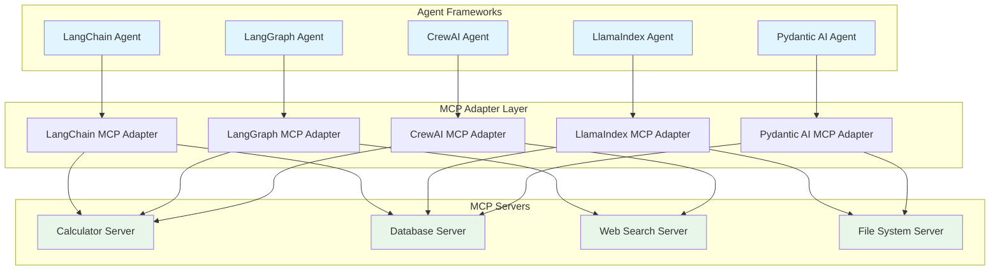

### The Adapter Pattern

The key idea is an **adapter** that translates between the agent framework's tool format and MCP's tool format:

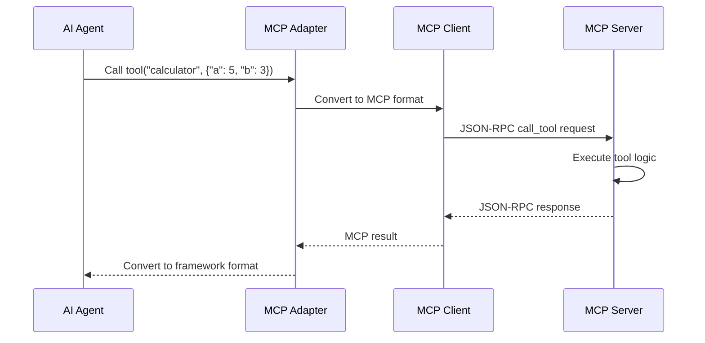

### What the Adapter Does

1. **Discovery**: Connects to MCP server, lists available tools
2. **Schema Translation**: Converts MCP tool schemas to framework-specific format
3. **Call Translation**: Converts framework tool calls to MCP protocol calls
4. **Result Translation**: Converts MCP results back to framework format

---

## 3. MCP + LangChain Integration

### How It Works

LangChain uses `BaseTool` as the base class for all tools. To use MCP tools with LangChain:

1. Connect to the MCP server
2. List all available tools
3. Create a LangChain `Tool` wrapper for each MCP tool
4. Pass these tools to a LangChain agent

### Architecture

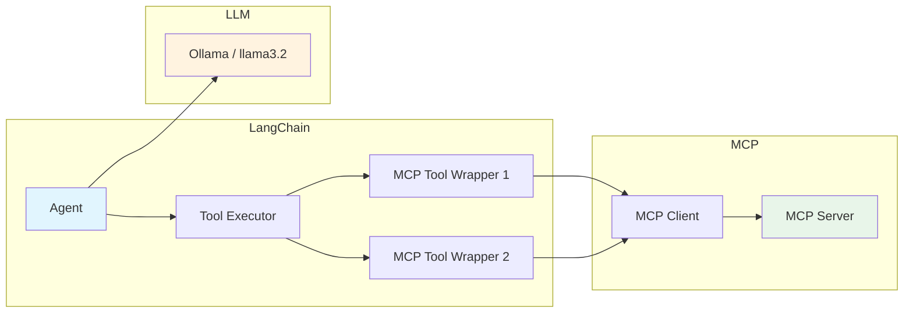

### Key Concepts

- **Tool wrapping**: Each MCP tool becomes a LangChain `Tool` object
- **Schema mapping**: MCP's JSON Schema maps to LangChain's `args_schema`
- **Async support**: LangChain supports async tools, which works well with MCP's async client

### When to Use LangChain + MCP

- You already have a LangChain-based application
- You need simple agent patterns (ReAct, function calling)
- You want quick integration with minimal code
- Your workflow is mostly linear (not complex branching)

---

## 4. MCP + LangGraph Integration

### How It Works

LangGraph extends LangChain with graph-based workflows. MCP tools become nodes in the graph:

1. Create a `ToolNode` that wraps MCP tools
2. Define state that flows through the graph
3. Connect agent nodes with tool nodes
4. The agent decides which MCP tools to call based on state

### Architecture

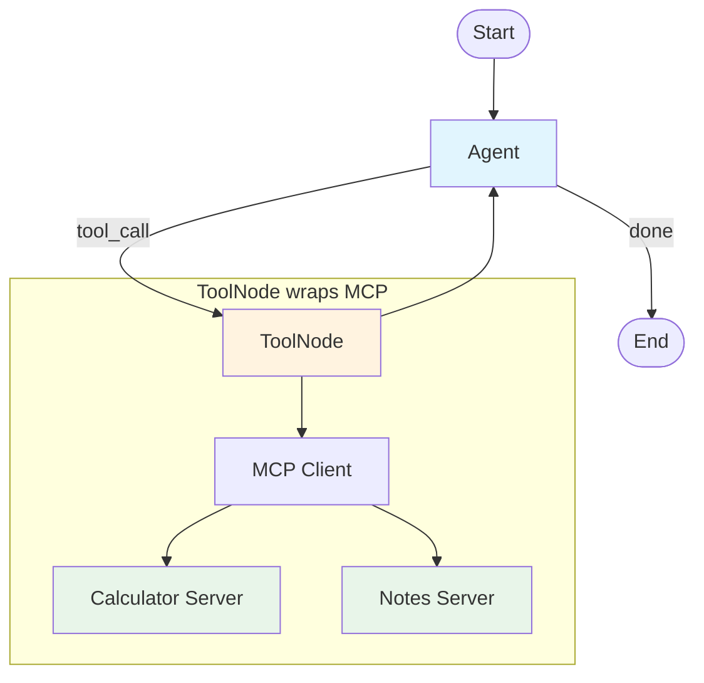

### Key Concepts

- **State management**: LangGraph manages conversation state; MCP manages tool state
- **Conditional routing**: The agent decides which tools to call based on context
- **Cycles**: LangGraph allows the agent to call tools multiple times in a loop
- **Checkpointing**: LangGraph can save/restore state, independent of MCP

### When to Use LangGraph + MCP

- You need complex, multi-step workflows
- Your agent needs to make decisions and branch
- You want fine-grained control over the agent loop
- You need state persistence and checkpointing
- Your workflow has cycles (agent calls tools, evaluates, calls more tools)

---

## 5. MCP + LlamaIndex Integration

### How It Works

LlamaIndex focuses on data and retrieval. MCP tools extend LlamaIndex agents:

1. Connect to the MCP server
2. Wrap each MCP tool as a `FunctionTool`
3. Create a LlamaIndex agent with these tools
4. The agent uses MCP tools alongside LlamaIndex's retrieval capabilities

### Architecture

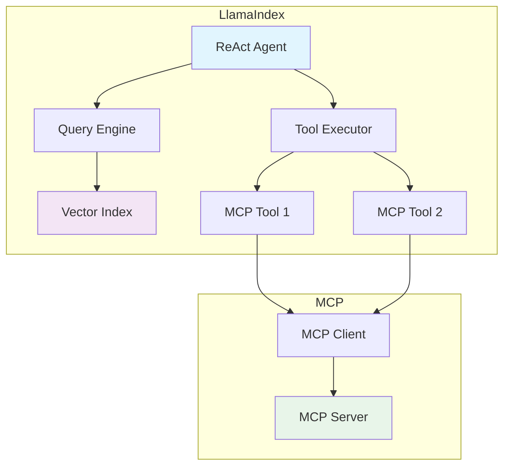

### When to Use LlamaIndex + MCP

- Your primary use case involves RAG (Retrieval Augmented Generation)
- You need to combine document retrieval with tool usage
- You want to use LlamaIndex's query engines alongside MCP tools
- Your data pipeline is already built on LlamaIndex

---

## 6. MCP + CrewAI Integration

### How It Works

CrewAI organizes agents into crews with roles. MCP tools become shared resources:

1. Connect to the MCP server
2. Wrap MCP tools for CrewAI
3. Assign tools to specific agents in the crew
4. Agents collaborate using their assigned MCP tools

### Architecture

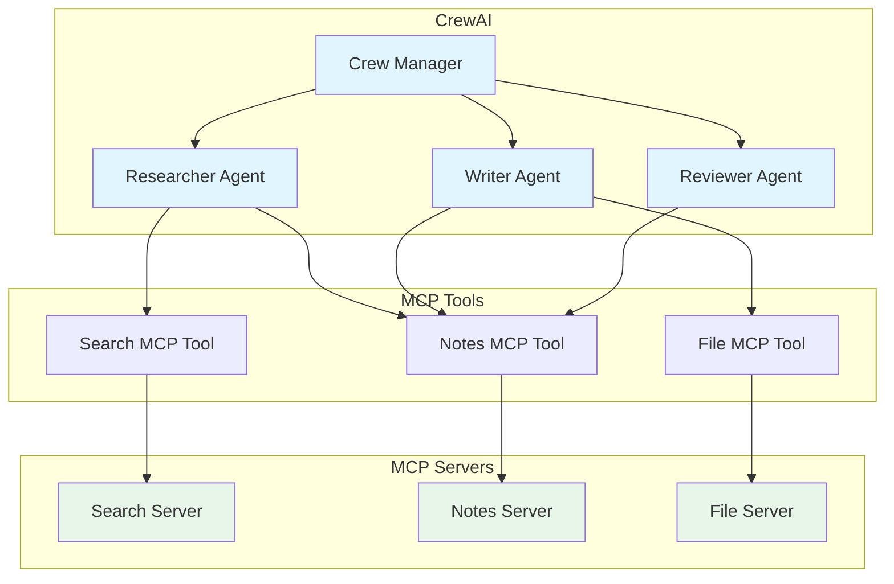

### When to Use CrewAI + MCP

- You need multiple specialized agents working together
- Each agent has a clear role and set of responsibilities
- You want agents to collaborate on complex tasks
- You need role-based access to different MCP tools

---

## 7. MCP + Pydantic AI Integration

### How It Works

Pydantic AI emphasizes type safety. MCP tools integrate naturally because MCP already uses JSON Schema:

1. Connect to the MCP server
2. Convert MCP tool schemas to Pydantic models
3. Wrap MCP tools with type-safe interfaces
4. The agent calls tools with validated inputs

### Architecture

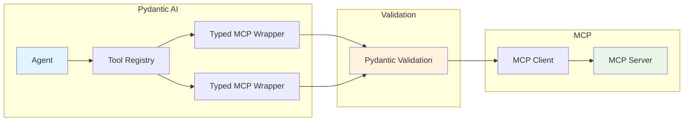

### When to Use Pydantic AI + MCP

- You want strong type safety and validation
- You need structured, predictable tool inputs/outputs
- Your team values code quality and maintainability
- You want automatic schema validation before MCP calls

---

## 8. MCP + AutoGen Integration

### How It Works

AutoGen (by Microsoft) uses multi-agent conversations. MCP tools extend agent capabilities:

1. Connect to the MCP server
2. Register MCP tools as AutoGen functions
3. Agents in the conversation can call these functions
4. Results flow back into the conversation

### When to Use AutoGen + MCP

- You need multi-agent conversations
- You want agents to debate and refine answers
- You need human-in-the-loop workflows
- Your use case involves code generation and execution

---

## 9. Comparison: When to Use Which Framework

### Decision Matrix

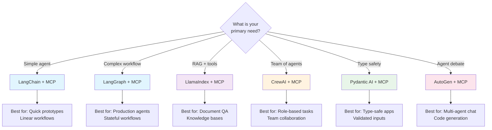

### Comparison Table

| Feature | LangChain | LangGraph | LlamaIndex | CrewAI | Pydantic AI | AutoGen |
|---------|-----------|-----------|------------|--------|-------------|---------|
| **Complexity** | Low | Medium | Medium | Medium | Low | High |
| **Workflow Control** | Basic | Advanced | Basic | Role-based | Basic | Conversation |
| **State Management** | Simple | Built-in | Index-based | Task-based | Simple | Chat-based |
| **MCP Integration** | Easy | Easy | Moderate | Moderate | Natural | Moderate |
| **Best For** | Prototypes | Production | RAG apps | Team tasks | Type-safe | Multi-agent |
| **Learning Curve** | Low | Medium | Medium | Low | Low | High |
| **Ollama Support** | Native | Native | Native | Via LangChain | Native | Via config |
| **Async Support** | Yes | Yes | Yes | Limited | Yes | Yes |

---

## 10. Architecture Patterns for Agents + MCP

### Pattern 1: Single Agent, Multiple MCP Servers

The most common pattern. One agent connects to multiple MCP servers:

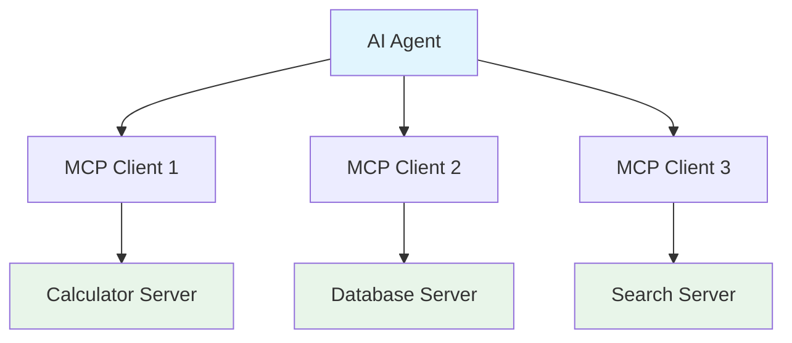

**Use when**: Your agent needs diverse capabilities from different domains.

### Pattern 2: Agent Team with Shared MCP Servers

Multiple agents share access to the same MCP servers:

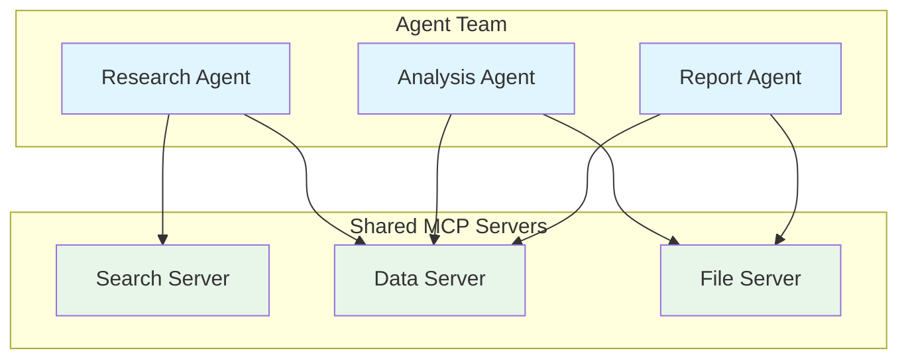

**Use when**: You have specialized agents that need overlapping tool access.

### Pattern 3: Pipeline with MCP Checkpoints

A processing pipeline where each stage uses different MCP servers:

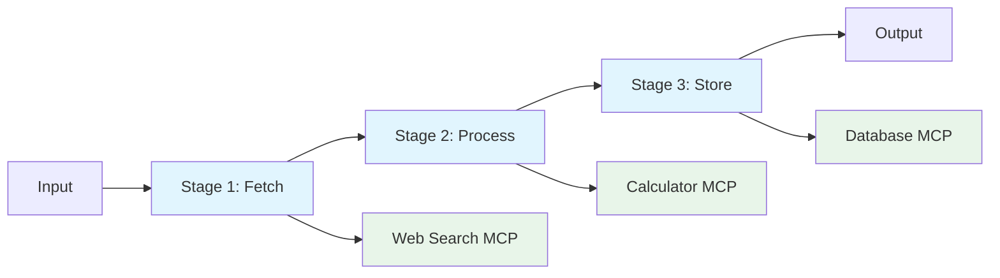

**Use when**: Your workflow has clear stages, each needing specific tools.

### Pattern 4: Supervisor Agent with Worker Agents

One agent orchestrates others, each with their own MCP tools:

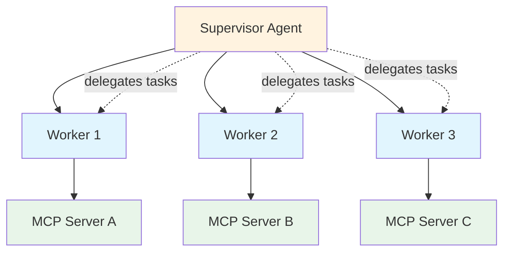

**Use when**: You need hierarchical task delegation with specialized tools.

---

## 11. Project Setup

### Poetry Setup

```bash
# Create project directory
mkdir mcp_agents_chapter16
cd mcp_agents_chapter16

# Initialize Poetry project
poetry init --name mcp-agents --python "^3.11" --no-interaction

# Add core dependencies
poetry add mcp langchain langchain-ollama langgraph

# Add optional framework dependencies
poetry add llama-index llama-index-llms-ollama
poetry add crewai
poetry add pydantic-ai

# Add development dependencies
poetry add --group dev pytest

# Install everything
poetry install

# Activate the environment
poetry shell
```

### Required: Ollama Setup

Make sure Ollama is running with a model:

```bash
# Pull a model (if not already done)
ollama pull llama3.2

# Verify it is running
ollama list
```

### Project Structure

```
mcp_agents_chapter16/
    pyproject.toml
    code/
        test_server_for_agents.py     # Shared MCP server for all examples
        example1_langchain_mcp.py     # LangChain integration
        example2_langgraph_mcp.py     # LangGraph integration
        example3_llamaindex_mcp.py    # LlamaIndex integration
        example4_crewai_mcp.py        # CrewAI integration
        example5_pydantic_ai_mcp.py   # Pydantic AI integration
        example6_comparison.py        # Side-by-side comparison
        exercise1_langchain_agent.py  # Exercise 1
        exercise1_solution.py
        exercise2_langgraph_workflow.py  # Exercise 2
        exercise2_solution.py
        exercise3_multi_framework.py  # Exercise 3
        exercise3_solution.py
        mini_project_research_agent.py  # Mini project
```

---

## 12. Hands-On Examples

### Example 1: LangChain + MCP

See `code/example1_langchain_mcp.py`

This example shows how to:
- Start an MCP server as a subprocess
- Connect an MCP client
- Wrap each MCP tool as a LangChain tool
- Create a LangChain agent with Ollama
- Let the agent use MCP tools to answer questions

### Example 2: LangGraph + MCP

See `code/example2_langgraph_mcp.py`

This example shows how to:
- Define a LangGraph state with message history
- Create a ToolNode that wraps MCP tools
- Build a graph with agent and tool nodes
- Route between the agent and tools based on decisions
- Run a multi-step workflow using MCP tools

### Example 3: LlamaIndex + MCP

See `code/example3_llamaindex_mcp.py`

This example shows how to:
- Connect to an MCP server from LlamaIndex
- Wrap MCP tools as LlamaIndex FunctionTools
- Create a ReAct agent with Ollama
- Use MCP tools for data retrieval and computation

### Example 4: CrewAI + MCP

See `code/example4_crewai_mcp.py`

This example shows how to:
- Create CrewAI-compatible tools from MCP tools
- Define agents with specific roles
- Assign MCP tools to specific agents
- Run a crew that uses MCP tools collaboratively

### Example 5: Pydantic AI + MCP

See `code/example5_pydantic_ai_mcp.py`

This example shows how to:
- Use Pydantic AI's native MCP integration
- Define type-safe tool interfaces
- Run an agent with validated MCP tool calls

### Example 6: Side-by-Side Comparison

See `code/example6_comparison.py`

This example shows the same task (mathematical calculation + note-taking) done with LangChain, LangGraph, and Pydantic AI, so you can compare the approaches.

---

## 13. Exercises

### Exercise 1: LangChain Agent with MCP Calculator

**Task**: Build a LangChain agent that uses the MCP calculator server to solve a multi-step math problem.

**Requirements**:
- Connect to the test MCP server
- Ask the agent to compute: "(15 + 27) * 3 - 10"
- The agent should break this into steps and use the calculator tool
- Print each step the agent takes

See `code/exercise1_langchain_agent.py` for the exercise template.
See `code/exercise1_solution.py` for the solution.

### Exercise 2: LangGraph Workflow with MCP

**Task**: Build a LangGraph workflow that uses MCP tools to research a topic and save notes.

**Requirements**:
- Create a graph with: research node, note-taking node, summary node
- Use MCP search tool for research
- Use MCP notes tool for saving findings
- Generate a final summary

See `code/exercise2_langgraph_workflow.py` for the exercise template.
See `code/exercise2_solution.py` for the solution.

### Exercise 3: Same MCP Server, Different Frameworks

**Task**: Connect the same MCP server to three different frameworks and compare results.

**Requirements**:
- Use the test MCP server
- Call the same tool from LangChain, LangGraph, and Pydantic AI
- Compare the output format and execution flow
- Note the differences in code complexity

See `code/exercise3_multi_framework.py` for the exercise template.
See `code/exercise3_solution.py` for the solution.

---

## 14. Mini Project: Research Agent

### Overview

Build a **Research Agent** using LangGraph + MCP that can:
1. Search for information (using a search MCP tool)
2. Take notes (using a notes MCP tool)
3. Create summaries of its findings

See `code/mini_project_research_agent.py` for the complete implementation.

### What You Will Learn

- How to build a multi-step agent workflow
- How to combine multiple MCP tools in one agent
- How to manage state across agent interactions
- How to create a useful, practical application

---

## 15. What Happens in Real Companies?

### Anthropic (Claude)

Claude Desktop natively supports MCP. When you configure MCP servers in Claude Desktop, Claude acts as the agent that decides which tools to call. This is the simplest form of agent + MCP integration.

### Cursor / VS Code

These IDEs use MCP to give AI coding assistants access to file systems, terminals, and external APIs. The AI agent inside the IDE connects to MCP servers to perform actions.

### Enterprise Applications

Companies build custom agent frameworks that connect to internal MCP servers:
- **Customer Support**: Agent uses MCP servers for ticket systems, knowledge bases, and CRM
- **Data Analysis**: Agent uses MCP servers for databases, visualization tools, and report generators
- **DevOps**: Agent uses MCP servers for deployment tools, monitoring, and alerting

---

## 16. Summary

### Key Takeaways

1. **MCP is a universal tool layer**: Build once, use with any agent framework
2. **The adapter pattern**: Each framework needs an adapter to translate between its tool format and MCP
3. **LangChain**: Best for simple agents and quick prototypes
4. **LangGraph**: Best for complex, stateful workflows with branching
5. **LlamaIndex**: Best when combining RAG with tool usage
6. **CrewAI**: Best for multi-agent teams with distinct roles
7. **Pydantic AI**: Best for type-safe applications with validated inputs
8. **AutoGen**: Best for multi-agent conversations and debates
9. **Architecture patterns**: Choose based on your workflow complexity
10. **MCP decouples tools from agents**: You can swap agent frameworks without rewriting tools

### What We Built

- MCP tool wrappers for LangChain, LangGraph, LlamaIndex, CrewAI, and Pydantic AI
- A comparison showing the same task done with different frameworks
- A research agent that combines multiple MCP tools in a LangGraph workflow

---

## 17. Interview Questions

### Q1: Why would you use MCP with an AI agent framework instead of building tools directly in the framework?

**Answer**: MCP provides a universal tool layer. If you build tools directly in LangChain, they only work in LangChain. With MCP, you build the tool once and connect it to any framework. This is especially valuable when you want to switch frameworks or use multiple frameworks simultaneously. MCP also provides a standardized protocol with built-in features like schema validation, error handling, and capability negotiation.

### Q2: How does the adapter pattern work when integrating MCP with LangChain?

**Answer**: The adapter connects to the MCP server, lists available tools, and creates a LangChain `Tool` object for each MCP tool. When the LangChain agent calls a tool, the adapter converts the call to an MCP `tools/call` JSON-RPC request, sends it to the server, and converts the MCP response back to a LangChain-compatible format. The adapter handles schema translation (MCP JSON Schema to LangChain args_schema) and result translation.

### Q3: When would you choose LangGraph over LangChain for MCP integration?

**Answer**: Choose LangGraph when you need complex workflows with branching, cycles, or state management. LangChain agents are simpler but limited to linear ReAct loops. LangGraph gives you fine-grained control over the agent loop, allows conditional routing (e.g., "if the search returned no results, try a different query"), supports checkpointing for long-running workflows, and handles error recovery more gracefully.

### Q4: How does CrewAI's approach to MCP differ from single-agent frameworks?

**Answer**: CrewAI assigns different MCP tools to different agents based on their roles. For example, a "Researcher" agent gets access to search MCP tools, while a "Writer" agent gets access to file MCP tools. This role-based access control is unique to CrewAI and mirrors how real teams work. Single-agent frameworks give all tools to one agent, which can lead to confusion when there are many tools.

### Q5: What is the advantage of Pydantic AI's MCP integration over other frameworks?

**Answer**: Pydantic AI has native MCP support built into its design. Because MCP already uses JSON Schema for tool definitions and Pydantic is built on JSON Schema, the integration is natural. Tool inputs are automatically validated before being sent to the MCP server, reducing errors. Other frameworks require manual schema translation, but Pydantic AI can directly use MCP schemas.

### Q6: How would you handle MCP server failures in an agent workflow?

**Answer**: Implement retry logic in the adapter layer, use circuit breaker patterns for repeated failures, provide fallback tools when an MCP server is unavailable, and log all failures for debugging. In LangGraph, you can add error-handling nodes that route to alternative paths when a tool fails. Always set timeouts on MCP connections to avoid hanging the agent.

### Q7: Can multiple agents share the same MCP server connection?

**Answer**: Yes, but with caveats. The MCP server handles one connection per client, so each agent typically has its own MCP client connection. If you need shared state across agents (e.g., shared notes), the MCP server manages that state internally. Use server-side state management rather than trying to share client connections.

### Q8: How does the MCP tool discovery process work with agent frameworks?

**Answer**: When the MCP client connects to a server, it calls `tools/list` to get all available tools with their schemas. The adapter then creates framework-specific tool objects for each MCP tool. This happens at startup. If the server's tools change, you can re-list them. Some adapters support dynamic tool discovery, refreshing the tool list periodically.

### Q9: What are the performance implications of using MCP with agents vs. native tools?

**Answer**: MCP adds network overhead (serialization, transport, deserialization) compared to native in-process tools. For STDIO transport, this overhead is minimal (sub-millisecond). For HTTP/SSE transport, expect 1-10ms additional latency per call. This is usually negligible compared to LLM inference time (seconds). The benefits of standardization and reusability outweigh the performance cost in most cases.

### Q10: How would you design a production system with multiple agent frameworks and MCP servers?

**Answer**: Use a layered architecture: (1) MCP servers as the tool layer, independently deployable and scalable; (2) An adapter/gateway layer that manages connections and provides monitoring; (3) Agent frameworks as the application layer, each connecting through the adapter. Add caching at the adapter layer, implement health checks for MCP servers, use load balancing for high-traffic tools, and monitor tool usage across all agents for optimization.

---

## 18. Common Mistakes

### Mistake 1: Not Handling MCP Server Lifecycle

**Wrong**: Assuming the MCP server is always running.

**Right**: Start the server as a subprocess, handle startup/shutdown, implement health checks, and have retry logic for connection failures.

### Mistake 2: Giving All Tools to Every Agent

**Wrong**: Every agent in a CrewAI crew gets access to all MCP tools.

**Right**: Assign tools based on agent roles. A "Researcher" does not need file-writing tools. Fewer tools means the LLM makes better decisions.

### Mistake 3: Ignoring Schema Translation Errors

**Wrong**: Blindly converting MCP schemas to framework schemas without validation.

**Right**: Validate that the schema translation is correct. Test each wrapped tool independently before using it in an agent. Some frameworks have schema requirements that MCP does not enforce.

### Mistake 4: Not Setting Timeouts

**Wrong**: Agent waits forever for an MCP tool response.

**Right**: Set timeouts on MCP client connections (e.g., 30 seconds). If a tool takes too long, the agent should handle the timeout gracefully and try an alternative approach.

### Mistake 5: Mixing Agent State and MCP Server State

**Wrong**: Storing agent conversation history in the MCP server.

**Right**: Keep agent state (conversation, decisions) in the agent framework. Keep tool state (data, computations) in the MCP server. They are separate concerns. The agent framework manages "what to do next"; the MCP server manages "how to do it."

---

## 19. Production Tips

### Tip 1: Use Connection Pooling

When running multiple agents, create a pool of MCP client connections instead of creating a new connection for each tool call. This reduces overhead and improves performance.

### Tip 2: Implement Tool Caching

If an MCP tool returns the same result for the same input (idempotent), cache the result in the adapter layer. This avoids unnecessary calls to the MCP server and speeds up agent workflows.

### Tip 3: Monitor Tool Usage

Track which tools each agent uses, how often, and how long each call takes. This data helps you optimize your MCP servers and identify bottlenecks in agent workflows.

### Tip 4: Version Your MCP Servers

When updating MCP server tools, use semantic versioning. Agent frameworks should be able to handle both old and new tool versions during rolling deployments.

### Tip 5: Test Adapters Independently

Before integrating MCP tools into an agent, test the adapter layer independently. Verify that schema translation is correct, tool calls work as expected, and error handling is proper.

### Tip 6: Use Health Checks

Implement a health check endpoint or tool in every MCP server. The agent framework should check server health before routing tool calls, enabling graceful degradation when servers are down.

### Tip 7: Log Everything

Log every tool call, including inputs, outputs, latency, and errors. This is essential for debugging agent behavior and optimizing MCP server performance in production.

---

## 20. Further Reading

- [MCP Specification](https://spec.modelcontextprotocol.io/)
- [LangChain MCP Integration](https://python.langchain.com/docs/integrations/)
- [LangGraph Documentation](https://langchain-ai.github.io/langgraph/)
- [LlamaIndex Documentation](https://docs.llamaindex.ai/)
- [CrewAI Documentation](https://docs.crewai.com/)
- [Pydantic AI Documentation](https://ai.pydantic.dev/)
- [AutoGen Documentation](https://microsoft.github.io/autogen/)

---

## Next Chapter

In Chapter 17, we will cover **Production Best Practices** - testing, monitoring, scaling, caching, and deploying MCP servers for production use.
