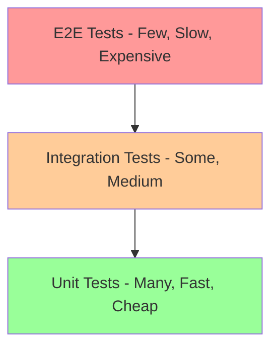
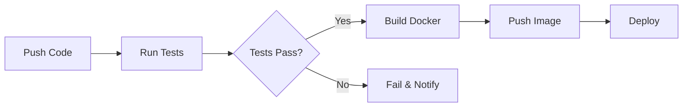
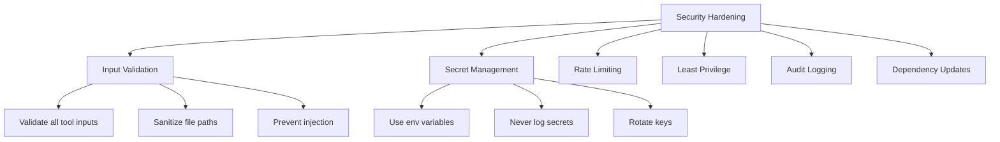
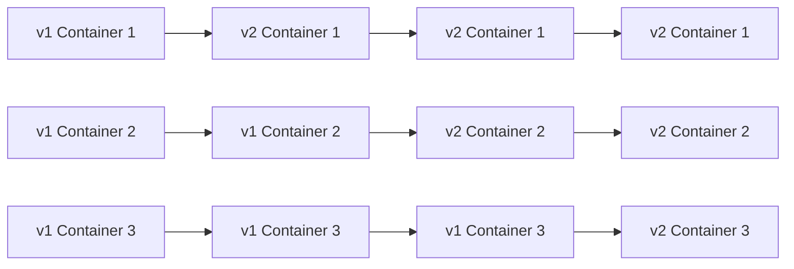

# Chapter 17: Production Best Practices

## Learning Objectives

By the end of this chapter, you will be able to:

1. Write unit tests and integration tests for MCP servers
2. Design CI/CD pipelines for MCP projects
3. Implement monitoring and alerting
4. Apply caching strategies for performance
5. Optimize MCP server performance
6. Harden security for production
7. Deploy with Docker and cloud services
8. Version and document your MCP servers

---

## Why Best Practices Matter

A server that works in development is a prototype. A server that works in production — under load, with failures, for months — is a product. Best practices are the difference.

### Real-World Analogy

Best practices for MCP servers are like safety standards for commercial aviation. A plane can fly without checklists, redundant systems, and maintenance schedules — but you would not want to be on it. Every practice below exists because someone, somewhere, learned the hard way.

---

## Testing Strategy

### The Test Pyramid



| Level | What It Tests | Speed | Count |
|-------|--------------|-------|-------|
| Unit | Individual tool functions | Fast (ms) | Many (50+) |
| Integration | Server + Client together | Medium (seconds) | Some (10-20) |
| E2E | Full workflow with real AI | Slow (minutes) | Few (3-5) |

### Unit Testing Tools

Test each tool function directly, without starting a server:

```python
# test_tools.py

def test_add():
    result = add(2, 3)
    assert result == "5"

def test_add_negative():
    result = add(-1, -2)
    assert result == "-3"

def test_divide_by_zero():
    result = divide(10, 0)
    assert "error" in result.lower()
```

### Integration Testing

Start a real server, connect a real client, test the full flow:

```python
async def test_full_flow():
    # Start server
    # Connect client
    # Call initialize
    # List tools
    # Call a tool
    # Verify result
    # Shutdown
    pass
```

---

## CI/CD Pipeline

### GitHub Actions Workflow

```yaml
name: MCP Server CI

on:
  push:
    branches: [main]
  pull_request:
    branches: [main]

jobs:
  test:
    runs-on: ubuntu-latest
    steps:
      - uses: actions/checkout@v4
      - uses: actions/setup-python@v5
        with:
          python-version: '3.11'
      - name: Install Poetry
        run: pip install poetry
      - name: Install dependencies
        run: poetry install
      - name: Run tests
        run: poetry run pytest
      - name: Run linter
        run: poetry run flake8

  build:
    needs: test
    runs-on: ubuntu-latest
    steps:
      - uses: actions/checkout@v4
      - name: Build Docker image
        run: docker build -t mcp-server .
      - name: Push to registry
        run: docker push mcp-server
```



---

## Monitoring and Alerting

### What to Monitor

| Metric | Why | Alert Threshold |
|--------|-----|----------------|
| Request count | Traffic volume | > 1000/min |
| Response time | Performance | > 5 seconds |
| Error rate | Reliability | > 5% |
| Memory usage | Resource leaks | > 80% |
| Tool call failures | Functionality | > 10/min |

### Simple Metrics Collection

```python
import time

# Simple in-memory metrics
metrics = {
    "total_calls": 0,
    "total_errors": 0,
    "total_response_time": 0.0,
}

def track_call(tool_name, duration, is_error=False):
    metrics["total_calls"] += 1
    metrics["total_response_time"] += duration
    if is_error:
        metrics["total_errors"] += 1
```

---

## Caching

### When to Cache

- Tool results that are expensive to compute
- External API responses (weather, search)
- Database query results
- Resource content that rarely changes

### Simple TTL Cache

```python
import time

cache = {}

def get_cached(key, ttl_seconds=300):
    if key in cache:
        value, timestamp = cache[key]
        if time.time() - timestamp < ttl_seconds:
            return value
    return None

def set_cached(key, value):
    cache[key] = (value, time.time())
```

### Cache Invalidation

> "There are only two hard things in Computer Science: cache invalidation and naming things." — Phil Karlton

Strategies:
- **TTL (Time-To-Live)** — Cache expires after N seconds
- **Event-based** — Clear cache when data changes
- **Manual** — Provide a "clear cache" tool

---

## Performance Optimization

### Profile First, Optimize Second

Never optimize without measuring. Common bottlenecks:

1. **External API calls** — Add caching, use connection pooling
2. **File I/O** — Read once, cache in memory
3. **Database queries** — Add indexes, cache results
4. **JSON serialization** — Use orjson for faster JSON

### Connection Pooling

Reuse HTTP connections instead of creating new ones per request:

```python
import httpx

# Create ONE client, reuse it
http_client = httpx.Client(timeout=30)

def fetch_data(url):
    response = http_client.get(url)
    return response.text
```

---

## Security Hardening Checklist



| Check | Status |
|-------|--------|
| All inputs validated | [ ] |
| Secrets in env variables | [ ] |
| Rate limiting enabled | [ ] |
| File path traversal prevented | [ ] |
| SQL injection prevented | [ ] |
| Prompt injection mitigated | [ ] |
| Dependencies up to date | [ ] |
| Audit logging enabled | [ ] |
| Least privilege applied | [ ] |
| Error messages don't leak internals | [ ] |

---

## Documentation

### What to Document

1. **README.md** — What the server does, how to install, how to run
2. **TOOLS.md** — Every tool with parameters, return types, examples
3. **DEPLOYMENT.md** — How to deploy to production
4. **CHANGELOG.md** — What changed in each version

### Tool Documentation Template

```markdown
## tool_name

**Description:** What this tool does

**Parameters:**
| Name | Type | Required | Description |
|------|------|----------|-------------|
| query | string | Yes | Search query |
| limit | integer | No | Max results (default: 10) |

**Returns:** JSON string with results

**Example:**
Input: {"query": "python", "limit": 5}
Output: "[{\"title\": \"Python Guide\", ...}]"
```

---

## Deployment Strategies

### Blue-Green Deployment

Run two identical environments. Route traffic to "blue." Deploy new version to "green." Switch traffic to "green." If problems, switch back to "blue."

### Rolling Deployment

Update one container at a time. If the new version fails health checks, stop the rollout.



---

## Summary

| Practice | Why It Matters |
|----------|---------------|
| Unit Tests | Catch bugs early, fast feedback |
| Integration Tests | Verify server-client flow works |
| CI/CD | Automate testing and deployment |
| Monitoring | Know when things break |
| Caching | Improve performance 10-100x |
| Security | Protect data and systems |
| Documentation | Help future you and your team |
| Versioning | Manage change safely |

---

## Interview Questions

1. **What is the test pyramid?** — Many fast unit tests at the bottom, fewer integration tests in the middle, few slow E2E tests at the top.

2. **How do you test an MCP tool?** — Unit test: call the function directly. Integration test: start server, connect client, call tool via protocol.

3. **What is TTL caching?** — Store results with a timestamp. Return cached result if it is newer than the TTL. Otherwise, recompute.

4. **What are the two hard problems in caching?** — Cache invalidation (knowing when to clear) and cache key design (what uniquely identifies a result).

5. **What is blue-green deployment?** — Running two identical environments and switching traffic between them for zero-downtime deployments.

6. **Why rate limit MCP tools?** — Prevent abuse, protect external APIs from being overwhelmed, and ensure fair resource usage.

7. **What should you monitor for MCP servers?** — Request count, response time, error rate, memory usage, tool call failures.

8. **What is connection pooling?** — Reusing HTTP/database connections instead of creating new ones per request, reducing overhead.

9. **How do you prevent prompt injection in MCP tools?** — Validate and sanitize all inputs, never pass raw user input to system prompts, use allowlists.

10. **What goes in CHANGELOG.md?** — Each version with date, categorized changes (Added, Changed, Fixed, Removed).

---

## Common Mistakes

1. **No tests** — "It works on my machine" is not a test strategy.
2. **Caching without TTL** — Stale data is worse than slow data.
3. **Monitoring only in production** — Set up monitoring in staging first to catch issues before they reach users.
4. **Over-caching** — Caching everything makes debugging hard. Cache selectively.
5. **No runbooks** — When the server is down at 3 AM, you need step-by-step instructions, not tribal knowledge.

---

## Production Tips

1. **Automate everything** — If you do it twice, automate it.
2. **Test in production-like environments** — Staging should mirror production as closely as possible.
3. **Keep dependencies updated** — Security vulnerabilities in old packages are the #1 attack vector.
4. **Log structured data** — JSON logs are searchable. Plain text logs are not.
5. **Plan for failure** — Assume every external API call will fail eventually. Handle it gracefully.
