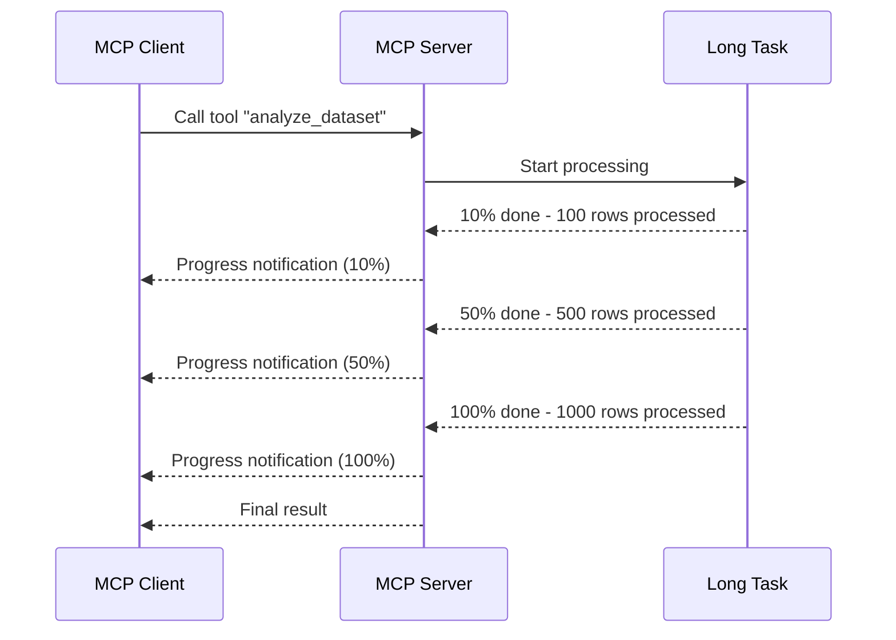
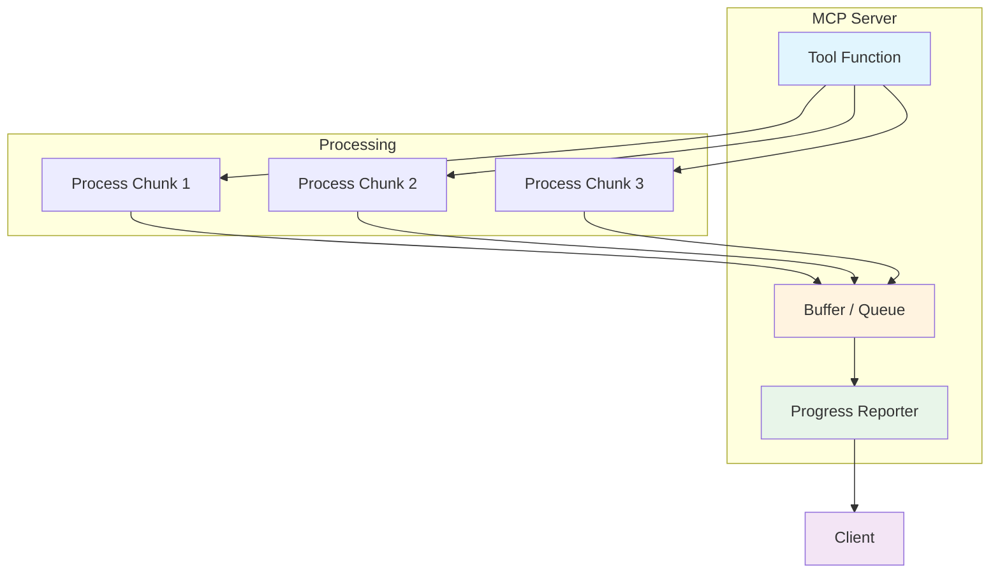
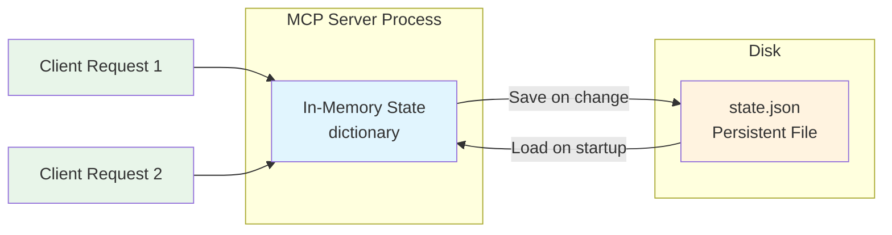
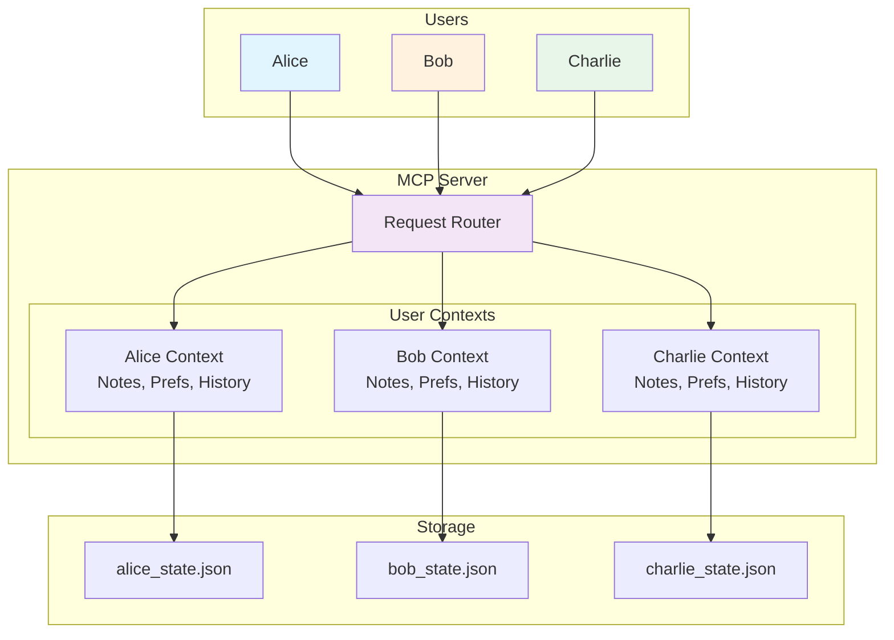
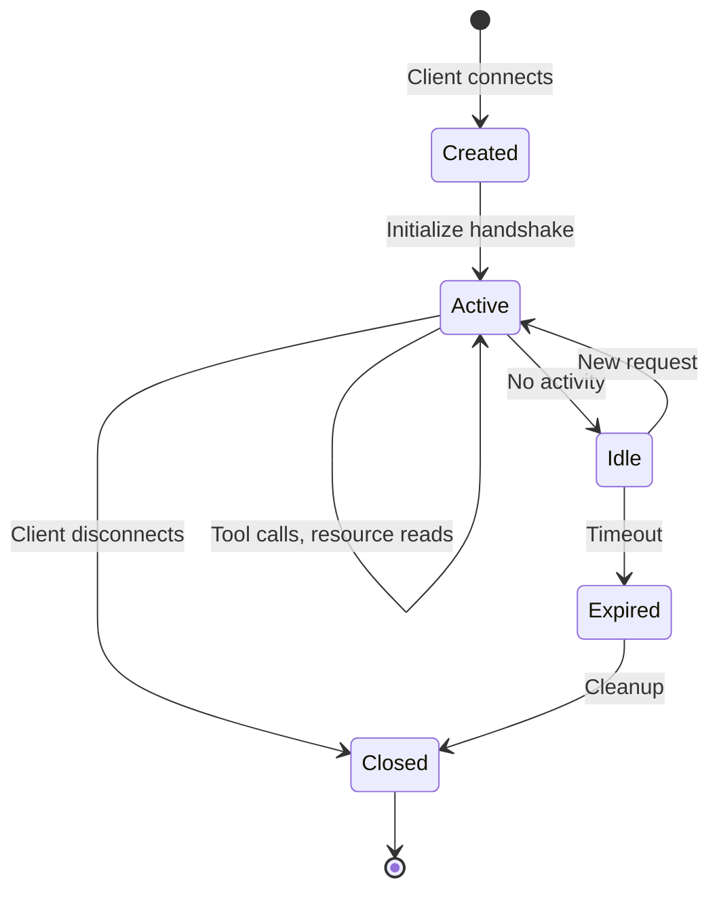
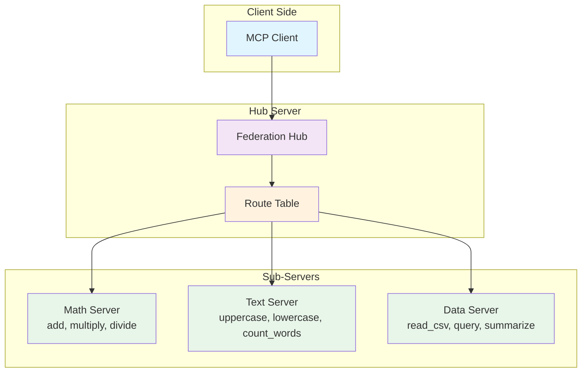
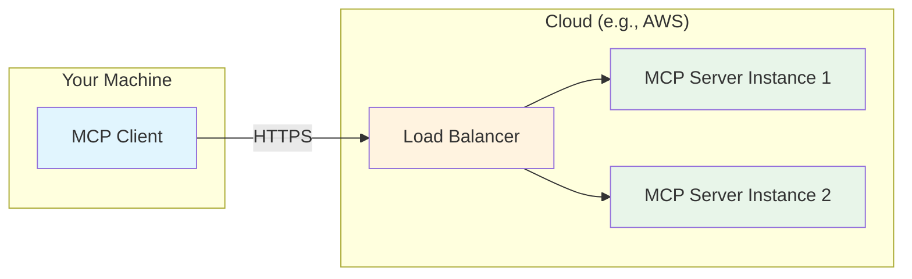
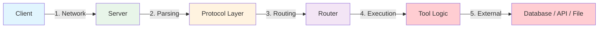
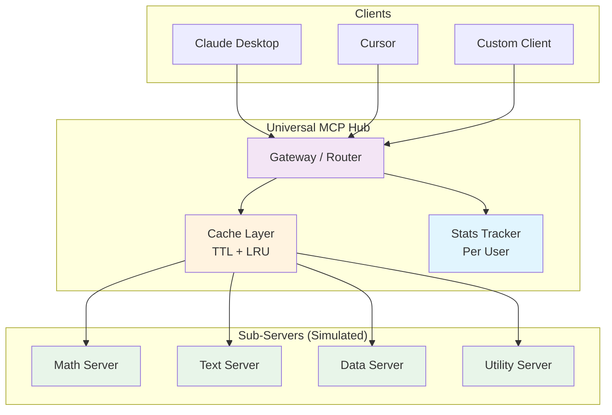

# Chapter 18: Advanced MCP

## Learning Objectives

By the end of this chapter, you will be able to:

1. Build MCP servers that stream responses for long-running tasks
2. Understand async/await at a practical level (only what you need for MCP)
3. Manage state and persist data across server sessions using file-based storage
4. Build multi-user MCP servers with separate contexts per user
5. Federate multiple MCP servers behind a single "hub" server
6. Implement advanced caching strategies (TTL, LRU, invalidation)
7. Deploy MCP servers to the cloud and connect remotely
8. Debug advanced MCP issues with tracing and inspection
9. Optimize MCP server performance for production workloads
10. Understand the future direction of the MCP ecosystem

---

## Prerequisites

Before starting this chapter, make sure you have completed:

- Chapters 1-6 (MCP fundamentals, tools, resources, prompts, server/client)
- Chapter 9 (Transport: STDIO, HTTP, SSE)
- Chapter 10 (MCP Security)
- Chapter 12 (Production MCP Server)
- Chapter 17 (Production Best Practices)
- Ollama installed with at least one model (e.g., `llama3.2` or `mistral`)

---

## 1. Why Advanced MCP Matters

### The Problem

In previous chapters, we built simple MCP servers. Each server handled one request at a time, kept no memory between sessions, and served a single user. This is fine for learning and prototyping, but real-world production environments demand much more.

Consider these real scenarios:

- A data pipeline server needs to **stream** results as they arrive, not wait for all 10 million rows to process
- A personal assistant server needs to **remember** what you told it yesterday
- A team server needs to keep **separate contexts** for each team member
- A company needs to expose **dozens of MCP servers** through a single gateway
- A high-traffic server needs **caching** to avoid redundant expensive computations

This chapter covers the advanced techniques that bridge the gap between tutorial servers and production-grade systems.

### Real-World Analogy: From a Food Cart to a Restaurant Chain

Think of our learning journey so far:

- **Chapters 1-6**: You learned to cook one dish at a time (basic MCP server)
- **Chapter 12**: You opened a small restaurant (production server)
- **Chapter 17**: You established health and safety standards (best practices)
- **Chapter 18 (this chapter)**: You are expanding into a restaurant chain

A restaurant chain needs things a single food cart does not:

| Restaurant Chain Need | MCP Equivalent |
|---|---|
| Serve food as it is ready, not all at once | Streaming responses |
| Remember regular customers and their orders | State persistence |
| Serve many customers at the same time | Multi-user support |
| Central ordering system across all locations | Server federation |
| Prep ingredients ahead of time | Advanced caching |
| Open locations in different cities | Cloud deployment |
| Quality control across all locations | Advanced debugging |

---

## 2. Streaming Responses

### What is Streaming?

Normally, an MCP tool processes a request and returns a single response when everything is done. With streaming, the server sends results **piece by piece** as they become available.

### Why Streaming Matters

| Scenario | Without Streaming | With Streaming |
|---|---|---|
| Process 1000 files | Wait 5 minutes, get all results | See results as each file finishes |
| Generate a long report | Wait 30 seconds for full report | Read paragraph by paragraph |
| Search a large database | Wait for full query completion | See matching results immediately |
| Run data analysis | Blank screen for 2 minutes | See progress and partial results |

### How Streaming Works in MCP

MCP supports streaming through **progress notifications** and **partial results**. The server sends incremental updates while processing continues in the background.



### Understanding Async (Just Enough)

MCP streaming requires `async` and `await`. Let us demystify these two keywords right now.

**The simple explanation:**

- `async def` means "this function might need to wait for something"
- `await` means "wait here until this thing finishes, but let other work happen while waiting"

**Analogy:** You are at a restaurant. You order food (`await`). While the kitchen prepares it, you chat with your friend. You are not blocked - you are doing other things while waiting. When the food arrives, you eat it.

```python
# SYNCHRONOUS (blocking) - like standing at the kitchen door waiting
def get_data():
    result = slow_database_query()  # Nothing else can happen
    return result

# ASYNCHRONOUS (non-blocking) - like ordering and chatting while you wait
async def get_data():
    result = await slow_database_query()  # Other tasks can run while waiting
    return result
```

**Key rule for this chapter:** You only need `async def` and `await` when the MCP framework requires it. We will keep it as simple as possible.

### Streaming Architecture



### Code Example

See `code/example1_streaming_server.py` for a complete streaming server implementation.

---

## 3. State Management Across Sessions

### The Problem

By default, MCP servers are **stateless**. When the server restarts, everything in memory is lost. This is a problem for servers that need to remember things:

- A note-taking server needs to keep notes between sessions
- A task tracker needs to persist tasks
- A conversation server needs to remember past interactions
- A user preferences server needs to store settings

### State Management Strategies

| Strategy | Complexity | Best For |
|---|---|---|
| In-memory (dictionary) | Simple | Development, temporary data |
| File-based (JSON) | Medium | Single-user, small data |
| SQLite database | Medium | Single server, structured data |
| Redis | Higher | Multi-server, fast access |
| PostgreSQL | Higher | Large scale, complex queries |

In this chapter, we focus on **file-based persistence** because it is simple, requires no external services, and teaches the core concepts.

### How File-Based Persistence Works



### The Save/Load Pattern

Every stateful server follows this pattern:

1. **On startup**: Load state from file (or create empty state if file does not exist)
2. **On every change**: Save the updated state to file
3. **On shutdown**: Final save (optional, since we save on every change)

This is like a cashier who keeps a written ledger. Every transaction is written down immediately. If the cash register breaks and needs to be replaced, the ledger lets you restore the exact state.

### Code Example

See `code/example2_stateful_sessions.py` for a complete stateful server with JSON-file persistence.

---

## 4. Multi-User Servers

### The Problem

A single-user server keeps one set of state. But what if multiple users connect? If Alice adds a note, Bob should not see it. Each user needs their own isolated context.

### Multi-User Architecture



### User Identification

How does the server know which user is making a request? There are several approaches:

| Approach | How It Works | Pros | Cons |
|---|---|---|---|
| User ID parameter | Client sends user_id with every tool call | Simple, explicit | Client must always include it |
| Session-based | Server assigns ID when client connects | Automatic | Lost on reconnect |
| Token-based | Client sends auth token | Secure | More complex |
| Header-based | User info in HTTP headers | Standard | Only works with HTTP transport |

For learning purposes, we use the **User ID parameter** approach. It is the simplest and works with any transport.

### Code Example

See `code/example3_multi_user_server.py` for a multi-user server implementation.

---

## 5. Session Management

### What is a Session?

A session is a conversation between a client and a server that has a beginning and an end. During a session, the server maintains context about that specific interaction.

### Session Lifecycle



### Session vs State

These two concepts are related but different:

| Concept | Lifetime | Scope | Example |
|---|---|---|---|
| Session | One connection | Current interaction | "User is currently browsing files in /home" |
| State | Persistent | Across all sessions | "User has 15 saved notes" |

Think of it like a library visit:
- **Session** = your current visit to the library (you walk in, browse books, walk out)
- **State** = your library card and borrowing history (persists forever)

### Session Data Examples

A session might track:

- When the user connected
- How many requests they have made
- What tools they have called
- Any temporary context (like "currently viewing file X")
- Rate limiting counters

---

## 6. Distributed MCP: Server Federation

### The Problem

As your MCP ecosystem grows, you end up with many servers:

- A file server for file operations
- A database server for queries
- A search server for web searches
- A code server for code analysis
- A note server for personal notes

A client should not need to connect to all of these individually. It should connect to ONE server and access everything.

### What is Server Federation?

Server federation is a pattern where a **hub server** acts as a gateway to multiple **sub-servers**. The hub routes requests to the right sub-server based on the tool being called.

### Federation Architecture



### How Federation Works

1. **Registration**: Each sub-server registers its tools with the hub
2. **Discovery**: When a client connects, the hub lists ALL tools from ALL sub-servers
3. **Routing**: When a client calls a tool, the hub looks up which sub-server owns it and forwards the request
4. **Response**: The sub-server processes the request and the hub forwards the response back

### Real-World Analogy: A Mall Directory

Think of the hub server as a mall directory:

- The mall (hub) has a directory listing all stores (sub-servers)
- You (client) go to the directory and find "Shoe Store - 2nd Floor, Store 204"
- You do not need to know the exact location yourself - the directory routes you
- Each store (sub-server) handles its own specialty independently

### Code Example

See `code/example4_server_federation.py` for a federation hub implementation.

---

## 7. Cloud Deployment

### Why Deploy to the Cloud?

Local MCP servers are great for development, but production needs:

- **Availability**: Server runs 24/7, not just when your laptop is on
- **Accessibility**: Connect from anywhere, not just localhost
- **Scalability**: Handle more users and requests
- **Reliability**: Automatic restarts, health checks, monitoring

### Deployment Options

| Platform | Complexity | Cost | Best For |
|---|---|---|---|
| Docker on VPS | Medium | $5-20/month | Small teams, full control |
| AWS Lambda | Medium | Pay per use | Sporadic usage, auto-scaling |
| Google Cloud Run | Medium | Pay per use | Container-based, auto-scaling |
| Railway / Render | Low | Free tier available | Quick deployment, prototyping |
| Fly.io | Low | Free tier available | Edge deployment, low latency |

### Docker Deployment

The most common approach is to containerize your MCP server with Docker.

**Dockerfile structure:**

```dockerfile
# Use Python base image
FROM python:3.11-slim

# Set working directory
WORKDIR /app

# Install Poetry
RUN pip install poetry

# Copy dependency files
COPY pyproject.toml poetry.lock ./

# Install dependencies (no dev dependencies in production)
RUN poetry config virtualenvs.create false \
    && poetry install --no-dev --no-interaction

# Copy server code
COPY . .

# Expose port for HTTP/SSE transport
EXPOSE 8000

# Run the server
CMD ["python", "server.py"]
```

### Remote Server Connection

When your server is deployed, clients connect via HTTP/SSE instead of stdio:



### Configuration for Remote Servers

To connect Claude Desktop or other clients to a remote MCP server:

```json
{
    "mcpServers": {
        "my-remote-server": {
            "transport": "sse",
            "url": "https://my-server.example.com/mcp/sse"
        }
    }
}
```

### Security for Remote Servers

Remote servers MUST have:

1. **HTTPS**: Never expose MCP over plain HTTP
2. **Authentication**: API keys, OAuth tokens, or mTLS
3. **Rate limiting**: Prevent abuse
4. **CORS configuration**: Control which origins can connect
5. **Input validation**: Sanitize all inputs (even more important when internet-facing)

---

## 8. Performance Optimization

### Where Bottlenecks Occur



Most bottlenecks occur at step 4 (tool logic) and step 5 (external calls). The MCP protocol itself is very lightweight.

### Optimization Strategies

#### 1. Caching

Cache results of expensive operations. Do not recompute what has not changed.

| Cache Type | How It Works | Best For |
|---|---|---|
| In-memory dict | Store results in a Python dictionary | Simple, fast, lost on restart |
| TTL (Time-To-Live) | Cache expires after N seconds | Data that changes periodically |
| LRU (Least Recently Used) | Evict oldest unused entries when cache is full | Memory-limited environments |
| File-based cache | Store cache on disk | Persist cache across restarts |

#### 2. Batch Processing

Instead of processing one item at a time, process items in batches:

```python
# SLOW: One at a time
for file in files:
    result = process_file(file)  # 100ms each = 10 seconds for 100 files

# FASTER: In batches
batch_results = process_files_batch(files)  # 2 seconds for 100 files
```

#### 3. Lazy Loading

Do not load everything at startup. Load resources only when they are first requested.

#### 4. Connection Pooling

If your tools connect to databases or APIs, reuse connections instead of creating new ones for each request.

### Code Example

See `code/example5_advanced_caching.py` for advanced caching strategies.

---

## 9. Advanced Debugging

### Debugging Strategies

| Strategy | When to Use | How |
|---|---|---|
| MCP Inspector | During development | `poetry run mcp dev server.py` |
| Structured logging | Always | Python `logging` module |
| Request tracing | Production debugging | Add trace IDs to every request |
| State inspection | Stateful server issues | Dump state to file or log |
| Protocol sniffing | Transport issues | Log raw JSON-RPC messages |
| Health checks | Production monitoring | Dedicated health endpoint |

### Request Tracing

Every request gets a unique trace ID. This ID follows the request through the entire system:

```
[TRACE-abc123] Received: call_tool("search", {"query": "python"})
[TRACE-abc123] Cache MISS for key: search:python
[TRACE-abc123] Executing search tool...
[TRACE-abc123] External API call took 245ms
[TRACE-abc123] Caching result with TTL=300s
[TRACE-abc123] Response sent in 251ms
```

### Common Advanced Debugging Scenarios

#### Scenario 1: Memory Leak

**Symptoms**: Server gets slower over time, eventually crashes.

**Cause**: Usually a cache or state dictionary that grows without bounds.

**Fix**: Use LRU cache with a maximum size, or add cleanup routines.

#### Scenario 2: Stale Cache

**Symptoms**: Server returns outdated data.

**Cause**: Cache TTL is too long, or no invalidation strategy.

**Fix**: Shorter TTL, or explicit cache invalidation when source data changes.

#### Scenario 3: Session Confusion

**Symptoms**: User A sees User B's data.

**Cause**: State is not properly isolated per user/session.

**Fix**: Key all state by user ID or session ID.

#### Scenario 4: Federation Timeout

**Symptoms**: Hub server returns errors when sub-server is slow.

**Cause**: Default timeout is too short for the sub-server's workload.

**Fix**: Increase timeout, add retry logic, or return partial results.

---

## 10. The Future of MCP

### Current State (2025)

MCP is rapidly evolving. As of mid-2025:

- **Adoption**: Claude Desktop, Cursor, VS Code, Continue.dev, and many more support MCP
- **Ecosystem**: Thousands of community-built MCP servers
- **Transport**: STDIO and HTTP/SSE are stable; Streamable HTTP is emerging
- **Authentication**: OAuth 2.0 support is being standardized
- **Registry**: Public server registries are being developed

### What is Coming

#### 1. Streamable HTTP Transport

The next generation of MCP transport combines the simplicity of HTTP with real-time streaming. Instead of separate SSE connections, a single HTTP connection handles both requests and streaming responses.

#### 2. Server Discovery and Registries

Imagine an "app store" for MCP servers:

- Search for servers by capability
- One-click install and configure
- Version management and updates
- Trust and verification

#### 3. Multi-Modal Tools

MCP tools that handle not just text, but:

- Images (send and receive)
- Audio (voice interactions)
- Video (analysis and generation)
- 3D data (spatial computing)

#### 4. Agent-to-Agent via MCP

MCP could become the standard protocol for AI agents to communicate with each other, not just with tools. Agent A could call Agent B's capabilities through MCP.

#### 5. Enterprise Features

- Role-based access control (RBAC)
- Audit logging
- Compliance controls
- Single sign-on (SSO)
- Multi-tenancy

### Comparison: MCP vs Alternatives

| Feature | MCP | REST API | GraphQL | Function Calling |
|---|---|---|---|---|
| Designed for AI | Yes | No | No | Partially |
| Bidirectional | Yes | No | No | No |
| Tool discovery | Built-in | Manual | Schema | Per-model |
| Streaming | Yes | Limited | Subscriptions | Limited |
| State management | Protocol-level | App-level | App-level | None |
| Multi-transport | Yes | HTTP only | HTTP only | Varies |
| Ecosystem | Growing fast | Mature | Mature | Fragmented |

---

## 11. Hands-On Coding

### Setup

```bash
# Create a new directory for this chapter
mkdir chapter18_advanced_mcp
cd chapter18_advanced_mcp

# Initialize a new Poetry project
poetry init --name "chapter18-advanced-mcp" \
    --description "Advanced MCP techniques" \
    --author "Your Name" \
    --python "^3.11" \
    --no-interaction

# Add dependencies
poetry add mcp
poetry add httpx

# Install everything
poetry install

# Activate the virtual environment
poetry shell
```

### Example Files

This chapter includes 5 example files:

1. **`example1_streaming_server.py`** - Server with streaming responses
2. **`example2_stateful_sessions.py`** - Server with file-based state persistence
3. **`example3_multi_user_server.py`** - Server handling multiple users
4. **`example4_server_federation.py`** - Hub server routing to sub-servers
5. **`example5_advanced_caching.py`** - Advanced caching with TTL, LRU, and invalidation

### Running the Examples

```bash
# Run any example with MCP Inspector
poetry run mcp dev example1_streaming_server.py

# The Inspector opens in your browser
# Go to the Tools tab to test the tools
```

---

## 12. Exercises

### Exercise 1: Build a Streaming Server

**Goal**: Build an MCP server that streams progress while processing a list of items.

**Requirements**:
- Create a tool called `process_items` that takes a list of items (as a comma-separated string)
- The tool should process each item one at a time (simulate with a delay)
- Return a summary of all processed items at the end
- Include progress information in the response

**Hints**: Use `time.sleep()` to simulate processing time. Build up results incrementally.

See `code/exercise1_streaming.py` for the starter code and `code/exercise1_solution.py` for the solution.

### Exercise 2: Build a Persistent Server

**Goal**: Build an MCP server that remembers a to-do list across restarts.

**Requirements**:
- Tools: `add_todo`, `list_todos`, `complete_todo`, `delete_todo`
- State is saved to a JSON file after every change
- State is loaded from the JSON file when the server starts
- Each to-do has: id, text, completed (true/false), created_at timestamp

**Hints**: Use `json.dump()` and `json.load()` for file persistence. Generate IDs with a simple counter stored in the state.

See `code/exercise2_persistent_server.py` for the starter code and `code/exercise2_solution.py` for the solution.

### Exercise 3: Build a Server Federation

**Goal**: Build a federation of 3 specialized servers behind a hub.

**Requirements**:
- Server 1: Math tools (add, subtract, multiply)
- Server 2: String tools (uppercase, reverse, word_count)
- Server 3: Date tools (today, days_until, format_date)
- Hub server: Routes requests to the correct sub-server

**Hints**: The hub does not need actual network connections to sub-servers for this exercise. Simulate it by keeping the sub-server logic in functions within the hub.

See `code/exercise3_federation.py` for the starter code and `code/exercise3_solution.py` for the solution.

---

## 13. Mini Project: Universal MCP Hub

### Project Description

Build a **Universal MCP Hub** that:

1. Federates multiple specialized sub-servers
2. Routes tool requests to the correct sub-server
3. Caches results with TTL to avoid redundant computation
4. Tracks per-user statistics
5. Provides a unified interface for all capabilities

### Architecture



### Features

- **Routing**: Automatically routes each tool call to the correct sub-server
- **Caching**: Caches responses with configurable TTL per tool
- **Statistics**: Tracks call counts, cache hits, and response times per user
- **Health monitoring**: Reports which sub-servers are healthy
- **Tool discovery**: Lists all available tools across all sub-servers

See `code/mini_project_mcp_hub.py` for the complete implementation.

---

## 14. Summary

### Key Concepts

| Concept | What It Is | When to Use |
|---|---|---|
| Streaming | Send results incrementally | Long-running tasks, large datasets |
| State persistence | Save state to disk | Servers that need memory |
| Multi-user | Isolated contexts per user | Shared servers |
| Federation | Hub routing to sub-servers | Many specialized servers |
| Advanced caching | TTL, LRU, invalidation | Performance optimization |
| Cloud deployment | Remote MCP servers | Production, team access |
| Session management | Track per-connection context | Stateful interactions |

### What We Built

1. A streaming server that reports progress on long tasks
2. A stateful server that persists data in JSON files
3. A multi-user server with isolated contexts
4. A federation hub that routes to sub-servers
5. An advanced caching system with TTL and LRU
6. A Universal MCP Hub that combines all techniques

### What Happens in Real Companies?

- **Anthropic**: Claude Desktop connects to MCP servers for file access, web search, and code execution
- **Cursor**: Uses MCP to give the AI access to your codebase, terminal, and browser
- **GitHub**: Copilot uses tool-calling patterns similar to MCP federation
- **Google**: Vertex AI agents use similar tool-routing patterns for enterprise deployments
- **Microsoft**: Semantic Kernel implements patterns similar to MCP for tool orchestration
- **Startups**: Many AI startups are building their entire tool layer on MCP

---

## 15. Interview Questions

### Q1: What is streaming in MCP and when would you use it?

**Answer**: Streaming in MCP allows a server to send partial results or progress updates to the client while a long-running task is still processing. You would use it when processing large datasets, generating long reports, or any operation where the user should not wait for the entire result before seeing output. MCP supports streaming through progress notifications sent during tool execution.

### Q2: Explain the difference between session state and persistent state in an MCP server.

**Answer**: Session state exists only for the duration of a single client connection. When the client disconnects, session state is lost. Examples include request counters and temporary context. Persistent state survives server restarts by being saved to external storage (files, databases). Examples include user notes, settings, and historical data. A well-designed server uses session state for temporary data and persistent state for data that must survive across sessions.

### Q3: How would you design a multi-user MCP server?

**Answer**: Each user needs an isolated context. The design involves: (1) identifying users via a user_id parameter, session token, or auth header, (2) maintaining a separate state dictionary for each user, (3) persisting each user's state to a separate file or database record, (4) ensuring no state leakage between users. The key principle is that every piece of state must be keyed by user identifier.

### Q4: What is server federation in MCP?

**Answer**: Server federation is a pattern where a hub server acts as a gateway to multiple specialized sub-servers. The hub maintains a routing table that maps tool names to sub-servers. When a client calls a tool, the hub looks up which sub-server owns that tool, forwards the request, and returns the response. This gives clients a single connection point to access many servers.

### Q5: Compare TTL and LRU caching strategies. When would you use each?

**Answer**: TTL (Time-To-Live) caching expires entries after a fixed time period, regardless of usage. It is best for data that changes on a known schedule (e.g., weather data every 5 minutes). LRU (Least Recently Used) caching evicts the least recently accessed entries when the cache reaches a size limit. It is best for memory-constrained environments where you want to keep frequently accessed data. In practice, you often combine both: entries expire after a TTL AND the cache has an LRU size limit.

### Q6: What are the security considerations for deploying an MCP server to the cloud?

**Answer**: Critical security measures include: (1) HTTPS for all connections - never expose MCP over plain HTTP, (2) authentication via API keys, OAuth tokens, or mTLS, (3) rate limiting to prevent abuse, (4) input validation and sanitization on all tool inputs, (5) CORS configuration to control which origins can connect, (6) network isolation so the server only exposes necessary ports, (7) secrets management for API keys and credentials, (8) audit logging for all tool calls.

### Q7: How would you debug a memory leak in a long-running MCP server?

**Answer**: Steps: (1) add logging to track the size of all dictionaries and caches over time, (2) check if caches grow without bounds - add LRU limits or TTL expiration, (3) check if state dictionaries accumulate entries that are never cleaned up, (4) use Python's `tracemalloc` module to track memory allocations, (5) implement a diagnostic tool that reports cache sizes and memory usage, (6) set up monitoring with alerts when memory exceeds thresholds.

### Q8: Explain how you would handle a sub-server failure in a federated MCP setup.

**Answer**: Strategies include: (1) health checks - periodically verify each sub-server is responsive, (2) circuit breakers - after N failures, stop sending requests to the failed server temporarily, (3) graceful degradation - return partial results from healthy servers and indicate which capabilities are unavailable, (4) timeout management - set reasonable timeouts so a slow sub-server does not block the entire hub, (5) retry logic - retry failed requests with exponential backoff, (6) fallback responses - return cached results if available when a sub-server is down.

### Q9: What is the difference between STDIO and HTTP/SSE transport for remote MCP servers?

**Answer**: STDIO transport communicates through standard input/output and is only suitable for local servers running on the same machine as the client. HTTP/SSE transport uses HTTP for client-to-server requests and Server-Sent Events for server-to-client notifications, making it suitable for remote servers deployed in the cloud. For production cloud deployments, HTTP/SSE (or the newer Streamable HTTP) is the only viable option. STDIO is simpler but limited to local use.

### Q10: How would you scale an MCP server to handle thousands of concurrent users?

**Answer**: Scaling strategies include: (1) horizontal scaling - run multiple server instances behind a load balancer, (2) stateless design - externalize state to Redis or a database so any instance can handle any request, (3) caching - use TTL and LRU caching to reduce load on external services, (4) connection pooling - reuse database and API connections, (5) async processing - use async for I/O-bound operations, (6) rate limiting - protect the server from being overwhelmed, (7) auto-scaling - configure cloud infrastructure to add instances based on load, (8) monitoring - track latency, error rates, and resource usage to identify bottlenecks early.

---

## 16. Common Mistakes

### Mistake 1: Unbounded Cache Growth

```python
# BAD: Cache grows forever, eventually crashes the server
cache = {}

def get_data(key):
    if key not in cache:
        cache[key] = expensive_computation(key)
    return cache[key]

# GOOD: Cache with maximum size
from functools import lru_cache

# Or manually:
MAX_CACHE_SIZE = 1000

def get_data(key):
    if len(cache) >= MAX_CACHE_SIZE:
        # Remove oldest entry
        oldest_key = next(iter(cache))
        del cache[oldest_key]
    if key not in cache:
        cache[key] = expensive_computation(key)
    return cache[key]
```

### Mistake 2: Not Handling File Persistence Errors

```python
# BAD: Crashes if file is corrupted or missing
def load_state():
    with open("state.json", "r") as f:
        return json.load(f)

# GOOD: Handle errors gracefully
def load_state():
    try:
        with open("state.json", "r") as f:
            return json.load(f)
    except FileNotFoundError:
        return {}  # Start fresh
    except json.JSONDecodeError:
        return {}  # File was corrupted, start fresh
```

### Mistake 3: State Leakage Between Users

```python
# BAD: All users share the same notes list
notes = []

def add_note(note):
    notes.append(note)  # Alice's notes visible to Bob!

# GOOD: Separate state per user
user_notes = {}

def add_note(user_id, note):
    if user_id not in user_notes:
        user_notes[user_id] = []
    user_notes[user_id].append(note)
```

### Mistake 4: No Timeout on Sub-Server Calls

```python
# BAD: Hangs forever if sub-server is down
response = call_sub_server(request)

# GOOD: Timeout after reasonable duration
import time

start_time = time.time()
try:
    response = call_sub_server(request, timeout=5.0)
except TimeoutError:
    response = {"error": "Sub-server did not respond in time"}
```

### Mistake 5: Saving State on Every Tiny Change

```python
# BAD: Writing to disk on every single update kills performance
def update_counter(user_id):
    state[user_id]["counter"] += 1
    save_to_disk(state)  # Writing file 1000 times per second!

# GOOD: Batch saves or save periodically
import time

last_save_time = time.time()
SAVE_INTERVAL = 5  # Save at most every 5 seconds

def update_counter(user_id):
    state[user_id]["counter"] += 1
    # Only save if enough time has passed
    current_time = time.time()
    if current_time - last_save_time > SAVE_INTERVAL:
        save_to_disk(state)
        last_save_time = current_time
```

---

## 17. Production Tips

### Tip 1: Use Health Check Tools

Add a `health_check` tool to every server. It reports server status without doing any real work:

```python
@server.tool()
def health_check() -> str:
    """Check if the server is running and healthy."""
    return "OK"
```

### Tip 2: Add Metrics Tools

Add tools that report internal metrics:

```python
@server.tool()
def get_metrics() -> str:
    """Get server performance metrics."""
    metrics = {
        "uptime_seconds": time.time() - start_time,
        "total_requests": request_count,
        "cache_hit_rate": cache_hits / max(total_lookups, 1),
        "active_users": len(user_states),
    }
    return json.dumps(metrics, indent=2)
```

### Tip 3: Graceful Degradation

When a feature fails, return a helpful error instead of crashing:

```python
def call_sub_server(server_name, tool_name, arguments):
    try:
        result = servers[server_name].call(tool_name, arguments)
        return result
    except Exception as e:
        return f"Server '{server_name}' is unavailable: {str(e)}. Try again later."
```

### Tip 4: Log Everything in Production

Use structured logging with context:

```python
import logging
import json

logger = logging.getLogger("mcp_server")

def log_request(user_id, tool_name, arguments, result, duration_ms):
    logger.info(json.dumps({
        "event": "tool_call",
        "user_id": user_id,
        "tool": tool_name,
        "args": arguments,
        "duration_ms": duration_ms,
        "success": True,
    }))
```

### Tip 5: Plan for Zero-Downtime Deployments

When deploying updates:

1. Start the new server version alongside the old one
2. Route new connections to the new server
3. Let existing connections finish on the old server
4. Shut down the old server when all connections close

### Tip 6: Cache Warm-Up

Pre-populate caches at startup for commonly requested data:

```python
def warm_up_cache():
    """Load frequently requested data into cache at startup."""
    common_queries = ["system_info", "help", "tool_list"]
    for query in common_queries:
        cache[query] = compute_result(query)
```

### Tip 7: Rate Limiting Per User

Protect your server from any single user consuming too many resources:

```python
import time

user_request_times = {}  # user_id -> list of timestamps
MAX_REQUESTS_PER_MINUTE = 60

def check_rate_limit(user_id):
    current_time = time.time()
    if user_id not in user_request_times:
        user_request_times[user_id] = []
    
    # Remove timestamps older than 1 minute
    recent = [t for t in user_request_times[user_id] if current_time - t < 60]
    user_request_times[user_id] = recent
    
    if len(recent) >= MAX_REQUESTS_PER_MINUTE:
        return False  # Rate limited
    
    user_request_times[user_id].append(current_time)
    return True  # Allowed
```

---

## 18. Further Reading

- [MCP Specification](https://spec.modelcontextprotocol.io/) - The official protocol specification
- [MCP Python SDK](https://github.com/modelcontextprotocol/python-sdk) - The Python SDK documentation
- [MCP Server Registry](https://github.com/modelcontextprotocol/servers) - Community-built servers
- [FastMCP Documentation](https://github.com/jlowin/fastmcp) - FastMCP framework docs
- [Python asyncio Documentation](https://docs.python.org/3/library/asyncio.html) - Understanding async/await
- [Redis Caching Patterns](https://redis.io/docs/manual/patterns/) - Advanced caching strategies
- [Docker Best Practices](https://docs.docker.com/develop/develop-images/dockerfile_best-practices/) - Container deployment

---

## 19. Assignment

### Challenge Project: Build a Production MCP Gateway

Build a gateway MCP server that combines everything from this chapter:

1. **Federation**: Route requests to at least 4 simulated sub-servers
2. **Streaming**: At least one tool should report progress during execution
3. **State persistence**: Save user preferences and usage history to JSON files
4. **Multi-user**: Each user should have isolated state
5. **Caching**: Cache expensive operations with TTL
6. **Health monitoring**: A tool that reports the health of all sub-servers
7. **Metrics**: A tool that reports usage statistics
8. **Rate limiting**: Limit each user to 30 requests per minute

**Evaluation Criteria**:
- All 8 features work correctly
- Code is well-commented and readable
- Error handling is comprehensive
- State survives server restarts
- Users are properly isolated

**Estimated Time**: 2-3 hours

---

*This concludes Chapter 18: Advanced MCP. You now have the knowledge to build production-grade MCP servers that stream, persist state, handle multiple users, federate across servers, cache intelligently, and deploy to the cloud. These are the skills that separate a tutorial developer from a production engineer.*
